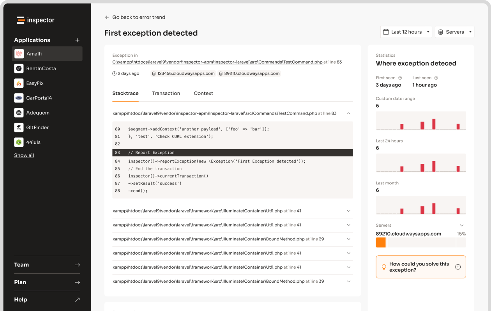

I decided to write a bit about API payload for machine-to-machine communication because during a cost optimization on our AWS infrastructure I noticed that a relevant item of the monthly bill is related to the traffic (internal and external) that our application generate to do its operations.

There are also factors like performance, because too large payloads can also slow down your app overloading servers. Optimizing payload size is critical for better performance, cost savings, and happier users. Here’s how you can do it in PHP:

1. **Compression**: Use [Gzip](https://en.wikipedia.org/wiki/Gzip) or [Brotli](https://en.wikipedia.org/wiki/Brotli) to reduce payload size by up to 80%.
2. **Field Selection**: Send only the data clients need to shrink payloads by 30-50%.
3. **JSON Optimization**: Remove empty values, use shorter keys, and strip whitespace for a 10-20% reduction.
4. **Pagination**: Split large datasets into smaller chunks for faster responses.
5. **Caching**: Store frequently requested data to reduce redundant processing.

**Quick Tip**: Combining these methods can drastically improve API performance while keeping server costs low. Let’s dive into each strategy.

## 7 Tips to Optimize Your Backend API Without Caching

[Watch the video on YouTube](https://www.youtube.com/watch?v=R4NvQMF58K4)

## Using Compression

Compression helps cut down data transfer volumes, speeding up response times and reducing bandwidth costs. Tools like **Gzip** and **Brotli** can shrink JSON payloads by as much as 80%, making them a smart choice for smoother API communication.

### Enabling [Gzip](https://en.wikipedia.org/wiki/Gzip) Compression

**Gzip** is widely supported and straightforward to set up in PHP. Here's an example:

```php
// Enable Gzip compression
if (strpos($_SERVER['HTTP_ACCEPT_ENCODING'], 'gzip') !== false) {
    header('Content-Encoding: gzip');
    ob_start('ob_gzhandler');
}

echo json_encode(['data' => $yourApiData]);
```

For Apache servers, you can enable Gzip by adding this to your `.htaccess` file:

```apache
<IfModule mod_deflate.c>
    AddOutputFilterByType DEFLATE application/json
</IfModule>
```

### Using [Brotli](https://en.wikipedia.org/wiki/Brotli) Compression

**Brotli** provides better compression ratios and faster decompression than Gzip, making it a great option for modern applications. Here's how to implement Brotli with a fallback to Gzip:

```php
// Enable Brotli or Gzip compression based on client support
if (strpos($_SERVER['HTTP_ACCEPT_ENCODING'], 'br') !== false) {
    header('Content-Encoding: br');
    ob_start('brotli_compress');
} else {
    header('Content-Encoding: gzip');
    ob_start('ob_gzhandler');
}

echo json_encode(['data' => $yourApiData]);
```

Brotli works best with modern browsers, while Gzip ensures compatibility with older ones. Compression is especially useful for larger payloads, though it does require additional CPU resources. For the best results, combine compression with other methods like **field selection** and **caching** to further optimize performance.

While compression reduces payload size during transmission, trimming the data at the source by sending only what's necessary can improve efficiency even more.

## Selecting Fields

Field filtering helps reduce payload size by sending only the data clients actually need. Here's an example of how to implement it using query parameters in PHP:

```php
// API endpoint: /api/users?fields=name,email,phone

function filterUserData($userData, $requestedFields) {
    $allowedFields = ['name', 'email', 'phone', 'address']; // Predefined fields
    $fields = array_intersect(explode(',', $requestedFields), $allowedFields); // Validate requested fields
    return array_intersect_key($userData, array_flip($fields)); // Filter the data
}

// Usage in API endpoint
$fields = $_GET['fields'] ?? '';
$filteredData = filterUserData($userData, $fields);
```

For instance, [Shopify](https://www.shopify.com/) implemented field filtering, which cut payload size by 45% and improved response times by 30%, even while handling over 1 billion API calls daily.

If you're dealing with more complex data structures, [GraphQL](https://graphql.org/) can provide a more precise way to request only the necessary data. Here's a basic implementation in PHP:

```php
use GraphQL\Type\Definition\Type;
use GraphQL\Type\Schema;

$queryType = new ObjectType([
    'name' => 'Query',
    'fields' => [
        'user' => [
            'type' => new ObjectType([
                'name' => 'User',
                'fields' => [
                    'name' => Type::string(),
                    'email' => Type::string()
                ]
            ]),
            'resolve' => fn($root, $args) => fetchUserById($args['id'])
        ]
    ]
]);

$schema = new Schema(['query' => $queryType]);
```

When implementing field selection, keep these considerations in mind:

| Consideration | Key Focus |
| --- | --- |
| **Security** | Use a whitelist to prevent exposing sensitive fields |
| **Performance** | Tailor database queries to retrieve only the requested fields |
| **Caching** | Plan for different combinations of requested fields |
| **Documentation** | Clearly specify which fields are available to clients |

Field filtering not only improves efficiency but also enhances the overall API experience for developers.

## Optimizing JSON

Optimizing JSON goes hand-in-hand with techniques like compression and selecting only necessary fields. These methods help shrink payload sizes, leading to faster and more efficient API responses. By using smart encoding strategies, you can significantly cut down response sizes.

### Reducing JSON Output

To clean up JSON output, you can use a recursive function to remove empty values. Here's an example:

```php
function removeEmptyValues($array) {
    foreach ($array as $key => $value) {
        if (is_array($value)) {
            $array[$key] = removeEmptyValues($value);
        }
        if (empty($array[$key]) && $array[$key] !== 0 && $array[$key] !== '0') {
            unset($array[$key]);
        }
    }
    return $array;
}

// Example usage
$data = [
    "user_id" => 123,
    "user_name" => "John Doe",
    "user_email" => "john@example.com",
    "user_age" => null,
    "user_preferences" => []
];

$optimizedData = removeEmptyValues($data);
```

For more compact JSON, you can also use custom serialization. Here's an example:

```php
class User implements JsonSerializable {
    private $id;
    private $name;
    private $email;

    public function jsonSerialize() {
        return [
            'i' => $this->id,
            'n' => $this->name,
            'e' => $this->email
        ];
    }
}
```

### Removing JSON Whitespace

To minimize JSON output, PHP provides encoding options that you can use to strip unnecessary whitespace:

```php
$jsonOptions = JSON_UNESCAPED_UNICODE | JSON_UNESCAPED_SLASHES | JSON_NUMERIC_CHECK;
$minifiedJson = json_encode($data, $jsonOptions);
```

For environments like production, you can fine-tune the encoding process:

```php
$optimizeJson = (ENVIRONMENT === 'production');
$jsonOptions = JSON_UNESCAPED_UNICODE | JSON_UNESCAPED_SLASHES;

if ($optimizeJson) {
    $jsonOptions |= JSON_NUMERIC_CHECK;
    $json = json_encode($data, $jsonOptions);
} else {
    $json = json_encode($data, JSON_PRETTY_PRINT);
}
```

### Things to Keep in Mind

When working with JSON optimization, pay attention to these key areas:

- **Data Integrity**: Ensure that removing null values doesn’t break client-side functionality.
- **Numeric Precision**: Be cautious about potential precision loss when using `JSON_NUMERIC_CHECK`.
- **Unicode Compatibility**: Test your JSON with various character sets to ensure proper handling.
- **Development Readability**: Use pretty-printed JSON during development for easier debugging.

While these techniques help reduce JSON payload sizes, don’t forget to use pagination to send only a manageable amount of data at a time. This approach keeps both your server and clients running smoothly.

## Implementing Pagination

Pagination is a practical approach to managing large datasets in APIs by splitting data into smaller, manageable portions. This reduces the payload size, making data delivery faster and improving performance for both servers and clients.

### Using Offset Pagination

Offset pagination is a straightforward method to divide data into pages. Here's an example:

```php
function getPaginatedUsers($page = 1, $limit = 10) {
    $offset = ($page - 1) * $limit;

    // Fetch total record count for metadata
    $countQuery = "SELECT COUNT(*) as total FROM users";
    $total = $pdo->query($countQuery)->fetch()['total'];

    // Fetch paginated results
    $query = "SELECT id, username, email FROM users 
             ORDER BY id ASC LIMIT :limit OFFSET :offset";

    $stmt = $pdo->prepare($query);
    $stmt->bindValue(':limit', $limit, PDO::PARAM_INT);
    $stmt->bindValue(':offset', $offset, PDO::PARAM_INT);
    $stmt->execute();

    return [
        'data' => $stmt->fetchAll(PDO::FETCH_ASSOC),
        'metadata' => [
            'current_page' => $page,
            'per_page' => $limit,
            'total' => $total,
            'total_pages' => ceil($total / $limit)
        ]
    ];
}
```

To integrate this into your API endpoints:

```php
$maxPageSize = 100;
$page = min(max(1, $_GET['page'] ?? 1), PHP_INT_MAX);
$limit = min(max(10, $_GET['limit'] ?? 20), $maxPageSize);

$result = getPaginatedUsers($page, $limit);
header('X-Total-Count: ' . $result['metadata']['total']);
echo json_encode($result);
```

### Using Cursor Pagination

Cursor pagination is better suited for large or constantly changing datasets, as it avoids the performance issues that can arise with large offsets:

```php
function getUsersAfterCursor($cursor = null, $limit = 10) {
    $query = $cursor 
        ? "SELECT * FROM users WHERE id > :cursor ORDER BY id ASC LIMIT :limit"
        : "SELECT * FROM users ORDER BY id ASC LIMIT :limit";

    $stmt = $pdo->prepare($query);

    if ($cursor) {
        $stmt->bindValue(':cursor', $cursor, PDO::PARAM_INT);
    }
    $stmt->bindValue(':limit', $limit, PDO::PARAM_INT);
    $stmt->execute();

    $results = $stmt->fetchAll(PDO::FETCH_ASSOC);
    $nextCursor = end($results)['id'] ?? null;

    return [
        'data' => $results,
        'metadata' => [
            'next_cursor' => $nextCursor,
            'has_more' => count($results) === $limit // Indicates whether additional pages are available
        ]
    ];
}
```

| Pagination Type | Best Use Case | Performance Impact |
| --- | --- | --- |
| Offset-based | Static datasets under 1000 records | Slows down with larger offsets |
| Cursor-based | Large or real-time datasets | Consistent regardless of position |

### Tips for Effective Pagination

- Use cache headers like `ETag` or `Last-Modified` to improve efficiency and avoid redundant data processing.
- Always include metadata (e.g., total records, current page, next cursor) to help clients handle paginated data.
- Clearly document pagination parameters and behavior in your API documentation.

While pagination helps reduce response sizes, adding caching mechanisms can further enhance performance by cutting down on redundant data processing.

## Applying Caching

Caching helps reduce payload size by temporarily storing frequently accessed data. This avoids repetitive data requests, making API payloads smaller and more efficient.

### Using Server Caching

Server-side caching can deliver pre-generated responses, cutting down on payload sizes. Here's a practical example using PHP's built-in caching features:

```php
function getCachedApiResponse($endpoint) {
    $cacheFile = 'cache/' . md5($endpoint) . '.cache';
    $cacheExpiry = 3600; // Cache duration in seconds

    if (file_exists($cacheFile) && (time() - filemtime($cacheFile) < $cacheExpiry)) {
        return json_decode(file_get_contents($cacheFile), true);
    }

    $response = generateApiResponse();
    file_put_contents($cacheFile, json_encode($response));
    return $response;
}
```

For even faster results, leverage PHP's [APCu](https://www.php.net/manual/en/book.apcu.php) extension:

```php
function getApiResponse($key) {
    if (($data = apcu_fetch($key)) === false) {
        $data = generateApiResponse();
        apcu_store($key, $data, 3600);
    }
    return $data;
}
```

### Using [Redis](https://redis.io/) for Caching

Redis provides a high-speed solution for caching API responses. Here's an example of how to implement Redis for caching:

```php
class ApiCache {
    private $redis;

    public function __construct() {
        $this->redis = new Redis();
        $this->redis->connect('127.0.0.1', 6379);
    }

    public function getResponse($endpoint) {
        $cacheKey = 'api_response_' . md5($endpoint);

        if ($cachedData = $this->redis->get($cacheKey)) {
            return json_decode($cachedData, true);
        }

        $response = $this->generateResponse($endpoint);
        $this->redis->setex($cacheKey, 3600, json_encode($response));

        return $response;
    }

    private function generateResponse($endpoint) {
        // API response generation logic
    }
}
```

To handle high-traffic situations and avoid cache stampedes, use a locking mechanism:

```php
private function getWithLock($key, $ttl = 3600) {
    $lockKey = "lock_{$key}";

    if ($this->redis->setnx($lockKey, time())) {
        $this->redis->expire($lockKey, 30);

        $data = $this->generateResponse();
        $this->redis->setex($key, $ttl, json_encode($data));
        $this->redis->del($lockKey);

        return $data;
    }

    return $this->redis->get($key) ?: $this->waitForLock($lockKey);
}
```

Although caching boosts efficiency, tools like Inspector can help you monitor and validate the performance of these optimizations.

## Monitoring with [Inspector](/)



Caching and pagination can reduce payload sizes, but [monitoring tools](/product-features/) ensure these improvements are consistent and effective. **Inspector** offers real-time tracking of critical metrics to help you maintain and validate your API optimization efforts.

Here’s a quick example of how you can use Inspector to monitor payload sizes:

```php
$inspector = new Inspector(new Configuration('INGESTION-KEY'));

// Report payload
$inspector->startTransaction('api-request')
    ->addContext('payload', $request->getBody());

// API logic here...

$inspector->transaction()->end();
```

Inspector keeps an eye on key API performance metrics, such as:

- Payload size and compression effectiveness
- How response times correlate with data volume
- Patterns in resource usage

This data can uncover new optimization opportunities and confirm the success of your current strategies. For example, after applying field selection and pagination on a product catalog API, monitoring revealed a **70% drop in response times**.

To get the most out of Inspector for payload management:

- Set up alerts to flag slow endpoints
- Compare metrics before and after making changes
- Track how query performance affects execution time
- Analyze endpoint usage to prioritize optimization effort

## Conclusion

We've covered five powerful techniques that, when used correctly, can greatly boost API performance.

By integrating **compression**, **field selection**, **JSON optimization**, **pagination**, and **caching**, developers can make APIs much more efficient. For example, Gzip and Brotli compression can reduce payload sizes by up to 70%. Using GraphQL for selective field inclusion often results in a 30-50% size reduction, while JSON optimization can further shrink payloads by 10-20% - a game-changer for APIs managing millions of requests daily.

Pagination and caching round out these methods by streamlining data delivery and easing server load. Tools like Redis are especially useful for storing frequently accessed data, cutting down on redundant processing.

That said, optimization isn’t a one-and-done task - it requires ongoing tweaks and monitoring. Tools like Inspector can help track payload sizes, evaluate compression efficiency, and measure cache hit rates, ensuring your optimizations are on point.

Keep in mind, every approach has trade-offs. Compression can add processing overhead, and field selection might complicate implementation. The goal is to find the right balance, improving performance without sacrificing functionality or scalability.

## FAQs

Here are quick answers to common questions about reducing API payload size in PHP, based on the strategies discussed in this guide.

### How can I reduce API size?

Several techniques can help shrink API payload size, including compression, field selection, JSON optimization, pagination, and caching. Here's a closer look at each:

**Field Filtering**

Send only the data your clients actually need. By filtering out unnecessary fields, you can significantly cut down on the amount of data transmitted. This approach is covered in detail in the field selection section.

**JSON Optimization**

Tweak your JSON payloads to make them smaller:

- Remove whitespace for a 10-15% reduction.
- Use shorter key names, like `{"fn": "John"}` instead of `{"full_name": "John"}` - this can reduce size by 20-30%.
- Filter out null values with `array_filter()`, achieving a 5-10% reduction.

**Compression**

Using Gzip or Brotli compression can shrink payload sizes by up to 70-90% [<sup>\[1\]</sup>](https://moldstud.com/articles/p-designing-api-payloads-for-performance-and-efficiency). Pick the method that works best with your server setup and the browsers your clients use.

**Caching**

Leverage tools like Redis to store frequently accessed data. This reduces the need to send repetitive content and speeds up response times, making it particularly useful for high-traffic APIs.

## Related Blog Posts

- [5 Ways to Optimize Symfony Application Performance](/5-ways-to-optimize-symfony-application-performance/)
- [Php Base64 encode/decode - best practices and use cases](/php-base64-encodedecode-best-practices-and-use-cases/)
- [PHP memory_get_peak_usage: Guide](/php-memorygetpeakusage-guide/)
- [Laravel Query Profiling: Tools and Techniques](/laravel-query-profiling-tools-and-techniques/)
