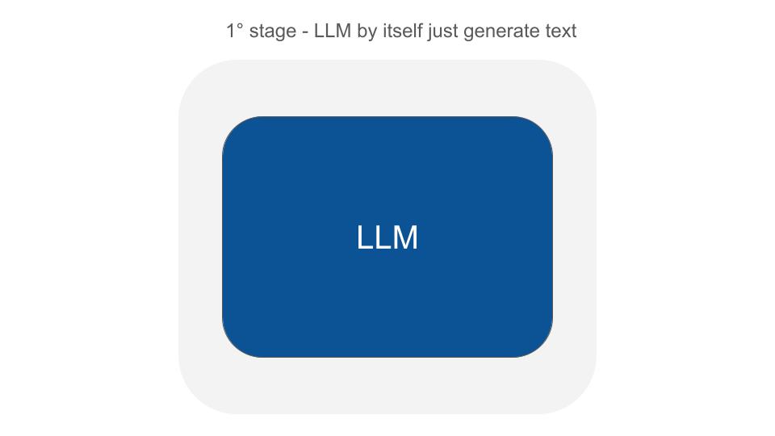
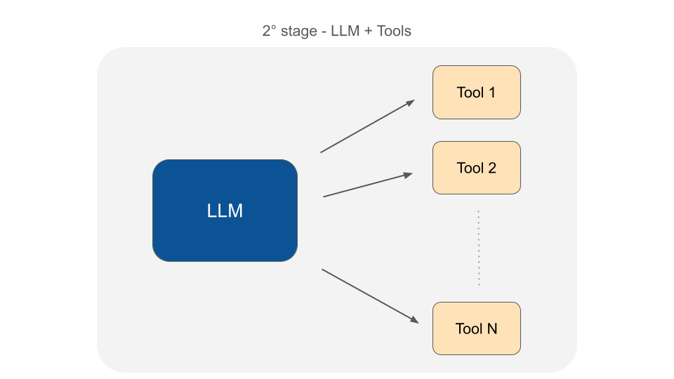
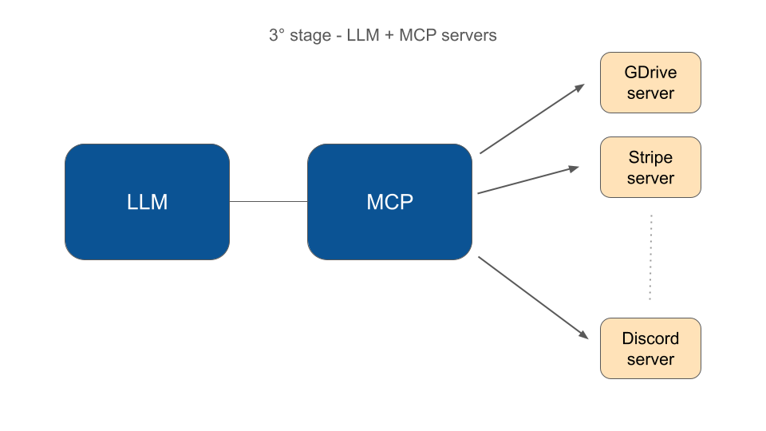
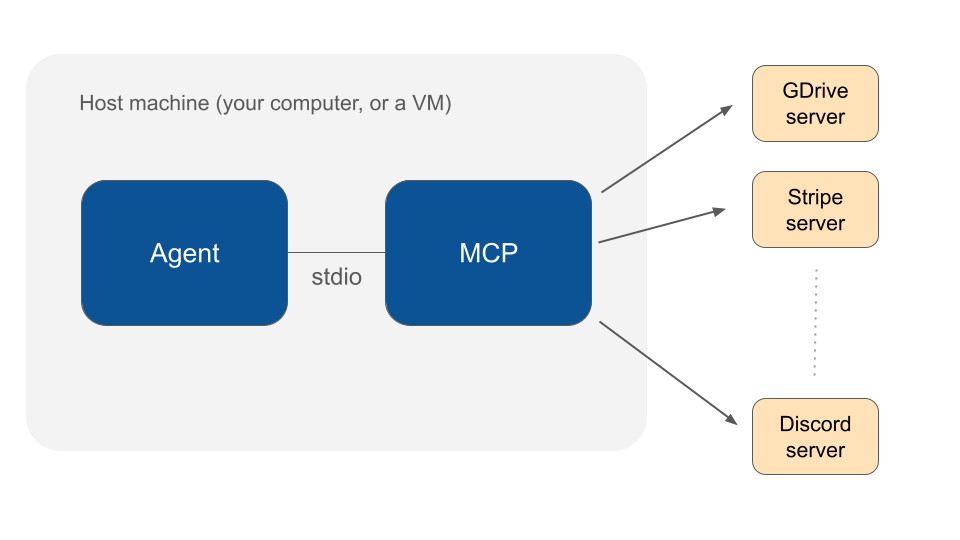
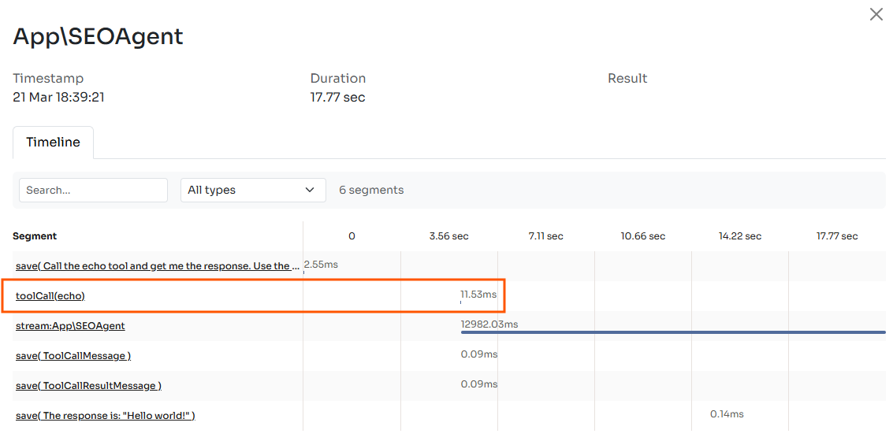

If you are building AI Agents you've probably heard about MCP (Model Context Protocol). Actually, really everyone is talking about MCP right now. From what I've read online, it seems many people don't seem to have the slightest idea what we're talking about, and the new product development opportunities associated with that.

To better understand the value of having MCP servers directly connected with your [Neuron AI Agent](/introduction-to-neuron-ai-create-full-featured-ai-agents-in-php/), I want to break down a couple of concepts, just to take in place the right foundations you need as a software creator to unlock new ideas for your next Agent implementation.

## Introduction to LLM Tools

One of the things we as engineers love are standards. And the reason standards are important is they allow for us as engineers and developers, to build systems that communicate with each other.

Imagine the REST APIs. The idea to have a standard process to authenticate and use a third party service, created a big wave of innovation for years. The idea behind MCP is to allow developers to implement a standard protocol to expose their application services to LLMs.

At this point, we have to remember that LLM by themselves are incapable of doing anything. They are just "token tumblers". If you open any LLM chat and you ask to send an email it won’t know how to do that.

It will just tell you "*I don't know how to send an email, I can eventually write the email content if you want*". At its core an LLM can just manage text.



The next evolution of these platforms was when developers figured out how to combine the LLMs capabilities with a mechanism to make functions (or callbacks) available to LLMs.



Take the ability of the recent chat interface where you can paste a web url into the message, and the LLM is able to fetch its content to give you the final response.

Imagine this prompt: “*Can you give me advice on how can I improve SEO performance of this article: https://exmaple.com/blog/article*”

The LLM itself is not capable of doing this task. But what developers have done is to construct a textual protocol to make LLMs able to ask the program that is executing the LLM for a function in charge of providing the content of the web page to continue to formulate the final response.

Using this mechanism developers were able to implement and provide any sort of functions (tools) to LLMs in order to perform actions and resolve user questions with information that are not in their training dataset.

If you do not provide an LLM with a tool to get the content of a web page, they basically are not able to complete this task.

You can now make functions available to LLMs also to perform queries to your database, or gather information from external APIs, or any other task you need for your specific usa case.

## Before MCP (Model Context Protocol)

LLMs started to become more powerful when we connect tools to them, because we can join the reasoning power of LLM with the ability to perform actions to the external world.

The problem here is that it could be really frustrating if you need to build an assistant that does multiple tasks. Imagine reading your email, searching on the internet, gathering information from your database, connecting to external services like Google Drive to read documents, GitHub for code, knowledge base, and any other sort of resources.

You can imagine how the implementation of the Agent could become really cumbersome. It could also be really complicated to stack all these tools together and make them able to work coherently in the context of the LLM.

Another level of complexity is that each service we want to connect with has its own APIs, with different technical requirements, and they should be implemented from scratch by every developer that wants to talk with these external services.

Some companies can do it, for many others it would simply be impossible.

This is where we are right now.

## Introducing MCP (Model Context Protocol)

MCP is a layer between your LLM and the tools you want to connect.



Now companies can implement an MCP server that is basically a new way to expose their APIs, but in a way that is ready to use by LLMs.

Think about the Stripe APIs. They provide features to access any kind of information about subscriptions, invoices, transactions, and so on. Using the Stripe MCP server (built by Stripe) you can basically expose the entire Stripe APIs to your LLM to make it able to gather information and answer questions about the status of your finance, or customer questions about their subscriptions and invoices. The Agent can even perform actions like cancel subscriptions or activate a new one for a customer.

You just have to install the MCP server, connect your agent to the resources exposed by the server (we are going to see how to do it in a moment), and you instantly have an Agent with powerful skills without all the effort to implement the Stripe API calls. Furthermore you no longer have to worry in case Stripe changes its APIs. Even highly interconnected systems, made up of multiple steps dependent on each other, can be developed more easily and be more reliable.

Using simple tools to implement all actions one at a time would be impossible to overcome certain levels of complexity.

## How MCP works

Let’s get into a practical example of how you can host an MCP server to be used by your Agents.

At its core MCP needs three components to work: A Host, an MCP server, and an MCP client.

Don't let the word "server" fool you. At this stage of the protocol implementations the MCP server runs in the same machine of your Agent. They communicate via the standard input/output local interface (stdio).



Probably in the future it will be possible to host MCP servers remotely, but now it works on board the same machine. So you have to install the MCP server on your computer first during development, and in your cloud machine if you want to deploy the implementation in the production environment.

I will go deeper into MCP server installation in another dedicated article, for now you can access the installation instructions on the MCP servers repository.

Here are some websites where you can explore a list of available MCP servers:

- [https://github.com/modelcontextprotocol/servers](https://github.com/modelcontextprotocol/servers)
- [https://mcp-get.com/](https://mcp-get.com/)

At this stage it’s not all sunshine and rainbows, there are some technical things to configure. You have to set up the server, configure some files, but once you figure it out, your Agents can become very powerful and capable of completing any sort of tasks autonomously.

## Connect Your AI Agent to MCP servers in PHP

To start building your AI Agent in PHP install the Neuron AI framework. We released Neuron as an open source project to fill the gap in AI development between PHP and other programming languages. Neuron basically makes PHP developers able to develop Agentic applications without the need to retool their skills towards other programming languages.

It provides you with a complete toolkit, from single Agents, to full featured RAG systems, vector store, embeddings, and extensive observability features.

For more information you can check out the documentation: [https://docs.neuron-ai.dev](https://docs.neuron-ai.dev)

You can install Neuron via composer with the command below:

```bash
composer require inspector-apm/neuron-ai
```

Create your custom agent extending the `NauronAI\Agent` class:

```php
use NeuronAI\Agent;
use NeuronAI\Providers\AIProviderInterface;
use NeuronAI\Providers\Anthropic\Anthropic;

class MyAgent extends Agent
{
    public function provider(): AIProviderInterface
    {
        // return an AI provider (Anthropic, OpenAI, Mistral, etc.)
        return new Anthropic(
            key: 'ANTHROPIC_API_KEY',
            model: 'ANTHROPIC_MODEL',
        );
    }
	
	
	public function instructions()
	{
		return "LLM system instructions.";
	}
}
```

Now you need to attach tools to the Agent so it can perform tasks in the application context and resolve questions sent by you or your users. If you need to implement a specific action related to your specific environment you can attach a Tool and create your own implementation:

```php
use NeuronAI\Agent;
use NeuronAI\Providers\AIProviderInterface;
use NeuronAI\Providers\Anthropic\Anthropic;
use NeuronAI\Tools\Tool;
use NeuronAI\Tools\ToolProperty;

class MyAgent extends Agent
{
    public function provider(): AIProviderInterface
    {
        // return an AI provider (Anthropic, OpenAI, Mistral, etc.)
        return new Anthropic(
            key: 'ANTHROPIC_API_KEY',
            model: 'ANTHROPIC_MODEL',
        );
    }
	
	
	public function instructions()
	{
		return "LLM system instructions.";
	}
	
	public function tools(): array
    {
        return [
            Tool::make(
                "get_article_content", 
                "Use the ID of the article to get its content."
            )->addProperty(
                new ToolProperty(
                    name: 'article_id',
                    type: 'integer',
                    description: 'The ID  of the article you want to analyze.',
                    required: true
                )
            )->setCallable(function (string $article_id) {
                // You should use your DB layer here...
                $stm = $pdo->prepare("SELECT * FROM articles WHERE id=? LIMIT 1");
                $stm->execute([$article_id]);
                return json_encode(
                    $stmt->fetch(PDO::FETCH_ASSOC)
                );
            })
        ];
    }
}
```

For other tools you can search for a ready to use MCP servers and attach the exposed tools to your agent. Neuron provides you with the `McpConnector` components to automatically gather available tools from the server and attach them to your Agent.

```php
use NeuronAI\Agent;
use NeuronAI\Providers\AIProviderInterface;
use NeuronAI\Providers\Anthropic\Anthropic;
use NeuronAI\Tools\Tool;
use NeuronAI\Tools\ToolProperty;

class MyAgent extends Agent
{
    public function provider(): AIProviderInterface
    {
        // return an AI provider (Anthropic, OpenAI, Mistral, etc.)
        return new Anthropic(
            key: 'ANTHROPIC_API_KEY',
            model: 'ANTHROPIC_MODEL',
        );
    }
	
	
	public function instructions()
	{
		return "LLM system instructions.";
	}
	
	public function tools(): array
    {
        return [
			// Load tools from an MCP server
			...McpConnector::make([
                'command' => 'npx',
                'args' => ['-y', '@modelcontextprotocol/server-everything'],
            ])->tools(),
		
			// Your custom tools
            Tool::make(
                "get_article_content", 
                "Use the ID of the article to get its content."
            )->addProperty(
                new ToolProperty(
                    name: 'article_id',
                    type: 'integer',
                    description: 'The ID  of the article you want to analyze.',
                    required: true
                )
            )->setCallable(function (string $article_id) {
                // You should use your DB layer here...
                $stm = $pdo->prepare("SELECT * FROM articles WHERE id=? LIMIT 1");
                $stm->execute([$article_id]);
                return json_encode(
                    $stmt->fetch(PDO::FETCH_ASSOC)
                );
            })
        ];
    }
}
```

Neuron automatically discovers the tools exposed by the server and connects them to your agent.

When the agent decides to run a tool, Neuron will generate the appropriate request to call the tool on the MCP servers and return the result to the LLM to continue the task. It feels exactly like with your own defined tools, but you can access a huge archive of predefined actions your agent can perform with just one line of code.

You can also check out the MCP server connection example in the [documentation](https://docs.neuron-ai.dev/advanced/mcp-servers-connection).

You can check the agent running every step using the Inspector monitoring dashboard:



Learn more about observability in the [Observability](https://docs.neuron-ai.dev/advanced/observability) section.

## Let us know what you are building

It was clear to me that MCP is a big deal in the sense that now Agents can become capable of doing an incredible amount of tasks with so little effort in developing these features.

With all these tools available also the product development opportunities will grow exponentially. And I can’t wait to see what you are going to build.

Let us know on our social channels what your next project is about, we are going to create a directory with all the Neuron AI based products to help you gain the visibility your business deserves.

Start creating your AI Agent with Neuron: [https://docs.neuron-ai.dev/installation](https://docs.neuron-ai.dev/installation)
