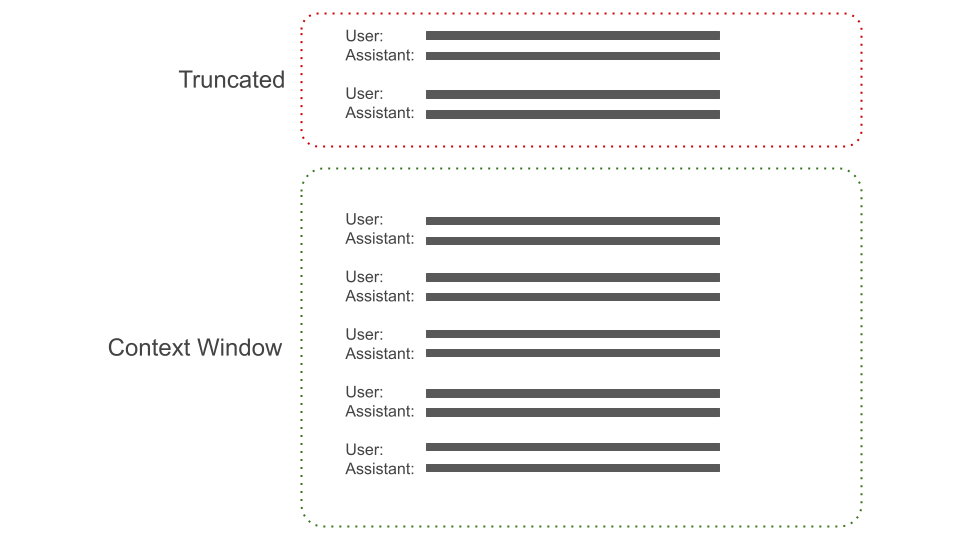

In the rapidly evolving landscape of artificial intelligence, PHP developers find themselves at an interesting crossroads. While Python and JavaScript often dominate AI discussions, PHP—the backbone of over 77% of websites—offers unique opportunities for implementing AI agents.

This is the real reason I decided to release [Neuron AI](/introduction-to-neuron-ai-create-full-featured-ai-agents-in-php/) as an open source framework trying to provide the PHP community with the best possible tool for developing AI Agents, while also doing much better than other programming languages ​​thanks to PHP's unique features.

In this article I want to explore how PHP developers can build robust AI agents that remember past interactions and maintain awareness of conversation context. We'll examine practical implementations using the Neuron AI framework, and demonstrate how to overcome the inherent statelessness of HTTP requests to create AI experiences that feel continuous and intelligent.

Memory and context are the twin pillars that enable AI agents to maintain coherent conversations and make intelligent decisions in multi turns conversations. The LLMs nature forces us to think differently about how information persists between interactions and how we manage the limited attention span (or "context window") of AI models.

## Context Window: The LLM's Working Memory

The context window represents one of the most important technical constraints when working with Large Language Models. Simply put, the context window is the total amount of text (measured in tokens) that an LLM can deal with. It encompasses both the input you provide and the output the model generates on any interactions.

Early models could only process a few thousand tokens, while cutting-edge models now support contexts of 200K tokens or more—equivalent to hundreds of pages of text. This expansion has enabled entirely new applications, from document analysis to extended conversations that maintain coherence over many exchanges.

You might think it is quite enough. But it could be filled rapidly because the context window is the only model's working memory.

When you interact with an LLM, it doesn't maintain state or remember past interactions outside of what's explicitly included in the current input. Everything the model knows about your specific request must be contained within the context window every time you interrogate the model.

When you send a message to chatGPT in the web interface, the web interface also takes all the previous messages in the conversation (maybe saved in a database) and sends them too to the model again to make it known about the ongoing discussion. You feel like you are chatting, instead the model is completely stateless.

Every interaction is a completely new request for the LLM. It starts generating tokens from scratch every time it is invoked based on the input. Simply the input will contain more conversation turns as you continue to iterate on the same topic because the application you use in the web interface does this job for you.

With this dynamic behind the scene even 200K tokens are a finite hard constraint that you must take in consideration before flooding the LLM with GB of data.



Context affects an LLM's responses in profound ways. Given the exact same question, an LLM might provide completely different answers based on what other information appears in the context window. This contextual sensitivity can be both a challenge and a powerful tool.

For those new to AI agent development in PHP, I’ve documented the foundational patterns and progressive implementation approaches in an educational resource that walks through the basic development lifecycle — [Start With AI Agents In PHP](https://www.amazon.it/dp/B0F1YX8KJB)

## Neuron AI Agents Memory

Neuron AI has a built-in system to manage the memory of a chat session you perform with the agent.

In many Q&A applications you can have a back-and-forth conversation with the LLM, meaning the application needs some sort of "memory" of past questions and answers, and some logic for incorporating those into its current thinking.

For example, if you ask a follow-up question like "*Can you elaborate on the second point?*", this cannot be understood without the context of the previous message. Therefore we can't effectively perform retrieval with a question like this.

The Chat History is the component of Neuron AI framework to automatically deal with these limitations.

In the example below you can see how the Agent doesn't know my name initially:

```php
use NeuronAI\Chat\Messages\UserMessage;

$response = MyAgent::make()
    ->chat(
        new UserMessage("What is my name?")
    );
    
echo $response->getContent();
// I'm sorry, I don't know your name. Do you want to tell me more about yourself?
```

Clearly the Agent doesn't have any context about me. Now I try present me in the first message, and then ask for my name:

```php
use NeuronAI\Chat\Messages\UserMessage;

$response = MyAgent::make()
    ->chat(
        new UserMessage("Hi, I'm Valerio!")
    );
	
echo $response->getContent();
// Hi Valerio, how can I help you today?


$response = MyAgent::make()
    ->chat(
        new UserMessage("Do you remember my name?")
    );
    
echo $response->getContent();
// Your name is Valerio as you said in your introduction.
```

## How Chat History works (context window management)

Neuron Agents take the list of messages exchanged between your application and the LLM into an entity called Chat History. It's a crucial part of the framework because the chat history needs to be managed based on the maximum context window that the underlying LLM can work with.

It's important to send past messages back to LLM to keep the context of the ongoing conversation, but if the list of messages grows enough to exceed the context window of the model the request will be rejected by the AI provider.

Chat history automatically truncates the list of messages to never exceed the context window avoiding unexpected errors.


The default implementation of the chat history is “in memory”. This means that the Agent takes memory of the conversation happening only during the current session. It doesn’t persist messages between sessions.

```php
use NeuronAI\Agent;
use NeuronAI\Providers\AIProviderInterface;
use NeuronAI\Chat\History\InMemoryChatHistory;

class MyAgent extends Agent
{
    public function provider(): AIProviderInterface
    {
        ...
    }
    
    public function chatHistory()
    {
        return new InMemoryChatHistory(
            contextWindow: 50000
        );
    }
}
```

If you need to save the conversation to be able to continue it in the future you can use FileChatHistory implementation. It provides basic persistence functionality storing messages into files on the filesystem:

```php
use NeuronAI\Agent;
use NeuronAI\Providers\AIProviderInterface;
use NeuronAI\Chat\History\FileChatHistory;

class MyAgent extends Agent
{
    public function provider(): AIProviderInterface
    {
        ...
    }
    
    public function chatHistory()
    {
        return new FileChatHistory(
            directory: '/home/app/storage/neuron',
            key: '[user-id]', // The key allow to store different files to separate conversations
            contextWindow: 50000
        );
    }
}
```

The key parameter allows you to store different files to separate conversations. You can use a unique key for each user, or the ID of a thread to make multiple users able restore and move forward on the same conversation.

## How to feed a previous conversation

Sometimes you already have a representation of user to assistant conversation and you need a way to feed the agent with previous messages.You just need to pass an array of messages to the *\`chat()\`* method. The conversation will be automatically loaded into the agent memory and you can continue to iterate on it.

```php
$response = MyAgent::make()
    ->chat([
        new Message("user", "Hi, I work for a company called Inspector.dev"),
        new Message("assistant", "Hi Valerio, how can I assist you today?"),
        new Message("user", "What's the name of the company I work for?"),
    ]);
    
echo $response->getContent();
// You work for Inspector.dev
```

The last message in the list will be considered the most recent.

## Let us know what you are building

Neuron AI framework opens the doors for new product development opportunities, and I can’t wait to see what you are going to build.

Follow the Neuron AI social channels below or register to the Neuron newsletter to receive future articles:

**Newsletter**: [https://neuron-ai.dev](https://neuron-ai.dev)

**Linkedin**: [https://www.linkedin.com/company/neuron-ai-php-framework](https://www.linkedin.com/company/neuron-ai-php-framework)

**X**: [https://x.com/neuronai_php](https://x.com/neuronai_php)

**Instagram**: [https://www.instagram.com/neuronai_php_framework/](https://www.instagram.com/neuronai_php_framework/)

**Facebook**: [https://www.facebook.com/profile.php?id=61574473883593](https://www.facebook.com/profile.php?id=61574473883593)

Let us know what your next project is about. We will create a directory with all the Neuron AI based products to help you gain the visibility your business deserves.

Start creating your AI Agent with Neuron: [https://docs.neuron-ai.dev/installation](https://docs.neuron-ai.dev/installation)
