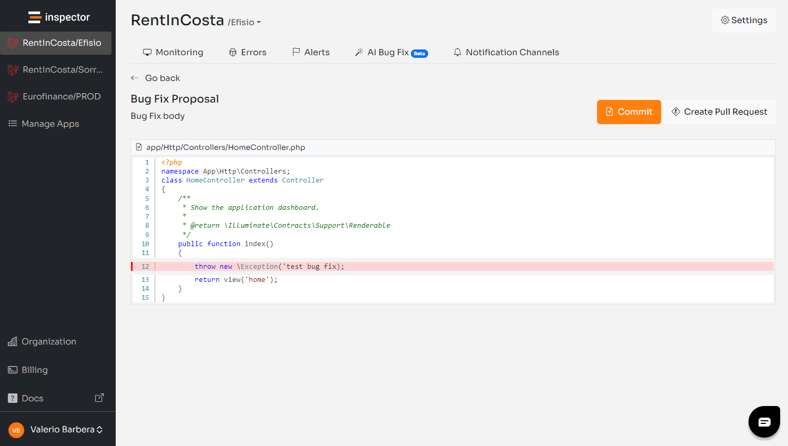

We have been experimenting with AI for a year now, with the intention to redesign web applications monitoring introducing a new AI Bug Fixer. As founder and CTO (the technical guy) of the company I threw myself into studying and experimenting to better understand the context looking for a way to substantially elevate the value that Inspector provides to developers when it comes to maintaining and evolving a web application.

So much talking around AI these days. A post on Linkedin from some time ago said:

> “To replace developers, customers should know what they need to tell AI to do it. We are safe."
>
> — Linkedin

Could not agree more. But the opportunity to drastically increase the quality of life for software creators is undeniable. As Inspector we are the opportunity to be the promoter of this change.

## First Experiment: Automatic Pull Requests

The first project that I decided to release in the beta stage was called “Automatic Pull Requests”.

We created a [Github app](https://github.com/marketplace/inspector-monitoring-ai), so you can connect Inspector to your GitHub account and automatically receive bug fix proposals in the form of Pull Requests when an error is detected. In a nutshell: Code fixes ready to be released without human intervention.

If you are in charge of software development in your company do you guess the possible implications for your business if something like this works?

Several customers tried the feature in the beta stage, giving us the opportunity to get a lot of insights about the developer experience they expect, what was good or bad, and what was just a good idea that could be expanded in the next releases.

I couldn't be more grateful to have a customer base of developers and engineers who are so open to try new things and so willing to give us feedback.

One of the hot points of this experiment was obviously the interaction with AI. During our internal experiments we learned the limitations of these systems. We thought we had built enough guardrails so we could run only into a few unexpected edge cases. In reality, the vast amount of data collected by Inspector showed a too low success rate for AI communications of around 40%. Very bad.

Another aspect was related to the developer experience our customers expect from an AI Bug Fixer. Suddenly receiving a notification of a new Pull Request in your repository is a too invasive experience. An intermediate validation step was needed.

## The latest release: AI Bug Fixer

To allow Inspector to communicate with the LLM at almost 100% success rate we created two algorithms: One to build the prompt, and another to intelligently merge the proposal provided by the AI with the current version of your code.

Since every LLM has its own limitations, everything is parameterized based on the underlying LLM capabilities. So we can eventually change the model without disrupting this integration.

We also decided to change the developer experience giving you more control between the creation of the bug fix, and the final push of the changes to the repository.

Now you are notified via email when Inspector AI generates a new bug fix in response to an error, so you can explore the diff between your current version of the code and the AI proposal directly in the Inspector dashboard with two actions available: “Commit”, or “Create Pull Request”.

*Code Diff from AI Bug Fixer*

Maybe your repository is already busy with other developments and you don't want Inspector to interfere. Thanks to this intermediate view you are free to choose the best way to apply changes, or eventually report the new implementation into your code manually to be included in the next release.

Basically you don’t have to be in front of your desktop, or wait for the intervention of your collaborators. You will have the code changes that fix your software errors just a click away of your mouse.

Finally we now support both GitHub and Gitlab as source control providers.

## Inspector AI Bug Fixer at SMAU London

*Inspector CTO at SMAU London*

Recently we had the opportunity to talk about this new product journey at SMAU London. It’s an annual event organized to allow international stakeholders to meet Italian innovative companies in presence.

We couldn't be more thrilled with the feedback we've gathered and how easy it is to understand the value Inspector brings to a software development company.

More will coming.

## Try AI Bug Fixer Now

Are you responsible for application development in your company? Monitor your web applications with [Inspector](/) for free. You can automatically fix bugs and bottlenecks in your code, before your customers stumble onto the problem.

Inspector is usable by developers of all skill levels. If you want effective automation, and clear insights try Inspector for free. [Register your account.](https://app.inspector.dev/register)Check out the official documentation for a step by step guide on how to activate this integration for your application: [https://docs.inspector.dev/concepts/ai-bug-fixes](https://docs.inspector.dev/concepts/ai-bug-fixes)
