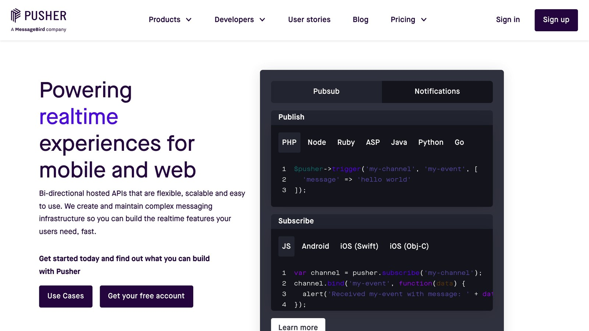
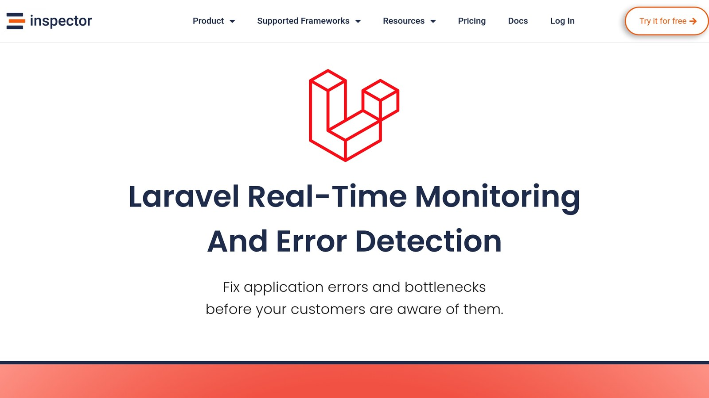

[Laravel](https://laravel.com/) events are **synchronous by default**, meaning listeners execute immediately during the request cycle. However, you can make them **asynchronous** by using Laravel's queuing system. This allows tasks like sending emails or generating reports to run in the background, improving application performance.

### Key Points:

- **Synchronous**: Runs immediately; ideal for critical tasks (e.g., updating inventory or verifying permissions).
- **Asynchronous**: Uses queues for non-urgent tasks (e.g., sending notifications or exporting data).

### Quick Comparison:

| Handling Type | Best For | Performance Impact |
| --- | --- | --- |
| **Synchronous** | Critical updates, validations | Immediate but may slow response |
| **Asynchronous** | Background tasks, reports | Minimal effect on response time |

Laravel's flexibility lets you choose the right approach for your application's needs.

## Event Handling Types in [Laravel](https://laravel.com/)

In Laravel, events are processed synchronously by default but can be made asynchronous using queues.

### Default Event Handling

Synchronous event handling runs listeners immediately during the request cycle. For example, you might update inventory levels right after an order is placed:

```php
class UpdateProductInventoryListener
{
    public function handle(OrderPlaced $event)
    {
        $order = $event->order;
        foreach ($order->items as $item) {
            $item->product->decrement('stock', $item->quantity);
        }
    }
}
```

This method is ideal for tasks that must happen instantly, such as:

- Updating stock levels after a purchase
- Verifying user permissions
- Ensuring data consistency across related tables

### Queue-Based Event Handling

Queues allow events to run asynchronously, which can improve application responsiveness by delaying tasks that aren't time-sensitive.

Here's a quick breakdown of when to use each type:

| Handling Type | Best For | Performance Impact |
| --- | --- | --- |
| Synchronous | Critical updates, Data validation, Security checks | Immediate but may slow response time |
| Asynchronous | Sending emails, Generating reports, Exporting data | Minimal effect on response time |

To make a listener asynchronous, you can use the `ShouldQueue` interface. Here's how it works:

```php
use Illuminate\Contracts\Queue\ShouldQueue;

class SendOrderConfirmation implements ShouldQueue
{
    public function handle(OrderPlaced $event)
    {
        Mail::to($event->order->customer->email)
            ->send(new OrderConfirmation($event->order));
    }
}
```

The next section will cover how to handle failed queues effectively.

## Creating Queued Event Listeners

Setting up queued processing involves three main steps:

### Queue System Setup

Begin by configuring your database queues. Update the `.env` file with:

```php
// .env
QUEUE_CONNECTION=database
```

Next, create the necessary database tables by running these commands:

```bash
php artisan queue:table
php artisan migrate
```

Here’s a quick comparison of available queue drivers:

| Queue Driver | Notes |
| --- | --- |
| Database | Relies on Laravel migrations; works well for most applications. |
| [Redis](https://redis.io/) | Offers high performance but requires a Redis server. |
| [Amazon SQS](https://docs.aws.amazon.com/sqs/) | A scalable option for distributed systems. |

### Adding ShouldQueue to Listeners

To ensure an event listener processes in the background, implement the `ShouldQueue` interface:

```php
use Illuminate\Contracts\Queue\ShouldQueue;

class GenerateUserReport implements ShouldQueue
{
    public $tries = 3;
    public $timeout = 120;

    public function handle(UserCreated $event)
    {
        $report = ReportGenerator::forUser($event->user)
            ->withMetrics()
            ->generate();

        Storage::put("reports/user-{$event->user->id}.pdf", $report);
    }
}
```

You can adjust queue behavior through properties like these:

```php
public $queue = 'reports';     // Assigns a specific queue
public $delay = 60;            // Delays the job by 60 seconds
public $connection = 'redis';  // Uses the Redis queue connection
```

### Failed Queue Management

To handle job failures, first create the failed jobs table:

```bash
php artisan queue:failed-table
php artisan migrate
```

Then, manage failures directly in the listener:

```php
public function failed(UserCreated $event, Throwable $exception)
{
    Log::error("Failed to generate report for user {$event->user->id}", [
        'exception' => $exception->getMessage(),
        'trace' => $exception->getTraceAsString()
    ]);

    Notification::send(
        User::whereRole('admin')->get(),
        new QueueFailureNotification($event, $exception)
    );
}
```

For production environments, use [Supervisor](https://supervisord.org/) to ensure jobs are continuously processed. Here’s an example configuration:

```ini
[program:laravel-worker]
command=php artisan queue:work --tries=3
autostart=true
autorestart=true
numprocs=8
```

This keeps your queue workers active and ready to handle jobs efficiently.

## Sending Events to JavaScript

Laravel's broadcasting system makes it possible to handle events not just on the backend but also in the frontend with real-time updates. This is especially useful for features like live notifications or chat systems.

### Setting Up Laravel Echo and [Pusher](https://pusher.com/)



To enable real-time broadcasting, you'll need to set up Laravel Echo and Pusher. Begin by installing the necessary packages:

```bash
npm install laravel-echo pusher-js
```

Next, configure your Pusher credentials in the `.env` file:

```
BROADCAST_DRIVER=pusher
PUSHER_APP_ID=your-pusher-app-id
PUSHER_APP_KEY=your-pusher-key
PUSHER_APP_SECRET=your-pusher-secret
PUSHER_APP_CLUSTER=mt1
```

In your JavaScript application, initialize Laravel Echo with the following:

```javascript
import Echo from 'laravel-echo';
import Pusher from 'pusher-js';

window.Pusher = Pusher;

window.Echo = new Echo({
    broadcaster: 'pusher',
    key: import.meta.env.VITE_PUSHER_APP_KEY,
    cluster: import.meta.env.VITE_PUSHER_APP_CLUSTER,
    forceTLS: true
});
```

### Types of Channels

Laravel supports three types of channels, each suited for different levels of security:

| Channel Type | Purpose | Authentication | Example |
| --- | --- | --- | --- |
| Public | Open data streams | None | Announcements |
| Private | User-specific data | Required | User notifications |
| Presence | Tracks user presence | Auth with user data | Chat applications |

For private channels, you'll need to define authorization in `routes/channels.php`. Here's an example:

```php
Broadcast::channel('order.{orderId}', function ($user, $orderId) {
    return $user->id === Order::find($orderId)->user_id;
});
```

### Receiving Events on the Frontend

To handle broadcasted events in your frontend, subscribe to the relevant channel and listen for events:

```javascript
Echo.private(`orders.${orderId}`)
    .listen('OrderShipped', (e) => {
        console.log('Order shipped:', e.order);
        updateOrderStatus(e.order);
    });
```

For presence channels, you can track user activity like this:

```javascript
Echo.join(`room.${roomId}`)
    .here(displayActiveUsers)
    .joining(notifyUserJoined)
    .leaving(notifyUserLeft);
```

These real-time capabilities work seamlessly with Laravel's event system, offering a complete solution for backend and frontend event handling.

## Event Performance Tips

Boost event performance by focusing on transactional safety, [monitoring tools](/laravel/), and worker setup.

### Database Transaction Handling

When events modify critical data, ensure data consistency by combining transactional safety with event queuing:

```php
use Illuminate\Contracts\Events\ShouldDispatchAfterCommit;

class OrderShipped implements ShouldDispatchAfterCommit
{
    public function __construct(public Order $order)
    {
        //
    }
}
```

For operations involving multiple tables, wrap updates in a database transaction to maintain integrity:

```php
DB::transaction(function () {
    $order->update(['status' => 'shipped']);
    $inventory->decrement('stock', $order->quantity);
    event(new OrderShipped($order));
});
```

### Queue Monitoring with [Inspector](/laravel/)



Laravel's built-in queue tools are powerful, but pairing them with Inspector can provide deeper insights:

| Monitoring Feature | Purpose |
| --- | --- |
| Real-time Queue Tracking | Keep an eye on job execution times and failures |
| Error Detection | Identify exceptions in queued jobs |
| Performance Profiling | Assess database queries and API performance |

Example implementation with Inspector:

```php
use Inspector\Laravel\Facades\Inspector;

Queue::after(function (JobProcessed $event) {
    Inspector::addSegment(function () use ($event) {
        // Log job duration and status
    }, 'queue');
});
```

### Queue Worker Setup

Fine-tune your worker processes with these key settings:

- `--sleep`: Set an appropriate value to minimize CPU usage during idle times.
- `--tries`: Adjust based on how many times a job should retry before failing.
- `--max-time`: Limit worker runtime to avoid memory issues.
- `numprocs`: Configure this based on your server’s resource capacity.

Ensure your worker configuration aligns with the queue driver selected during initial setup.

## Summary

Laravel's event system supports both immediate execution and queued tasks, with broadcasting features for real-time frontend updates. Developers can choose the execution method that best fits their specific requirements.

For asynchronous operations, Laravel's queuing system lets event listeners run as background tasks. This is especially helpful for handling heavy tasks without slowing down the application.

By combining synchronous and asynchronous options, developers can create applications that are both efficient and scalable. In production, it's important to pair these methods with queue monitoring practices discussed earlier.

Configuring and monitoring queues properly ensures reliable background processing. Tools like Inspector can also provide helpful insights into queue performance and task execution.

## FAQs

### Where should event listeners be stored in a Laravel project?

In Laravel, the `app/Listeners` directory is the ideal spot for event listeners, while event classes should go in the `app/Events` directory. When you use Laravel's Artisan commands to generate these classes, they are automatically placed in these locations.

Here’s a quick guide to naming conventions:

- **Events**: Use past tense singular names like `OrderShipped`.
- **Listeners**: Use action-oriented names such as `SendConfirmation`.

For better organization, group related listeners into subdirectories (e.g., `Listeners/Orders`). This structure makes it easier to manage and configure queued listeners for asynchronous processing. Keeping your files organized ensures a clear distinction between synchronous and asynchronous handlers, especially in larger projects.

## Related Blog Posts

- [Laravel Logging: Setup and Use](/log-channels-in-laravel-setup-and-use/)
- [Laravel Logging: Channels and Stacks Explained](/laravel-logging-channels-and-stacks-explained/)
- [Symfony Messenger Component - Setup and Use with doctrine and MySQL](/symfony-messenger-component-setup-and-use-with-doctrine-and-mysql/)
- [Laravel Query Profiling: Tools and Techniques](/laravel-query-profiling-tools-and-techniques/)
