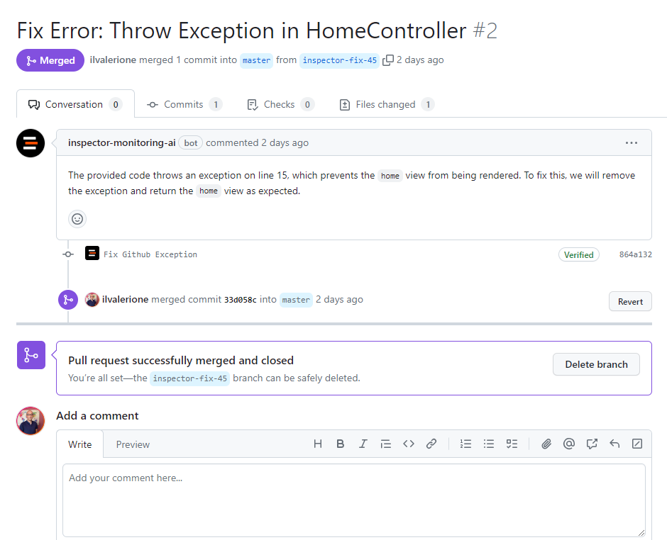

In this article I'll show you how Inspector Monitoring AI creates Pull Requests on your GitHub repository to automatically fix application errors.

Automatically receive recommendations to improve application reliability and performance, spot new risks, and improve application stability based on real-time production errors.

For the last three years we've been working on making Inspector the easiest application monitoring platform for developers of any skill level.

Today we are releasing a significant upgrade.

Inspector Monitoring AI uses your Inspector telemetry data to generate tailored Pull Requests that contains the following:

- **An explanation** of the error detected and the proposed code changes.
- **The code changes** that fix the error.
- **Additional snippets** to eventually improve performance and reliability of the code near the error.

## How Automatic Pull Request Works

When Inspector detects a new error it sends you a real-time notification as usual.

Not it also launches an analysis to eventually solve the problem proactively. If a valid solution is found then Inspector automatically creates a Pull Request in your GitHub repository.

You will be able to do your code review and merge the Pull Request without any human intervention in between.

## Benefits Of Automatic Pull Requests

Automatic Pull Requests can help CTO, software developers and other collaborators streamlining their communication and productivity in several ways.

1. It provides code fixes in real-time the moment your application fires an error.
2. You don't have to be in front of your desktop to release the appropriate code changes. Let Inspector AI do the job for you.
3. You don't have to wait the intervantion of your collaborator. You will have the code changes that fix your software errors just a click away of your mouse.

Check out the official documentation for a step by step guide on how to activate this integration for your application: [https://docs.inspector.dev/concepts/ai-bug-fixes](https://docs.inspector.dev/concepts/ai-bug-fixes)

## New to Inspector? Try it for free now

Are you responsible for application development in your company? Monitor your software products with [**Inspector**](/) for free. You can find out bugs and bottlenecks in your code automatically, before your customers stumble onto the problem.

Inspector is usable by developers of all skills level. If you want effective automation, deep insights, and the ability to forward alerts and notifications into your messaging environment try Inspector for free. [**Register your account**](https://app.inspector.dev/register).

Or learn more on the website: [**https://inspector.dev**](/)
