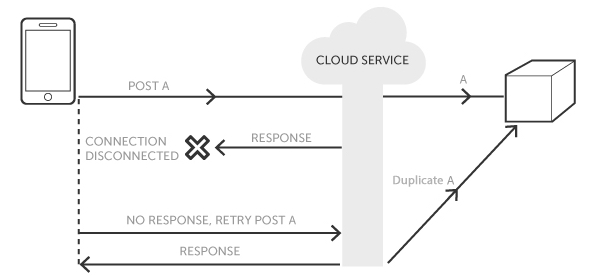

It's happened to the best of us. You're in the middle of a task when all of a sudden, the inevitable lambda timeout occurs.

Running into a timeout can feel like a bit of a setback when you're trying to focus on running your application. At worst, timeouts can ultimately lead to a negative impact on the overall user experience and a non-optimized application is bound to result in a loss of users which can lead to financial repercussions.

In this article, we'll go through a brief overview of what AWS Lambda is and how to overcome the AWS Lambda Timeout.

## What is AWS Lambda

Lambda is a computing service provided through Amazon Web Services (AWS, for short). Lambda is "serverless" giving developers the freedom to focus on running applications from the cloud rather than maintaining physical servers.

With over 200 unique services, AWS prides itself in being the world's most comprehensive and broadly adopted cloud platform. Lambda supports various languages such as Node.js, Python, Ruby, Java as well as several others.

As one of the key services provided by AWS, Lambda only charges by time computing, being a cost-effective option depending on the service needed.

## A Closer Look at Lambda Timeout

Talking about serverless we refer to the opportunity of no longer having the problem of server management. But that doesn't mean you have no problems at all.

In AWS Lambda, there are three different timeouts a user can run into. Timeouts can occur from Event sources (such as the AWS API gateway), services (this can be other third-party apps), and Lambda functions. In this article, we're going to focus on the lambda function timeout.

For every function, there is a set amount of time that it can be run before the timeout kicks in. The timeout limit can be adjusted starting from 1 second to the max limit of 15 minutes. This allows for the freedom to allocate the proper computing resources (and thus, financial resources) to a given function based on its complexity.

## Why it Happens

Like any other task, it's key to match the job at hand with the ideal tools, and Lambda is no different. If you find yourself running into timeouts often, a simple place to start would be to evaluate what kind of functions you're needing. It's also worth noting that a timeout while using an AWS SDK (Software Development Kit), could be due to a remote API being unreachable or taking too long to respond.

Be sure to check the network connectivity as well, as API calls tend to take longer during connection issues which could lead to retries and duplicate requests. Simply put, there are several reasons why a Lambda function timeout might occur.

This is why having the right preventive measures in place beforehand can lead to a more efficient troubleshooting experience. We'll go into more depth on this topic in the following paragraph.

## Ensure function idempotence

As mentioned in the [AWS Lambda documentation](https://aws.amazon.com/premiumsupport/knowledge-center/lambda-function-idempotent/), one key method to avoid inconsistencies or lost data, is to verify that your function is idempotent.

### What does idempotent mean?

Idempotence is a characteristic of an operation, such as an HTTP endpoint call, allowing to execute it multiple times in a short time interval and observe the same result as if the operation was only applied once.

In an ideal scenario, typically in >99% of the cases, your system, the provider, the network, and everything else work fine and the operation successfully completes on the first attempt. If something goes wrong, however, and the client is not sure of the result of the operation, it may be necessary to try again, submitting the same API call.

As stated in the previous paragraph, network issues can lead to duplicated API requests, because even if your function was performed successfully, the client may receive an error in response due to connectivity issues.

Repeated calls to endpoints that make changes to your system's data could have unpleasant consequences.

### How idempotence is guaranteed

A particular request is usually identified with a unique ID. This identifier is kept for a certain window of time. If the request is sent several times the application is able to check if it has already been performed.

For a detailed explanation of this problem I suggest you read the article below:

[https://betterprogramming.pub/architecting-distributed-systems-the-importance-of-idempotence-138722a6b88e](https://betterprogramming.pub/architecting-distributed-systems-the-importance-of-idempotence-138722a6b88e)

## How to Avoid Lambda Timeout

### Reconfigure Functions

If you find that the timeout limit is not enough time to perform the function as needed, it could be that you need to re-evaluate the function. If there are too many tasks being handled in one, opt for step functions that get the work done in smaller steps. Though this can take a little extra time, it's worth considering breaking it up if it gets the job done.

### Optimize Function Memory

Another component that can be adjusted per function in AWS Lambda is the amount of memory used. The range of memory allowed per function is between 128 MB and 10,240 MB. For memory, the system will default to the lowest setting and this will often be sufficient.

An example of this would be transforming and routing events to other AWS services. Functions that are more complex such as including layers or interacting with S3 require more memory for optimum functionality.

Keep in mind that Lambda's pricing is scalable- the more memory used, typically, the more price is affected. This is calculated by gigabyte seconds. For more information on this, visit the AWS website.

### CloudWatch and X-Ray

As previously mentioned, there are a slew of additional AWS services that can be used and integrated with AWS Lambda to improve the overall experience and functionality of the platform. With CloudWatch, you can view Lambda function metrics that are reported automatically by AWS Lambda.

This means that while you are using Lambda, the application is actively sending these reports to CloudWatch for you to be able to monitor the performance of these functions. All requests that are fulfilled by these functions are logged and stored in CloudWatch, organized by function. Although there is a free tier for CloudWatch. It is fairly limited as the service also follows the "pay for what you use" model in terms of pricing with higher tiers following the base free tier.

Like Cloudwatch, AWS X-Ray is another useful tool that is offered by AWS to integrate with Lambda. X-Ray can provide a visual representation of your application’s components as well as spot potential errors or bottlenecks in the code. X-Ray can integrate with Cloudwatch to seamlessly provide a comprehensive report on the functionality of your application. Like Cloudwatch and other AWS services, the pricing starts with a free tier and levels up from there.

## Conclusion

In short, we looked at what AWS Lambda is as well as what methods can be put in place to mitigate its timeout limitations. In addition to the right preventative measures, it’s best to incorporate a monitoring tool into your workflow to ensure you’re staying on track of potential bottlenecks and errors before your users spot them.
