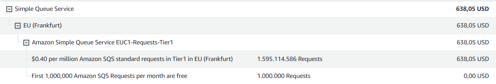
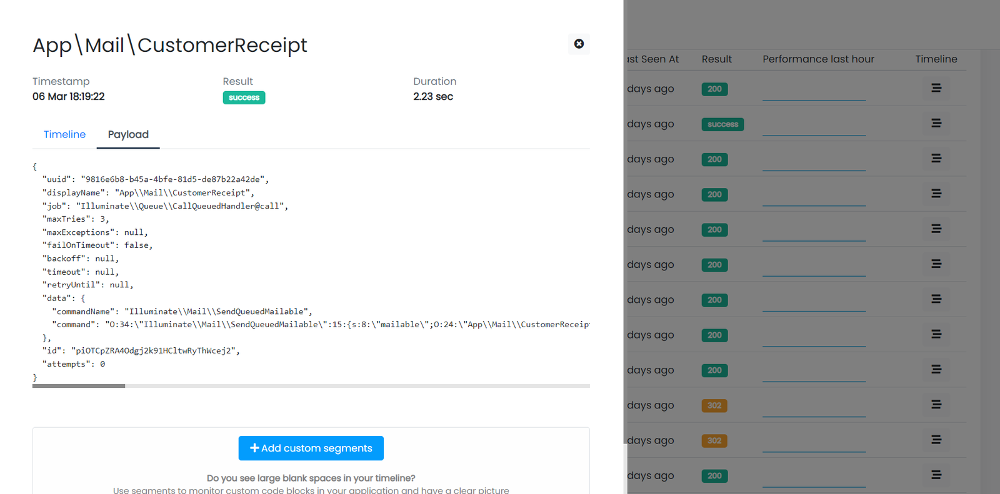
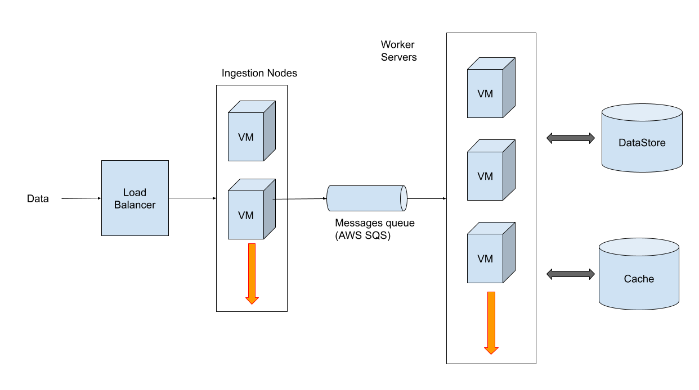

In today’s article, I’m going to show you how we use [AWS SQS](https://aws.amazon.com/sqs/) in our Laravel application, and how it helps us to manage 1.6 billion operations each month.

In the image below you can see our typical bill for a month of AWS SQS usage:



Before entering in the details of our system design I would introduce the SQS technology, why you should take a messaging system in consideration, and how to compare it with similar services.

## What is AWS SQS?

Amazon Simple Queue Service is a fully managed messages queueing system to enable communication between distributed software components or microservices.

Decoupling some parts of your system allows you to run and fail your software components independently. And also build applications that can easily scale.

Message queues act as intermediaries.


## What is a message?

This is an important question I want to answer to really help developers that are approaching this technology for the first time.

Every message queuing system accepts a text as content of a message. So the most common way to make different systems exchange structured data is to use JSON objects.

JSON can be easily serialized as text when pushing a new message onto the queue, and deserialized when it is consumed on the other side of the system.

### The Laravel way

Laravel implements its own format when exchanging messages with queue systems. Here is an example:



The JSON is automatically created by the internal queue system of the framework when you dispatch a job. It is somewhat hidden from the eyes of the developer.

The JSON message contains all data needed by Laravel to understand what job class should be executed and under what conditions (attempts, maxTries, etc.).

If your application doesn’t have a prepackaged solution like the one provided by Laravel, you can define your own format. The goal is to provide the consumer of the queue with all information to process the desired task.

## How to consume messages from the queue

You have to implement a system that continuously polls the queue waiting for a message to arrive.

Laravel provides a built-in “worker” that you can run with a simple command:

```php
php artisan queue:work
```

This command runs a background process that asks for new messages. When a message is retrieved the worker can run the job class included in the message.

You can see this process in the **\\Illuminate\\Queue\\Worker.php** class

```php
while (true) {
	// Before reserving any jobs, we will make sure this queue is not paused and
	// if it is we will just pause this worker for a given amount of time and
	// make sure we do not need to kill this worker process off completely.
	if (! $this->daemonShouldRun($options, $connectionName, $queue)) {
		$status = $this->pauseWorker($options, $lastRestart);

		if (! is_null($status)) {
			return $this->stop($status, $options);
		}

		continue;
	}
	
	...

	// If the daemon should run (not in maintenance mode, etc.), then we can run
	// fire off this job for processing. Otherwise, we will need to sleep the
	// worker so no more jobs are processed until they should be processed.
	if ($job) {
		$jobsProcessed++;

		$this->runJob($job, $connectionName, $options);

		if ($options->rest > 0) {
			$this->sleep($options->rest);
		}
	} else {
		$this->sleep($options->sleep);
	}
	
	...
}
```

## Why should you use AWS SQS?

Since my product is a developer tool, I discuss with other fellow developers almost every week about the internal design of their software.

In most of the applications I’ve had the opportunity to analyze, a messaging system was introduced to enable asynchronous tasks execution.

And the same is for Inspector.

I think this is the most common use case for messaging systems today. Microservices or large distributed software in general are very niche use cases. Probably belonging more to enterprise environments.

## What is an asynchronous task?

Imagine your product offers the ability to import account information by uploading large files. The user picks the file from the local PC and clicks “Import”.

This operation can take a while to be completed. You have to open the file, read each line, convert it in the appropriate format and store this information in your system.

It could be impossible to handle this process in the time of an HTTP request.

Thanks to a message queueing system we can store the file on our servers and push a message to the “import” queue with the path where the file is located.

The next step is to make up a background system that waits for these messages to handle the import process. Users don't need to wait until the import is done. In the meantime they can continue to use the product or leave it waiting to be notified when the import is completed.


## How Inspector use AWS SQS

The most important challenge of Inspector is to be able to process large amounts of traffic also guaranteeing good performance.

The endpoint where Inspector receives data from the monitored applications handles about 10 million HTTP requests per day. With this volume the problem is that these data packets can’t be processed on the fly.

At the beginning of our adventure we used a self managed Redis as a messages queueing system. But with increasing volumes we have preferred to rely on a managed service.

Read more in this article: [https://inspector.dev/what-worked-for-me-using-laravel-queues-from-the-basics-to-horizon/](/what-worked-for-me-using-laravel-queues-from-the-basics-to-horizon/)

The strategy is to use AWS SQS to be able to push these tasks to a queue which will be consumed by another separate system in the background (the processing pipeline).



Ingestion Nodes are implemented in nodejs. They are built as a very simple and extremely scalable script. The worker servers that consume the queue are instead a system component built on-top of the Laravel framework.

Obviously we could have chosen any other technology to manage the message queue. But at this stage of the company SQS guarantees scalability without any complexity on us, since it is a fully managed service.

Other solutions could also save us costs. But we prefer to guarantee our customers that the platform works perfectly and avoid the risk of introducing weaknesses that could cause unexpected downtimes.
