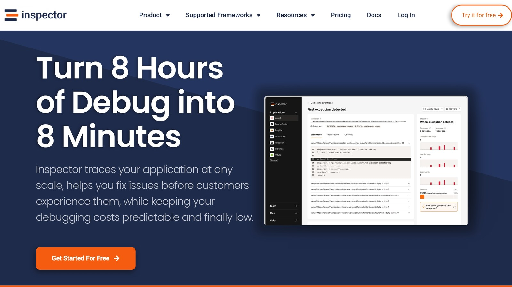

**Struggling with stale data or poor app performance?** Cache invalidation in [Laravel](https://laravel.com/) ensures your data is accurate and your app runs faster. Here's a quick guide to mastering it:

- **Key Strategies**:
  - **Time-based Expiration**: Set TTL (Time-to-Live) for cached data to balance freshness and performance.
  - **Event-driven Updates**: Use Laravel events to automatically invalidate cache after changes.
  - **Tag-based Clearing**: Group related cache items with tags for precise invalidation.
  - **Manual Clearing**: Use `Cache::forget()` or `Cache::flush()` for targeted or full cache removal.
- **Laravel Tools**:
  - Unified API for cache drivers ([Redis](https://redis.io/), [Memcached](https://memcached.org/), etc.).
  - Built-in methods for setting expiration (`Cache::put()`, `Cache::forget()`, etc.).
  - [Artisan](https://laravel.com/docs/11.x/artisan) commands for quick cache management.
- **Pro Tips**:
  - Monitor performance with tools like [Inspector](/).
  - Use model observers for automatic cache updates.
  - Organize cache tags for better control in complex apps.

| Cache Driver | Best Use Case | Tag Support | Performance |
| --- | --- | --- | --- |
| Redis | High-traffic apps | Yes | Extremely fast |
| Memcached | Distributed systems | Yes | Very fast |
| File | Development environments | No | Slower, ideal for testing |
| Database | Simple apps | No | Moderate, adds DB load |

**Want faster apps and fresher data?** Start optimizing your Laravel cache today with these proven practices.

## Setting Cache Expiration Times

Setting the right cache expiration times helps balance data freshness and system performance.

### Choosing TTL Values

The Time-to-Live (TTL) for cached data should depend on the type of data you're handling. Here's a quick guide:

| Data Type | Recommended TTL | Examples |
| --- | --- | --- |
| **Static Content** | 24–48 hours | Blog posts, documentation |
| **User Preferences** | 1–2 hours | Theme settings, display options |
| **Dynamic Data** | 5–15 minutes | Product inventory, pricing |
| **Real-time Data** | 30–60 seconds | Live stats, status updates |

Cache data that’s resource-intensive to generate but avoid caching values that change frequently.

### [Laravel](https://laravel.com/) Cache Expiration Methods

Laravel makes managing cache expiration straightforward with built-in methods. Here are some examples:

```php
// Store an item with a 60-minute expiration
Cache::put('key', 'value', now()->addMinutes(60));

// Store an item with a 24-hour expiration
Cache::put('key', 'value', now()->addHours(24));

// Store an item indefinitely
Cache::forever('key', 'value');

// Remove a cached item
Cache::forget('key');
```

For sensitive data, use shorter expiration times to reduce security risks.

### Time-based Expiration Rules

When setting expiration times, consider how often the data changes, how it’s used, and the resources available.

One effective technique is the *stale-while-revalidate* strategy. This serves cached content to users while refreshing it in the background, avoiding delays. Customize your cache driver settings in the `config/cache.php` file to support this approach.

Finally, keep in mind that different cache drivers, like Redis, Memcached, or File, offer varying performance. Choose the one that aligns with your application's traffic and performance needs.

## Manual Cache Clearing

Laravel provides methods for clearing cache manually, offering precise control over cache management. Here's how you can handle it effectively.

### Removing a Single Entry with Cache::forget()

Use `Cache::forget()` to delete specific cache items:

```php
// Remove a single cached item
Cache::forget('posts.all');

// Verify removal
if (Cache::forget('user.preferences')) {
    Log::info('Cache cleared successfully');
}
```

When updating a blog post, you can clear related cache entries like this:

```php
public function update(Post $post)
{
    $post->update($validatedData);
    Cache::forget('posts.' . $post->id);
    Cache::forget('posts.all');
}
```

This approach ensures updated data is served without unnecessary performance hits.

### Clearing All Cache with Cache::flush()

The `Cache::flush()` method removes all entries from the cache store, regardless of prefixes. Use this cautiously to avoid unintended data loss. To reduce risks:

- Perform flushes during low-traffic periods.
- Use separate cache stores for different environments.
- Log flush operations for troubleshooting.
- Opt for targeted clearing when possible.

### Targeted Cache Clearing

If your application relies on more complex caching, you can clear specific groups of data using tags:

```php
// Clear specific tagged cache entries
cache()->store('redis')->tags('product-catalog')->flush();

// Flush multiple tags at once
cache()->tags(['users', 'roles'])->flush();
```

For command-line operations, Laravel's Artisan tool supports targeted clearing:

```bash
php artisan cache:clear --tags=product-catalog,inventory
```

### Cache Clearing Methods Overview

| Cache Type | Method | Best Use Case |
| --- | --- | --- |
| Single Entry | `Cache::forget()` | Updates, user-specific data |
| Tagged Items | `Cache::tags()->flush()` | Related groups or categories |
| Full Cache | `Cache::flush()` | Major updates, development |

These techniques help keep your data current while minimizing unnecessary disruptions to application performance.

## Automatic Cache Updates

Laravel's event system simplifies cache management by automatically handling invalidation to ensure your data stays up-to-date.

### Laravel Event System for Caching

Laravel uses cache events to automate tasks like logging and monitoring:

```php
use Illuminate\Support\Facades\Event;
use Illuminate\Cache\Events\CacheHit;
use Illuminate\Cache\Events\CacheMissed;
use Illuminate\Cache\Events\KeyWritten;

Event::listen(function (KeyWritten $event) {
    Log::info("Cache key {$event->key} was written");
});
```

If performance is a concern, you can disable these events in the `config/cache.php` file:

```php
'events' => [
    'enabled' => false
],
```

To further streamline cache updates, consider using model observers to handle changes triggered by database updates.

### Model Observer Implementation

Model observers take cache automation a step further by invalidating relevant data when records are created, updated, or deleted:

```php
namespace App\Observers;

class ProductObserver
{
    public function created(Product $product)
    {
        Cache::tags(['products', 'catalog'])->flush();
    }

    public function updated(Product $product)
    {
        Cache::forget('product.' . $product->id);
        Cache::tags(['products'])->flush();
    }

    public function deleted(Product $product)
    {
        Cache::tags(['products', 'catalog'])->flush();
    }
}
```

To activate this observer, register it in your `AppServiceProvider`:

```php
use App\Models\Product;
use App\Observers\ProductObserver;

public function boot()
{
    Product::observe(ProductObserver::class);
}
```

### Managing Related Data Caches

For data with relationships, Laravel offers the `$touches` property to ensure related caches are updated automatically. Here's how it works:

```php
class Comment extends Model
{
    protected $touches = ['article'];

    public function article()
    {
        return $this->belongsTo(Article::class);
    }
}
```

In multi-tenant applications, cache key prefixes help maintain organized and isolated data:

| Cache Type | Prefix Example | Use Case |
| --- | --- | --- |
| Tenant-specific | `tenant_{id}_products` | Isolated tenant data |
| Global | `global_categories` | Shared application data |
| Time-sensitive | `hourly_stats_{timestamp}` | Regularly updated metrics |

### Understanding Cache Events

Laravel's cache events offer insights into your application's behavior, which is useful for debugging and monitoring:

- **CacheHit**: Triggered when cached data is retrieved.
- **CacheMissed**: Triggered when no data is found in the cache.
- **KeyForgotten**: Triggered when a cache entry is removed.
- **KeyWritten**: Triggered when new data is written to the cache.

> "Laravel's events provide a simple observer pattern implementation, allowing you to subscribe and listen for various events that occur within your application."

> "Cache events provide valuable insights into your application's caching behavior, perfect for monitoring and debugging."

## Cache Tags Management

Laravel's cache tags allow you to clear specific groups of cached items without disrupting unrelated data.

### Laravel Cache Tags Overview

Cache tags act like labels you can attach to cached items, giving you fine control over cache invalidation. Here's an example:

```php
Cache::tags(['products', 'featured'])->put('item.1', $product, 3600);
```

| Cache Driver | Tag Support | Best Use Case |
| --- | --- | --- |
| Redis | Yes | High-performance production environments |
| Memcached | Yes | Distributed caching systems |
| File | No | Local development |
| Database | No | Testing environments |
| Array | No | Unit testing |
| *Note: Only Redis and Memcached drivers support cache tagging.* |  |  |

### Tag-based Cache Updates

You can group related cache items under descriptive tags that align with your data structure:

```php
// Store multiple related items  
Cache::tags(['products', 'electronics'])->put('laptop.1', $laptop, 3600);  
Cache::tags(['products', 'electronics'])->put('phone.1', $phone, 3600);
```

To clear all items in a specific group, like "electronics":

```php
Cache::tags(['electronics'])->flush();
```

For e-commerce, you can organize cache tags by category:

```php
Cache::tags(['products', "category.{$categoryId}"])->remember('product-list', 3600, function() {
    return Product::with('category')->get();
});
```

### Cache Tag Structure Guidelines

Here are some tips for naming and organizing cache tags effectively:

- **Use Descriptive Names**: Pick tag names that clearly reflect the purpose of the data.
- **Stick to a Consistent Naming Convention**: Keep your tags simple and only use as many as necessary to maintain clarity.

You can also create hierarchical tag structures to represent relationships in your data:

```php
Cache::tags(['catalog', 'catalog.products', 'catalog.products.featured'])
    ->put('featured-items', $items, 3600);
```

This method offers more control compared to manually clearing the entire cache.

To maximize performance, consider organizing cache tags based on data relationships:

| Tag Level | Example | Purpose |
| --- | --- | --- |
| Primary | 'products' | Main data category |
| Secondary | 'products.active' | Filtered subset |
| Tertiary | 'products.active.featured' | Specific use case |

For larger applications, you can use Artisan commands to manage cache tags efficiently:

```bash
php artisan cache:clear --tags=products
```

This approach ensures accurate cache invalidation, better performance, and reduced server load.

## Cache Monitoring with [Inspector](/)



Inspector provides automatic instrumentation for Laravel apps, offering insights to help identify caching problems. This feature works alongside automated cache updates to maintain smooth performance.

### Real-time Performance Monitoring

Inspector integrates seamlessly with your [Laravel application](/laravel-real-time-performance-monitoring-using-inspector-part-1/) - no server-level setup required. It tracks critical performance metrics, including:

| Metric Type | Monitored Data | Why It Matters |
| --- | --- | --- |
| **HTTP Requests** | Request durations, URLs, parameters, and headers | Pinpoints latency issues affecting response times |
| **Database Queries** | Execution times and query details | Highlights inefficiencies that could impact caching |
| **Background Jobs** | Job durations and error occurrences | Ensures background tasks are running smoothly |
| **Artisan Commands** | Execution times of scheduled tasks | Tracks periodic operations like maintenance tasks |

Inspector wraps the execution cycles to directly link performance bottlenecks with cache behavior.

### Issue Detection

Inspector’s real-time monitoring helps spot performance problems that may hurt caching efficiency. It identifies:

- Latency problems slowing down responses
- Recurring errors that signal operational issues
- Bottlenecks caused by inefficient resource usage

For example, Inspector can monitor Laravel cache usage like this:

```php
// Example Laravel cache usage monitored by Inspector
Cache::tags(['products'])->remember('product-list', 3600, function() {
    return Product::all();
});
```

By detecting problems as they occur, Inspector enables you to act quickly and optimize caching processes.

### Inspector Integration Steps

Setting up Inspector in your Laravel app is straightforward:

1. Clear your configuration cache:

   ```bash
   php artisan config:clear
   ```

2. Install the Inspector Laravel package:

   ```bash
   composer require inspector-apm/inspector-laravel
   ```

3. Add your Inspector API key to the `.env` file:

   ```env
   INSPECTOR_API_KEY=your_api_key
   ```

4. Register the middleware in `app/Http/Kernel.php`:

   ```php
   protected $middleware = [
       \Inspector\Laravel\Middleware\WebRequestMonitoring::class,
   ];
   ```

### Pricing Plans

Inspector offers flexible pricing options:

| Plan | Monthly Transactions | Team Size | Price |
| --- | --- | --- | --- |
| **Free** | 30,000 | Up to 3 members | $0 |
| **Developer** | 500,000 | Up to 3 members | $39 |
| **Team** | 1.2M | Up to 5 members | $69 |

To organize data in auto-scaling environments, you can group transactions by service:

```php
Inspector::beforeFlush(function($transaction) {
    $transaction->setService('api-gateway');
    return true;
});
```

This ensures consistent monitoring across your infrastructure while managing data efficiently.

## Conclusion

### Key Takeaways

A well-rounded cache invalidation approach combines time-based, event-driven, tag-based, and manual methods to ensure both speed and accuracy.

> "Effective invalidation ensures that users do not receive stale data, which is crucial for maintaining data accuracy and trust, especially in applications dealing with frequently changing data."

Here’s a quick overview of the main cache invalidation strategies and their use cases:

| Strategy | Ideal For | Primary Advantage |
| --- | --- | --- |
| Time-based | Predictable data lifecycles | Automated cleanup with minimal effort |
| Event-driven | Real-time data updates | Instant cache updates after changes |
| Tag-based | Grouped content updates | Simplifies bulk invalidation |
| Manual | Critical situations | Gives full control when necessary |

Using these strategies, you can build a reliable cache invalidation system for your Laravel app.

### Steps to Implement in Laravel

1. **Set Up Cache Settings**  
   Define TTL (Time-To-Live) values that align with how often your data changes.

2. **Add Event Listeners**  
   Use event listeners to handle cache invalidation dynamically. For example:

   ```php
   Event::listen(UserProfileUpdated::class, function ($event) {
       Cache::forget('user_profile_' . $event->userId);
   });
   ```

3. **Track and Optimize Performance**  
   Use tools like *Inspector* to monitor your app’s real-time performance. Regular monitoring helps you:

   - Spot slow requests that may impact cache efficiency
   - Identify any unauthorized access attempts
   - Analyze cache hit rates and usage trends
   - Keep an eye on overall performance metrics

## Related Blog Posts

- [Laravel Query Profiling: Tools and Techniques](/laravel-query-profiling-tools-and-techniques/)
- [5 Common Laravel Exceptions Explained](/5-common-laravel-exceptions-explained/)
- [Common Causes of Lock Contention in Laravel](/common-causes-of-lock-contention-in-laravel/)
- [Memcached Query Caching: Performance Tips](/memcached-query-caching-performance-tips/)
