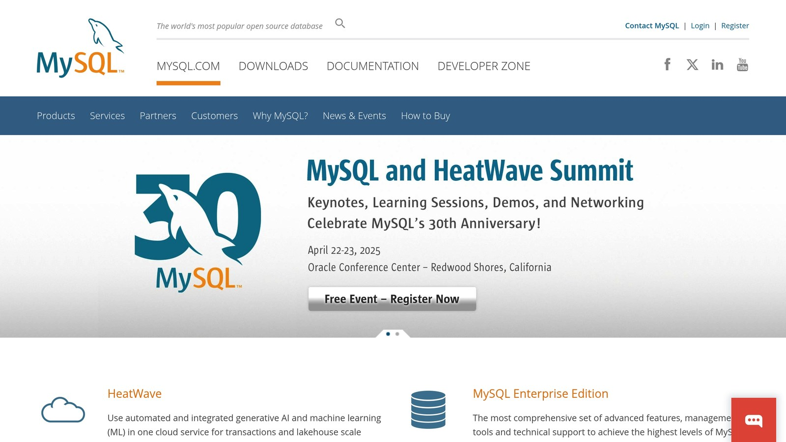
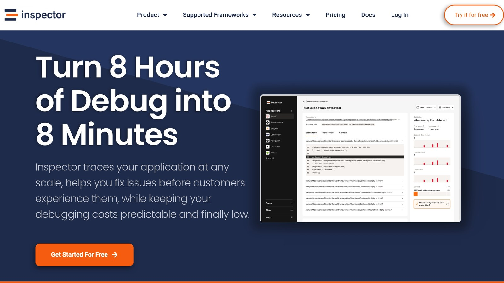

- **Normalize for Accuracy**: Use at least 1NF, 2NF, and 3NF to reduce redundancy and ensure consistency.
- **Index Strategically**: Add indexes to frequently queried columns but avoid over-indexing.
- **Choose the Right Data Types**: Match column data types to their purpose for better storage and speed.
- **Balance Normalization and Denormalization**: Normalize for transactional accuracy and denormalize for faster reads in reporting systems.
- **Monitor Performance**: Use tools like `EXPLAIN` or [Inspector](/) to catch slow queries and optimize.
- **Plan for Scalability**: Implement sharding or partitioning for large datasets to handle growth.

## Quick Comparison: Normalization vs. Denormalization

| Aspect | Normalization | Denormalization |
| --- | --- | --- |
| **Data Integrity** | High | Moderate |
| **Query Speed** | Slower | Faster |
| **Storage Space** | Efficient | Higher usage |
| **Maintenance** | Easier | More challenging |
| **Best Use Case** | OLTP systems | OLAP systems |

## Data Normalization vs Denormalization

Normalization and denormalization each serve different purposes. Picking the right approach can improve PHP performance. Let’s break down when and how to use these methods.

### Normalization Rules

Normalization focuses on reducing redundancy and ensuring data consistency. By optimizing the database structure, it tackles performance challenges effectively. Here are the main normalization forms:

| Form | Purpose | Example |
| --- | --- | --- |
| 1NF | Removes repeating groups and keeps values atomic | Break down customer address into street, city, and state fields |
| 2NF | Eliminates partial dependencies | Separate order items from order details |
| 3NF | Removes transitive dependencies | Store supplier details in a separate table from products |

### When to Use Normalization

Normalization works best when accuracy and consistency are top priorities. A properly normalized database can:

- Reduce data duplication
- Maintain data integrity during updates
- Save storage space
- Simplify maintenance and troubleshooting

For example, in an e-commerce system, normalizing supplier data ensures updates are consistent across the database.

### When to Use Denormalization

Denormalization is ideal for systems that prioritize fast read operations and quick query responses. It reduces the need for complex joins, making it a good fit for read-heavy applications.

You might consider denormalization if:

- The system is mostly read-focused
- Fast query execution is critical
- Some level of data duplication is acceptable

For instance, an e-commerce platform with slow query times due to excessive joins benefited from selective denormalization. This adjustment led to faster queries and improved performance.

Here’s how the two approaches compare:

| Aspect | Normalization | Denormalization |
| --- | --- | --- |
| Data Integrity | High | Moderate |
| Query Speed | Slower (more joins) | Faster (fewer joins) |
| Storage Space | Efficient | Higher usage |
| Maintenance | Easier | More challenging |
| Best Use Case | OLTP systems | OLAP systems |
| Data Consistency | Strong | Needs monitoring |

Many PHP applications use a mix of both methods. For instance, they might normalize transactional data to ensure accuracy while denormalizing frequently accessed data for faster reporting. This balance helps achieve both performance and integrity goals.

## Database Index Optimization

Indexes play a key role in speeding up data retrieval for PHP applications. When used properly, they can dramatically improve performance, especially for applications handling large datasets.

### Index Types and Their Uses

Different types of indexes are suited to specific needs. Here's a quick look at the most commonly used ones in PHP applications:

| Index Type | Best For | Benefits |
| --- | --- | --- |
| Primary | Unique record identification | Quick lookups for single-record retrieval |
| Clustered | Range-based queries | Speeds up access to sorted data |
| Non-clustered | Secondary search criteria | Useful for frequently queried columns |
| Covering | Complex SELECT queries | Can eliminate the need for table lookups |
| Bitmap | Low-cardinality columns | Ideal for data warehousing and similar tasks |

For example, if your application often searches for users by email, adding an index to the email column can make lookups much faster. However, keep in mind that indexes require extra storage and can slow down write operations.

### Tips for Creating Effective Indexes

Follow these steps to make sure your indexes are efficient:

- **Analyze Slow Queries**: Use tools like `EXPLAIN` to identify slow queries and pinpoint columns that need indexing.

- **Order Matters for Multi-Column Indexes**: Place the most frequently used columns first. For instance, if you often search by last name and then first name, create an index like this:

  ```sql
  CREATE INDEX names ON users(last_name, first_name);
  ```

- **Remove Unused Indexes**: Regularly review your indexes and drop those that aren't being used to avoid unnecessary overhead.

- **Focus on Common Operations**: Index columns frequently used in `WHERE`, `JOIN`, and `ORDER BY` clauses to replace full table scans with faster index seeks.

By following these steps, you can optimize your database for faster queries while keeping write operations efficient.

### Mistakes to Avoid

Even with the best intentions, indexing mistakes can hurt performance. Here are some common pitfalls to watch out for:

- **Too Many Indexes**

  Adding too many indexes can slow down write operations and eat up storage space. Aim for a balance between read and write efficiency.
- **Wrong Column Choices**

  Avoid indexing columns with low selectivity (e.g., columns with very few unique values). These indexes are often ignored by the database engine, which may still perform full table scans.
- **Ignoring Maintenance**

  As data and query patterns change, your indexing strategy should evolve too. Use tools like MySQL's `EXPLAIN` to find and fix unused or inefficient indexes, ensuring performance stays consistent.

For PHP applications dealing with large datasets, monitoring query performance and index usage is essential. Regular analysis and adjustments can help maintain optimal database performance.

## Data Type Selection

Picking the right data types for your PHP database schema is critical for both storage efficiency and query performance. Let’s break down some common MySQL data types and explore how to choose the best ones for your application.

### [MySQL](https://www.mysql.com/) Data Types Guide



Here's a quick comparison of commonly used MySQL data types and their storage requirements:

| Data Type | Storage Size | Best For | Value Range |
| --- | --- | --- | --- |
| **TINYINT** | 1 byte | Small numbers, flags | -128 to 127 (signed) |
| **INT** | 4 bytes | Standard integers | \~-2.1 billion to 2.1 billion |
| **VARCHAR(255)** | Length + 1 byte | Variable text | Up to 255 characters |
| **TIMESTAMP** | 4 bytes | Date/time tracking | 1970-01-01 to 2038-01-19 |
| **DECIMAL(18,9)** | 9 bytes | Precise calculations | 18 digits total |

### Storage Space Optimization

Efficient use of storage starts with choosing the right data types for your specific needs:

- **Fixed-length data?** Use `CHAR` instead of `VARCHAR` to avoid row fragmentation. For instance, `CHAR(2)` works well for state codes, while `CHAR(3)` is ideal for currency codes.
- **Small numbers?** Opt for the smallest integer type that fits your data. For example, using `TINYINT` (0–255) for age values saves 3 bytes per row compared to `INT`.
- **Dates and times?** Use `TIMESTAMP` (4 bytes) instead of `DATETIME` (8 bytes) to save space without losing precision.

### Data Types and Query Speed

- **Numeric keys over strings:** Integers are faster to compare than strings. For example, storing IP addresses as `UNSIGNED INT` (4 bytes) instead of `VARCHAR(15)` improves both lookup speed and storage efficiency.
- **Floating-point vs. DECIMAL:** Floating-point calculations are faster because they’re handled directly by the CPU. However, for financial or precise data, use `DECIMAL` to avoid rounding errors.
- **Strings and indexing:** Use `VARCHAR` for strings under 255 characters. Avoid `TEXT` unless absolutely necessary, as it has indexing limitations and can slow down queries.

Regularly analyze your data patterns and adjust your schema as needed. Even small tweaks can lead to noticeable storage savings and faster query responses. Thoughtful data type selection lays the foundation for a high-performing and [scalable database](/how-i-handled-the-scalability-of-the-sql-database-at-inspector/).

## Schema Design for Growth

As your PHP application grows, it's crucial to adjust your database schema to handle increasing data volumes and user demands effectively.

### Data Partitioning Methods

Partitioning divides large datasets into smaller, more manageable pieces to boost performance and reduce resource conflicts. Here are two common approaches:

| Partitioning Type | Best For | Advantages | Drawbacks |
| --- | --- | --- | --- |
| Horizontal (Sharding) | High-volume tables, time-series data | Distributes workload evenly, speeds up queries | Can require more complex application logic |
| Vertical | Wide tables with varied column access | Cuts down I/O, improves caching | Scalability is limited |

You can combine both methods to align with your application's access patterns. This forms a strong foundation for sharding across multiple servers.

### Database Sharding Guide

Sharding spreads large datasets across different servers, making it easier to manage and query massive amounts of data. Here's how to do it effectively:

1. **Pick the Right Sharding Key**

   The sharding key determines how data gets distributed. Consider factors like query patterns, access frequency, and the need for balanced data distribution tailored to your business logic.

2. **Choose a Sharding Strategy**

   Different strategies work for different needs. Here's a quick breakdown:

   | Strategy | How It Works | Best Use Case |
   | --- | --- | --- |
   | Range-based | Divides data by date ranges or ID sequences | Time-series data, historical records |
   | Hash-based | Uses a hash function on a key | When even data spread is critical |
   | Geographic | Groups data by location | Region-specific applications |

3. **Monitor and Adjust**

   Regularly check your shard distribution to ensure data remains evenly spread and rebalance as needed.

Sharding is just one piece of the puzzle - distributed database design can take scalability even further.

### Distributed Database Design

Expanding on partitioning and sharding, distributed databases address challenges like consistency and availability while scaling PHP applications.

**Consistency vs. Availability**

The CAP theorem highlights a trade-off between consistency and availability. Depending on your application's needs, you might prioritize:

- **Strong consistency (CP):** Best for tasks like financial transactions where accuracy is critical.
- **High availability (AP):** Ideal for features like content delivery or social functionalities.

**Data Synchronization**

To keep data synchronized:

- Use master-slave replication for workloads heavy on reads.
- Configure settings such as `group_replication_consistency=AFTER` to ensure data consistency.
- Monitor replication lag to maintain up-to-date data.

**Planning for High Availability**

Design your schema to support high availability, keeping in mind the following levels:

| Availability Level | Annual Downtime | Best For |
| --- | --- | --- |
| 99.9% | 8.77 hours | General web applications |
| 99.99% | 52.60 minutes | Critical business systems |
| 99.999% | 5.26 minutes | Enterprise-grade solutions |

Reaching higher availability levels often requires advanced infrastructure and careful schema optimization.

## Schema Monitoring Tools

Keeping an eye on your database schema is essential for ensuring smooth [PHP application performance](/php-performance-optimization/). Modern tools can help you spot query issues before they disrupt user experiences.

### [Inspector](/) Performance Tracking



Inspector is a tool designed to monitor database performance in PHP applications with minimal setup. Its lightweight integration provides insights into SQL query performance through features like:

| Feature | Purpose | Example Use Case |
| --- | --- | --- |
| Slow SQL Query Identification | Helps locate slow queries causing bottlenecks | Managing high-traffic databases |
| Real-time Error Detection | Sends alerts for schema performance issues | Debugging complex query errors |
| [Automated Bug Fix Proposals](https://docs.inspector.dev/concepts/ai-bug-fixer) | Suggests fixes for detected problems | Debugging in production quickly |

Inspector’s real-time monitoring is particularly useful for identifying performance issues in complex database operations, such as joins or subqueries. For example, it can pinpoint the exact part of a query where performance drops.

> "We like Inspector because it's really simple to install and use. It doesn't require any configuration. It allows us to immediately identify and fix issues in our code!" - Miller Adulu, Founder & Team Lead - FrogTech

While Inspector excels in real-time monitoring, other debugging tools can complement it by offering additional insights.

### To effectively monitor your database operations, look for tools that offer:

- Detailed transaction monitoring for query analysis
- Continuous database performance tracking
- [Real-time alerts for performance issues](/metrics-performance-monitoring/)
- Historical data to analyze trends

## Summary

The following principles highlight the key strategies for effective PHP database schema design.

### Main Schema Design Rules

Good PHP performance begins with a carefully planned database schema. Here's a quick look at some core rules:

| Design Principle | Best Practice | Effect on Performance |
| --- | --- | --- |
| Normalization | Apply at least 1NF, 2NF, and 3NF | Minimizes redundant data and ensures data accuracy |
| Indexing Strategy | Add indexes to frequently queried columns | Makes data retrieval faster |
| Data Types | Use the right data type for each column | Saves storage and improves query speed |
| Security Measures | Use encryption and constraints | Safeguards data and prevents breaches |

### Implementation Steps

1. **Initial Planning and Design**

   Start by analyzing data needs and creating Entity-Relationship Diagrams (ERDs).
2. **Schema Implementation**

   Apply these practices for building your schema:
   - Stick to consistent naming for tables and columns.
   - Use foreign key constraints to maintain relationships between tables.
   - Document all schema-related decisions for future reference.
   - Pick data types that balance storage efficiency and performance.
3. **Performance Monitoring**

   Keep an eye on database performance by:
   - Using tools like Inspector to identify slow queries and track resource usage.
   - Setting up alerts to flag slow queries.
   - Monitoring resource consumption across operations.

For advanced monitoring, Inspector's Developer plan costs $39/month and supports up to 800,000 transactions, plus [AI-driven bug fixes](/ai-bug-fixer-revolutionizing-web-application-monitoring-with-inspector/).

## Related Blog Posts

- [Common JOIN Query Indexing Mistakes to Avoid](/common-join-query-indexing-mistakes-to-avoid/)
- [Ultimate Guide to MySQL Query Caching in PHP](/ultimate-guide-to-mysql-query-caching-in-php/)
- [How to Benchmark PHP Code Performance](/how-to-benchmark-php-code-performance/)
- [Best Practices for PHP-FPM with High Concurrent Users](/best-practices-for-php-fpm-with-high-concurrent-users/)
