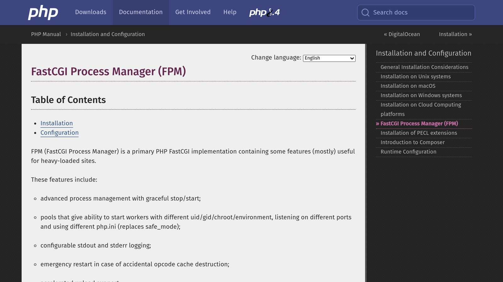
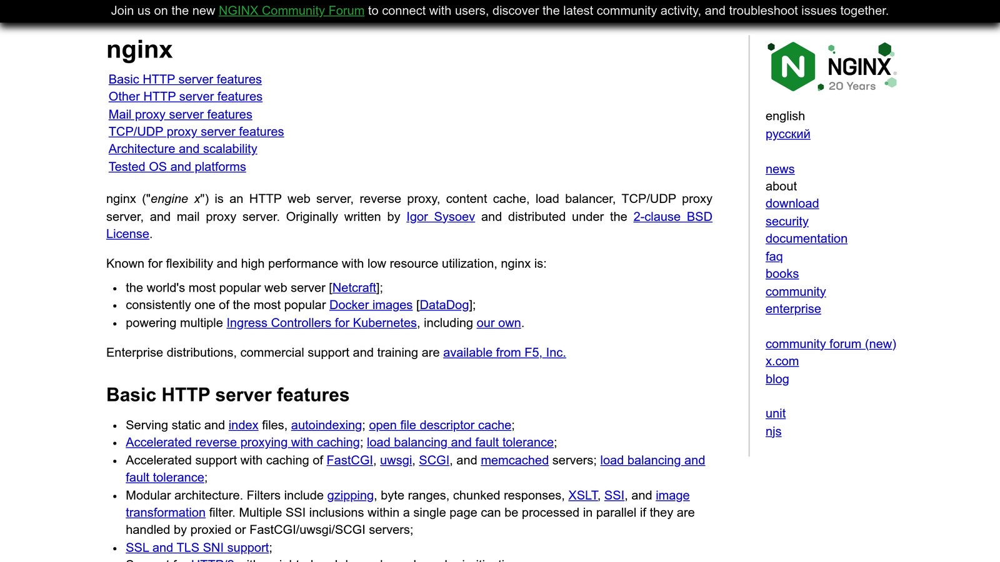

**Want to optimize** [**PHP-FPM**](https://www.php.net/manual/en/install.fpm.php) **for high traffic? Here's a quick guide to handle more users without slowing down.**

PHP-FPM is essential for high-traffic websites, but managing it properly can be tricky. Here’s what you need to know to improve performance:

- **Set the Right Process Manager Mode**: Use `dynamic` mode for better scalability.
- **Calculate Worker Processes**: Adjust `pm.max_children` based on your server’s RAM (e.g., 128MB per process).
- **Fine-Tune Memory Settings**: Use `memory_limit` and `pm.max_requests` to manage memory efficiently.
- **Optimize Connections**: Set timeouts (`request_terminate_timeout`, `max_execution_time`) and use persistent connections.
- **Enable Monitoring**: Track key metrics like queue length, memory usage, and request times.

## Quick Example Configuration

```ini
pm = dynamic
pm.max_children = 72
pm.start_servers = 8
pm.min_spare_servers = 8
pm.max_spare_servers = 20
pm.max_requests = 500
```

This setup ensures stability while handling high concurrency. Dive into the full article for detailed configurations, including [Nginx](https://nginx.org/en/) tweaks, slowlog setup, and monitoring tools.

## [PHP-FPM](https://www.php.net/manual/en/install.fpm.php) Core Configuration



Configuring PHP-FPM plays a key role in ensuring your server performs well and stays stable under heavy traffic.

### Process Manager Settings

Selecting the right process manager (PM) mode is critical. For high-traffic production setups, **dynamic mode** strikes a good balance between resource usage and performance.

For example, on a server with 16 GB of RAM, you might reserve 4 GB for the OS, leaving 12 GB for PHP-FPM. If each process uses 128 MB, you can support up to 96 processes. To avoid maxing out resources, set `pm.max_children` to about 75–80% of that capacity - let's say 72. Here's a sample configuration:

> pm = dynamic
>
> pm.max_children = 72
>
> pm.start_servers = 8
>
> pm.min_spare_servers = 8
>
> pm.max_spare_servers = 20
>
> pm.max_requests = 500

### Memory Settings

Proper memory configuration ensures your server can handle heavy loads efficiently. Key settings might include:

> memory_limit = 256M
>
> php_value[session.gc_maxlifetime] = 1440
>
> php_admin_value[memory_limit] = 256M

Adjust `memory_limit` based on your application's requirements. Use `pm.max_requests` to recycle processes regularly and clear memory leaks. Also, allocate enough memory for [OpCache](https://www.php.net/manual/en/book.opcache.php) to improve performance.

### Connection Settings

Fine-tuning connection parameters is equally important. Here’s an example setup:

> request_terminate_timeout = 120s
>
> max_execution_time = 120
>
> max_input_time = 60

For the listen queue, consider these optimizations:

> listen.backlog = 65535
>
> listen.owner = www-data
>
> listen.group = www-data
>
> listen.mode = 0660

To monitor connection health, enable a status page with these settings:

> pm.status_path = /status
>
> ping.path = /ping
>
> ping.response = pong

This configuration works well in high-concurrency environments. For ongoing monitoring and diagnostics, tools like [Inspector](/) can provide detailed insights into your PHP applications.

## PHP-FPM Pool Configuration

Efficient PHP-FPM pool settings are key to handling high traffic. Below, you'll find recommended configurations for process pools and slowlog settings.

### Process Pool Settings

For a server with 32GB of RAM (assuming each process uses 128MB):

| Setting | Value | Purpose |
| --- | --- | --- |
| **pm.max_children** | 180 | Total processes (about 70% of capacity) |
| **pm.start_servers** | 45 | Processes started at launch (25% of max) |
| **pm.min_spare_servers** | 30 | Minimum idle processes |
| **pm.max_spare_servers** | 60 | Maximum idle processes |
| **pm.process_idle_timeout** | 10s | Time before idle processes are terminated |

These values should be adjusted based on your application's memory requirements. Always leave 20–30% of RAM available for the operating system and other services.

Once the pool is configured, slowlog settings can help pinpoint and fix performance issues.

### Slowlog Setup

Add the following lines to your PHP-FPM configuration file:

```ini
slowlog = /var/log/php-fpm/slowlog.log
request_slowlog_timeout = 5s
```

The `request_slowlog_timeout` is initially set to 5 seconds but can be adjusted based on your application's needs.

To make the most of slowlog:

- **Enable stack traces**: Use `request_slowlog_trace_depth = 20` to capture detailed execution data.
- **Set proper permissions**: Ensure PHP-FPM processes have access to the log file.
- **Manage log size**: Use tools like `logrotate` to keep logs under control.

For real-time insights into slow requests, consider using [Inspector](/) or similar monitoring tools.

## [Nginx](https://nginx.org/en/) and PHP-FPM Setup



### FastCGI Settings

To handle high-load scenarios effectively, fine-tune your FastCGI settings in Nginx. Below are the recommended configurations:

> fastcgi_buffers 16 16k;
>
> fastcgi_buffer_size 32k;
>
> fastcgi_connect_timeout 60s;
>
> fastcgi_read_timeout 60s;
>
> fastcgi_send_timeout 60s;
>
> fastcgi_busy_buffers_size 32k;
>
> fastcgi_temp_file_write_size 32k;
>
> fastcgi_max_temp_file_size 0;

If your responses exceed 16KB, consider increasing `fastcgi_buffers` and `fastcgi_buffer_size` to avoid performance issues.

Additionally, enable persistent connections to improve the communication between Nginx and PHP-FPM.

### Connection Management

Set up Nginx and PHP-FPM to handle connections efficiently. For persistent connections, use this configuration:

> upstream php-fpm {
>
> server unix:/var/run/php-fpm.sock;
>
> keepalive 32;
>
> }

If you're using TCP sockets, implement connection pooling for better load distribution:

> upstream php-fpm {
>
> server 127.0.0.1:9000;
>
> server 127.0.0.1:9001;
>
> server 127.0.0.1:9002;
>
> least_conn;
>
> }

To avoid bottlenecks, adjust your PHP-FPM pool settings to match your server's capacity:

> pm.max_requests = 500
>
> request_terminate_timeout = 60s
>
> rlimit_files = 65535
>
> rlimit_core = unlimited

## Performance Monitoring

Keep an eye on PHP‐FPM performance, especially during high traffic, to spot and fix bottlenecks before they impact users.

### Monitoring Tools

Real-time tools like **Inspector** provide detailed, code-level insights without requiring server installation.

Here are the key metrics to monitor:

- **Request Processing Time**: Measure both average and peak times.
- **Memory Usage**: Track memory consumption per process and overall.
- **Process States**: Keep an eye on active, idle, and total processes.

For deeper insights, set up your monitoring stack to cover these critical PHP‐FPM metrics:

| Metric Type | Key Indicators | Warning Thresholds |
| --- | --- | --- |
| Load | N.o. requests | >80% spike |
| Memory | Per-process usage | >256 MB per process |
| Response | Processing Time | >2000 ms per request |

These metrics work hand-in-hand with the PHP‐FPM configurations mentioned earlier.

## Summary

Fine-tune PHP-FPM settings to handle high traffic efficiently.

### Key Configuration Areas

| Configuration Area | Key Settings | Suggested Values |
| --- | --- | --- |
| **Process Manager** | `pm.max_children`, `pm.start_servers` | Calculate based on RAM: *(Total RAM – 2GB) ÷ 50MB per process* |
| **Memory** | `memory_limit`, `php_value[memory_limit]` | Allocate 256–512MB per process |
| **Connection** | `pm.max_requests`, `request_terminate_timeout` | Set 1,000–5,000 requests; 300–600 seconds timeout |
| **Pool Settings** | `listen.backlog`, `pm.status_path` | Use 65,535 for backlog; set `"/status"` for monitoring |

These configurations are critical for ensuring PHP-FPM performs well under heavy loads. To maintain stability, it’s essential to also implement monitoring tools. For example, Inspector provides real-time insights without requiring additional infrastructure.

### Key Points to Remember

- **Dynamic Scaling**: Adjust process manager settings to align with your system’s resources.
- **Resource Allocation**: Distribute memory wisely between PHP processes and the rest of the system.
- **Connection Limits**: Use proper timeouts and request limits to prevent bottlenecks.
- **Active Monitoring**: Keep an eye on process states, memory usage, and queue lengths for early issue detection.

Regularly review and tweak these settings to keep your system running smoothly under varying workloads.

## Related Blog Posts

- [5 Ways to Optimize Symfony Application Performance](/5-ways-to-optimize-symfony-application-performance/)
- [Ultimate Guide to MySQL Query Caching in PHP](/ultimate-guide-to-mysql-query-caching-in-php/)
- [How to Benchmark PHP Code Performance](/how-to-benchmark-php-code-performance/)
- [Memcached Query Caching: Performance Tips](/memcached-query-caching-performance-tips/)
