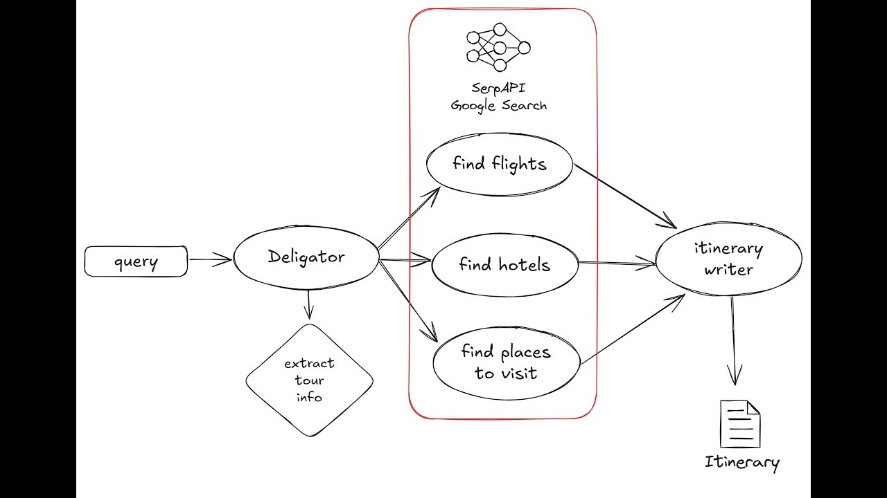

As PHP developers, we've watched the AI agent conversation happen around us rather than with us. While Python frameworks multiplied and JavaScript libraries emerged, PHP remained notably absent from the agentic application development landscape. The question isn't whether PHP developers want to build intelligent applications—it's whether the tools exist to do it properly.

The answer is increasingly yes, and a new Laravel travel planner application demonstrates exactly how accessible multi-agent development has become for PHP developers who prefer to stick with their existing expertise rather than retool their entire skillset.

## The Multi-Agent Architecture Challenge

Building applications that coordinate multiple AI agents presents unique architectural challenges. Unlike single-agent systems that follow linear request-response patterns, multi-agent workflows require orchestration, state management, and coordination between different specialized components. Each agent needs to understand its role, communicate with others, and contribute to a larger objective without creating bottlenecks or conflicts.

Traditional PHP applications handle these coordination patterns well—think about how Laravel's job queues manage complex background processes or how service containers resolve dependencies. The missing piece has been frameworks that apply these familiar patterns to AI agent coordination.

## Introducing Neuron's Workflow Component

The [Neuron AI framework's Workflow component](https://docs.neuron-ai.dev/workflow/getting-started) addresses this gap by providing a structured approach to multi-agent orchestration that feels natural to PHP developers. Rather than forcing developers to learn entirely new paradigms, it builds on established patterns like dependency injection, event handling, and pipeline processing.

A Workflow in Neuron defines how multiple agents collaborate to complete complex tasks. Each workflow consists of specialized nodes that handle specific responsibilities, with the framework managing communication and state between them. This approach separates concerns while maintaining the flexibility to handle dynamic, context-dependent decision making.

## The Travel Planner Agent: Multi-Agent Coordination in Practice



The [travel planner project](https://github.com/neuron-core/laravel-travel-agent) demonstrates these concepts through a practical application that most developers can immediately understand. When a user requests travel recommendations, the system doesn't rely on a single agent trying to handle flights, hotels, and attractions simultaneously. Instead, it coordinates specialized agents, each optimized for specific tasks.

The architecture includes several key components:

**TravelPlannerAgent** serves as the workflow orchestrator, managing the overall process and ensuring all components work together toward the final itinerary.

**Receptionist Node** handles initial user interaction, collecting destination preferences, dates, budget constraints, and other requirements. This separation ensures user input validation happens consistently, regardless of how complex the downstream processing becomes.

**Delegator Node** coordinates parallel research across three specialized areas—flights, hotels, and places to visit. Rather than processing these sequentially, the workflow can handle multiple research streams simultaneously, improving both performance and result quality.

**GenerateItinerary Node** synthesizes all gathered information into a cohesive travel plan, ensuring recommendations work together rather than existing as isolated suggestions.

This structure provides several advantages over monolithic approaches. Each agent can be developed, tested, and optimized independently. The system can scale specific components based on demand.

## Implementation Simplicity

Despite the sophisticated coordination happening behind the scenes, the implementation remains straightforward for Laravel developers. The workflow definition looks familiar to anyone who has worked with Laravel's service providers or pipeline components:

```php
class TravelPlannerAgent extends Workflow
{
    /**
     * @throws WorkflowException
     */
    public function __construct(
        protected ChatHistoryInterface $history,
        ?WorkflowState $state = null,
        ?PersistenceInterface $persistence = null,
        ?string $workflowId = null
    ){
        parent::__construct($state, $persistence, $workflowId);
    }

    protected function nodes(): array
    {
        return [
            new Receptionist($this->history),
            new Delegator(),
            new Flights(),
            new Hotels(),
            new Places(),
            new GenerateItinerary($this->history)
        ];
    }
}
```

Each node handles its specific responsibility while the framework manages state transitions and inter-node communication. The result is code that's both powerful and maintainable, without requiring developers to become experts in distributed systems or advanced AI orchestration patterns.

## Monitoring & Debugging

When your application makes decisions based on LLM outputs and external API calls, understanding why specific choices were made becomes crucial for both debugging and optimization.

The travel planner integrates with [Inspector](/) for comprehensive monitoring of agent interactions, decision points, and performance metrics. Feel free to try this experience, it’s free and it can give you even more insights on how the system works behind the scenes.

Just add the Inspector ingestion key to your environment file and the agent will be automatically monitored:

```bash
INSPECTOR_INGESTION_KEY=fwe45gtxxxxxxxxxxxxxxxxxxxxxxxxxxxx
```

## Beyond Travel Planning

While the travel planner serves as an accessible demonstration, the underlying patterns apply to numerous business applications. Content management systems could coordinate research agents, writing agents, and editorial agents to produce comprehensive articles. E-commerce platforms might coordinate inventory agents, pricing agents, and recommendation agents to optimize product suggestions.

The key insight is that many complex business processes already involve coordination between specialized roles—Neuron's Workflow component simply provides a framework for implementing these patterns helping AI agents collaborate with human operators.

## Getting Started

The travel planner project provides a complete, runnable example that developers can clone, configure, and modify for their own use cases. Setting up requires standard Laravel dependencies plus API keys for language models and external services like SerpAPI for travel data.

Installation follows familiar Laravel patterns:

```php
composer install

npm run build

php artisan migrate
```

Configuration happens through environment variables, making it straightforward to swap different language models or external services without code changes.

If you want to learn more about how to get started your AI journey in PHP check out the [**learning section in the documentation**](https://docs.neuron-ai.dev/overview/fast-learning-by-video).
