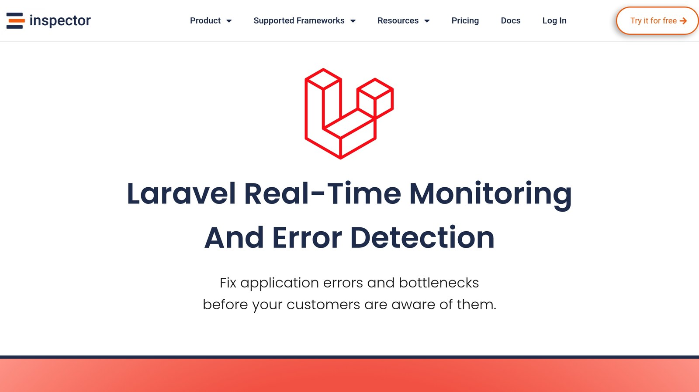

The `@can` [Laravel Blade](https://laravel.com/docs/master/authorization#via-blade-templates) directive is a simple way to manage user permissions directly in your templates. It works with Laravel's authorization system (policies and gates) to hide or show content based on user roles or actions. Here's what you need to know:

- **What It Does**: Checks if a user has permission to perform an action, like editing or deleting a post.

- **Why Use It**: Keeps your views secure, clean, and consistent by handling permissions in one place.

- **How to Use**: Wrap UI elements with `@can` or `@cannot` to restrict access. Example:

  ```blade
  @can('update', $post)
      <button>Edit Post</button>
  @endcan
  ```

- **Advanced Features**: Use `@canany` for multiple permissions, pass extra parameters for complex checks, and handle unauthenticated users securely.

## Quick Overview

1. **Setup**: Define policies using `php artisan make:policy`, register them in `AuthServiceProvider`, and map methods like `update` or `delete`.
2. **Directives**: Use `@can`, `@cannot`, and `@canany` in your templates for conditional rendering.
3. **Tips**: Ensure correct parameter matching between directives and policy methods, and use `Gate::before` for admin overrides.

Laravel's `@can` makes authorization seamless and keeps your views secure. Dive into the article for step-by-step guidance and examples.

## Creating Policies for @can

### Create Policies with [Artisan](https://laravel.com/docs/11.x/artisan)

Laravel makes policy creation easier with its Artisan command. To generate a policy with methods tailored to a specific model, run:

```bash
php artisan make:policy PostPolicy --model=Post
```

This command creates a policy file with methods for common actions on the model.

### Define Policy Methods

Policy methods take the authenticated user as the first argument and usually the model instance as the second. Here's an example of a `PostPolicy`:

```php
class PostPolicy
{
    public function delete(User $user, Post $post)
    {
        return $user->id === $post->user_id || $user->isEditor();
    }
}
```

In this case, the `delete` method allows post deletion if the user owns the post or has editor privileges[.](https://laravel.com/docs/11.x/authorization)

### Register Policies

Laravel provides two ways to register your policies:

**1. Manual Registration**

Manually map policies to models in `AuthServiceProvider.php`:

```php
use App\Models\Post;
use App\Policies\PostPolicy;

public function boot()
{
    $this->registerPolicies();
    Gate::policy(Post::class, PostPolicy::class);
}
```

**2. Wildcard Default Policy**

Set a default policy for all models using a wildcard:

```php
protected $policies = [
    '*' => 'App\Policies\DefaultPolicy',
];
```

To give administrators full access while maintaining other permissions, you can use a `Gate::before` check:

```php
Gate::before(function ($user, $ability) {
    return $user->isAdmin() ? true : null;
});
```

After registering, these policies enable the use of `@can` directives in your Blade templates[.](https://laravel.com/docs/11.x/authorization)

## Implementing @can in Templates

Once your policies are set up, you can use them directly in your Blade templates to manage access control. Here's how:

### Basic @can Usage

The `@can` directive checks if a user has permission for a specific action. For example:

```blade
@can('update', $post)
    <a href="{{ route('posts.edit', $post) }}">Edit</a>
@elsecan('create-post')
    <button>New Post</button>
@endcan
```

In this snippet, the user can either edit the post or, if not, see the option to create a new one.

### Using Multiple Parameters in @can

Sometimes, you need to pass extra data to your policy methods. Here's an example:

```blade
@can('update', [$post, 'draft'])
    <button>Save Draft</button>
    <button>Publish</button>
@endcan
```

The associated policy method would look like this:

```php
public function update(User $user, Post $post, string $status)
{
    return $user->id === $post->user_id && $status === 'draft';
}
```

This approach gives you flexibility to handle more complex scenarios.

### @cannot and @canany Directives

For cases where you want to check if a user *cannot* perform an action, use `@cannot`:

```blade
@cannot('delete', $post)
    <div>Only post owners can delete this content.</div>
@endcannot
```

If you need to check multiple permissions, use `@canany`:

```blade
@canany(['publish', 'feature', 'promote'], $post)
    @can('publish', $post)<button>Publish</button>@endcan
    @can('feature', $post)<button>Feature</button>@endcan
@endcanany
```

This is useful for displaying options based on different permissions.

### Handling Unauthenticated Users

To handle unauthenticated users in your templates, you can set your policy methods to accept nullable arguments:

```php
public function view(?User $user, Post $post)
{
    if ($user === null) {
        return $post->is_public;
    }
}
```

This ensures that your templates remain secure, even when dealing with guests.

## Advanced @can Features

Laravel's `@can` directive provides more than just basic permission checks. It enables sophisticated authorization patterns that improve both security and code organization. Let’s dive into some practical implementations.

### Policy Filters for Admins

You can use the `before` method in policies to allow admin overrides:

```php
public function before($user, $ability)
{
    return $user->isAdmin(); // Grants full access
}
```

This method ensures admins have unrestricted access. Additionally, Laravel supports both instance-level and class-level model authorization, offering flexibility in how permissions are applied.

### Simplify Logic with @canany

The `@canany` directive is perfect for scenarios where multiple permissions need to be checked in your templates:

```php
@canany(['publish', 'schedule', 'feature'], $article)
    <!-- Action buttons -->
@else
    <p>No management permissions</p>
@endcanany
```

This reduces clutter in your templates and makes permission checks more readable while handling multiple conditions efficiently.

### Model-Based Authorization

Laravel's model-based authorization allows two main approaches:

| Type | Syntax | Use Case |
| --- | --- | --- |
| Instance | `@can('update', $post)` | For a specific item |
| Class | `@can('create', Post::class)` | For general actions |

For more complex scenarios involving multiple models, you can define custom policy methods. For example:

```php
public function transferPost(User $user, Post $post, Category $category)
{
    return $user->id === $post->user_id && 
           $category->allows_transfers && 
           $post->status === 'published';
}
```

In your templates, pass the required parameters explicitly:

```php
@can('transferPost', [$post, $targetCategory])
    <button class="transfer-btn">Transfer to {{ $targetCategory->name }}</button>
@endcan
```

This method keeps your templates clean and supports complex, multi-model authorization logic with ease.

## Fix Common @can Issues

Even with a well-configured policy setup, developers can still face challenges when using `@can`. Here’s how to tackle some of the most common issues:

### Fix Policy Detection

If policies aren't being detected, the problem often lies in how they're implemented or configured. Here's an example of a properly named policy:

```php
// Example of correct policy naming
class PostPolicy // This matches the Post model
{
    public function view(User $user, Post $post)
    {
        return $user->id === $post->user_id;
    }
}
```

To make sure policies are detected correctly:

- Place your policies in the **app/Policies** directory.

- Clear the configuration cache by running:

  ```bash
  php artisan config:clear
  ```

### Correct Parameter Errors

Mismatched parameters between `@can` directives and policy methods can lead to unexpected results. Here are some common issues and their fixes:

| Problem | Incorrect Usage | Correct Usage |
| --- | --- | --- |
| **Parameter Count** | `@can('update', $post, $extra)` | `@can('update', $post)` |
| **Model Binding** | `@can('view', $id)` | `@can('view', $post)` |
| **Type Mismatch** | `@can('publish', $postArray)` | `@can('publish', $post)` |

### Monitor with [Inspector](/laravel/)



Inspector is a tool that provides real-time tracking for authorization issues. To monitor `@can` usage with Inspector, update the configuration file:

```php
// Update config/inspector.php
return [
    'monitoring' => [
        'authorization' => true,
        'policies' => true
    ]
];
```

Inspector’s dashboard allows you to keep an eye on:

- Failed authorization attempts
- Policy execution times
- Authorization-related exceptions

For detailed setup instructions, refer to Inspector’s Laravel documentation.

## Summary

### Key Points

Here’s a breakdown of the main principles for secure and efficient template authorization, building on the earlier implementation steps:

**Policy Implementation**

These steps focus on setting up policies to support template authorization effectively:

- Set up **model-specific policies** with detailed methods, registered via `AuthServiceProvider`.
- Define specific methods like `view`, `create`, `update`, and `delete` within your policies.
- Register these policies in `AuthServiceProvider` to enable automatic resolution.

**Template Integration**

When working within templates:

- Use `@can`/`@cannot` directives with model instances for authorization checks, and rely on `@canany` for handling multiple conditions.
- Avoid overloading templates with too many authorization checks.

**Best Practices**

To maintain clarity and consistency:

- Follow naming conventions like pairing models with their corresponding policies (e.g., `Post → PostPolicy`).
- Ensure parameter types are properly validated.

### Further Learning

If you want to dive deeper into Laravel authorization beyond Blade templates, consider exploring:

**Core Laravel Features**

- Use **Gates** as an additional method for handling authorization .

For more details, refer to these resources:

- Laravel's official authorization documentation.
- Community discussions on Laravel’s GitHub.

## Related Blog Posts

- [Laravel Logging: Setup and Use](/log-channels-in-laravel-setup-and-use/)
- [Laravel Query Profiling: Tools and Techniques](/laravel-query-profiling-tools-and-techniques/)
- [5 Common Laravel Exceptions Explained](/5-common-laravel-exceptions-explained/)
- [Real-Time XSS Detection with Laravel](/real-time-xss-detection-with-laravel/)
