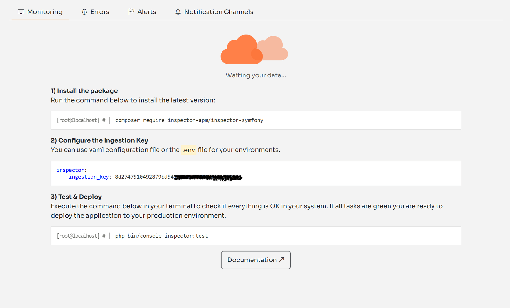
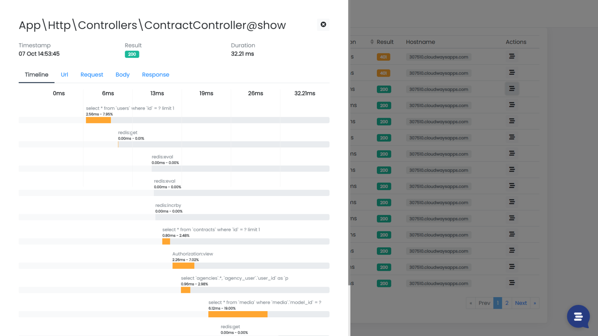
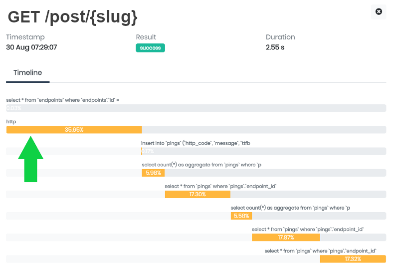
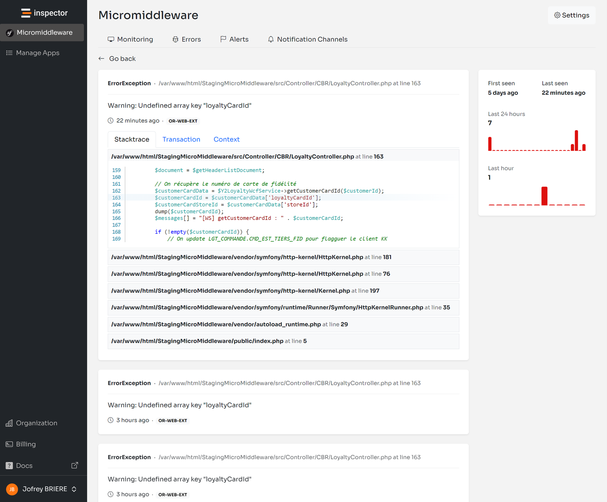

As a product owner, you may have experienced how much negative impact application issues can have on your customers' experience. They can block new potential customers during onboarding or even create a negative perception of the quality of your work.

Users don't spend their time reporting bugs, they just stop using your application if it doesn't work as expected, looking for another one that fits their needs better.

The idea behind Inspector is to create an application monitoring tool specifically designed for software developers. Therefore, it avoids any server or infrastructure configuration that developers hate dealing with.

I designed the tool around a simple package that you can install and use for free so you will never have to install things on the server or make complex configurations at the infrastructure level. In case of Symfony you can use the official [Symfony Bundle](https://github.com/inspector-apm/inspector-symfony).

Developers are not always comfortable installing and configuring software at the server level. These installations are out of their software development lifecycle or are even managed by external teams.

Forcing teams with different goals (Developers, IT infrastructure, Cyber Security, etc.) to work with the same tools can cause confusion. And it can compromise developers’ ability to quickly identify and resolve problems.

Inspector allows developers to have a code-driven monitoring environment entirely under their control. So they will be the first to know if the application is in trouble.

## Symfony Code Execution Monitoring: how it works

Inspector is a [Symfony bundle](https://github.com/inspector-apm/inspector-symfony) to add real-time code execution monitoring to your application, allowing you to work on continuous code changes while catching bugs and bottlenecks in real-time before users do.

It takes less than one minute to get started. Let's see how it works.

### Install the Symfony bundle

Run the composer command below in your terminal to get the latest version:

```bash
composer require inspector-apm/inspector-symfony
```

### Configure the Ingestion Key

Get a new Ingestion key by signing up for Inspector ([https://app.inspector.dev/register](https://app.inspector.dev/register)) and creating a new project, it takes a few seconds.

You'll see installation instructions directly in the app screen:



Create the **inspector.yaml** configuration file in your **config/packages** directory, and put the **ingestion_key** field inside:

```yaml
inspector:
    ingestion_key: [your-ingestion-key]
```

### Test everything is working

Execute the **inspector:test** command to check if your app sends data to Inspector correctly:

```bash
php bin/console inspector:test
```

Go to [https://app.inspector.dev/home](https://app.inspector.dev/home) to explore the demo data.

By default, Inspector traces:

- HTTP requests
- Database queries
- Console commands
- Twig view redering
- Background Messenger Operations
- Unhandled Exceptions

## Explore your application's performance metrics

When your application receives a request, Inspector automatically detects the most important events executed to fulfill the request. Then, it creates a visual representation of what happens inside your code during its regular operation.

Transactions stream in your dashboard in real-time, and for each transaction, you can monitor what your application is doing:



## Add custom segments to the timeline

Inspector monitors database queries, HTTP requests, and console commands by default. Still, there might be critical statements in your code that you need to monitor for performance and errors. Such as:

- Http calls to external services
- Function that deals with files (pdf, excel, images)
- Data Import/Export processes

**Thanks to Inspector, you can add custom segments in your timeline besides those detected by default. This functionality allows you to monitor a custom code block’s impact on application performance.**

Let’s look at a real-life example.

Suppose you have an HTTP route that executes some database operations and performs an HTTP call to an external service.

Inspector automatically detects database queries. But, it would be interesting to see the external HTTP request in the timeline to monitor its execution over time and activate alerts if something goes wrong.

```php
class BlogController extends AbstractController
{
    /**
     * @Route("/posts/{slug}", methods="GET", name="blog_post")
     */
    public function postShow(Post $post): Response
    {
        $tags = this->externalService->get('tags');

        return $this->render('blog/post_show.html.twig', compact('post', 'tags'));
    }
}
```

You can wrap the external service call with a segment to add it to the transaction’s timeline. Type hint the Inspector service into the controller method to access the Inspector instance:

```php
use Inspector\Inspector;

class BlogController extends AbstractController
{
    /**
     * @Route("/posts/{slug}", methods="GET", name="blog_post")
     */
    public function postShow(Post $post, Inspector $inspector): Response
    {
        $tags = $inspector->addSegment(function () {
            return this->externalService->get('tags'); // return value will be transparently returned back.
        }, 'http');

        return $this->render('blog/post_show.html.twig', compact('post', 'tags'));
    }
}
```



## Errors & Exceptions Alerting

**Every unhandled exception fired in your Symfony app is automatically reported by default. You'll be alerted for unpredictable errors in real-time.**

We all wish that every change to your code is perfect. But the reality is that this is not always the case. Some errors appear immediately after an update, while others pop up later unexpectedly. Many errors often depend on connection issues between your application and other services and are even more difficult to understand just looking at logs.

Inspector makes your job easier. It automates the detection of unknown issues. You no longer need to manually check the status of your apps or await reports from users. If something does go wrong, you'll receive a notification in real-time. And after each release, you stay informed about the impact of the latest code changes overtime.

If your code fires an exception, but you don't want to block the execution, you can manually report the error to Inspector for personal monitoring:

```php
try {

    // Your dangerous external call here...

} catch (GuzzleException $exception) {
    $inspector->reportException($exception)
}
```


