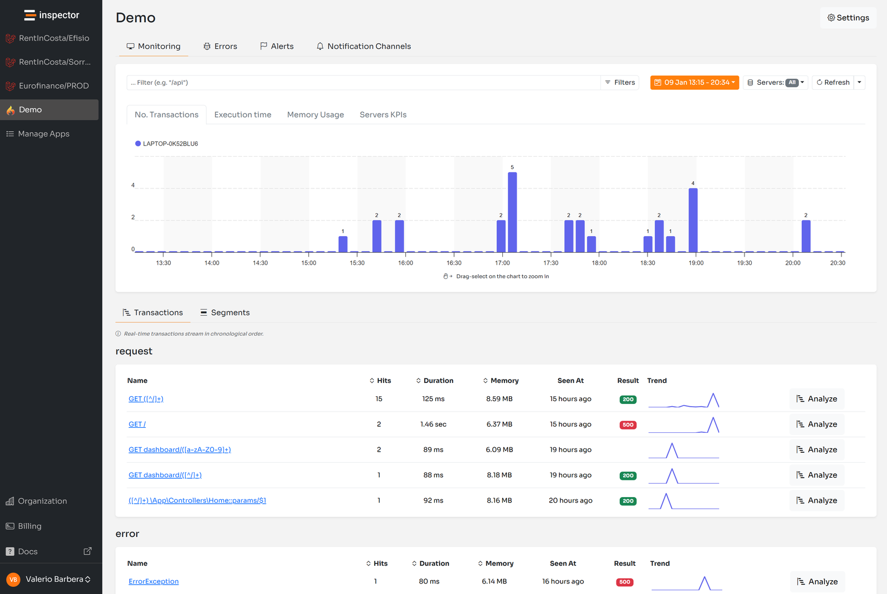
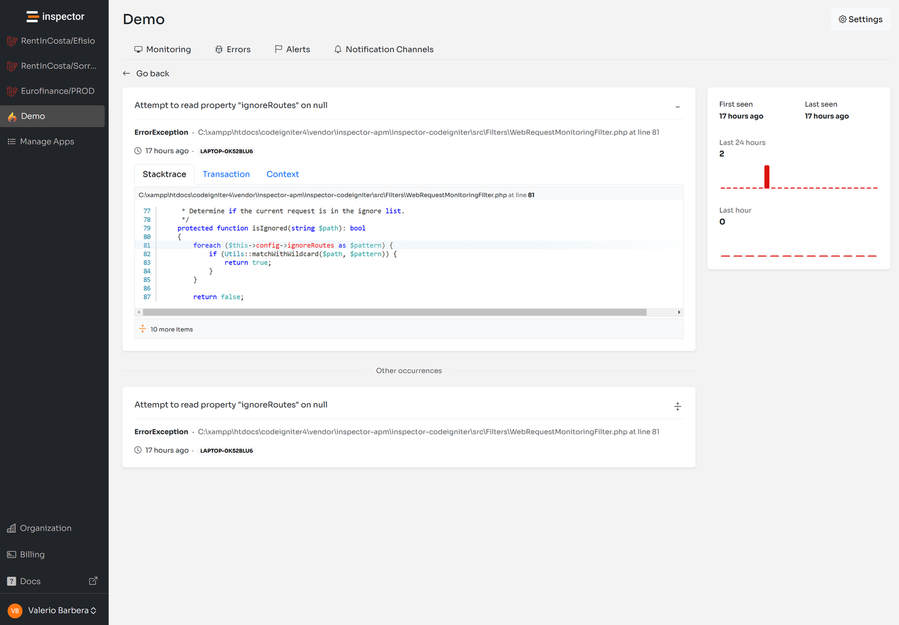

I’ve finally built the CodeIgniter monitoring package.

I spent so much time building this monitoring library because I felt a significant gap in the monitoring space for CodeIgniter framework. I think that often the CodeIgniter community gets overlooked by larger monitoring solutions.

Sentry, Bugsnag, and other well known tools do not offer native integration for this framework and a lot of developers struggle to adopt this kind of technology. I decided to try to solve this problem by creating monitoring libraries for more specialized niches like Symfony, CodeIgniter, and Slim framework.

They might not be interesting for big SaaS companies, but for me it's completely different. I'm a bootstrapped founder with two other friends that help me maintain the company, so I can be free to build the product.

I come basically from nothing, working from my home in the south of Italy for 5 years now. Finally Inspector took off the ground after two years and now we have more room to go deeper into specific technologies where we can provide great value due to the lack of solutions.

We rejected a lot of VC proposals along the way because of their tendency to scale up the market and target big corporations. We definitely rejected this idea. We started this journey trying to help other software creators to make their life easier with powerful solutions. And we have been growing consistently for five years thanks to this different position against the market.

I had the wonderful opportunity to support developers in every corner of the world literally (US, Australia, Argentina, Kenya, Singapore, Germany, etc), and I'm so grateful for that.

I hope the Inspector package for CodeIgniter can be the right monitoring solution for developers that love to work with this framework, without the need to manually integrate libraries and tools, or implement tricky configurations.

I designed the package to guarantee the best possible developer experience. As CodeIgniter exerts you can for sure identify many ideas to improve it. Feel free to send us your feedback or open new issues on the [**GitHub**](https://github.com/inspector-apm/inspector-codeigniter) [**repository**](https://github.com/inspector-apm/inspector-codeigniter). We are here to help make it better over time.

Let’s get started!

## Install CodeIgniter monitoring package

Install the latest version using the composer command below:

```bash
composer require inspector-apm/inspector-codeigniter
```

Run the install command to publish the **Inspector.php** configuration file in your application **app/Config** directory:

```bash
php spark inspector:install
```

## Configure the Ingestion Key

Add the environment variable below to your *.env* file in order to enable data transfer from your application to your Inspector dashboard. You can get a new Ingestion Key by creating a new app in your account: [https://app.inspector.dev](https://app.inspector.dev)

```properties
#--------------------------------------------------------------------
# INSPECTOR
#--------------------------------------------------------------------

inspector.ingestionKey = '974yn8c34ync8xxxxxxxxxxxxxxxxxxxxxxxxxxxxx'
```

## Verify And Deploy

Run the command below to check if your system is properly configured. If all checks are green you can deploy the update in your production environment.

```bash
php spark inspector:test
```

By default Inspector will monitor:

- Incoming HTTP requests
- Spark Commands
- Database queries
- Unhandled Exceptions



## Helper

**We highly recommend** adding the helper in the *Config/Autoload.php* configuration class to make it available globally into the application:

```php
class Autoload extends AutoloadConfig
{
    ...
    
    /**
     * -------------------------------------------------------------------
     * Helpers
     * -------------------------------------------------------------------
     * Prototype:
     *   $helpers = [
     *       'form',
     *   ];
     *
     * @var list<string>
     */
    public $helpers = ['inspector'];
}
```

The helper provides a shortcut to the inspector instance to monitor custom code blocks or manually report specific exceptions.

```php
// Load the helper if you haven't added it to Autoload.php
helper('inspector');

// Monitor custom code blocks
$json = inspector()->addSegment(function () {
    return file_get_contents('auth.json');
}, 'http', 'READ auth.json');

// Report an exception
inspector()->reportException(new \Exception("Whoops there's an error here."));
```

Learn more about custom Segments here: [https://docs.inspector.dev/guides/raw-php/custom-segments](https://docs.inspector.dev/guides/raw-php/custom-segments)

## CodeIgniter Monitoring Exceptions

By default every Unhandled Exception will be reported automatically to be sure you'll be alerted for unpredictable errors in real time.

Inspector offers the ability to connect several notification channels to your project like Email, Slack, Telegram, Discord, and others, so you can integrate your monitoring system with your preferred communication environment.

Using the Inspector instance inside your application you can also report an exception manually if you want to be aware of it, but you don't want to block the execution of your code:

```php
helper('inspector'); // You don't need this if you autoload inspector globally

try {

    // Your code statements here...

} catch(LogicException $exception) {
    // Report an exception intentionally to collect diagnostics data
    inspector()->reportException($exception);
}
```

If something goes wrong in your code you will be alerted in real time and the exception will be monitored for all subsequent occurrences. You can also read the code inside the stacktrace to immediately understand the line of code is generating the issue:



## Monitor your CodeIgniter application for free

If you are looking for HTTP monitoring, database query insights, Error detection, and the ability to forward alerts and notifications into your preferred messaging environment [**try Inspector for free**](https://app.inspector.dev/register).

We offer first party library you can enjoy a full featured experience with zero configurations.

Or learn more on the website: **[https://inspector.dev](/)**
