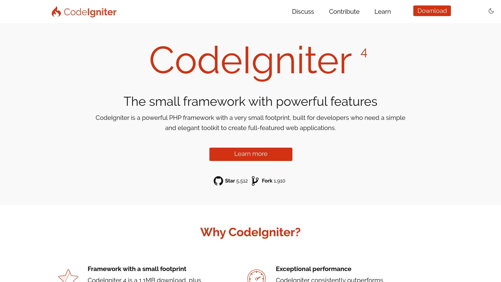
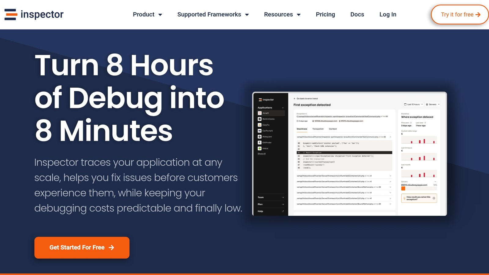

**Monitoring your** [**CodeIgniter**](https://codeigniter.com/) **application is crucial to ensure smooth performance and quickly address issues.** Here’s a quick overview of the tools and techniques available:

- **Built-in Logging**: Tracks errors, debug messages, and system events. Best for basic debugging.
- **CodeIgniter Profiler**: Offers insights on memory usage, execution times, and database queries. Ideal for development and optimization.
- [**Inspector**](/): Advanced real-time monitoring with error alerts, slow query detection, and team collaboration. Suitable for production environments.

**Quick Comparison**:

| Feature | Built-in Logging | CodeIgniter Profiler | Inspector |
| --- | --- | --- | --- |
| Real-time Monitoring | No | Only on local env | Yes |
| Setup Complexity | Simple | Simple | Simple |
| Performance Impact | Minimal | Not for production env | Low |
| Team Collaboration | Basic | Limited | Unlimited users |
| Error Detection | Logs errors | Manual review | AI Bug Fix |
| Query Analysis | No | Basic | Advanced |
| Cost | Free | Free | Free plan + Premium options |

**Choose the right tool based on your project’s size, complexity, and environment needs.** Built-in tools are great for debugging and development, while advanced options like Inspector excel in production settings.

## 1. Built-in Logging System

CodeIgniter includes a logging system located in `application/logs`, which helps track application events and issues.

The system uses different severity levels to control what gets logged:

| Log Level | Purpose | Typical Usage |
| --- | --- | --- |
| DEBUG | Detailed debugging details | Useful during development |
| INFO | General system updates | Tracks runtime status |
| ERROR | Runtime errors | Logs critical application issues |
| CRITICAL | Severe failures | Captures major system breakdowns |

You can configure logging settings in `app/Config/Logger.php` for version 4.x or `config/config.php` for older versions. These settings allow you to define thresholds for the types of messages to log.

Here’s how you might use it:

```php
log_message('error', 'Database connection failed: Connection timeout');
log_message('info', 'User authentication successful');
```

**Log Rotation**

To prevent logs from becoming too large, you can enable log rotation. For example, you might set logs to rotate daily and keep them for 30 days.

### Security Tips for Logging

- **Restrict access**: Set proper file permissions to protect log files.
- **Avoid sensitive data**: Do not log user credentials or other private information.
- **Review regularly**: Check logs for any potential security issues.
- **Store securely**: Keep log files outside the public web directory.

To improve logging, you can route critical errors to files while sending debug messages to the browser using handlers. Be mindful of the trade-off between logging detail and performance, especially in production environments.

## 2. [CodeIgniter](https://codeigniter.com/) Profiler Features



The Profiler in CodeIgniter is a built-in tool that helps track performance and debug your application by providing detailed insights. Here's a closer look at what it offers and how to use it.

### Enabling the Profiler

To turn on the Profiler, update your `config.php` file:

```php
$config['enable_profiler'] = TRUE;
```

You can also enable it for specific controllers:

```php
$this->output->enable_profiler(TRUE);
```

### Key Profiling Metrics

The Profiler provides a range of performance metrics:

| Metric Type | Information Provided | Usage |
| --- | --- | --- |
| **Database Analysis** | Query execution times, total queries | Pinpoints slow SQL queries |
| **Memory Usage** | Peak and current memory consumption | Highlights potential memory leaks |
| **Controller Load Time** | Execution time per controller | Identifies slow-loading pages |
| **View Rendering Stats** | Template processing duration | Improves view performance |

### Database Profiling Features

To analyze database performance, enable query logging:

```php
$this->db->save_queries = TRUE;
```

This lets you examine:

- Execution times for individual queries
- Patterns in query frequency
- Resource-heavy operations
- Opportunities to refine and optimize queries

### Memory Management Tracking

The memory profiler keeps tabs on resource usage, including:

- **Peak Memory Usage**: Helps locate memory-heavy processes
- **Memory Allocation**: Tracks how resources are distributed
- **Memory Leaks**: Flags inefficient or unoptimized code

### Best Practices for Using the Profiler

- **Use in Development Only**: Enable profiling during development to avoid exposing sensitive information.
- **Focus on Critical Controllers**: Profile specific areas and review the data regularly.
- **Disable in Production**: Turn off the Profiler in live environments for security and performance reasons.

You can also add custom benchmarks to track specific operations:

```php
$this->benchmark->mark('my_operation_start');
/* your code */
$this->benchmark->mark('my_operation_end');
```

The Profiler is a powerful tool for [monitoring and debugging](/monitoring-solutions-for-developers-why-monitoring-could-be-a-crap/) CodeIgniter applications. By analyzing its data and applying optimization strategies, you can ensure your application performs efficiently without unnecessary overhead.

## 3. [Inspector](/) Monitoring Platform



Inspector takes [CodeIgniter monitoring](https://docs.inspector.dev/guides/codeigniter/installation) to the next level with [real-time debugging](/) and performance tracking. It integrates directly into your application with no need for complex cloud setups.

### Real-Time Monitoring Features

Inspector keeps an eye on your application with these key features:

| Feature | What It Does | Why It Matters |
| --- | --- | --- |
| **HTTP Traffic Monitoring** | Tracks incoming requests and response times | Helps pinpoint request bottlenecks |
| **Slow SQL Query Detection** | Flags slow database queries | Improves database performance |
| **Background Task Insights** | Visualizes asynchronous task execution | Ensures tasks run efficiently |
| **Real-Time Error Alerts** | Detects runtime issues immediately | Speeds up issue resolution |

### Smarter Error Management

Inspector goes beyond CodeIgniter's standard error tracking. It doesn’t just detect errors - it analyzes them and offers potential fixes. This automated approach helps developers address problems faster and with less guesswork.

### Easy Integration

Setting up Inspector in your CodeIgniter project is simple. Just follow these steps:

```php
// Install using Composer
composer require inspector-apm/inspector-codeigniter

// Automatically install the configuration file
php spark inspector:install

// Configure the Ingestion Key in your environment file
inspector.ingestionKey = '974yn8c34ync8xxxxxxxxxxxxxxxxxxxxxxxxxxxxx'
```

Once integrated, Inspector not only monitors your app but also simplifies team collaboration.

### Built for Teams

Inspector's tiered plans make it great for teams. The free plan supports up to 3 members, while the team plan expands to 5 members - perfect for small to medium-sized groups working together.

## Tool Comparison

Here's a summary of the key features and applications of various CodeIgniter monitoring tools:

| Feature | Built-in Logging | CodeIgniter Profiler | Inspector |
| --- | --- | --- | --- |
| **Real-time Monitoring** | No | Only for local env | Yes |
| **Setup Complexity** | Simple | Simple | Simple |
| **Performance Impact** | Minimal | Not for production env | Low |
| **Team Collaboration** | Basic | Limited | Unlimited users |
| **Error Detection** | Logs errors | Manual review | AI Bug Fix |
| **Query Analysis** | No | Basic | Advanced |
| **Cost** | Free | Free | Free plan + Premium options |

### Practical Applications

The **Built-in Logging System** works best for simple development environments. It’s a great choice for small projects or individual developers who need basic error tracking without any complex setup.

The **CodeIgniter Profiler** is better suited for development and staging environments where detailed insights into database queries, loading times, and memory usage are crucial. It’s a handy tool for performance optimization efforts.

**Inspector** is ideal for production environments that need real-time monitoring and automated bug detection. With features like team collaboration for up to 5 members, it’s a strong choice for medium-sized teams handling complex applications.

Choose a tool based on your project’s needs, team size, and application complexity.

### Performance and Integration

Built-in tools have minimal impact on performance, while advanced tools like Inspector are designed to maintain low overhead through efficient processing. Here's a breakdown of setup and learning requirements:

| Tool | Setup Time | Configuration Needed | Learning Curve |
| --- | --- | --- | --- |
| Built-in Logging | 30 minutes | Minimal | Low |
| CodeIgniter Profiler | 30 minutes | Basic | Low |
| Inspector | 5 minutes | Minimal | Medium |

For enterprise-level applications needing extensive monitoring, combining CodeIgniter’s native tools with an advanced solution like Inspector can offer thorough and reliable oversight.

## Conclusion

Choosing the best tool comes down to what your project needs. The built-in logging system is a solid choice for basic requirements, offering straightforward error tracking without any extra cost. It's especially useful for development environments or individual developers who need a simple solution.

For applications that are scaling and need deeper insights, the CodeIgniter Profiler is a great option. It tracks database queries and memory usage, making it a handy tool during the optimization phase, even though it may not cover all the needs of a production environment.

When built-in options don't cut it for production, advanced platforms step in to fill the gap. For enterprise-level applications, specialized tools can make a big difference. **Inspector** is a great pick for teams managing complex systems, offering features like:

- **Real-time HTTP traffic monitoring**
- [**Automated bug fixes**](/ai-bug-fixer/)
- **Support for small teams**
- **Easy integration without cloud setup**

For critical projects, tools like **Inspector** can save debugging time and improve reliability.

## Related Blog Posts

- [Real-Time Error Tracking vs. Log Analysis: A Comparison](/real-time-error-tracking-vs-log-analysis-a-comparison/)
- [Error Pattern Recognition in PHP Applications](/error-pattern-recognition-in-php-applications/)
- [Laravel Query Profiling: Tools and Techniques](/laravel-query-profiling-tools-and-techniques/)
- [How to Benchmark PHP Code Performance](/how-to-benchmark-php-code-performance/)
