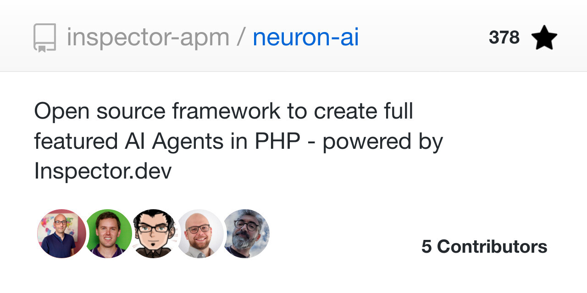
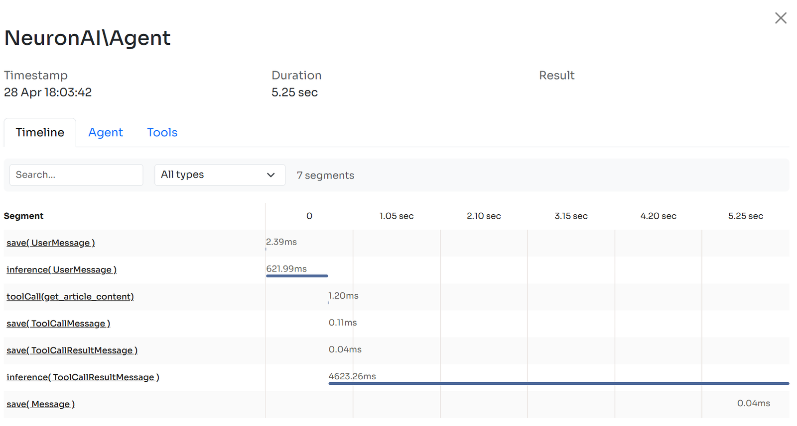

The PHP ecosystem is rapidly evolving compared to Python and JavaScript frameworks for AI Agents development thanks to Neuron AI, a powerful PHP framework that's bringing access to advanced AI capabilities for PHP developers. Today marks another significant milestone as Neuron AI expands its provider support to include Google Gemini, responding directly to community demand through a recent user poll.

This latest addition joins Neuron's already impressive lineup of supported AI providers, including Anthropic (Claude), OpenAI (GPT models), and Ollama (for self-hosted deployments). By integrating Google Gemini, Neuron continues to fulfill its mission of creating the most flexible and powerful AI toolkit for PHP developers, allowing them to leverage cutting-edge language models without switching their tech stack.

Whether you're building conversational agents, content generators, or complex AI-powered business applications, Neuron's intuitive API makes it remarkably straightforward to create, deploy, and manage AI agents directly within your PHP codebase. The addition of Google Gemini support opens up new possibilities, particularly for developers who want to take advantage of Gemini's unique strengths in multimodal reasoning and cost-effective performance.

In this article, we'll explore how to leverage Neuron AI with Google Gemini to create sophisticated AI agents in PHP, demonstrate practical use cases, and show why this combination is becoming an essential tool for forward-thinking PHP developers who want to remain competitive in the rapidly evolving AI landscape.

You can explore the Neuron AI GitHub repository here[:](https://github.com/inspector-apm/neuron-ai)

[](https://github.com/inspector-apm/neuron-ai)

## Install Neuron AI

Neuron ships as a composer package and it is completely independent by any framework. Being a stand alone module allows you to integrate AI Agents into any existing stack with just a few steps.

Install the latest version with the command below:

```bash
composer require inspector-apm\neuron-ai
```

## Create Your AI Agent Powered By Gemini

You can create your agent just by extending the NeuronAI\\Agent class to inherit the main features of the framework and create fully functional agents. This class automatically manages some advanced mechanisms for you such as memory, tools and function calls, up to the RAG systems. We will go into more detail about these aspects in the following sections.

This implementation strategy ensures the portability of your agent because all the moving parts are encapsulated into a single entity that you can run wherever you want in your application, or release as stand alone composer packages.

Let's start creating the `YouTubeAgent` class extending `NeuronAI\Agent`:

```php
use NeuronAI\Agent;
use NeuronAI\Providers\AIProviderInterface;
use NeuronAI\Providers\Gemini\Gemini;

class YouTubeAgent extends Agent
{
    protected function provider(): AIProviderInterface
    {
        return new Gemini(
            key: 'GEMINI_API_KEY',
            model: 'GEMINI_MODEL',
        );
    }
}
```

The only required method to implement is provider(). It's where we assign the agent the connection to the LLM we want to use. We can return an instance of the new Gemini AI provider.

You can also use other providers like OpenAI, Anthropic, or Ollama if you want to run the model locally. Check out the [supported providers](https://docs.neuron-ai.dev/components/ai-provider).

## System instructions

The second important building block is the system instructions. System instructions provide directions for making the AI ​​act according to the task we want to achieve. They are fixed instructions that will be sent to the LLM on every interaction.

That’s why they are defined by an internal method, and stay encapsulated into the agent entity. Let's implement the instructions() method:

```php
use NeuronAI\Agent;
use NeuronAI\SystemPrompt;
use NeuronAI\Providers\AIProviderInterface;
use NeuronAI\Providers\Gemini\Gemini;

class YouTubeAgent extends Agent
{
    protected function provider(): AIProviderInterface
    {
        return new Gemini(
            key: 'GEMINI_API_KEY',
            model: 'GEMINI_MODEL',
        );
    }
    
    public function instructions(): string
    {
        return new SystemPrompt(
            background: ["You are an AI Agent specialized in writing YouTube video summaries."],
            steps: [
                "Get the url of a YouTube video, or ask the user to provide one.",
                "Use the tools you have available to retrieve the transcription of the video.",
                "Write the summary.",
            ],
            output: [
                "Write a summary in a paragraph without using lists. Use just fluent text.",
                "After the summary add a list of three sentences as the three most important take away from the video.",
            ]
        );
    }
}
```

The SystemPrompt class is designed to take your base instructions and build a consistent prompt for the underlying model reducing the effort for prompt engineering. You car learn more about system instructions in the following article:

[System Prompt for AI Agents In PHP](/system-prompt-for-ai-agents-in-php/)

## Talk to the PHP Agent

We are ready to test how the agent responds to our message based on the new instructions.

```php
use NeuronAI\Chat\Messages\UserMessage;

$response = YouTubeAgent::make()
    ->chat(
        new UserMessage("Who are you?")
    );
    
echo $response->getContent();
// Hi, I'm a frindly AI agent specialized in summarizing YouTube videos!
// Can you give me the URL of a YouTube video you want a quick summary of?
```

The agent always accepts input as a Message class, and returns Message instances.

As you saw in the example above we sent a UserMessage instance to the agent and it responded with an AssistantMessage instance. A list of assistant messages and user messages creates a chat.

We can learn more about ChatHistory in the article below. It’s one of the most used components of the framework. For the purpose of this example it's important to know that the unified interface for the agent input and response is the Message object.

[AI Agents Memory And Context Window In PHP](/ai-agents-memory-and-context-window-in-php/)

## Tools & Function Calls

Tools enable Agents to go beyond generating text by facilitating interaction with your application services, or external APIs.

Think about Tools as special functions that your AI agent can use when it needs to perform specific tasks. They let you extend your Agent's capabilities by giving it access to specific functions it can call inside your code.

In the `YouTubeAgent` example we can define a tool to make the Agent able to retrieve the YouTube video transcription:

```php
use NeuronAI\Agent;
use NeuronAI\SystemPrompt;
use NeuronAI\Providers\AIProviderInterface;
use NeuronAI\Providers\Gemini\Gemini;
use NeuronAI\Tools\Tool;
use NeuronAI\Tools\ToolProperty;

class YouTubeAgent extends Agent
{
    protected function provider(): AIProviderInterface
    {
        return new Gemini(
            key: 'GEMINI_API_KEY',
            model: 'GEMINI_MODEL',
        );
    }
    
    public function instructions(): string 
    {
        return new SystemPrompt(
            background: ["You are an AI Agent specialized in writing YouTube video summaries."],
            steps: [
                "Get the url of a YouTube video, or ask the user to provide one.",
                "Use the tools you have available to retrieve the transcription of the video.",
                "Write the summary.",
            ],
            output: [
                "Write a summary in a paragraph without using lists. Use just fluent text.",
                "After the summary add a list of three sentences as the three most important take away from the video.",
            ]
        );
    }
    
    protected function tools(): array
    {
        return [
            Tool::make(
                'get_transcription',
                'Retrieve the transcription of a youtube video.',
            )->addProperty(
                new ToolProperty(
                    name: 'video_url',
                    type: 'string',
                    description: 'The URL of the YouTube video.',
                    required: true
                )
            )->setCallable(function (string $video_url) {
                // ... retrieve the transcription
            })
        ];
    }
}
```

There are some best practices you should follow to create consistent tools your agent can use appropriately, and you can also attach external tools connected with the MCP protocol. Follow the documentation for a deep dive: [https://docs.neuron-ai.dev/tools-and-function-calls](https://docs.neuron-ai.dev/tools-and-function-calls)

## Run your PHP Agent

We provided the agent with a tool to make it able to retrieve the YouTube video transcription when it thinks it's needed to complete the task.

Since we gave the agent this ability the interaction it's really simple:

```php
use NeuronAI\Chat\Messages\UserMessage;

$response = YouTubeAgent::make($user)
    ->chat(
        new UserMessage('What about this video: https://www.youtube.com/watch?v=WmVLcj-XKnM')
    );
    
echo $response->getContent();

/**

Based on the transcription, I'll provide a summary of this powerful environmental 
message from "Mother Nature":
This video presents a monologue from the perspective of Nature herself, 
speaking directly to humanity. In an authoritative tone, Nature reminds 
us that she has existed for 4.5 billion years—22,500 times longer than 
humans—and doesn't need people, though people depend entirely on her.

Three most important takeaways:

1. Nature has existed for billions of years without humans and will 
continue to exist regardless of human actions, but humans cannot 
survive without Nature.

2. The wellbeing of humanity is directly linked to the wellbeing of 
natural systems—oceans, soil, rivers, and forests.

3. How humans choose to act toward Nature determines humanity's future, 
not Nature's, as she is built to endure change while humans may not be.

*/
```

## Observability

Many of the Agents you build with Neuron AI will contain multiple steps with multiple invocations of LLM calls. As these applications get more and more complex, it becomes crucial to be able to inspect what exactly is going on inside your agents. The best way to do this is with [Inspector](/).

The Inspector team designed Neuron AI with built-in observability features, so you can monitor AI agents were running, allowing you to get meaningful insights from your agents to help you release and maintain AI Agents to your customers.

You have to install the Inspector package based on your development environment. We provide integration packages for [PHP](https://github.com/inspector-apm/inspector-php), [Laravel](https://github.com/inspector-apm/inspector-laravel), [Symfony](https://github.com/inspector-apm/inspector-symfony), [CodeIgniter](https://github.com/inspector-apm/inspector-codeigniter), [Drupal](https://docs.inspector.dev/guides/drupal).

Neuron AI integrates seamlessly with Inspector just installing the appropriate package. When your agent are being executed you will see the details of their internal steps on the Inspector dashboard.



You can find step-by-step instructions on how to connect your PHP Agent with Inspector in the [documentation](https://docs.neuron-ai.dev/advanced/observability).

## Bringing It All Together: The Future of AI in PHP

As we've demonstrated throughout this article, integrating Google Gemini's powerful LLMs into your PHP applications has never been easier. With just a few lines of code, Neuron transforms complex AI interactions into simple, maintainable PHP objects that seamlessly integrate with your existing systems.

The addition of Google Gemini to Neuron's roster of supported providers—alongside Anthropic's Claude, OpenAI's GPT models, and self-hosted Ollama solutions—gives PHP developers better flexibility. You can now choose the most appropriate AI provider based on your specific requirements, whether that's Gemini's excellent performance-to-cost ratio, Claude's nuanced understanding of complex instructions, or the privacy advantages of self-hosted models.

## What Sets Neuron Apart

Neuron doesn't just provide API wrappers—it offers a comprehensive framework for building sophisticated AI agents in PHP:

- **Provider Agnostic Design:** Easily switch between AI providers without rewriting your application logic
- **Context Management:** Maintain conversation history and state across interactions
- **Tool Integration:** Allow your AI agents to perform real-world actions through function calling
- **PHP-Native Experience:** Work with familiar PHP patterns and conventions

## Join the Neuron Community

We're excited to see what you'll build with Neuron and Google Gemini. Are you working on a customer support bot? A content generation system? Or perhaps something we haven't even imagined yet?

Share your projects, questions, and ideas on the [Neuron Forum](https://github.com/inspector-apm/neuron-ai/discussions). Our growing community is the perfect place to:

- Showcase your AI implementations
- Get help with specific integration challenges
- Suggest new features and providers
- Connect with other PHP developers exploring AI

For those new to AI agent development in PHP, I’ve documented the foundational patterns and progressive implementation approaches in an educational resource that walks through the basic development lifecycle — [Start With AI Agents In PHP](https://www.amazon.it/dp/B0F1YX8KJB)

Start building the future of your PHP applications today with Neuron AI.
