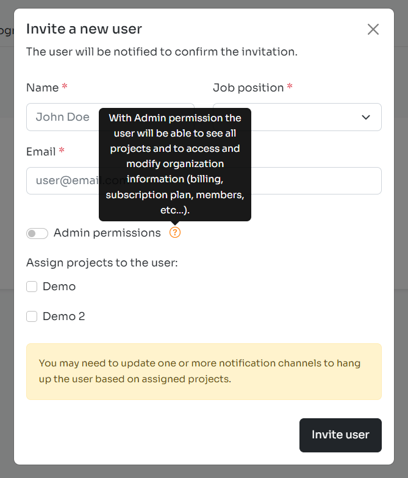
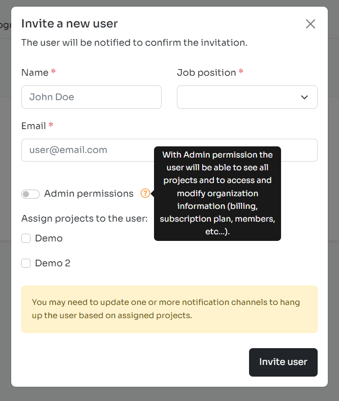

Custom directives in Vuejs 3 are one of those things where there is no compatibility with the previous version of the framework.

Working on the new version of the Inspector frontend dashboard I had the need to show tooltips in many different points of the application. The goal was immediately to avoid duplicate code.

Before entering the implementation of a custom tooltip directive in Vuejs 3 let me introduce the fundamentals of a good code reuse strategy in Vuejs.

## Code reuse in Vuejs

The most important forms for code reuse in Vuejs are [components](https://vuejs.org/guide/essentials/component-basics.html) and [composable](https://vuejs.org/guide/reusability/composables.html) if you write components with composition API.

The benefit of using components is that you can create complex user interfaces with ease, by breaking them down into smaller, reusable pieces. This makes it easier to maintain your code and allows you to make improvements to the user interface incrementally.

Vuejs provides other options for code reuse, such as mixins, directives, and plugins, which can further improve your code's maintainability and reusability. Mixins are reusable code blocks that can be added to a component (no more recommended in Vuejs 3), while directives are used to add custom behavior to HTML elements. Plugins, on the other hand, are packages that can be installed and used across multiple components in your application.

By leveraging these features, you can create powerful, scalable applications that are easy to maintain and extend.

If you want learn more strategies used to build our platform check out this article on how to implement an event-bus in Vuejs 3: [https://inspector.dev/why-and-how-to-create-an-event-bus-in-vuejs-3/](/why-and-how-to-create-an-event-bus-in-vuejs-3/)

## Custom directives in Vuejs 3

As mentioned in the documentation:

*Custom directives, on the other hand, are mainly intended for reusing logic that involves low-level DOM access on plain elements.*

A perfect tool to add features like "tooltip", "popover" and other Bootstrap components to DOM elements.

A directive in Vuejs is essentially an object with the same properties and hooks used in components. But in this case the hooks will receive the instance of the DOM element the directive is bound to.

```javascript
export default {
    mounted(el) {
        el.focus();
    }
}
```

To register the directive and make it available in the template you must pass the directive object to the app instance:

```javascript
const app = createApp({})

import tooltip from "./Directives/tooltip";

// make v-tooltip usable in all components
app.directive('tooltip', tooltip);
```

You can check out all the available lifecycle hooks in the [official documentation](https://vuejs.org/guide/reusability/custom-directives.html#directive-hooks).

## Custom tooltip directive for Vuejs 3

Why do we need to create a directive to show tooltips?

As mentioned in the Bootstrap 5 documentation you have to initialize Tooltips with javascript to make it visible:

```javascript
// HTML in your view
<a href="#" data-bs-toggle="tooltip" data-bs-title="Hello World!">Tooltip Example</a>


// Enable tooltip via Javascript 
const tooltipTriggerList = document.querySelectorAll('[data-bs-toggle="tooltip"]');

const tooltipList = [...tooltipTriggerList].map(tooltipTriggerEl => new bootstrap.Tooltip(tooltipTriggerEl));
```

But this code works in a static HTML page, where DOM elements are available yet the time the javascript code runs to activate all the tooltips in the view.

But a reactive frontend application works in the opposite way. Components are loaded dynamically with the user interaction. **So every tooltip included in the view after the first application bootstrap will not be activated and will remain hidden**.

We need to attach tooltips to the DOM elements dynamically the time the element is attached to the view.

A perfect use case for a custom directive in Vuejs.

```javascript title="./Directives/tooltips.js"
import {Tooltip} from "bootstrap";

// Use "mounted" hook
export default {
    mounted(el, binding) {
        let tooltip = new Tooltip(el, {
            placement: binding.arg || 'top',
            title: binding.value
        });
    }
}
```

Register the directive in the app instance to make it available in your components:

```javascript title="app.js"
import tooltips from "./Directives/tooltips.js";
app.directive(tooltips);
```

## How to use the tooltip directive

The code above allows you to set the behavior of the tooltip dynamically.

Default usage:

```html
<a href="#" v-tooltip="Hello World!">Tooltip Example</a>
```



*Tooltip on the top*

If you want change the placement of the tooltip you can pass it as an argument:

```html
<a href="#" v-tooltip:right="Hello World!">Tooltip Example</a>
```



*Tooltip on the right*

You can follow me on [**Linkedin**](https://www.linkedin.com/in/valeriobarbera/) or **[X](https://x.com/Barbalerio)**. I post about building my SaaS business.
