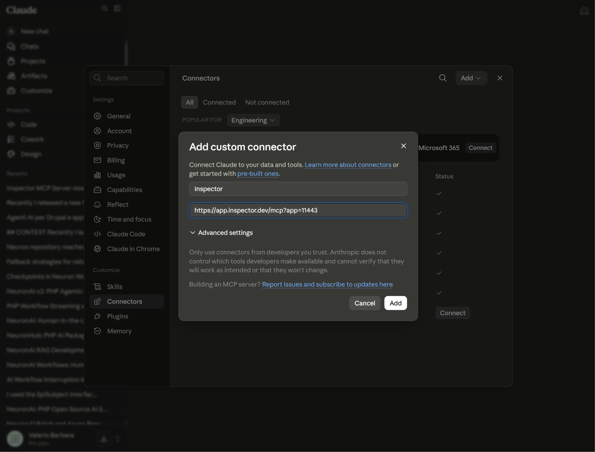
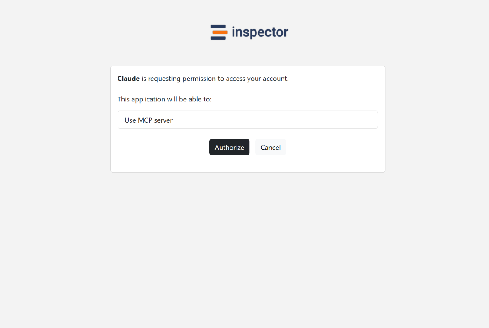
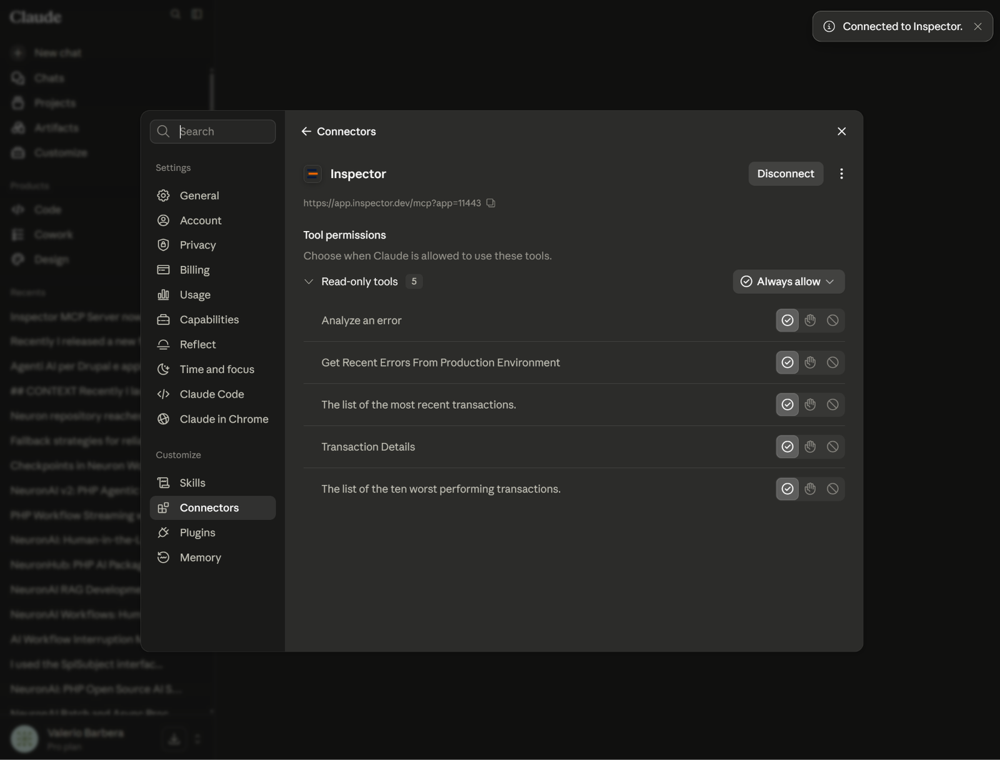

Last month I was at dinner when my phone buzzed with an Inspector alert: an error on one of our own endpoints. The old routine kicks in automatically at that point. Open the dashboard on a screen too small for it, squint at a stack trace, tell yourself "I'll look properly when I'm back at the laptop," and spend the rest of the evening with that specific low grade guilt of knowing something is broken and choosing to do nothing about it.

This time I didn't do that. I opened Claude on my phone, asked it to check what was going on with that endpoint, and within a couple of messages it had pulled the actual error, traced it to a query that started timing out after a data migration earlier that day, and proposed the fix. I reviewed it, it looked right, and the incident was basically closed before the table finished eating. That gap, between getting the alert and being able to do something real about it, is what we spent the last stretch of work closing.

## The part of the workflow nobody designed for

We built the Inspector MCP server so your AI coding assistant could read your production data directly: errors, response times, slow queries, the same information you'd normally go dig up in the dashboard. If you missed that first release, the [original announcement](/monitor-your-php-applications-through-your-ai-assistant-inspector-mcp-server/) covers what it does.

It worked well from day one, but only in one context: coding agents running on your own machine, like Claude Code or Cursor, where you paste your Inspector API token into a config file once and the tool uses it locally from then on. That's fine when the AI client lives on your laptop next to your code. It falls apart the moment the client is Claude or ChatGPT running as a hosted app in a browser or on your phone, because there's no config file there to paste a token into, and there shouldn't be. Hosted apps authenticate through OAuth, the login-and-approve flow you already know from connecting Slack or Google Drive to some other tool, not through a secret you copy and paste. Our server simply didn't speak that language yet, so the alert would land on your phone and the trail stopped right there. You could read that something broke. You couldn't do anything about it without switching devices.

That's the specific moment this update is built for. Not "AI assistants can now use Inspector data," which was already true, but the alert-to-fix path being unbroken end to end, on whatever device you're holding when the alert arrives.

## Connecting Inspector to your AI account, step by step

The whole point of this release is that there is no JSON configuration and no API token involved anymore. If you tried the first version and remember editing a config file, forget that part. Here is the actual flow, using Claude as the example, because it's the client I use most. ChatGPT and other web based agents follow the same pattern under different menu names.

### Step 1: add the connector with just a URL

In Claude, open Settings and go to the Connectors section, then choose to add a custom connector. You give it a name, Inspector, and paste the server URL, which you'll find in your application settings inside the Inspector dashboard. It looks like this, with your own application ID at the end:

```bash
https://app.inspector.dev/mcp?app=YOUR_APP_ID
```

That's it. You don't need to touch "Advanced settings", and there is no field asking you for an authorization token, because the server now negotiates that part on its own.



### Step 2: authorize the connection on Inspector

As soon as you connect, you're redirected to Inspector, where you'll see a plain authorization screen telling you which application is asking for access and what it will be able to do. In this case, Claude requesting permission to use the MCP server. You log in with the Inspector account you already have, click Authorize, and the handshake completes behind the scenes.



This is the piece that was missing before, and it's the reason the whole thing now works from a phone: your credentials stay between you and Inspector, and the AI client walks away with a scoped token it can refresh on its own.

### Step 3: check the tools you just gave your assistant

You land back in Claude with a confirmation that you're connected, and the connector page now shows the tools the Inspector MCP server exposes, along with a permission switch for each one. You'll see the ability to analyze a specific error, pull recent errors from your production environment, list recent transactions, inspect the details of a single transaction, and get the ten worst performing transactions in your application.



Worth noticing that these are all read only. Your assistant can look at your production data and reason about it, but it isn't changing anything in your Inspector account. You can also decide per tool whether Claude is always allowed to use it, should ask first, or shouldn't touch it at all.

### Step 4: try it with one prompt

The fastest way to confirm everything works is to ask something broad and see if it comes back with real data instead of a polite guess. Copy and paste this:

```bash
Look at Inspector and let me know what kind of transactions happened in my application recently.
```

You should get an actual summary of your traffic: the endpoints, jobs and commands that ran, how they performed, and anything that stands out. Once you see real numbers coming back, the connection is done and you can forget it exists.

## What this looks like when something actually breaks

The setup above takes two minutes and then disappears into the background. The part that matters is the next time an alert reaches your phone while you're nowhere near a desk.

You open the assistant straight from the notification and start with something like this:

```bash
Inspector just flagged an error on the /checkout/complete endpoint. What's happening?
```

The assistant pulls the real error through the MCP connection: exception type, how often it's firing, when it started, which transactions are affected. Then you keep going in the same thread:

```bash
Show me the slowest transaction involved and suggest what to fix in the code.
```

It's working from actual execution data now, not from reading your code in isolation and guessing which branch is expensive. It can propose a fix, and if your coding agent is set up with access to your repository, open a pull request or push to a branch so the change is waiting for you already reviewed by the time you sit down.

This won't replace a proper debugging session for anything genuinely complex. But for the alert that hits during a commute, at dinner, or on a Sunday afternoon, the difference between "I'll deal with it tonight" and "I already dealt with it" is the whole reason we built this.

## Why it took actual engineering work

We could have shipped a shortcut, some long lived token you paste into a web form, and called the mobile use case supported. It would have demoed fine. It also would have meant handing a static credential to a third party service, which is the exact failure mode OAuth exists to prevent, and it would have made revoking access a manual step that's easy to forget. Doing it properly means Inspector now behaves like any other real OAuth provider: connected applications are visible and revocable from your account, tokens expire and refresh on their own, and the security model matches what you already expect when you connect one service to another.

It's a small piece of infrastructure next to the monitoring itself, but it's the piece that decides whether "you can debug from your phone" is actually true or just true in a demo video. For us, it's the former now.

If you haven't connected it yet, the server URL is in your application settings in the [Inspector dashboard](https://app.inspector.dev/). Add it to whichever AI assistant you carry around, laptop, browser, or phone.
