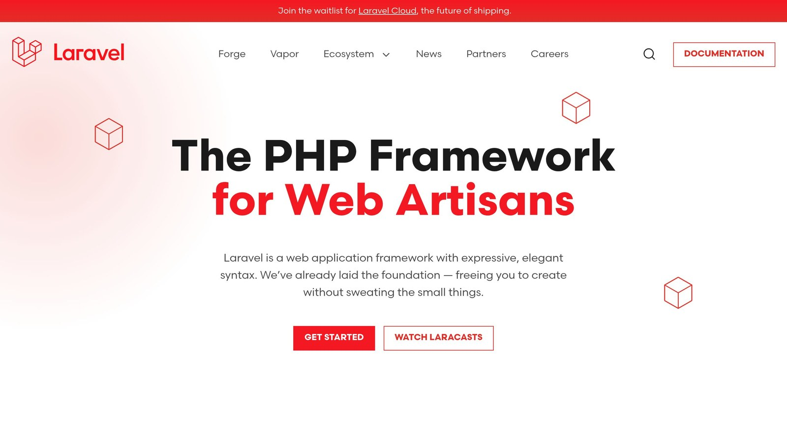

`declare(strict_types=1)` in PHP enforces strict type checking, ensuring function arguments and return values match their declared types exactly. This eliminates automatic type conversion and helps catch errors early.

### Why Use It in [Laravel](https://laravel.com/)?



Strict typing can improve your [Laravel](https://laravel.com/) project by:

- **Reducing Bugs**: Detects type errors during development.
- **Improving Code Clarity**: Promotes explicit type declarations.
- **Simplifying Maintenance**: Makes code easier to understand and manage.
- **Enhancing Security**: Prevents type-related vulnerabilities.

### Key Differences: Strict vs Default Typing

| Feature | Strict Typing | Default Typing |
| --- | --- | --- |
| Type Conversion | No automatic conversion | Automatic coercion |
| Error Handling | Throws `TypeError` for issues | Silently adjusts types |
| Function Calls | Requires exact matches | Accepts compatible types |

### How to Enable It in Laravel

1. Add `declare(strict_types=1);` at the top of each PHP file.
2. Update Laravel stubs with `php artisan stub:publish` to include it in new files.
3. Gradually migrate old files while testing for compatibility.

### Common Challenges and Solutions

1. **Nullable Values**: Handle nullable database fields explicitly.
2. **Request Data**: Cast and validate request inputs properly.
3. **Return Types**: Ensure consistent return types in all methods.

### Tools to Help

- **Static Analysis**: Use tools like [PHPStan](https://phpstan.org/) or [Psalm](https://psalm.dev/) to catch type issues early.
- **Testing**: Write unit tests to validate type-specific scenarios.
- **Error Monitoring**: Integrate tools like [Inspector](/laravel/) to track `TypeError` occurrences.

### Example Use Case

```php
<?php
declare(strict_types=1);

namespace App\Http\Controllers;

use Illuminate\Http\Request;

class UserController extends Controller
{
    public function store(Request $request): void
    {
        $validated = $request->validate([
            'age' => 'required|integer',
            'email' => 'required|email',
        ]);

        // Strictly typed operations
        $user = new User();
        $user->age = (int) $validated['age'];
        $user->email = (string) $validated['email'];
        $user->save();
    }
}
```

## Setting Up strict_types in Laravel

Adding strict typing to your Laravel application can help enforce type safety, but it requires careful implementation. Here’s how to get started and avoid common pitfalls.

### Setting Up and Implementing strict_types

The `declare(strict_types=1)` directive needs to go at the very top of each PHP file, right after the opening `<?php` tag:

```php
<?php
declare(strict_types=1);

namespace App\Http\Controllers;
use Illuminate\Http\Request;
```

To make this consistent for new files, update Laravel's stubs to include the directive:

```bash
php artisan stub:publish
```

Once the stubs are published, add `declare(strict_types=1);` to the relevant files in the `stubs` directory at your project’s root. This ensures all newly generated files include strict typing by default.

To integrate strict typing without disrupting your workflow, consider these steps:

| Phase | Action | Purpose |
| --- | --- | --- |
| Initial Setup | Add to new files first | Avoid breaking existing code |
| Testing & Monitoring | Use tests and static analysis tools | Identify type issues early and ensure consistency |
| Migration | Gradually update old files | Keep the application stable during changes |

### Common Issues and Solutions

Laravel’s dynamic features can sometimes conflict with strict typing. Here are some challenges and how to address them:

1. **Type Mismatch in Database Operations**

[Eloquent](https://laravel.com/docs/master/eloquent) models often return nullable values. Use explicit handling to avoid errors:

```php
public function show(int $id): ?User
{
    return User::find($id);
}
```

2. **Handling Request Data Types**

When working with request data, always cast values explicitly:

```php
public function store(Request $request): void
{
    $validated = $request->validate([
        'age' => 'required|integer',
        'name' => 'required|string'
    ]);

    $user = new User();
    $user->age = (int) $validated['age'];
    $user->name = (string) $validated['name'];
    $user->save();
}
```

3. **Consistent Return Types**

Ensure your methods return values of the same type in all cases:

```php
public function calculate(int $value): int 
{
    if ($value < 0) {
        return 0; // Always return an integer
    }
    return $value * 2;
}
```

To catch potential type issues early, incorporate static analysis tools like PHPStan or Psalm into your workflow. Adding these tools to your CI/CD pipeline can automate the process of identifying and fixing problems.

## strict_types in Laravel Components

### Controller Type Safety

Using strict typing in Laravel controllers can help ensure that your code is both predictable and reliable. Here's an example:

```php
<?php
declare(strict_types=1);

namespace App\Http\Controllers;

use App\Models\User;
use Illuminate\Http\Request;
use Illuminate\Http\Response;

class UserController extends Controller
{
    public function store(Request $request): Response
    {
        $validated = $request->validate([
            'age' => 'required|integer',
            'email' => 'required|email'
        ]);

        $user = new User();
        $user->age = (int) $validated['age'];
        $user->email = (string) $validated['email'];
        $user->save();

        return response()->json(['message' => 'User created'], 201);
    }
}
```

This example highlights how strict typing can improve request validation and response generation. By explicitly defining types, you reduce the risk of unexpected errors. Just as controllers benefit from this approach, models and database interactions can also become more consistent and dependable.

### Model and Database Type Safety

Strict typing in Eloquent models promotes data integrity while simplifying debugging. Here's how it works:

```php
<?php
declare(strict_types=1);

namespace App\Models;

use Illuminate\Database\Eloquent\Model;
use Carbon\Carbon;

class User extends Model
{
    protected $casts = [
        'age' => 'integer',
        'is_active' => 'boolean',
        'last_login' => 'datetime'
    ];

    public function getLastLoginAttribute(?string $value): ?Carbon
    {
        return $value ? new Carbon($value) : null;
    }

    public function setAgeAttribute(int $value): void
    {
        if ($value < 0) {
            throw new \InvalidArgumentException('Age cannot be negative');
        }
        $this->attributes['age'] = $value;
    }
}
```

In this example, property casting ensures attributes like `age` and `is_active` always have the correct type. Accessors and mutators, such as `getLastLoginAttribute` and `setAgeAttribute`, enforce additional type rules. These techniques make it easier to maintain consistent and accurate data throughout your application.

### Service and Helper Type Safety

Service classes often handle complex business logic, where strict typing can prevent errors and simplify debugging. Take a look:

```php
<?php
declare(strict_types=1);

namespace App\Services;

use App\Models\User;
use App\Exceptions\UserServiceException;

class UserService
{
    public function calculateUserScore(User $user, int $activityPoints): float
    {
        try {
            $baseScore = $this->getBaseScore($user);
            $multiplier = $this->getMultiplier($activityPoints);

            return round($baseScore * $multiplier, 2);
        } catch (TypeError $e) {
            throw new UserServiceException('Invalid calculation parameters');
        }
    }

    private function getBaseScore(User $user): float
    {
        return (float) ($user->reputation_points ?? 0);
    }

    private function getMultiplier(int $points): float
    {
        return $points > 100 ? 1.5 : 1.0;
    }
}
```

In this example, every method explicitly defines parameter and return types. The `calculateUserScore` method ensures type consistency and includes error handling for type mismatches. This approach not only makes debugging easier but also increases confidence in the correctness of your business logic. By applying strict typing across your services, you create a more predictable and maintainable codebase.

## Error Handling with strict_types

### Common TypeError Examples

TypeErrors occur when strict typing is enforced, and input values, like form data, don't match the expected type. Here's an example:

```php
<?php
declare(strict_types=1);

class UserService
{
    public function updateAge(int $userId, int $age): void
    {
        $user = User::find($userId);
        $user->age = $age;
        $user->save();
    }
}

// Usage that triggers TypeError
$userService = new UserService();
$userService->updateAge(1, $_POST['age']); // TypeError: Argument 2 must be of type int, string given
```

To avoid this, ensure proper type casting and validation:

```php
public function updateAge(int $userId, mixed $age): void
{
    if (!is_numeric($age)) {
        throw new InvalidArgumentException('Age must be a numeric value');
    }
    $user = User::find($userId);
    $user->age = (int) $age;
    $user->save();
}
```

Laravel simplifies handling these issues with its error management tools.

### Error Management Methods

Laravel's global exception handler is a powerful way to handle TypeErrors:

```php
<?php
namespace App\Exceptions;

use Illuminate\Foundation\Exceptions\Handler as ExceptionHandler;
use TypeError;

class Handler extends ExceptionHandler
{
    public function register(): void
    {
        $this->renderable(function (TypeError $e) {
            return response()->json([
                'error' => 'Type mismatch error',
                'message' => $e->getMessage(),
                'line' => $e->getLine()
            ], 400);
        });
    }
}
```

For more localized error handling, use try-catch blocks. This approach allows you to log and manage TypeErrors in specific parts of your application:

```php
try {
    $result = $this->calculateUserScore($user, $points);
} catch (TypeError $e) {
    Log::error('Type mismatch in user score calculation', [
        'user_id' => $user->id,
        'points' => $points,
        'error' => $e->getMessage()
    ]);

    throw new UserServiceException('Invalid calculation parameters');
}
```

### Monitoring with [Inspector](/)


Error monitoring is essential in strict typing environments to quickly identify and fix type-related problems. Inspector provides clear insights through its real-time monitoring and detailed metrics.

To configure Inspector just install the Laravel package:

```php
composer require inspector-apm/inspector-laravel
```

Or follow the step by step guide on the documentation: [https://docs.inspector.dev/guides/laravel/installation](https://docs.inspector.dev/guides/laravel/installation)

Inspector's dashboard highlights key metrics, such as:

| Metric | Description | Impact |
| --- | --- | --- |
| Error Frequency | Number of TypeErrors per hour | Identifies recurring issues |
| Error Location | File and line number of the error | Speeds up debugging |
| Stack Trace | Full error context | Helps pinpoint the root cause |

## Testing strict_types Code

Testing plays a key role in maintaining the reliability of strictly typed Laravel applications, complementing the type safety provided by `declare(strict_types=1)`.

### Unit Testing Guidelines

When writing unit tests for strictly typed code, focus on scenarios that involve type-specific behavior:

```php
<?php
declare(strict_types=1);

class UserRegistrationTest extends TestCase
{
    public function testCreateUserWithValidTypes(): void
    {
        $service = new UserRegistrationService();
        $result = $service->register(
            'john@example.com',
            'password123',
            25
        );

        $this->assertInstanceOf(User::class, $result);
    }

    public function testCreateUserWithInvalidAgeType(): void
    {
        $this->expectException(TypeError::class);

        $service = new UserRegistrationService();
        $service->register(
            'john@example.com',
            'password123',
            '25' // String instead of int
        );
    }
}
```

The second test ensures a `TypeError` is triggered when a string is passed instead of an integer.

Key areas to prioritize include:

| Testing Focus | Implementation | Expected Outcome |
| --- | --- | --- |
| Valid Types | Provide correct type arguments | Successful execution |
| Invalid Types | Use mismatched types | TypeError exception |
| Edge Cases | Test type conversion scenarios | Proper type validation |
| Return Types | Verify return type compliance | Matches declared types |

While unit tests confirm runtime behavior, static analysis tools help catch type-related issues before the code even runs.

### Static Analysis Tools

To integrate PHPStan for static analysis, create a `phpstan.neon` configuration file with the following setup:

```yaml
parameters:
    level: 8
    paths:
        - app
        - tests
    checkMissingIterableValueType: true
    checkGenericClassInNonGenericObjectType: true
```

Then, add these scripts to your `composer.json` file to streamline the process:

```json
{
    "scripts": {
        "analyse": "vendor/bin/phpstan analyse",
        "test": [
            "@analyse",
            "vendor/bin/phpunit"
        ]
    }
}
```

PHPStan helps identify potential type-related issues during development, reducing the likelihood of runtime errors.

### Monitoring with Inspector

You can enhance your testing workflow by [enabling Inspector](https://github.com/inspector-apm/inspector-laravel) for real-time tracking of type-related issues. Configure it by creating a dedicated configuration file.

Inspector provides insights into several key metrics:

| Metric Type | Description | Action Item |
| --- | --- | --- |
| Type Errors | Tracks occurrences of TypeError | Review and fix mismatches |
| Performance Impact | Analyzes strict typing overhead | Optimize type-heavy code |
| Test Coverage | Monitors type-related test cases | Address untested scenarios |

Combining unit tests, static analysis, and monitoring tools ensures a robust approach to handling strict types in your Laravel application.

## Summary

Using `declare(strict_types=1)` in Laravel improves type-checking, making your code more reliable and easier to debug. It enforces stricter rules around data types, helping developers catch errors early and write more predictable applications.

| Benefit | Impact | Things to Consider |
| --- | --- | --- |
| Type Safety and Code Quality | Identifies type-related bugs and enforces consistent data types | Requires clear type declarations and thorough testing |
| Easier Debugging | Offers detailed error messages for type mismatches | May need updates to older code |
| Improved Maintainability | Makes application behavior easier to understand | Demands extensive testing |

> "Strict type-checking makes your code less forgiving, potentially causing errors that require careful handling".

To implement strict typing effectively in your Laravel projects:

- Ensure **comprehensive test coverage** before and after [enabling strict types](/why-use-declarestrict_types1-in-php-fast-tips/).
- Use **static analysis tools** to spot type issues early.
- Customize Laravel stubs to include `declare(strict_types=1)` for consistency in new files.

By gradually introducing strict types, combined with testing and monitoring, developers can harness its full benefits. When paired with Laravel's built-in features, strict typing strengthens your application's foundation - especially when supported by proper testing and analysis tools.

The next section answers frequently asked questions about using strict types in Laravel.

## FAQs

Here are answers to some common questions about using strict types in Laravel, explaining how they work and their effects.

### Does Laravel use strict types?

By default, Laravel does not enable strict typing. However, you can turn it on for specific files by adding `declare(strict_types=1);` at the top. Keep in mind, this must be done individually for each file since Laravel does not offer a global configuration for strict types.

### What does `declare(strict_types=1);` do?

This statement enforces strict type checking in PHP. It ensures that function arguments and return values strictly adhere to their declared types. If there's a mismatch, PHP will throw a `TypeError`.

```php
<?php
declare(strict_types=1);

function add(int $a, int $b): int {
    return $a + $b;
}

add("1", "2"); // Throws TypeError because strict types prevent automatic type conversion
```

### How do you enable strict types in PHP?

To enable strict typing, include `declare(strict_types=1);` at the very top of your PHP file, right after the `<?php` tag. Keep in mind that this setting applies only to the file where it’s declared - it doesn’t affect any included or required files.

## Related Blog Posts

- [Laravel Logging: Setup and Use](/log-channels-in-laravel-setup-and-use/)
- [Laravel Query Profiling: Tools and Techniques](/laravel-query-profiling-tools-and-techniques/)
- [5 Common Laravel Exceptions Explained](/5-common-laravel-exceptions-explained/)
- [Symfony declare(strict_types=1)](/symfony-declarestricttypes1/)
