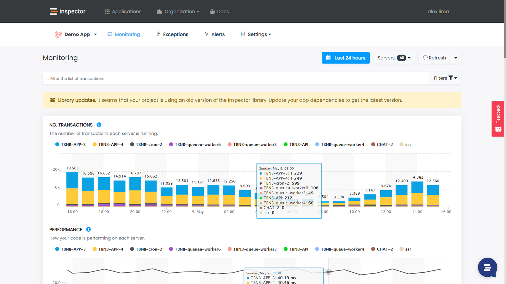
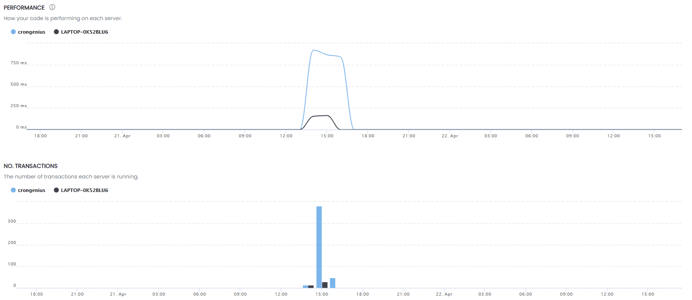
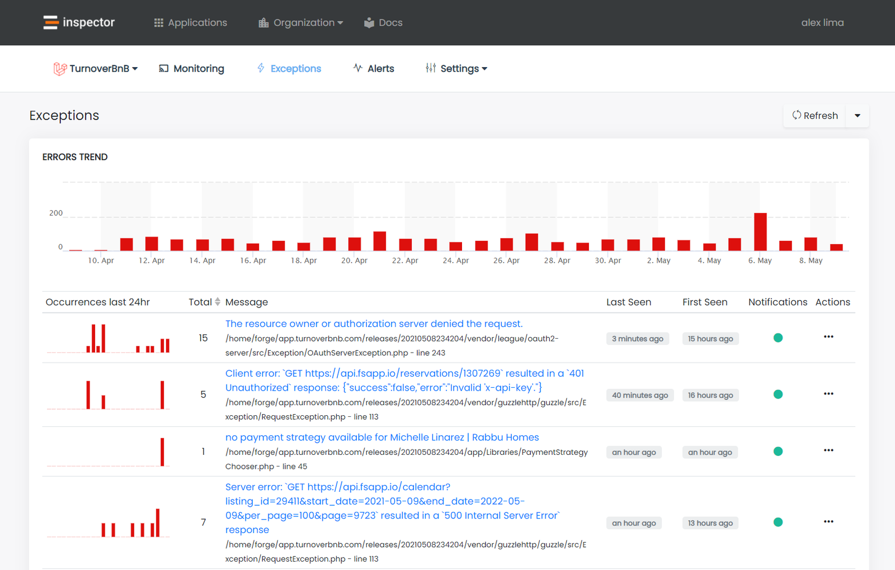

Hi, I'm Valerio, software engineer from Italy, CTO and founder at Inspector.

We’ve been hard at work these past few months improving the data visualization components in the application monitoring dashboard to make Inspector even more valuable for developers. We're super excited to tell you all about these new features and we hope you enjoy them as much as we do.

## The problem to solve

Since it was launched in the early of 2019 Inspector give the developers the ability to visually explore and analyze the code execution flow inside their applications.

In the last two years more and more mature companies have adopted Inspector as their main application monitoring dashboard, giving us the opportunity to see the product in action in a variety of scenarios.

It was clear that navigating the insights using the previous version of the dashboard, some important metrics were lost in the large amount of data Inspector is able to trace.

For complex applications, developers had to apply filters, manually settings time intervals, move the mouse in tiny spaces within the charts... The real informative power of our data was still underused.

So we immediately got to work improving the product and giving developers the information they need immediately, without any additional effort.

## Highcharts as data visualization library

We decided to purchase the license for use [Highcharts](https://www.highcharts.com/), one of the best data visualization libraries on the market, and rebuild our UI components to bring its powerful features to our users.

The Inspector dashboard is a [Vue.js](https://vuejs.org/) Single Page Application, built as a set of components that consume and visualize data provided by our REST APIs.

Highcharts has a great design particularly suitable for developing a dashboard based on components. It provides the global "[plotOptions](https://api.highcharts.com/highstock/plotOptions)" property that can contains all the default settings for all type of charts.

This is perfect to create a "Highcharts" basic component to standardize the chart rendering options like colors, weigth of lines, legends, width, height, etc, and incapsulate the chart constructor. The default properties can be replaced at runtime if some chart has its own specific needs.

Here is an example from one of our Vue.js components that use the basic Highcharts component:

```javascript
<template>
    <Highcharts :options="options"/>
</template>

<script>
export default {
    props: {
        dataset: {
            type: Array,
            required: true
        }
    },

    data() {
        return {
            options: {series: []}
        }
    },

    mounted() {
        this.$watch('dataset', {
            handler(newVal, oldVal) {
                if (newVal)
                    this.renderCharts([...newVal])
            },
            immediate: true,
            deep: true
        })
    },


    methods: {
        renderCharts(data) {
            this.options.series = data.map(host => {
                return {
                    name: host.hostname,
                    data: host.performance.map(item => {
                        return [
                            this.$moment(item.date).unix()*1000,
                            item.transactions
                        ]
                    })
                }
            })
        }
    }
}
</script>
```

## New data navigation features

The new dashboard now shows application insights segmented by server. This allows you to understand at a glance which server deserves more attention based of ts performance KPIs.



### Zoom in

You can click and drag into the chart to zoom in on a shorter time interval.



### Errors trend

The exception tracking view now shows the error occurrences in the last 30 days.



## Conclusion

We very much hope you can enjoy the best monitoring experience on the market, and we are continuing to work on many other improvements to make Inspector your best partner to deliver high quality software product for your customers.

Are you curious about what Inspector can do for you? Pick your preferred technology:

- [Laravel](/laravel/)
- [Symfony](/symfony/)
- [CodeIgniter](/codeigniter/)

New to Inspector? [Create an account](https://app.inspector.dev/register).
