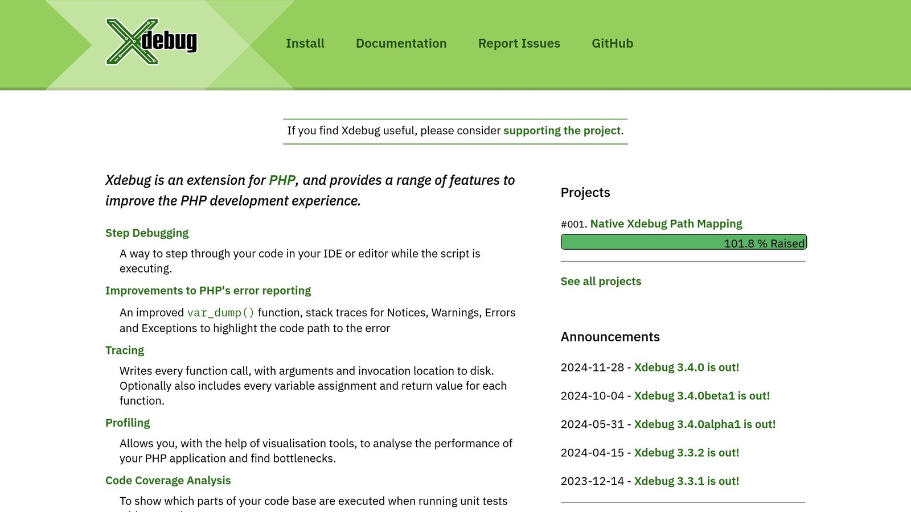

**Recognizing error patterns in PHP can transform debugging from frustrating to efficient.** By identifying recurring issues and their root causes, developers can improve application stability and reliability. Here’s how to get started:

- **Track and analyze errors systematically**: Use error logs and categorize issues.
- **Leverage tools**: Static analysis tools like [PHPStan](https://phpstan.org/) catch problems early, while [monitoring tools](/log-monitoring-tools/) like [Inspector](/) detect patterns in real-time.
- **Implement robust error handling**: Use design patterns (e.g., Command or Chain of Responsibility) and custom error handlers to manage errors effectively.
- **Focus on clean code and static analysis**: Tools like PHPStan and [Psalm](https://psalm.dev/) help spot issues during development.

For production environments, real-time monitoring tools help identify and address errors before they affect users. Combining proactive error detection with structured handling ensures your PHP applications remain stable and reliable.

## Setup debugging for PHP8.1 with [XDebug](https://xdebug.org/) 3 in [VSCode](https://code.visualstudio.com/)



[Watch the video on YouTube](https://www.youtube.com/watch?v=HrQWtbxY1Hs)

## Basics of PHP Error Handling

PHP error handling helps developers identify recurring issues, trace their patterns, and fix them effectively.

### Common Types of PHP Errors

PHP errors fall into several categories:

| Error Type | Description | Impact on Execution |
| --- | --- | --- |
| **Fatal Errors** | Serious issues that halt execution | Stops immediately |
| **Warnings** | Potential problems in the code | Execution continues |
| **Notices** | Minor issues or suggestions | Execution continues |
| **Exceptions** | Errors handled in code | Can be caught and managed |

### Configuring PHP Error Reporting

Setting up error reporting is crucial for tracking and understanding issues. Here's a basic example:

```php
error_reporting(E_ALL);

function errorHandler($errno, $errstr, $errfile, $errline) {
    error_log("Error $errno: $errstr in $errfile on line $errline");
}

set_error_handler('errorHandler');
```

This setup ensures all errors are reported and logged, making them easier to analyze later.

### Interpreting PHP Error Details

PHP error messages provide valuable information, including:

- **Error Code**: Identifies the error type.
- **Error Message**: Explains the issue.
- **File Path**: Shows where the error occurred.
- **Stack Trace**: Maps the sequence of function calls leading to the error.

When reviewing errors, pay attention to:

- How often certain error codes appear.
- Specific files where errors are common.
- Stack traces to identify problematic code paths.
- Repeated error messages across the application.

In production environments, it's better to log errors instead of showing them to users. This not only improves security but also makes error analysis more manageable. Tools like Inspector can help by providing real-time error monitoring and detecting patterns automatically.

## Methods for Recognizing Error Patterns

Structured approaches like design patterns and automated tools can help identify and manage error patterns in PHP applications effectively.

### Using Design Patterns for Error Management

Certain design patterns, such as Command, Decorator, and Chain of Responsibility, provide structured ways to handle errors:

| Pattern | Purpose | Benefits |
| --- | --- | --- |
| **Command Pattern** | Encapsulates error-prone tasks | Centralizes error handling and reduces redundancy |
| **Decorator Pattern** | Adds layers for error handling | Manages errors flexibly without altering core code |
| **Chain of Responsibility** | Creates a sequence of handlers | Offers tiered responses based on error type |

Here’s an example of using the Chain of Responsibility pattern:

```php
class ErrorHandler {
    private $nextHandler;

    public function setNext(ErrorHandler $handler) {
        $this->nextHandler = $handler;
        return $handler;
    }

    public function handle($error) {
        if ($this->nextHandler) {
            return $this->nextHandler->handle($error);
        }
    }
}

class DatabaseErrorHandler extends ErrorHandler {
    public function handle($error) {
        if ($error instanceof DatabaseException) {
            return true;
        }
        return parent::handle($error);
    }
}
```

### Building Custom Error Handlers

For more tailored solutions, custom error handlers can address specific application needs. Below is an example of a custom error handler:

```php
function customErrorHandler($errno, $errstr, $errfile, $errline) {
    $errorDetails = [
        'type' => $errno,
        'message' => $errstr,
        'file' => $errfile,
        'line' => $errline
    ];

    switch (APP_ENVIRONMENT) {
        case 'production':
            logError($errorDetails);
            displayUserFriendlyMessage();
            break;
        case 'development':
            displayDetailedError($errorDetails);
            break;
    }
}

set_error_handler('customErrorHandler');
```

This setup ensures that users see appropriate messages while developers can dig into detailed reports during debugging.

### Automating Error Pattern Detection

As applications grow, automating error detection can save time and effort in managing recurring problems. Modern tools can assist by:

- **Real-time Detection**: Spotting issues as they occur
- **Pattern Analysis**: Grouping similar errors to find root causes
- **Automated Responses**: Triggering actions like notifications or logs
- **Performance Monitoring**: Assessing the impact of errors on response times and database queries

Here’s a quick example of automating error detection:

```php
$detector = new ErrorPatternDetector();
$detector->onPatternDetected(function($pattern) {
    notifyDevelopmentTeam($pattern);
    updateErrorLog($pattern);
});
```

This approach helps streamline error management and ensures recurring issues are addressed efficiently.

## Using Monitoring Tools to Detect Errors

Monitoring tools are essential for spotting and managing error patterns in PHP applications. They provide real-time data, enabling developers to address issues quickly before they escalate and disrupt user experiences.

### Why Real-Time Monitoring Matters

Real-time monitoring transforms how PHP errors are handled. Instead of waiting for user reports or running periodic checks, these tools provide immediate visibility. This approach helps:

- Spot errors as they happen
- Pinpoint performance bottlenecks
- Shorten the time needed to resolve issues (MTTR)
- Keep applications running smoothly and reliably

When production errors arise, time is critical. Real-time monitoring ensures swift responses, reducing downtime and keeping users happy.

### [Inspector](/): A PHP Monitoring Solution


Inspector is a monitoring tool designed specifically for PHP applications, with a focus on recognizing error patterns. Here’s what it offers:

| Feature | How It Helps |
| --- | --- |
| SQL Query Analysis | Detects slow or problematic database queries |
| HTTP Traffic Monitoring | Tracks API performance |
| Background Task Visualization | Monitors background tasks for issues |
| Real-time Error Detection | Provides instant error alerts |
| Framework Integration | Works with popular frameworks like [Laravel](https://laravel.com/) and [Symfony](https://symfony.com/) |

Inspector combines automated detection with detailed insights, helping developers not only see when errors happen but also understand their root causes.

### Steps to Add Monitoring Tools to PHP

1\. **Installation and Configuration**

Start by installing the PHP package. Or you can install the ready-to-use framework integration for [**Laravel**](/laravel/) and [**Symfony**](/symfony/) framework.

2\. **Custom Error Handler Implementation**

Next, integrate a custom error handler with your monitoring tool:

```php
$inspector = new Inspector();
$inspector->startTransaction('web-request');

set_error_handler(function($errno, $errstr, $errfile, $errline) use ($inspector) {
    $inspector->reportError($errstr, [
        'errno' => $errno,
        'file' => $errfile,
        'line' => $errline
    ]);
});
```

Focus on monitoring key areas like:

- Critical paths in your application
- Performance metrics
- Error trends and patterns
- Custom events for additional insights

## Tips for Effective Error Pattern Recognition

Building reliable PHP applications requires a structured approach to identifying and managing error patterns. Here’s how you can improve error handling to ensure stable, production-ready code.

### Writing Clean and Organized Code

Keeping your code clean and well-organized makes it easier to spot and fix errors. Following standards like PSR-12 promotes maintainability and simplifies debugging. Here's an example of structured error handling:

```php
class OrderProcessor 
{
    public function __construct(protected Logger $logger) {}

    public function process(Order $order): void 
    {
        try {
            $this->validateOrder($order);
            $this->calculateTotal($order);
            $this->saveOrder($order);
        } catch (ValidationException $e) {
            $this->logger->error('Order validation failed', [
                'order_id' => $order->getId(),
                'error' => $e->getMessage()
            ]);
            throw $e;
        }
    }
}
```

This snippet uses type declarations, exception handling, and contextual logging to ensure your code remains clean and easier to troubleshoot.

### Using Static Analysis Tools

Static analysis tools are essential for catching issues early, often before they make it to production. Here are some popular tools and their features:

| Tool | Key Features |
| --- | --- |
| PHPStan | Type checking, undefined variable detection |
| Psalm | Security checks, type coverage analysis |
| [PHP_CodeSniffer](https://github.com/squizlabs/PHP_CodeSniffer) | Enforces coding standards |

Incorporate these tools into your CI/CD pipeline. Adjust their rules to suit your project’s needs, balancing strictness with practical usability. Over time, these tools help you identify and address recurring error patterns.

### Monitoring and Improving Over Time

Error pattern recognition is a continuous process. Regularly track error metrics, analyze recurring issues, and address the root causes for long-term improvement. Tools like Inspector can help you monitor error trends and automate the detection of recurring patterns, making this process more manageable and efficient.

## Conclusion

Tools like Inspector offer real-time insights, helping developers incorporate error pattern recognition into a larger error management strategy. By combining structured error handling techniques, such as design patterns, with modern monitoring tools, developers can quickly spot and fix recurring problems before they disrupt production.

Design patterns simplify error handling by centralizing logic, making systems easier to maintain and customize. This approach keeps the codebase clean while allowing tailored responses to different error scenarios.

Static analysis tools, such as PHPStan and Psalm, shift error detection to an earlier stage. These tools catch issues during development, reducing the risk of problems appearing in production and changing how teams approach error management.

Real-time monitoring is now essential for PHP applications. Tools like Inspector improve reliability by offering features like:

- **Real-time error detection** to speed up issue resolution
- **SQL query monitoring** to avoid database performance problems
- **HTTP traffic analysis** to pinpoint performance bottlenecks
- **Background task tracking** for smoother workflows

Using a mix of clean coding practices, static analysis, and continuous monitoring builds a strong foundation for recognizing error patterns. These methods work together to create an effective strategy for managing errors in PHP applications.

As PHP applications become more complex, a systematic approach to error recognition ensures stability and reliability in production. By refining these methods over time, teams can keep up with growing challenges and maintain long-term performance.

## FAQs

### What are the four types of PHP errors?

PHP errors come in four main types, each with its own impact and purpose:

| Error Type | Severity | Effect | Description |
| --- | --- | --- | --- |
| **Parse Error** | High | Stops script execution | Signals syntax mistakes |
| **Notice Error** | Low | Script continues | Points out minor issues like undefined variables |
| **Warning Error** | Medium | Script continues | Warns about potential problems needing attention |
| **Fatal Error** | Critical | Stops script execution | Caused by serious issues, like calling undefined functions |

These errors help developers identify and address problems in their code. For instance, **Parse Errors** stop the script entirely due to syntax issues, while **Notice Errors** flag smaller, non-critical concerns.

To manage PHP errors effectively:

- Adjust error reporting settings depending on whether you're in development or production.
- Use tools like Inspector for tracking errors in real-time.
- Set up custom error handlers to deal with errors in a way that suits your project.
- Regularly check error logs to spot recurring issues and patterns.

## Related Blog Posts

- [Real-Time Error Tracking vs. Log Analysis: A Comparison](/real-time-error-tracking-vs-log-analysis-a-comparison/)
- [Laravel Logging: Setup and Use](/log-channels-in-laravel-setup-and-use/)
- [Common JOIN Query Indexing Mistakes to Avoid](/common-join-query-indexing-mistakes-to-avoid/)
- [5 Ways to Reduce API Payload Size in PHP](/5-ways-to-reduce-api-payload-size-in-php/)
