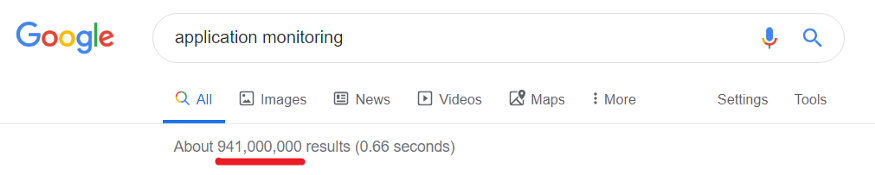
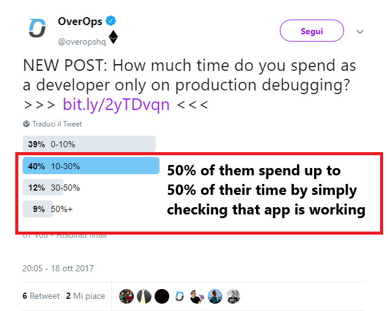
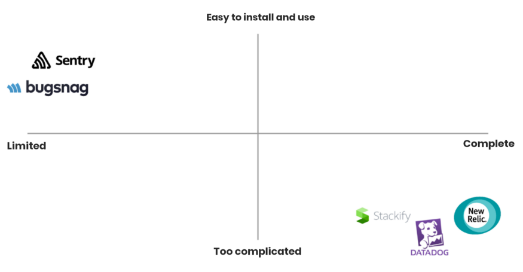
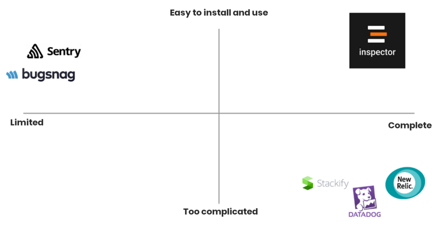
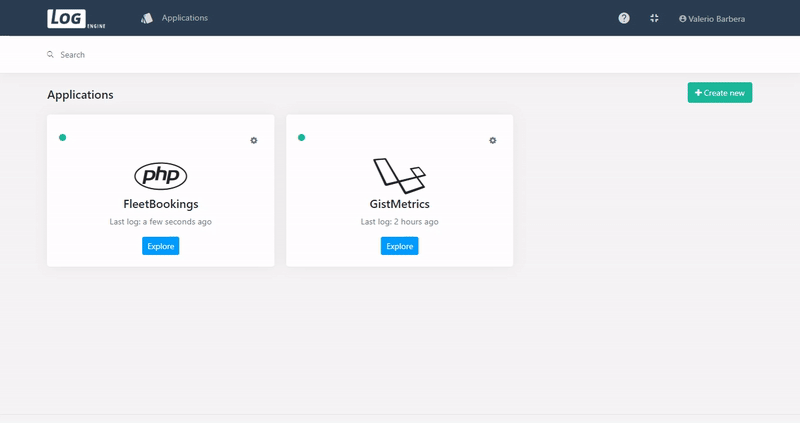
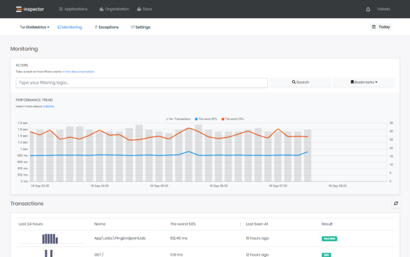

Creating a successful software as a service (SaaS) product is the dream for many entrepreneurial-minded programmers. In the process of launching my own SaaS I discovered that sharing and comparing experiences with other founders is an essential part of this journey, and without this, I probably would never have created it at all.

In this article, I’ll share the mental and practical processes that led me to create a SaaS product from scratch, and how I gained my first paying customers. Whether you are thinking about creating a new product or you have already launched, this article can help you compare your own strategies and methods with the ones that worked for me, and possibly adapt them for yourself.

I personally dedicate up to three hours per week reading the experiences of other founders. I’m always looking for new ideas, ways to avoid mistakes, and evaluating new strategies that could help me to obtain concrete results (that is, improve the product and increase customers’ happiness).

For this reason, I decided to work in a completely frank and transparent way and share everything about my path — including what has been working and what has not — with the aim of helping one another through direct and rational discussion.

## How to launch a SaaS business

The article is divided into seven chronological sections, following every phase of the work I have done:

- **Detecting the problem**
- **Quantifying the problem**
- **Evaluating competitors and their approach to the problem**
- **Developing the first prototype**
- **Throwing everything away and starting again**
- **Getting the first subscription**
- **How to move forward**

The SaaS product I built is [Inspector](/), a Code Execution Monitoring tool that helps software developers to identify bugs and bottlenecks in their applications before customers do with a simple, lightweight software library.

This article is focused on the early days of this amazing experience, today Inspector is used by developers in more than ten countries and it continues to grow organically. Here is our testimonials page: [**https://inspector.dev/testimonials**](/testimonials/).

### Detecting the problem

Spending the last 10 years working with software development teams made me realize how complicated it is for developers to handle technical problems that affect applications every day. Development teams have close relationships with their customers, and this is a high risk for companies that produce software because with problems you realize how fragile this bond really is.

Users do not like problems! It seems obvious, but this aspect is constantly underestimated. This is an uncomfortable truth. No one likes to be in trouble, and it is instinctive to minimize the problem. But by denying this reality you could annoy the customer even more, to the point where they may even reconsider whether or not they “should” even pay you.

Customers do not spend their time reporting problems and errors. No ones cares about helping us resolve bugs. They just leave our application, and it may be years before we see them again. Despite this, every team I have worked with used the best-known method of figuring out whether applications were working properly or not:

> “If an angry customers calls you, the software is not working.”

It is not exactly a technological solution…

Maybe it seems ridiculous, but beyond the perception tycoons of technology project on our jobs, insiders know that urgency, limited budget, pressing customers, managers, forcing developers to constantly work under pressure, and adopting Band-Aid solutions (to temporarily fix a problem), are survival strategies. Working this approach for 10 years helped me realize there is clearly a problem here.

### Quantifying the problem

At the beginning of 2019, I had just finished some important projects and was expecting to enjoy a little period of calmness. During the last few years, I have used such moments to look for business opportunities which allow me to put my technical skills to good use with the hope of finding the right conditions to launch my own business idea.

I knew from my experience as a developer that an easy and immediate monitoring instrument would be enough to help development teams to stay up-to-date about the performance of applications, instead of relying on customer calls to know when the software was creating problems. On the other hand, I did not need a tool to monitor everything, as everything often means nothing.

I wrote a detailed guide on how to chose the right monitoring tool for the right need, helping you to avoid unnecessary tools that do not serve your needs: [https://inspector.dev/application-performance-monitoring-tools-101/](/how-code-execution-monitoring-can-help-you/)

The first step was to understand if there already were solutions trying to solve this problem, so I googled “*application monitoring*” and 941,000,000 results appeared:

Wow. That’s a very huge amount of content for a problem that probably is huge. But how huge, exactly?

Software development team inefficiency is a problem I have always faced directly, but there is a big difference between estimating a job task and quantifying the economic impact of a problem. It is even more difficult on a large scale. This tweet captured my attention:

**50% of developers admit to spending up to 50% of their time verifying that applications are working.**

Software development is work mostly paid by the time technicians spend working on a project, and if there are periods in which developers spend 50 percent of their time checking that everything is okay, a tool which  
completely automates this job could be useful enough to buy.

**So why aren’t they so common to so many developers?**

### Evaluating competitors and their approach to the problem

I thought about the two main parameters a company looks at when it has to decide which tools to use to increase productivity:

1. *Simplicity* (ease of installation and use)
2. *Efficacy* (I spend x to solve a problem which is worth x+10, so I gain the +10)

Using these parameters, I spent about a week creating an evaluation sheet of the most well-known monitoring instruments and I placed them in a graphic:

After days of putting information together, a look at the graphic was enough to realize where the problem was. Easy instruments do not provide enough value to the majority of developers. All-in-one platforms instead, are thought of as being for big organizations and requiring skilled engineers dedicated to their installation, configuration, and use, which ends up complicating team operations rather than simplifying them.

**In my vision, the problem is not the monitoring itself but the developers productivity.**

For a massive adoption, it would be necessary to have a product that requires a minute for the installation, no configurations, and at the same time, that provides complete and easy to understand information that would allow even medium-sized development teams to fix the real-time monitoring problem.

And of course, it has to be cool.

### Developing the first prototype

Finally, I decided to try to do it. The last work experience had gone well and I thought that it would not be impossible for me to create this tool. So, I immediately informed my partners that I wanted to build an MVP for the following two or three months. When I explained it to them, it was hard to make them understand the problem because they are not technicians involved at the same level I am. They gave me the okay based 90 percent on trust, and I thank them for this.

Over the course of three months I was able to create this prototype:

While working on the implementation, I gradually understood the problems of realizing this kind of tool and even problems users would encounter during its use. From a technical point of view, a monitoring product has to be designed to work with huge quantities of data and I also wanted to deal with them in real-time.

I had to spend longer than I predicted for the backend part — in other words, the part which cannot be seen, or the backstage of an in-cloud software — leaving out the graphic interface (as you can see above), which is the part users see and use.

### Throwing everything away and starting again

In the last few years, the dream of launching a product on the market pushed me to constantly study and apply marketing strategies that are particularly adept for SaaS software, to different projects (even the failed ones). I started to write articles for my blog with the aim of publishing them on different websites and social media to collect the first feedback.

Although I wrote horrible content in English with writing mistakes because English is not my mother tongue, I started to receive feedback on my idea which included:

- I don’t understand what I can do with it.
- How can I install it?
- Why use it rather than XXX?
- And so on…

It was not easy to be objective while looking at developers’ responses and comments. The emotional reaction could always take over and it was really hard for me to understand where the mistakes were because I am not a sales agent or a seller, but I am a damn good technician.

## The lessons I learned along the way

### Lesson 1 — Selling sucks

Thanks to my technical skills on the matter, I did not need to sell. Rather, I just needed to learn how to communicate the problems I faced every day and how I fix them with my tools.

I spent an entire month writing the most important things I knew about the monitoring and application scalability problems and the reasons why I decided to start this project, the difficulties I had been encountering during the development of a product, how I fixed them and moved forward, code examples, technical guides, my best practices, and more.

Then I gave everything to [Robin](https://www.fiverr.com/robinoo/professionally-proofread-1000-words?context=recommendation&context_alg=recently_ordered%7Cco&context_referrer=homepage&context_type=gig&mod=rep&pckg_id=1&pos=1&source=recently_and_inspired&tier_selection=recommended&ref_ctx_id=1bf19e6d-aa27-407d-86ea-f8ca268b8131), a Canadian copywriter found on Fiverr, who corrected all the content, including the website text, and polished the writing into native-level English.

### Lesson 2 — Insufficient product

The fear of leaving out the user interface turned out to be a well-founded fear. What I did was not enough to create the kind of experience I had in my head, so I had to start again. The advantage of this was that I fixed the majority of the technical problems. It is not easy for an engineer to put themselves in a designer’s shoes.

To improve my design sense I attended two courses about the development of graphic interfaces, read three books on design and user experience, and made direct experiments using VueJs as frontend framework.

### Lesson 3 — Give it a try despite all doubts

When we spend our time reading books and watching videos on marketing and business, we always learn common advice which, in practical situations, usually does not work. Consider, for example, the mantra: “If you wait until everything is ready, you will never start your business”. So true!

But first experiences push us to emotional reactions that can put us on the defensive. This is a very big mistake because creating a product that is worthy of being bought thanks to its utility is a process, not a sudden event. The word “launch” misleads us, so forget about it and concentrate on "creation", the process which, step by step, helps you understand what you need to change and improve to achieve your aim, compared with the outside world.

### Inspector is born!

It took me another two months of working on the project; during these months I decided to recreate the brand from scratch, trying to use the prototype experience not just in terms of product but also in terms of marketing and communication.

[Inspector](/) — Simple Code Execution Monitoring, built for developers.

Have you ever desired to watch your code running, instead of just imagining it?

That's what Inspector is designed to do.

We endlessly repeated ourselves that the aim was not the monitoring itself, but to help developers automate their working processes:

- **Without any effort**
- **Without wasting time with manual procedures**
- **Guaranteeing flexibility when it is necessary**

### Getting the first subscription

On July 14, 2019, one of my tutorials was approved to be published on Laravel News, one of the most important websites for the Laravel developers’ community, which got the word out about this tool to an extended audience. Within four days, more than 2,000 people visited the Inspector website, almost 100 companies signed up, and the two first users — from Holland and Switzerland — subscribed.

I cannot describe the emotion I felt when I received my first notice from Stripe which informed me that I had just received my first payment. When it happened, it was late in the evening. It felt like I was carrying an elephant on my shoulders for seven months and, finally, it went away and let me breathe.

A lot of problems cropped up during the following months, and they required time, effort, and money to be fixed. This included things like hacking attacks and overloaded infrastructures, problems that forced me to stay chained to the PC even on Christmas Eve. These are problems that send you crashing back to earth and make you realize things are even more difficult than before because you have something to lose now.

## Saas Developer Tools

With the first subscribers, I knew I had an interesting product and, thanks to the web and the cloud, I had the chance to make the product known to developers from all over the world.

So I kept working hard, full-time, every day for months to create and publish technical articles from my experience on as many channels as possible:

- [https://medium.com/inspector](https://medium.com/@valerio_27709)
- [https://dev.to/inspector](https://dev.to/inspector)
- [https://valerio.hashnode.dev/](https://inspector-monitoring.hashnode.dev/)
- [https://www.facebook.com/inspector.realtime](https://www.facebook.com/inspector.realtime)
- [https://www.linkedin.com/company/14054676](https://www.linkedin.com/company/14054676)
- [https://twitter.com/Inspector_rt](https://twitter.com/Inspector_rt)
- [https://www.indiehackers.com/product/inspector](https://www.indiehackers.com/product/inspector)
- [https://www.reddit.com/r/InspectorFans/](https://www.reddit.com/r/InspectorFans/)
- [https://www.producthunt.com/posts/inspector](https://www.producthunt.com/posts/inspector)
- [https://hackernoon.com/u/valerio-barbera](https://hackernoon.com/u/valerio-barbera)

Now, more than 1500 companies and business people have an account on Inspector and we have more than 20 active subscriptions from Singapore, Germany, NewYork, France, Hong Kong, Holland, and more.

### How to move forward

Sharing and comparing with others has been fundamental in my journey to get here, so I plan to keep going this way. After all, I’m aware there are still a lot of things we need to improve and, even worse, problems that at the moment we’re ignoring entirely. This is why we started to tell this story during the most important Italian events where the topic is innovation.

Now we are part of the [**Hubble**](/inspector-joins-nana-bianca-the-italian-startup-accelerator/) program, the Italian startup accelerator made by Paolo Barberis, Jacopo Marello, and Alessandro Sordi; three of Dada’s founders who spent 20 years of their lives collaborating to finance and support more than 30 Italian and foreign companies in growth.

Our aim is to introduce ourselves to other managers, business people, and marketing and technology experts in order to elevate the product to the next level and test new instruments and strategies to get Inspector known all over the world. We would like to help software developers to work in a more productive and fun way thanks to smart tools which give them more free time to spend on more valuable activities instead of boring, repetitive, manual checks.

### Conclusion

In this article, I’ve shared the mental and practical process that led me to create and launch a SaaS product from scratch, and how I gained my first paying customers. Without sharing my journey I would never have created [Inspector](/), so thank you for reading this article and I invite you to leave a comment below with any questions, curiosities, or just to tell me what you think about it. And if you think this article could be useful to others, please share it on your social media!
