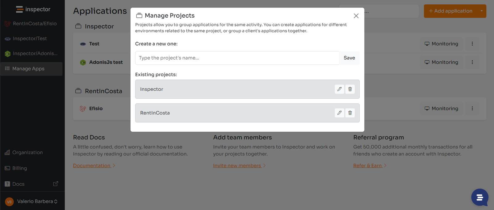
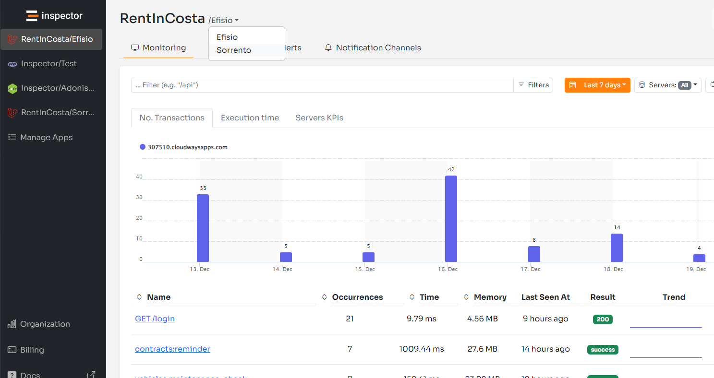

Hi, I'm Valerio, CTO at Inspector.dev. Last week we released an important product update introducing the ability to group monitored applications into Projects.

Until today, applications connected to the monitoring system are listed in a single page. As Inspector is countuing to onboard new customers, some of them have become large accounts with custom data consumption plans and a long list of applications.

A single list with all items doesn't help you access a specific application quickly. The idea to better organize the list of applications came out also in our **[Feature Requests](https://inspector.feedbear.com/boards/feature-requests?filter=All)** dashboard. This gave us the push to plan this development immediately.

## What is a Project

Projects allow you to group monitored applications for the same activity. You can create different environments of the same project, or group a client's applications together.

Check out the new feature on the dashboard: [https://app.inspector.dev/manage-apps](https://app.inspector.dev/manage-apps)

The orange button "Add application" in the top-right corner of the screen has a new sub menu "Manage projects" to create one. Next you can assign applications to a project in the "Application Settings".

We decided for this design to serve various types of needs. We've also introduced the search bar to help find what you need rapidly. Anyway the evolution is always in progress.

## Quick navigation

After associating more than one application to a project, the title of the monitoring dashboard became a dropdow menu. It allows you to quickly move to other applications in the same project.

## Feature requested by customers

Thanks to Alexander Kramer to post this idea on the feature requests dashboard, helping us to identify a spot for making the product better for him and all other users.

Do you already have some idea to post? **[Find out what other developers are discussing](https://inspector.feedbear.com/boards/feature-requests?filter=All)**!

To authenticate just click on the "Log-in" button. You will be automatically authenticated with your Inspector account and redirected back to the dashboard to post your ideas.

## New to Inspector? Try it for free now

Are you responsible for software development in your company? Consider trying my product [**Inspector**](/) to find out bugs and bottlenecks in your code automatically. Before your customers stumble onto the problem.

Inspector is usable by any IT leader who doesn’t need anything complicated. If you want effective automation, deep insights, and the ability to forward alerts and notifications into your messaging environment try Inspector for free. [**Register your account**](https://app.inspector.dev/register).

Or learn more on the website: [**https://inspector.dev**](/)
