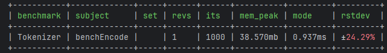

When I launched [Neuron AI Framework](https://github.com/inspector-apm/neuron-ai) six months ago, I wasn't certain PHP could compete with Python's AI ecosystem. The framework's growth to over 1,000 GitHub stars in five months changed that perspective entirely. What began as an experiment in bringing modern AI agents capabilities to PHP has evolved into something more substantial: proof that PHP can handle sophisticated AI workflow with performance that matters in production.

This success sparked a deeper question: if PHP can handle complex AI agent architectures, what other foundational AI components could be created in PHP? The answer led me to tackle one of the most critical building blocks of any generative AI system: the Tokenizer.

[**https://github.com/neuron-core/tokenizer**](https://github.com/neuron-core/tokenizer)

## Tokens: The Foundation Every AI System Needs

Tokenizers convert human-readable text into numerical tokens that language models can process. Every interaction with chatGPT, Claude, or any transformer-based model begins with tokenization. The quality and speed of this process directly impacts both the accuracy of AI responses and the performance of your applications.

In most cases developers working with AI have been forced into a compromise. They either make HTTP calls to external tokenization services, introducing latency and dependencies, or attempt to integrate Python libraries through complex subprocess calls. Both approaches create bottlenecks that make AI applications challenging and expensive to build.

The new PHP tokenizer implementation provides native tokenization that matches the performance and accuracy of established Python libraries while integrating seamlessly into existing PHP applications.

Neuron chat history component for example, relis on a [TokenCounter](https://github.com/inspector-apm/neuron-ai/blob/2.x/src/Chat/History/AbstractChatHistory.php#L30) to understand the usage of the context window in order to cut old messages to avoid AP error from the model. The default implementation is just an empirical estimation. Thanks to this tokenizer implementation it could be possible to integrate a full-featured BPE tokenizer into the framework to keep calculate token consumption in the same LLM does. Withouth approximations.

## Sub-Milliseconds Performance Matters in Production

The core implementation focuses on the areas where tokenization performance typically suffers: memory allocation, string processing, and vocabulary lookups. Rather than porting Python code directly, the tokenizer leverages PHP 8's specific strengths including efficient array handling and optimized string operations.

It has an internal cache to speed up recurring encoding and decoding operations, and implement a priority queue for merge rules.

```php
$tokenizer = new BPETokenizer();

// Initialize pre-trained tokenizer
$tokenizer->loadFrom(
    __DIR__.'/../dataset/bpe-vocabulary.json',
    __DIR__.'/../dataset/bpe-merges.txt'
);

// Tokenize text
$tokens = $tokenizer->encode('Hello world!');

var_dump($tokens);
```

The benchmarks shows sub-milliseconds performance with the GPT-2 vocabulary data and the tokenization of a standard "Lorem Ipsum..." chapter.



## Compatibility

The tokenizer maintains compatibility with established AI models while building applications in PHP. It supports the same vocabulary and encoding schemes used by GPT based-models, ensuring that tokens generated in PHP applications match exactly what the model expects.

As part of the broader Neuron ecosystem, this Tokenizer provides the foundation for more sophisticated AI applications built entirely in PHP. When combined with Neuron's agent framework, developers can build complete AI workflows without leaving the PHP environment.

## The Path Forward

The tokenizer's development reinforces what Neuron AI Framework demonstrated: PHP's modern capabilities make it viable for approaching some parts of the AI ecosystem.

You can experiment with tokenization, understand how language models process text, and build applications that leverage these capabilities without learning new languages.

If you're building PHP applications and considering AI features, take a look on [Neuron AI Framework](https://github.com/inspector-apm/neuron-ai), it provides the tools needed to transform ideas into working AI applications using skills and infrastructure you already have.

**Start experimenting with Neuron PHP AI Framework today and discover how quickly you can turn AI concepts into production applications.**

If you want to go deeper into the AI Agents development in PHP take a look on my book on Amazon: **[Start With AI Agents In PHP](https://www.amazon.com/dp/B0F1YX8KJB)**
