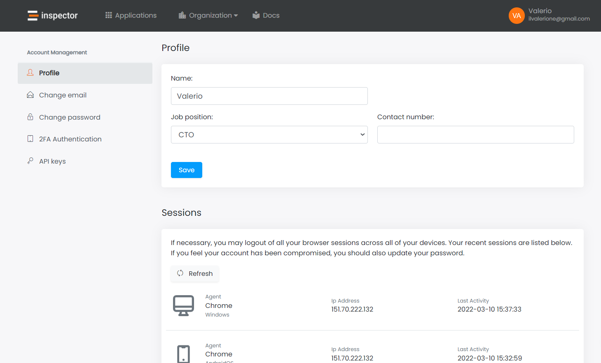

Hi, I'm Valerio Barbera, software engineer, founder and CTO at Inspector.

A recent product update introduced new security features for the Inspector user account.

I learned a lot more about the implications of security on the user experience and I realized that some details are not clear to many developers so they are too slow to implement security patterns in their applications.

I also wrote a guide on how to develop a filter to preventing users from using weak passwords in Laravel. Click on the link below to read more: [https://inspector.dev/how-to-prevent-users-from-usi-insecure-passwords/](/how-to-prevent-users-from-usi-insecure-passwords/)

Let’s talk about 2FA, Password Confirmation and Logged-in devices control.

## Password Confirmation

Every critical action should require a password confirmation. You should always prompt the user to type the current password to authorize actions that can compromise the account accessibility, like change email, change password, logout other browsers sessions.

For some time I have seen this feature spread and I believe it’s important to make it available to my customers.

This feature will improve security because also having physical access to the computer with the Inspector dashboard opened on the screen, a malicious user can't change access credentials without knowing the current password. He can't shut you out.

## Control Logged-in devices

This feature allows users to check out the logged-in devices and easily log-out from other devices with a simple click.

Here is a screenshot of the new profile page.

Three actions at your fingertips:

- Displays currently logged in devices;
- Log out from all other devices except the currently logged-in device.
- An option to disable multiple device logins altogether. This means that a user can only be logged in from one device at a time.

If you log in Inspector from your smartphone, you will see this new device in the logged-in devices list. This will allow you to identify unknown devices in the list, disconnect them with a simple click, and change your password to protect your account from unexpected authentications.

## Two Factors Authentication

Are you using the same password for multiple websites including Inspector? Are you accessing Inspector from public or shared computers?

Such actions weaken your password and make it easier to steal.

That’s why we implemented two step verification. An optional security feature that helps protect your account even if your password is stolen or cracked.

This feature will improve security because signing in requires two things:

- Something you know: **Your Password**
- Something you have: **Your Phone**

If an attacker crack your credentials he cannot authenticate into your Inspector account because he doesn’t have your phone to provide us the security code.
