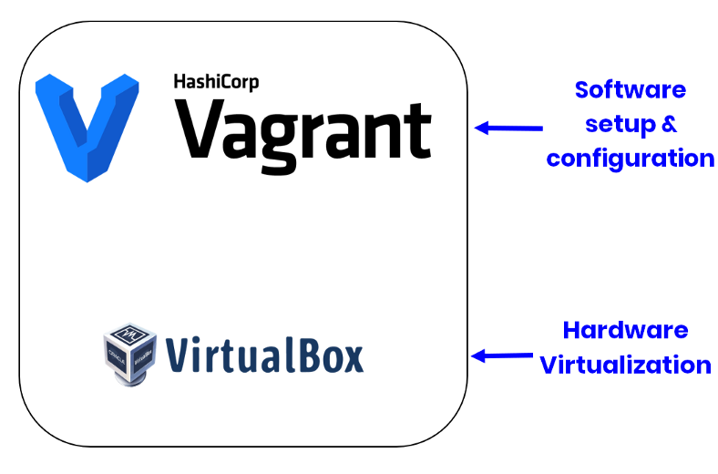
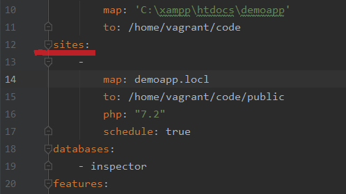
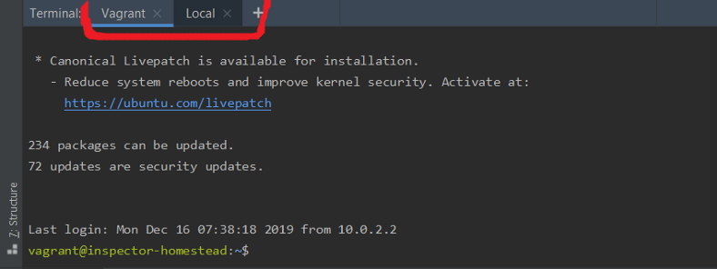

Hi, I’m Valerio Barbera, software engineer, founder and CTO at Inspector.dev.

In this article I wrote about my best practices to install and use [Homestead](https://laravel.com/docs/master/homestead), Laravel's official development environment in my projects, including some real life tips as I usually do in my articles.

To be honest, I wasn’t an early adopter of local VMs as a development environment (Docker, Vagrant, etc), mainly because I thought they took time to learn and I always have very limited free time.

Already from the first tests I understood how Homestead would drastically improve my development experience giving me the ability to have a faithful replica of the production environment separated for each project.

This article is for you if you want:

- **Learn what Homestead and Vagrant are and do**;
- **Understand why and how Homestead will supercharge your development experience**;
- **You are expanding your business and you are no longer able to recreate different production environments using the same Xampp, MAMP local installation**.

I start with the mandatory requirements before moving into Homestead instalaltion and configuration.

### Vagrant

Vagrant is a tool to automate virtual machine setup and configuration process. Once you create a Vagrant file, you only need vagrant up and everything is installed and configured for you to work.

So whether you are working on Linux, Mac OS X, or Windows, all your team members are running code in the same environment, against the same dependencies, all configured the same way. Say goodbye to "it doesn't works on my machine" bugs.

The team behind Vagrant has built a simple tool that get a script in input (called Vagrantfile) to install and configure automatically all softwares and features you want your server to have, on top of the hardware provided by VirtualBox.



That’s why we need both installed on our PC.

Download and install **VirtualBox** from here: [https://www.virtualbox.org/wiki/Downloads](https://www.virtualbox.org/wiki/Downloads)

Download and install **Vagrant** from here: [https://www.vagrantup.com/downloads.html](https://www.vagrantup.com/downloads.html)

VirtualBox + Vagrant already provide you everything you need to run the VM for your application. But at this stage you should learn more about Vagrant to manipulate the Vagrantfile and customize your server configuraiton to fit your requirements.

This is where Homestead comes to the rescue.

## What is Laravel Homestead

Homestead is a pre-packaged Vagrant box with all basic tools included by default without requiring you to install PHP, a web server, redis, MySQL, and any other server software your project need.

Thanks to Homestead you don’t need to learn anything about Vagrant that's why it allows you to save a lot of time and complexity.

This is simple for small teams, fit for small to medium size projects, it boots fast, and it’s enough to get anyone started with Laravel in seconds.

### 1. Install on your project (Windows 10, Mac, Ubuntu)

Looking for lavarel homestead windows 10, lavarel homestead for ubuntu...? I **love** this, mainly because you can install it “[per project](https://laravel.com/docs/master/homestead#per-project-installation)” using Composer like any other dependencies:

```bash
composer require laravel/homestead --dev
```

### 2. Generate the Vagrantfile and Homstead.yaml

Run the make command based on your OS:

Mac / Linux:

```bash
php vendor/bin/homestead make
```

Windows:

```bash
php vendor\\bin\\homestead make
```

### 3. Map an URL for your project



The first field in the configuration file is the IP address of the VM.

It could be better to have an url that map this raw IP address to reach our application with the browser.

For the **sites** section, the “map” Key references the hostname that you are calling your project.

Using this hostname and the IP address we’ll need to update your computer’s host file.

- **Mac:** /etc/hosts
- **Windows**: C:\\Windows\\System32\\drivers\\etc\\hosts

Add the entry below:

```bash
192.168.10.10 demoapp.locl
```

This is telling your computer that *demoapp.locl* is located at the server IP address *192.168.10.10* (which is your VM).

---

T**ips!** To run multiple VM for multiple project at the same time you need to have a unique IP for each of them. You can simply increase the last IP number in the *Homestead.yaml* file and configure properly your computer’s *hosts* file:

```bash
192.168.10.10 demoapp.locl
192.168.10.11 another-app.locl
...
```

---

In the Homestead.yaml file you can see:

```bash
schedule: true
```

This option provided by homestead allow us to run the server with a cron job configured to run the [Laravel Task Tcheduling](https://laravel.com/docs/master/scheduling). This is what I mean with “I didn’t need to learn Vagrant”.

### 4. Run the VM with your application inside

In your project’s directory execute:

```bash
vagrant up
```

You will see the booting logs appear in your teminal, it takes just a few seconds.

### 5. Connect with SSH

You can SSH into your virtual machine by issuing the command below inside your project’s directory:

```bash
vagrant ssh
```

---

T**ips!** As you can see in this image I usually keep two terminal windows opened in my IDE (this is a screenshot of my PHPStorm):

- “**Vagrant**” always in SSH with the project’s VM.
- “**Local**” that simply point my local terminal to the project’s directory (as by default in PHPStorm).



This is important because **now your database isn’t reachable from the outside of your VM**. So for example you can use the “*Local*” terminal to create a migration script, but you need to go in the “*Vagrant*” terminal to run the migration against the database.

## Lavarel/Homestead Github

Take a time to review the homestead documentation especially “[Installing Optional Features](https://laravel.com/docs/master/homestead#installing-optional-features)” to check what other softwares you can install in your server to reproduce your production environment faithfully.

If you are interested in code details about Homestead and Laravel integration check the official repository on Github: [https://github.com/laravel/homestead](https://github.com/laravel/homestead)
