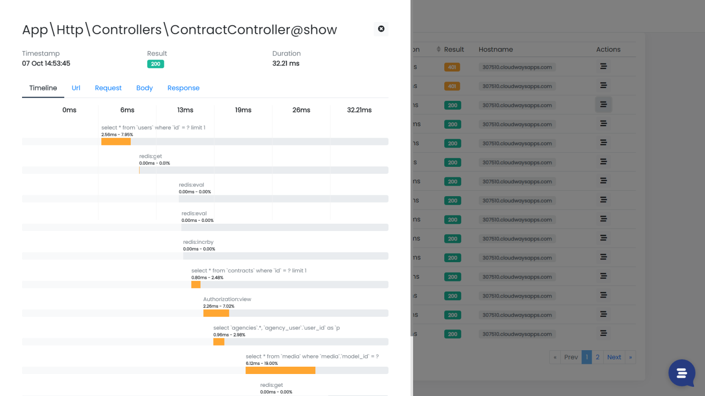

Hi, I’m Valerio, software engineer, CTO & founder at Inspector, a monitoring platform used by developers all around the world to find out issues in their applications before users stumble onto the problem. In this article I would share my experience working in the monitoring industry trying to help you better understand:

- **What** is the right tool for each specific monitoring problem;
- **When**, or in which situations, monitoring can be effective and worth the investment;
- **Why** you should monitor certain parts of your system and not others, based on your stage of growth.

## Why Monitoring Matter

The time many developers feel the need to monitor their applications often coincides with when they first start working on a medium / large project.

The reason is simple: when your software becomes complex, or serves highly valuable customers, software bugs become expensive; doubly so when your customers find them! Customers may rate you as unreliable and search for alternatives.

Solving critical customer problems can certainly generate great business opportunities, but the more critical the problem is, the more you need to be ready for really high customer expectations.

Monitoring is the way for developers to avoid unexpected incidents and retain customers or contracts as long as possible - which means stable income for your business over time.

Today it may not be so easy to navigate the world of monitoring, probably because so many different data can be used in so many different ways.

Here is what I’ve learned in my journey.

## What are monitoring tools?

Monitoring tools generally consist of two parts: the agent, and the analytics platform.

The agent is a software package that developers install in their servers or applications. Its goal is to collect relevant information about system behavior and performance.

Data are sent to the remote platform to be transofrmed and stored in order to generates visual charts to help developers easily understand what’s happening in their system. The platform should be able to send alerts to developers if something goes wrong in a convenient way.

This is obviously a simplistic description that could cover a lot of tools out there. If you search for monitoring solutions on Google you'll find tons of tools. Many of them looks like (or sold as) application monitoring tools, but they have nothing to do with application monitoring. These similarities can make it difficult to figure out which was the right tool according to your specific needs.

Let's take a look at the most known categories of tools.

## Logs management tools

A logs management tool is often the first kind of tool developers approach looking for a monitoring solution for the first time, because since the birth of software development, watching application logs has been one the dominant habit for developers to be informed about what’s happening inside the application.

It was the same for me, but when the application started to scale (it runs on multiple servers, requires a complex architecture, high performance become crucial, etc.), I realized that it was very difficult to extract relevant information from logs and monitor the impact of the code changes over time in terms of stability and resources consumption.

When the car was invented, people claimed for a faster horse because horses were what they knew. Then they realized that a completely different tool was needed to take it to the next level.

## Uptime monitoring tools

Uptime monitoring tools can be described as a more sophisticated “ping.”

The main purpose is simple: they ping your application endpoints from multiple regions to understand how well (or bad) it can be reached by users located in different parts of the world.

These metrics help to understand how the cloud infrastructure works to bring your application to the end-users (load balancer, CDN, network, etc.) and be aware when some of these systems generate issues. It does not provide any information on what is going on **inside** your application.

In my case, my application serves users all around the world, so external ping insights help us to understand what regions suffer the highest latency by making decisions about in which regions we should place more resources to improve our customer experience.

The downside is they monitor the external environment. If your application slows down, you will never know why.

## Error tracking tools

These tools work as an exception trap and allows you to receive alerts when an error occurs during application execution.

In many cases exceptions are too basic information to prevent system downtimes. There is no feedback about performance, system load, CPU, memory, etc.

Furthermore you don't know if your application is in trouble until it explicitly fails. And we would like to try to prevent errors from being found by customers.

But approaching a more comprehensive monitoring it seems to be not so easy.

## All-in-one Application Monitoring platforms

The most known application monitoring platforms like Datadog, Dynatrace, NewRelic, AppDynamics, and others, provide logs, server metrics, uptime metrics, infrastructure insights, application metrics, unstructured events collection, etc.

I think it's reasonable to believe that they are targeted for enterprise-class scenarios.

They require a lot of assistance and training or even a dedicated engineering team for configuration and maintenance, and tend to be too complex and expensive for small/medium teams.

Furthermore they need to be installed and configured at the server level.

Whether you're using infrastructure automation tools, or even have external teams to take care of it, everything configured at the server level is out of the software development lifecycle, and developers tend to lose their autonomy.

This can cause constant email exchanges across teams to adjust configurations, customizations, and in the end software developers almost always have the worst because they have no control over everything that resides in the infrastructures.

## Code Execution Monitoring tools

Code Execution Monitoring tools are focused on the most important thing for every developer: Code Execution.

Have you ever thought to watch your code running instead of just imagining it?

That is what a Code Execution Monitoring tool is designed to do.

This class of tools collects relevant information about application performance, errors, and trends and gives you a visual representation of what your application is doing during its normal operation.

Inspector works specifically in this area.

The idea behind Inspector is to create a "code-driven" monitoring environment specifically designed for software developers avoiding any server or infrastructure configuration that many developers hate to deal with.

I'm one of those developers who prefer not to complicate my life with infrastructure management. Managing the IT infrastructure is a profession in itself. It requires a lot of vertical skills about server environments, cyber security, scalability, and involves complicated technologies (like Kubernetes).

As a software developer, I have long searched for code monitoring systems that are totally “code-driven”, to stay as independent as possible from infrastructures, whether they are managed with automation platforms or even under the control of teams outside my company.

For several months I shared this idea by giving talks at events of the Italian PHP community, and discussing with other CTOs. On this page I have collected the reviews of the developers who have tried Inspector: https://www.inspector.dev/testimonials

Thanks to Inspector you can make sure your application is working properly, make sure you’re always delivering a good customer experience even while you are making changes to it with a simple lightweight software library that you can install in your application like any other dependencies.
