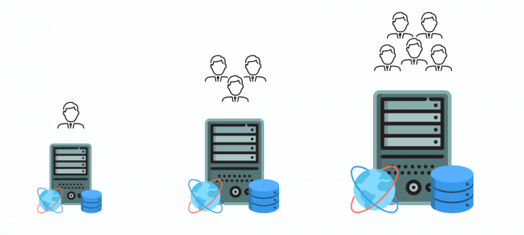
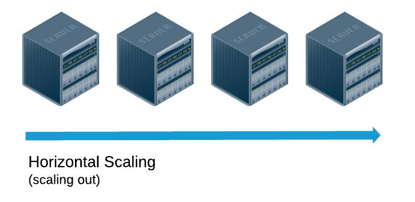
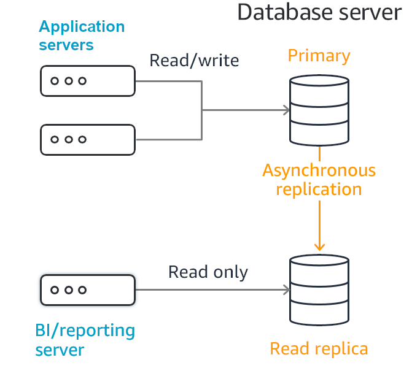

Hi, I'm Valerio, software engineer, CTO, and founder at Inspector. In this article, I'll talk about what I learned by increasing the operational limits of the Inspector SQL database.

Before talking about read-replicas or sharded data, it might be helpful to introduce the problem. And to look at the most common strategies to improve the database's ability to process an increasing number of queries per second. Thus, granting better growth margins for the application.

## Why the SQL database causes so many performance issues?

We often forget that each request or process performed by the application is not "atomic". When we write a piece of code, we should keep in mind that ten other requests will simultaneously execute that piece of code. If it's slow, it's likely to affect other requests running in parallel and at the end of the whole system.

The database is a shared resource used by all processes and servers behind your application. So, be careful with thinking, "*it's okay if this piece of code isn’t optimized*".

Even one poorly designed access to the database can hurt the whole system’s performance.

## What problem does scaling the SQL database solve?

Before proceeding, we should clarify a difference between *vertical* vs *horizontal* scaling. Both are useful but suited to solve different problems.

### Vertical scaling

Do you deal with large datasets, import/export processes, data aggregation algorithms, and similar problems?

If so, you can get more benefits from scaling your database vertically.

Resource-intensive tasks usually don't have great benefits from multiple instances. When a long-running query executes against an instance, that instance must have enough resources to execute the query with resonable performance. And do so without hurting the performance of other tasks.

For this type of database operation, you should right size the RAM and CPU of the machines to take care of the performance of the SQL tasks you write.

Learn how to tune your SQL queries to run cumbersome queries with optimal performance in this article: [How to accelerate application performance with smart SQL queries](/how-to-accelerate-application-performance-with-smart-sql-queries/).

### Horizontal scaling

Horizontal scaling aims to solve the opposite problem: allow the database to perform a large number of small queries per second.

It's a matter of finding a way to run the database on multiple instances. It's just like a load balancer that distributes the traffic between application servers.

But, when you take a closer look at new database architectures and see what's working and what's not, the fundamental problems with relational databases become clearer.

## Achieving SQL database scalability is a massive challenge for RDBMS

Relational databases were first designed to run on a single server in order to maintain the integrity of the table mappings and avoid the typical problems of distributed computing.

Relational database vendors have come out with a whole assortment of improvements to handle these concerns. They use complex architectures like "master-slave" or "sharded-data".

**Below we discuss about "read-replicas" which is the Inspector implementation. It's also the most common strategy to scale a relational database **horizontally**.**

## What is a database read-replica?

A read replica is a copy of the primary instance that reflects changes to the primary in almost real time. You can basically use a read replica to do the following:

- Offload read requests from the primary instance;
- Perform a regional migration or fail over to another instance for disaster recovery purposes.

We use the read replica to distribute the load against two instances instead of one.

While it looks cool, this setup still has a weakness. The second instance is readonly.

If we can write on the second instance, it too would have to synchronize the data back to the first one (the master). Still, two-way synchronization is not allowed in relational databases to avoid data corruption.

We can offload only the "read" queries from the primary instance, so it is the right solution if your application is "read" intensive. If your application is *write intensive* this architecture wouldn't be enough.

### Database read-replica Pros

1. It is very fast as doesn't impose any restrictions on read performance.
2. You can split read and write requests to different servers. For example, all analytics queries can be made on replica nodes.

### Database read-replica Cons

1. It is not very reliable because of asynchronous replication. It means that some committed on master transactions may be not available on slave if the master fails.
2. Write requests can hardly be scaled. The only option to scale write requests is to increase compute capacity (RAM and CPU) of the Master node.

Master-Master replication can enable two way synchronization, allowing us to write on both instance. But consider that even the largest cloud computing providers doesn't provide this option in their managed SQL database offerings. It is a tunnel that is best not to enter.

## Rely on your cloud provider

We are a small team, that needs to keep our infrastructure management flexible and cost friendly. So we migrated our MySQL instance to AWS RDS. It offers the possibility to create/delete read replicas with a few clicks. As a result we can focus our efforts on application development instead of SQL server manaement.

Inspector is backed by the [AWS Startup Program](https://aws.amazon.com/activate/). They allow us to experiment with their cloud platform to find the right solutions for our needs. Regardless, the most known cloud providers offer a managed SQL database with the ability to add read-replicas. For example Amazon RDS or DigitalOcean managed databases.

It's all about to better understand the architecture and how your application can get more advantages.

## Conclusion

One of our code design constraints is to avoid database write operations as much as possible to stay away from the most critical limit to scalability of a SQL database.

I hope this article helped bring new ideas to improve your application.

If you want to learn more about how to scale up your application, join [Scalable Applications](https://www.facebook.com/groups/scalableapplications), the international community of professional developers, to share strategies and experiences building scalable systems.
