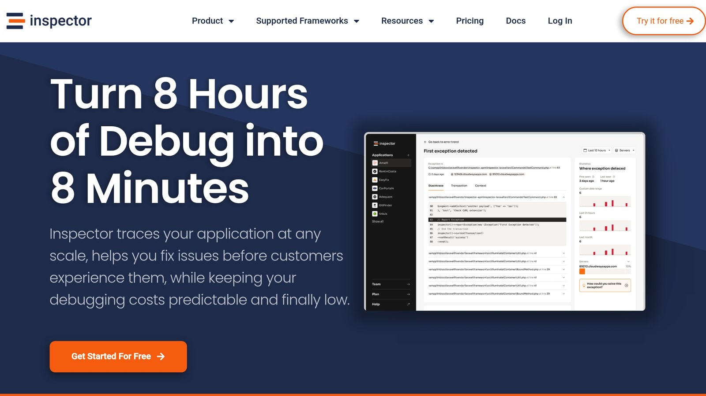

PHP performance directly impacts user experience and server efficiency. Benchmarking helps you identify slow code, optimize resources, and improve application speed. Here's how to get started:

- **Focus on Key Metrics**: Track execution time, memory usage, peak memory, and CPU time.
- **Choose the Right Tools**:
  - [**PHPBench**](https://github.com/phpbench/phpbench): Great for isolated tests but requires a separate environment.
  - [**XHProf**](https://www.php.net/manual/en/book.xhprof.php): Ideal for production profiling with low overhead.
  - [**Xdebug**](https://xdebug.org/): Best for development with detailed analysis but slows execution.
- **Set Up Proper Environments**: Match production settings, enable [OPCache](https://en.wikipedia.org/?title=Zend_Opcache&redirect=no), and isolate tests.
- **Analyze Results**: Identify bottlenecks, test optimizations, and monitor live performance.

## Quick Comparison of Benchmarking Tools

| Tool | Best For | Key Features | Limitations |
| --- | --- | --- | --- |
| PHPBench | Isolated Tests | Detailed metrics, PHPUnit-like syntax | Requires separate setup |
| XHProf | Production Code | Function-level profiling, low overhead | Complex setup |
| Xdebug | Development | Call graphs, memory analysis | High performance impact |

## PHP Benchmarking Fundamentals

PHP benchmarking evaluates code performance under different conditions to identify bottlenecks and guide improvements. Below, we’ll explore why benchmarking matters and the key metrics you should monitor.

### Why Benchmarking Your Code Matters

Amazon revelaaled that a 100ms delay caused a 1% drop in sales. This highlights how performance can directly affect business success.

Benchmarking your PHP code can help you:

- **Spot Performance Problems:** Find slow parts of your code before they impact users.
- **Make Informed Choices:** Base optimizations on actual performance data instead of guesses.
- **Avoid Setbacks:** Monitor how updates affect performance to ensure they don’t slow things down.
- **Improve Resource Management:** Understand how your application uses server resources to make better use of them.

To get these benefits, you need to focus on specific PHP performance metrics.

### Key PHP Performance Metrics

When benchmarking, track these critical metrics:

| Metric | Description | Why It’s Important |
| --- | --- | --- |
| Execution Time | Time taken to execute the code | Impacts user experience and server load |
| Memory Usage | RAM used during execution | Affects costs and application stability |
| Peak Memory | Highest memory usage recorded | Helps avoid out-of-memory errors |
| CPU Time | Processing power used | Indicates computational efficiency |

An industry expert put it best:

> "The best way to ensure your code is executing as efficiently as possible in terms of resource usage is, naturally, by measuring the efficacy of each individual element and determining where any bottlenecks may exist."
>
> - [SourceGuardian](https://www.sourceguardian.com/) Limited

For accurate benchmarking, run tests in isolated environments, repeat them to get an average, and test both in development and production setups. Use tools like Xdebug for detailed profiling during development and switch to XHProf for production benchmarking.

Finally, make sure your testing environment closely matches production. This ensures the data you gather will help you make meaningful improvements.

## How to Benchmark PHP Code

Let's dive into the process of benchmarking PHP code effectively.

### Select the Right Benchmarking Tool

The tool you choose depends on what you're testing and your specific requirements. Here's a quick comparison:

| Tool | Best For | Key Features | Limitations |
| --- | --- | --- | --- |
| PHPBench | Isolated Tests | Detailed metrics, PHPUnit-like syntax | Needs a separate test environment |
| XHProf | Production Code | Function-level profiling, low overhead | Complex setup |
| Xdebug | Development | Detailed call graphs, memory analysis | High performance impact |

For example, XHProf, originally developed at Facebook, is excellent for tracking CPU time, memory usage, and wall time all at once. It can even compare multiple test runs and aggregate results, which is incredibly helpful for analyzing complex applications.

Once you've chosen a tool, make sure your environment is set up properly to avoid external factors affecting your results.

### Set Up and Run Your Tests

After picking your tool, it's time to configure and execute your tests for accurate benchmarking.

1. **Configure the Environment**
   - Turn off unnecessary extensions during tests.
   - Enable OPcache to ensure consistent performance.
2. **Prepare the Code**

   Create isolated benchmark classes that focus on specific parts of your application. This helps pinpoint performance issues without interference.

> "Benchmarking aims to detect performance bottlenecks and understand how well an application performs under various conditions. It enables developers to make data-driven decisions regarding optimizations and enhancements."

3. **Run the Tests**

   Always execute benchmarks through a web server instead of using CLI for more realistic results. Test with different worker counts to simulate real-world scenarios:

| Worker Count | Requests/Second | Average Response (ms) |
| --- | --- | --- |
| 1 Worker | 4.99 | 199.39 |
| 8 Workers | 41.84 | 190.71 |
| 50 Workers | 160.89 | 309.70 |

### Analyze and Apply Test Results

Once the tests are complete, it's time to dig into the data:

- Look at CPU metrics to identify resource-heavy functions.
- Check memory usage and wall times for inefficiencies.
- Focus on areas with the most potential for improvement.

Keep in mind that isolated testing won't perfectly mirror production environments. Use statistical methods to spot trends and outliers, then retest after making changes to confirm your optimizations are working.

Consider using automated tools to catch performance issues in real time, giving you actionable insights for further improvements.

## Professional Benchmarking Methods

Scale PHP benchmarking with advanced tools and techniques to gain actionable insights.

### Load Testing Setup

Tools like [Apache JMeter](https://jmeter.apache.org/) and [Gatling](https://gatling.io/) are excellent for simulating traffic and understanding how your application performs under pressure. JMeter works at the protocol level, making it ideal for creating detailed user scenarios, while [Gatling](https://gatling.io/) is better suited for high-scale testing and seamless DevOps integration.

| Testing Aspect | JMeter | Gatling |
| --- | --- | --- |
| **Ideal For** | Protocol-level testing with detailed metrics | High-scale testing and DevOps integration |
| **Scalability** | Desktop app with distributed testing | Handles 1M+ requests per second |
| **Language Support** | Java-based | JavaScript, TypeScript, Java, Kotlin, Scala |
| **Analysis** | Basic reporting | Detailed performance metrics and reports |

> "Being able to scale and load test at 1 million requests per second from multiple regions has been amazing!"

While load testing is crucial, don't overlook caching and database tuning to further improve your application's speed.

### Cache and Database Speed Tips

Caching is one of the simplest ways to enhance PHP performance. Tools like [Redis](https://redis.io/) can act as both a cache and a database, reducing the load on your main database and speeding up response times. Here's an example of how you might implement caching in PHP:

```php
// Check cache first
$cached_data = $redis->get('key');
if (!$cached_data) {
    // Fetch from database if not in cache
    $data = $db->query('SELECT * FROM heavy_table');
    // Cache with a 1-hour TTL
    $redis->setex('key', 3600, serialize($data));
}
```

The trick is to manage cache invalidation carefully. This ensures data stays consistent while still reaping the performance benefits.

### Monitor Performance with [Inspector](/)



Synthetic tests are useful, but live monitoring tools can reveal bottlenecks that static benchmarks might miss. Inspector is particularly helpful for tracking performance in real time. With Inspector, you can:

- Monitor HTTP traffic patterns as they happen
- Pinpoint slow SQL queries that drag down performance
- Compare the performance of different requests
- Create detailed reports to share with stakeholders

For instance, while monitoring a blog, Inspector flagged significant slowdowns on the `/blog/{post}` route. Upon investigation, it turned out that certain database queries were taking 371.93ms - far longer than acceptable.

It's worth noting that Google's data shows bounce rates nearly triple when page load times exceed three seconds. This highlights the importance of focusing optimization efforts on areas that will bring the most noticeable improvements to users.

## Conclusion

Benchmarking PHP code is key to maintaining strong performance. By testing and monitoring systematically, developers can pinpoint bottlenecks and improve how resources are used.

Start by selecting effective tools like PHPBench and running regular tests. Since applications evolve, benchmarking should be an ongoing process to address new performance challenges as they arise. Tools like Inspector help with continuous monitoring, catching potential issues early. This is especially important when you consider that page load times over three seconds can nearly triple bounce rates.

To stay ahead, combine synthetic benchmarks with real-time monitoring. This approach blends controlled testing with real user insights, helping you tackle performance problems before they escalate. As Valerio, Inspector's Founder and CTO, puts it:

> "Be the first to know if your application is in trouble before users stumble onto the problem can drastically reduce the negative impacts on their experience with your product".

## Related Blog Posts

- [5 Ways to Optimize Symfony Application Performance](/5-ways-to-optimize-symfony-application-performance/)
- [PHP memory_get_peak_usage: Guide](/php-memorygetpeakusage-guide/)
- [Laravel Query Profiling: Tools and Techniques](/laravel-query-profiling-tools-and-techniques/)
- [Ultimate Guide to MySQL Query Caching in PHP](/ultimate-guide-to-mysql-query-caching-in-php/)
