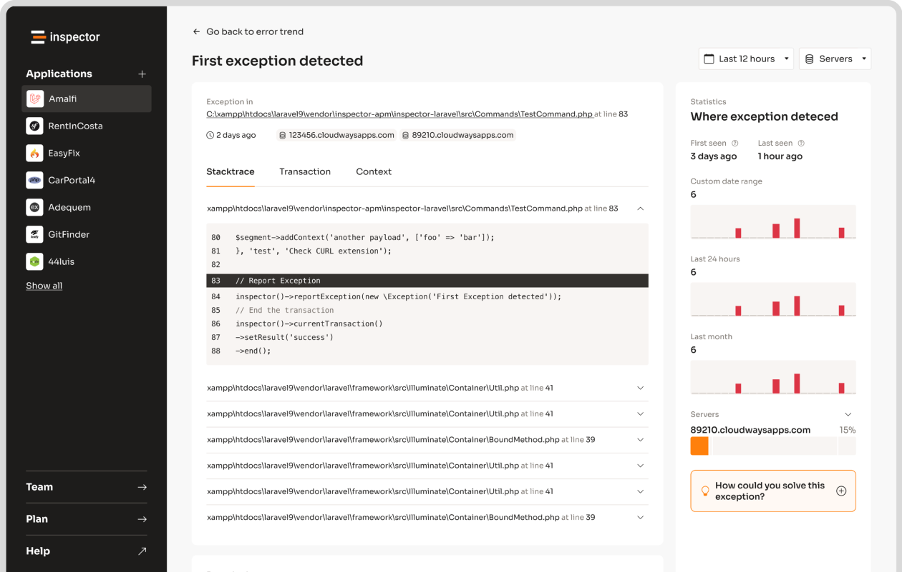

Caching a request body in Spring Boot lets you read it multiple times without errors like "Required request body is missing." This issue arises because request bodies, handled via `InputStream`, can only be read once. The solution? Use `ContentCachingRequestWrapper` to store the request body in memory for repeated access. Here's what you need to know:

- **Problem**: Request bodies are consumed after one read due to `InputStream` behavior.
- **Solution**: Use `ContentCachingRequestWrapper` to cache the body in a filter.
- **Benefits**: Enables multiple reads, simplifies debugging, and integrates with Spring's filter chain.

### Quick Steps:

1. **Create a Filter**: Wrap incoming requests with `ContentCachingRequestWrapper`.
2. **Access Cached Content**: Use `getContentAsByteArray()` in controllers or services.
3. **Be Mindful**: Handle large payloads carefully to avoid memory issues.

This approach ensures smooth handling of request data across logging, validation, and processing layers. Read on for code examples and implementation tips.

## Using ContentCachingRequestWrapper

Spring Boot's `ContentCachingRequestWrapper` helps overcome the limitation of reading a request body only once in `HttpServletRequest`. It does this by caching the request body, making it accessible for multiple reads.

### How ContentCachingRequestWrapper Works

The `ContentCachingRequestWrapper` wraps the original `HttpServletRequest` and saves the request body in a byte array. This allows you to access the body multiple times without encountering errors. The content is cached during the first read and safely reused afterward.

Here’s an example of a filter to enable caching for request bodies:

```java
@Component
public class CachingRequestBodyFilter extends GenericFilterBean {
    @Override
    public void doFilter(ServletRequest request, ServletResponse response, FilterChain chain)
            throws IOException, ServletException {
        HttpServletRequest httpRequest = (HttpServletRequest) request;
        ContentCachingRequestWrapper wrappedRequest = new ContentCachingRequestWrapper(httpRequest);
        chain.doFilter(wrappedRequest, response);
    }
}
```

### Key Benefits

Using `ContentCachingRequestWrapper` in your Spring Boot application offers several advantages:

| Benefit | Explanation |
| --- | --- |
| **Multiple Reads** | Lets you read the request body multiple times, avoiding errors like "Required request body is missing". |
| **Easier Debugging** | Makes logging and debugging simpler by keeping a cached version of the request body. |
| **Filter Chain Integration** | Works smoothly with Spring's filter chain for streamlined processing. |

One thing to keep in mind: the cached content is only available after the `doFilter` method has been executed. This ensures the entire request body has been read and cached, avoiding issues with incomplete data during debugging or logging.

For example, in a controller, you can use the cached request body for logging purposes like this:

```java
@RestController
public class EmployeeController {
    private static final Logger log = LoggerFactory.getLogger(EmployeeController.class);

    @PostMapping("/employee")
    public String saveEmployee(HttpServletRequest request) {
        ContentCachingRequestWrapper requestWrapper = (ContentCachingRequestWrapper) request;
        String requestBody = requestWrapper.getContentAsString();
        log.info("Inside Controller. Request Body: {}", requestBody);
        return "Received employee data: " + requestBody;
    }
}
```

This method ensures you can read the request body multiple times without affecting performance. Now that you understand how it works, you can start applying `ContentCachingRequestWrapper` effectively in your Spring Boot projects.

## Implementation Guide

Now that you know how `ContentCachingRequestWrapper` operates, here's how to put it to use in your Spring Boot application.

### Wrapping Incoming Requests

Start by creating a filter component to handle the wrapping of incoming requests:

```java
@Component
@Order(Ordered.HIGHEST_PRECEDENCE)
public class RequestBodyCachingFilter extends OncePerRequestFilter {

    @Override
    protected void doFilterInternal(
            HttpServletRequest request, 
            HttpServletResponse response, 
            FilterChain filterChain) throws ServletException, IOException {

        ContentCachingRequestWrapper wrappedRequest = 
            new ContentCachingRequestWrapper(request);

        filterChain.doFilter(wrappedRequest, response);
    }
}
```

This filter ensures that the request body is cached, making it accessible for further processing in your application.

### Reading Cached Content

Once requests are wrapped, you can easily access the cached request body in your controllers:

```java
@RestController
public class DataController {
    private static final Logger logger = LoggerFactory.getLogger(DataController.class);

    @PostMapping("/api/data")
    public ResponseEntity<String> processData(HttpServletRequest request) {
        ContentCachingRequestWrapper wrapper = (ContentCachingRequestWrapper) request;

        try {
            String requestBody = new String(wrapper.getContentAsByteArray(), 
                StandardCharsets.UTF_8);
            logger.info("Request body content: {}", requestBody);
            return ResponseEntity.ok("Data processed successfully");
        } catch (Exception e) {
            logger.error("Error reading cached request body: {}", e.getMessage());
            throw new RuntimeException("Failed to process request body");
        }
    }
}
```

> "ContentCachingRequestWrapper is a Spring Boot class that wraps the HttpServletRequest and caches its content, allowing multiple reads." - BootcampToProd [<sup>\[2\]</sup>](https://bootcamptoprod.com/read-request-body-multiple-times/)

When using this approach, keep a few things in mind:

- Always use consistent encoding (like UTF-8) when reading cached content.
- Monitor memory usage, especially for large request bodies.
- Handle errors gracefully to ensure application stability.

While this method is practical, be mindful of potential memory and security concerns when caching request data.

## Technical Guidelines

Using `ContentCachingRequestWrapper` simplifies working with request bodies, but it comes with trade-offs in memory and performance that need careful handling.

### Memory Usage and Speed

Caching request bodies can strain memory and slow down performance, especially during high traffic. Here are some key points to consider:

| Aspect | Potential Issues | Mitigation Strategy |
| --- | --- | --- |
| **Memory Footprint** | Grows with larger request bodies and more traffic | Set limits on cache size |
| **Response Time** | Adds slight delay during initial caching | Use streaming for large payloads |
| **Concurrent Load** | Higher memory usage with multiple requests | Implement cache eviction policies |

To maintain efficiency, set cache size limits, monitor memory usage, and handle large payloads with chunked processing.

### Data Security

Caching request bodies also introduces risks when handling sensitive data, making security a critical concern.

> "Developers should follow secure coding practices, such as validating and sanitizing input data, using secure storage mechanisms, and implementing robust access controls."

To protect sensitive data, encrypt cached content and restrict access with authentication. Adjust cache settings to enforce encryption, secure headers, and access controls.

For added safety, implement cache eviction policies to clear cached data after processing or within a set timeframe. This reduces the risk of data exposure while also optimizing memory usage.

Regular security audits are essential to identify and fix vulnerabilities early. By addressing these factors, you can ensure your caching setup is both efficient and secure.

## Common Problems and Solutions

Using `ContentCachingRequestWrapper` can simplify working with request bodies, but there are challenges you need to address carefully.

### Error Management

Here are some common errors and how to handle them:

| Error Type | Cause | Solution |
| --- | --- | --- |
| Missing or Unreadable Request Body | Issues with multiple reads or streams | Use `ContentCachingRequestWrapper` and configure the filter chain correctly. |
| ServletException | Problems in filter chain configuration | Ensure filters are ordered properly and the chain progresses as expected. |

To handle these errors efficiently, you can create a custom filter with exception handling like this:

```java
@Component
public class RequestCachingFilter extends OncePerRequestFilter {
    @Override
    protected void doFilterInternal(HttpServletRequest request, 
            HttpServletResponse response, FilterChain filterChain) 
            throws ServletException, IOException {
        ContentCachingRequestWrapper wrappedRequest = 
            new ContentCachingRequestWrapper(request);
        try {
            filterChain.doFilter(wrappedRequest, response);
        } catch (IOException e) {
            throw new ServletException("Error processing cached request: " + e.getMessage());
        }
    }
}
```

### Testing and Debugging

Testing your caching logic is crucial to ensure it works as intended. Here are some strategies:

- Write **unit tests** to verify multiple reads from the request body.
- Use **integration tests** to simulate real-world scenarios and validate behavior.
- Monitor memory usage during heavy traffic to avoid performance bottlenecks.

When debugging, you can use a simple test like this to verify the request body is cached properly:

```java
@Test
public void testRequestBodyCaching() {
    ContentCachingRequestWrapper wrapper = 
        new ContentCachingRequestWrapper(mockRequest);
    assertTrue(wrapper.getContentAsByteArray().length > 0);
}
```

These steps will help you identify and resolve caching issues effectively.

## Summary

Using `ContentCachingRequestWrapper` in Spring Boot simplifies handling request body caching, especially for applications that need to access request data multiple times. Here's a closer look at the outcomes and how to set it up.

### Key Benefits

Caching the request body allows multiple reads, aids in debugging, and avoids common errors like "Required request body is missing." It ensures smooth performance and efficient memory use. This approach is particularly useful for tasks like logging, validation, and other operations, all while keeping the original data intact.

### Implementation Steps

To set up request body caching, follow these steps:

1\. **Set Up a Request Wrapper**

Create a filter by extending `OncePerRequestFilter`. Here's an example:

```java
@Component
public class RequestCachingFilter extends OncePerRequestFilter {
    @Override
    protected void doFilterInternal(HttpServletRequest request, 
            HttpServletResponse response, FilterChain filterChain) 
            throws ServletException, IOException {
        ContentCachingRequestWrapper wrappedRequest = 
            new ContentCachingRequestWrapper(request);
        filterChain.doFilter(wrappedRequest, response);
    }
}
```

2\. **Retrieve Cached Content**

Access the cached body in your controller or service as needed:

```java
ContentCachingRequestWrapper requestWrapper = (ContentCachingRequestWrapper) request;
String requestBody = requestWrapper.getContentAsString();
```

3\. **Handle Security and Performance**

While caching is efficient, it's important to securely manage sensitive data and monitor memory usage to avoid potential issues.

> "ContentCachingRequestWrapper is a Spring Boot class that wraps the HttpServletRequest and caches its content, allowing multiple reads." - BootcampToProd

For enhanced debugging and tracking, tools like Inspector can help analyze request data more effectively.

## Using Inspector for Monitoring



After setting up request body caching with `ContentCachingRequestWrapper`, Inspector can help you keep an eye on your application and troubleshoot any issues.

### Inspector Features

Inspector provides monitoring for Spring Boot applications that use request body caching. To get started, add this dependency to your project:

```xml
<dependency>
    <groupId>dev.inspector</groupId>
    <artifactId>spring</artifactId>
    <version>[1.0.3,2.0.0)</version>
</dependency>
```

Next, set up Inspector in your `application.properties` file by adding your ingestion key:

```properties
inspector.ingestion-key=81e6d4df93xxxxxxxxxxxxxxxxxxxxxxxxxx
```

Inspector helps you track essential metrics, such as:

- HTTP requests with cached bodies
- Database queries tied to request handling
- External HTTP calls
- Performance stats for accessing cached content

These tools not only give you a clear picture of your application's performance but also make debugging much easier.

### Debugging with Inspector

Inspector's debugging tools dive deep into your application's request handling, providing insights like:

- How and when caches are created or accessed
- Memory usage for cached data
- Errors related to request body handling
- Response times for serving cached content

> "Inspector's real-time monitoring identifies caching issues instantly, offering actionable insights"

Inspector also prioritizes security by masking sensitive information in request bodies and headers. This way, you maintain privacy while still getting the data you need to optimize your caching process.

## Related Blog Posts

- [How to Monitor SQL Performance in Spring Boot](/how-to-monitor-sql-performance-in-spring-boot/)
- [5 Ways to Optimize Symfony Application Performance](/5-ways-to-optimize-symfony-application-performance/)
- [Spring Boot Error Handling: A Step-by-Step Guide](/spring-boot-error-handling-a-step-by-step-guide/)
- [5 Ways to Reduce API Payload Size in PHP](/5-ways-to-reduce-api-payload-size-in-php/)
