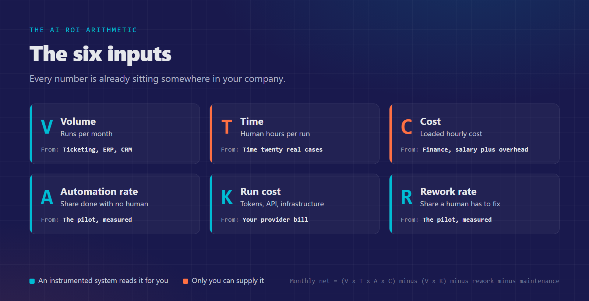
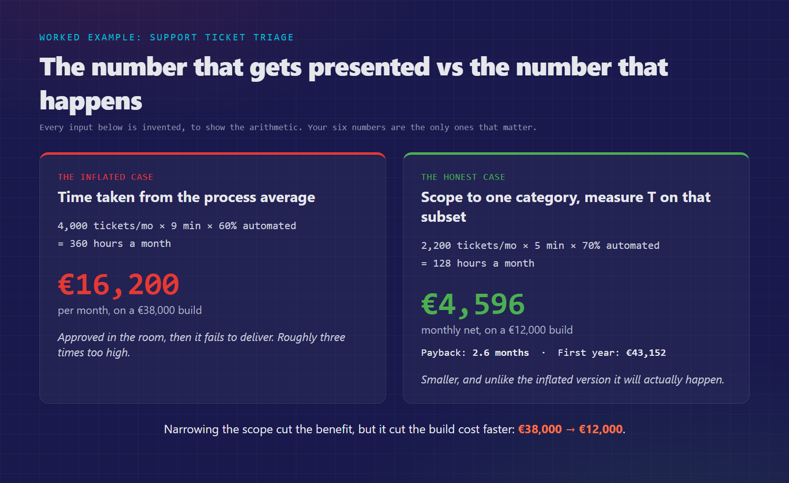
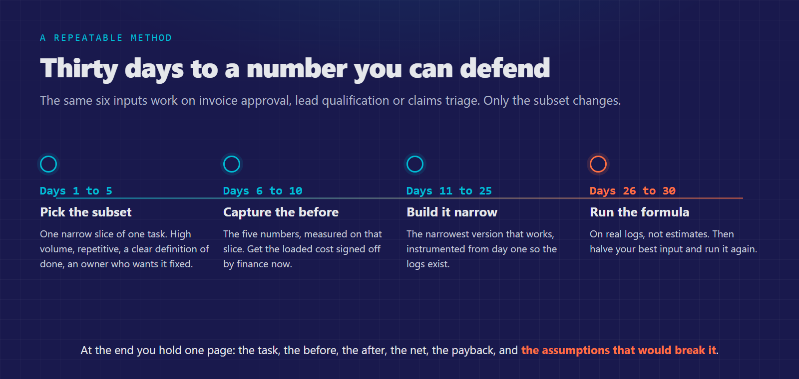

*Everyone selling AI promises a return. Nobody can prove one. Here is the arithmetic a decision maker can run in a week, with numbers already sitting in the company.*

Before writing this I went looking for a number.

We build tools that developers and companies use to put AI agents inside applications that are already running their business. So I went through what our users publish: the projects, the write-ups, the posts. Real systems, in production, doing useful work.

Every one of them describes **what they built**. Not one describes **what it returned**.

That is not a failure of my search. It is the finding. And to be clear before I go any further: that includes us. Nobody in this market is doing this work properly, ourselves included, and I would rather say so than sell you a case study with a suspiciously round percentage on it.

So this article does not tell you what AI will return for your company. Nobody can tell you that, and anybody who does is extrapolating from somebody else's business. What I can hand you is the method, which is the only honest thing to hand over.

## What the data says, and what it does not

A recent report on AI adoption in Italy ("2026: AI in Italia, oltre l'hype", Osservatorio AI Improove with the AUSED network) put numbers on something I see in every market I work in. Its sample is not the average company: 37% C-level, 24% VP and director, mostly tech, finance and consulting, a third of them enterprise. These are the people who moved first.

Even there:

- 73% already use AI agents in production or in testing
- 40% have projects that stall before production
- 1 in 2 name proving the ROI as their single biggest barrier, ahead of skills, cost and regulation
- 1 in 3 operate with no formal AI governance at all

One detail stayed with me more than the percentages. In a full room, asked who can measure the value their AI is generating, ten or fifteen hands go up.

Notice what the report does **not** contain: any figure for what AI actually returns. That absence is consistent everywhere I look, and it is the whole problem. The technology arrived, the proof did not, and every decision maker is being asked to fund the next project on faith one more time. After the second or third time, they stop. Correctly.

## If this reminds you of RPA, it should

Repetitive task, hours saved, payback in months. That is the exact shape of the RPA business cases of 2018, and RPA became the most cited ROI disappointment of the decade. If you have that scar, you are right to raise it now rather than in month nine.

Two things were wrong then, and it is worth being precise about what is different.

RPA automated **gestures**, not decisions. It clicked through interfaces, so it broke every time a screen changed, and the maintenance cost quietly ate the savings. It also had no notion of a task that could pause: anything requiring judgment fell out of the flow and back onto a person, uncounted.

An agent working as a stateful workflow reads content and decides on it, so an interface change is not a breakage. It can pause for a human and resume, so the human step is inside the process instead of outside it, and therefore measurable. That is a real difference, but it is not a guarantee, and the maintenance line stays in the model below for exactly this reason.

## Change the unit: stop evaluating the AI

Most pilots start as an assistant: a chat box, a copilot, a "try it and see". An assistant has no unit of work. If someone asks it eight questions and feels faster, what did you buy? Nothing countable, therefore nothing to attribute. This is the single most common reason a pilot cannot graduate. Not that it works badly, but that nobody can say what it did.

So do not evaluate the AI. Evaluate **one repeated task inside a process you already run**.

A task happens N times a month. It takes a person T minutes. It has a cost per unit and a failure rate. It is already an economic object, and your company has been paying for it for years without giving it a line in the budget.

## The six inputs

|  | Input | Where it comes from |
| --- | --- | --- |
| **V** | Volume: runs per month | Ticketing, ERP, CRM |
| **T** | Human hours per run | Time twenty real cases |
| **C** | Loaded hourly cost | Finance: salary plus overhead |
| **A** | Automation rate: share completed without a human | The pilot, measured |
| **K** | Run cost per task: tokens, API, infrastructure | Your provider bill |
| **R** | Rework rate: share of automated runs a human fixes, and how long | The pilot, measured |

> **Monthly net = (V × T × A × C) − (V × K) − rework − maintenance**  
> **Rework = V × A × R × T_fix × C**  
> **Payback (months) = build cost / monthly net**

There is nothing clever here, and that is the point. Every term is a number somebody in your company already owns and can defend in a meeting.

## The mistake that inflates almost every AI business case

This one is worth more than the rest of the article, because it is where nearly everybody goes wrong, in good faith.

You will be tempted to take T from the process average. Do not.

**Automation takes the easy cases first, and the easy cases are by definition below the average.** If your support queue averages nine minutes a ticket, the subset an agent can close on its own is not a nine minute subset. It is a five minute subset. The hard, expensive, ambiguous tickets are exactly the ones still landing on a person.

Use the average and your business case inflates by two to three times. It will be approved, and then it will fail to deliver, and the next three AI proposals in your company will die because of it.

**The rule: define the exact subset the agent will handle, and measure T only on that subset.** Narrower scope, smaller number, and a business case that survives contact with reality.

## A worked example

Support ticket triage. **Every input below is invented.** It is here to show the arithmetic, not to suggest what you should expect. Your six numbers are the only ones that matter.

**The wrong version first.** 4,000 tickets a month, nine minutes each, 60% automated: 360 hours a month, €16,200. That is the number that gets presented, and it is roughly three times too high.

**The corrected version.** We scope the agent to one category, order status and delivery questions.

- V = 2,200 tickets a month in that category
- T = 5 minutes (0.083 h), measured on that category, not the queue average
- C = €45 per hour, loaded
- A = 70% closed with no human touch (narrow scope, higher rate)
- K = €0.05 per run
- R = 8% need a fix, 6 minutes each
- Build = €12,000 (three weeks, one engineer, because the scope is narrow)
- Maintenance = €500 a month

**The arithmetic**

- Hours removed: 2,200 × 0.083 × 0.70 = **128 hours a month**
- Gross: 128 × €45 = €5,760
- Run cost: 2,200 × €0.05 = €110
- Rework: 1,540 × 8% = 123 fixes × 0.1 h × €45 = €554
- Maintenance: €500

> **Monthly net: €4,596. Payback: 2.6 months. First year net of build: €43,152.**

Smaller than the inflated version, and unlike the inflated version it will actually happen.

Note what narrowing did to both sides of the ledger. The benefit fell, but the build cost fell faster, from €38,000 to €12,000. Scope is not just a risk control, it is the main lever on payback.

## What if I am wrong by half

Answer this before the room asks. Halve the most optimistic input, the automation rate, from 70% to 35%:

- 64 hours a month, worth €2,880
- Minus run cost, rework and maintenance: **monthly net €1,999**
- **Payback: 6 months. First year: €11,988.**

Still positive, so the project survives being wrong by half. That sentence is worth more in a board meeting than any headline number, and if your case only works at the optimistic value, you have learned something extremely valuable for the price of one afternoon.

## Two of the six will never come from a tool

I want to be straight about this, because this is where vendors usually overclaim.

If your system is properly instrumented, **V, A, R and K fall out of it**. How many times it ran, how many runs finished with no human, how often a human corrected it, what each run cost. You do not estimate those, you read them.

**T and C are on you.** No observability platform will ever tell you how long a human used to take, or what that human costs fully loaded. Those two dominate the result, and they are the two nobody can automate for you.

That is precisely why you capture them **before** the pilot goes live. Once the agent is running, the "before" is gone forever and every claim becomes an opinion.

## Capture the before: one week, five numbers

1. **Volume** of the specific subset, weekly, for the last three months
2. **Time**: stopwatch twenty real cases from that subset, keep the median
3. **Cost**: the loaded hourly rate, agreed with finance in advance
4. **Quality**: current error or rework rate, however roughly
5. **Cycle time**: elapsed time from request to done, not hands on time

One week of work, and every claim you make for the next two years is anchored.

## The value you are not counting

Labour hours are the easiest bucket, not the biggest.

**Cycle time.** First response going from four hours to ninety seconds changes outcomes, not just costs: inbound conversion, SLA penalties, invoices approved days earlier and therefore cash collected earlier. Ask finance what one day of average cycle time is worth in your process. It often dwarfs the labour line.

**Risk and consistency.** A traced workflow applies the same rule every time and records who decided what. In the same report, 39% have not even assessed the impact of the AI Act on their business. That log is the audit trail.

**Capacity, honestly stated.** Freed hours are money only if something happens to them. In the example, 128 hours a month is about 0.8 of a full time person on that queue, and ticket volume is growing 15% a year: the saving is the hire planned for Q3 that no longer happens. If nothing concrete happens to the hours, you saved time and no money. Say that out loud rather than let a CFO find it in month four.

## Why architecture decides whether any of this is possible

The measurement problem is not really a management problem.

A chat endpoint that answers well is a demo. There is no unit of work and no record, so there is nothing to attribute. When the question comes, you have nothing to hand over.

An agent built as a workflow is a different object. It reads, decides, calls your tools, finishes the task, and leaves a trail of every step. That trail is not developer plumbing, it is the raw material of the business case.

It is why we built Neuron the way we did. Every agent is a workflow: state that persists across steps, pause and resume, human in the loop as a first class feature, and a full execution timeline through Inspector showing every decision, every tool call and what each run cost. And it runs in PHP, inside the applications teams already have, which removes the largest hidden line in most AI business cases: the rewrite.

You do not need our stack to use the arithmetic in this article. You do need a stack that leaves a trail.

## Thirty days to a number you can defend

1. **Days 1 to 5.** Pick one narrow subset of one task. High volume, repetitive, clear definition of done, an owner who wants it fixed.
2. **Days 6 to 10.** Capture the before, the five numbers above. Get C signed off by finance now.
3. **Days 11 to 25.** Build the narrowest version that works, instrumented from day one.
4. **Days 26 to 30.** Run the formula on real logs, not estimates. Then halve your best input and run it again.

The same six inputs work unchanged on invoice approval, lead qualification, document classification or claims triage. Only the subset changes.

At the end you hold one page: the task, the before, the after, the net, the payback, and the assumptions that would break it. That page turns the second project from a debate into a decision.

## The part I would argue

The report closes on a line worth repeating: AI pays off where somebody has built the method to prove it.

I would go further. The market is not stuck on technology, and at this point it is not even stuck on skills. It is stuck because almost nobody is doing the quantification work, so the whole thing runs on faith, and faith runs out.

That is a solvable problem, and it is arithmetic.

You do not need a tool for this. The six inputs are in this article, the formula is three lines, and every number is already sitting somewhere in your company. Run it on one task this month, and halve your best input to see if it still holds. If you do run it, I would genuinely like to know what came out, including the cases where the answer was no. Those are the numbers this market is missing, and the only way they start existing is if the people doing the arithmetic start sharing what it told them.

**Best,**  
**Francesco Criscuolo**
