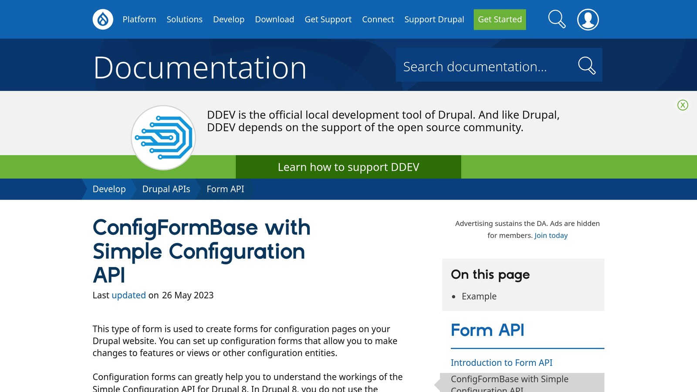

Want to create a custom form in [Drupal](https://www.drupal.org/)? Here's a quick guide to get started:

- **Set Up a Custom Module**: Create a module with a proper directory structure and `.info.yml` file.
- **Build a Form Class**: Use `ConfigFormBase` to design your form and manage configurations.
- **Add Form Fields**: Define fields like text inputs, checkboxes, and emails, pulling default values from your configuration.
- **Set Up Routing and Menus**: Create `.routing.yml` and `.links.menu.yml` files to make your form accessible in the admin interface.
- **Save and Retrieve Data**: Use Drupal's configuration system to handle form data securely and efficiently.

With these steps, you can build forms for site settings, data collection, or any custom functionality. Keep reading for detailed instructions and examples.

## Create a Custom Module

To build your form, start by creating a custom module. Drupal requires a specific directory structure and naming conventions for modules, so let's break it down.

### Module File Structure

Your custom module should include these essential files:

```
custom_module/
├── custom_module.info.yml
├── custom_module.routing.yml
├── custom_module.links.menu.yml
└── src/
    └── Form/
        └── CustomConfigForm.php
```

Make sure the module name is lowercase and uses underscores. Place it in the `modules/custom` directory of your Drupal installation. This keeps your custom code separate from Drupal core and contributed modules.

### Setting Up the .info.yml File

The `.info.yml` file defines your module's basic information. Here's an example:

```yaml
name: Custom Module
type: module
description: 'Provides a custom configuration form.'
package: Custom
core_version_requirement: ^9 || ^10
configure: custom_module.settings
```

Key elements in this file:

- **name**: The module's name as it appears in the admin interface.
- **type**: Always "module" for custom modules.
- **core_version_requirement**: Specifies the Drupal core versions your module supports.
- **description**: A short explanation of what your module does.
- **package**: Groups your module under a specific category in the admin interface.
- **configure**: Points to your form's route, adding a "Configure" link in the Extend page.

### Enabling the Module

Once your files are set up, enable the module through the admin interface at `/admin/modules` or use [Drush](https://www.drush.org/):

```bash
drush en custom_module
```

After enabling, clear Drupal's cache to ensure all the new files are properly loaded:

```bash
drush cr
```

With the module enabled, you're ready to create the form class for your custom configuration form.

## Create the Form Class

With your module structure ready, it’s time to create the form class that will manage your configuration settings. This class will extend `ConfigFormBase`, making use of Drupal's built-in configuration system.

### Use [ConfigFormBase](https://www.drupal.org/docs/drupal-apis/form-api/configformbase-with-simple-configuration-api) Class



Start by creating a new file called `CustomConfigForm.php` in your module's `src/Form` directory. Use the following structure as a starting point:

```php
namespace Drupal\custom_module\Form;

use Drupal\Core\Form\ConfigFormBase;
use Drupal\Core\Form\FormStateInterface;

class CustomConfigForm extends ConfigFormBase {
  // Form implementation will go here
}
```

The `ConfigFormBase` class simplifies how configuration is stored and processed in forms.

### Add Required Methods

Next, implement these methods to connect your form to Drupal's configuration system:

```php
protected function getEditableConfigNames() {
  return ['custom_module.settings'];
}

public function getFormId() {
  return 'custom_module_settings';
}
```

### Add Form Fields

Now, expand the form by defining fields for your configuration settings:

```php
public function buildForm(array $form, FormStateInterface $form_state) {
  $config = $this->config('custom_module.settings');

  $form['settings'] = [
    '#type' => 'vertical_tabs',
    '#title' => $this->t('Settings'),
  ];

  $form['general'] = [
    '#type' => 'details',
    '#title' => $this->t('General Settings'),
    '#group' => 'settings',
  ];

  $form['general']['site_name'] = [
    '#type' => 'textfield',
    '#title' => $this->t('Site Name'),
    '#default_value' => $config->get('site_name'),
    '#required' => TRUE,
    '#maxlength' => 64,
  ];

  $form['general']['email'] = [
    '#type' => 'email',
    '#title' => $this->t('Email'),
    '#default_value' => $config->get('email'),
    '#required' => TRUE,
  ];

  $form['general']['enable_feature'] = [
    '#type' => 'checkbox',
    '#title' => $this->t('Enable Feature'),
    '#default_value' => $config->get('enable_feature'),
    '#description' => $this->t('Toggle this feature on/off'),
  ];

  return parent::buildForm($form, $form_state);
}

public function submitForm(array &$form, FormStateInterface $form_state) {
  $this->config('custom_module.settings')
    ->set('site_name', $form_state->getValue('site_name'))
    ->set('email', $form_state->getValue('email'))
    ->set('enable_feature', $form_state->getValue('enable_feature'))
    ->save();

  parent::submitForm($form, $form_state);
}
```

Here’s what you should keep in mind when defining form fields:

- Use descriptive machine names for field keys.
- Wrap user-facing strings in `$this->t()` to enable translation.
- Pull default values from the configuration to pre-fill fields.
- Add clear descriptions for fields that might need explanation.
- Group related fields using the `details` element for better organization.
- Validate input through form validation methods as necessary.

This example shows how to efficiently collect and store settings like the site name, email, and a feature toggle option.

###### sbb-itb-f1cefd0

## Set Up Routes and Menus

Make your form available in Drupal's admin interface by setting up routes and menus.

### Create the .routing.yml File

Define the route for your form in a file named `custom_module.routing.yml`:

```yaml
custom_module.settings_form:
  path: '/admin/config/system/custom-module'
  defaults:
    _form: '\Drupal\custom_module\Form\CustomConfigForm'
    _title: 'Custom Module Settings'
  requirements:
    _permission: 'administer site configuration'
  options:
    _admin_route: TRUE
```

Here's what this configuration does:

- **Defines the URL** for your form and how it should be handled.
- **Specifies the form class** to be used.
- **Sets access permissions** for who can view the form.
- **Marks it as an admin route** for proper categorization in the admin interface.

Once the route is set, the next step is to link it to the admin menu.

### Add Admin Menu Links

To make your form accessible through the admin menu, create a file called `custom_module.links.menu.yml` in your module's root directory:

```yaml
custom_module.admin_settings:
  title: 'Custom Module'
  description: 'Configure custom module settings'
  parent: system.admin_config_system
  route_name: custom_module.settings_form
  weight: 100
```

This configuration will:

- Add your form under the **System** section in the admin menu.
- Display a descriptive title and tooltip for the menu link.

You can also add a local tasks menu for the module's configuration:

```yaml
custom_module.settings_task:
  route_name: custom_module.settings_form
  title: 'Settings'
  base_route: custom_module.settings_form
```

Finally, clear the cache to apply your changes:

```bash
drush cr
```

Now, your form will be accessible via:

- The admin menu under **Configuration → System → Custom Module**.
- The local tasks menu when viewing the module's configuration page.

## Work with Form Data

In Drupal, you can access saved configurations in other module components using **ConfigFactoryInterface**. This method helps keep your module organized and easier to maintain by leveraging Drupal's configuration management system.

### Retrieve Saved Settings

Here’s how you can retrieve saved settings in your code:

```php
use Drupal\Core\Config\ConfigFactoryInterface;

class YourClass {
  protected $configFactory;

  public function __construct(ConfigFactoryInterface $configFactory) {
    $this->configFactory = $configFactory;
  }

  public function getSavedSettings() {
    $config = $this->configFactory->get('custom_module.settings');
    $value = $config->get('your_field_name');
    return $value;
  }
}
```

### Practical Code Examples

Below are examples of how to work with form data in various scenarios:

```php
// Example 1: Retrieve a single configuration value
$config = $this->configFactory->get('custom_module.settings');
$emailAddress = $config->get('notification_email');

// Example 2: Retrieve multiple values with default fallbacks
$settings = $config->get();
$emailAddress = $settings['notification_email'] ?? 'default@example.com';
$threshold = $settings['alert_threshold'] ?? 100;

// Example 3: Use configuration in a service
public function sendNotification($message) {
  $config = $this->configFactory->get('custom_module.settings');
  $recipientEmail = $config->get('notification_email');
  $notificationEnabled = $config->get('enable_notifications');

  if ($notificationEnabled) {
    // Logic for sending the notification
    $this->mailer->send($recipientEmail, $message);
  }
}
```

When retrieving configuration values, it’s a good idea to use the **null coalescing operator (??)** to provide default values. You should also validate data types and ensure your configuration schema is defined.

### Handling Complex Configurations

For more complex configuration structures, consider using a dedicated service class. This keeps your code cleaner and adheres to dependency injection principles:

```php
use Drupal\Core\Config\ConfigFactoryInterface;

class ConfigurationManager {
  protected $configFactory;

  public function __construct(ConfigFactoryInterface $configFactory) {
    $this->configFactory = $configFactory;
  }

  public function getNotificationSettings(): array {
    $config = $this->configFactory->get('custom_module.settings');
    return [
      'enabled' => (bool) $config->get('enable_notifications'),
      'email' => $config->get('notification_email'),
      'frequency' => $config->get('notification_frequency'),
    ];
  }
}
```

Using a dedicated service class provides a reusable and structured way to access your module's configuration. This approach not only keeps your codebase consistent but also aligns with service-oriented architecture best practices.

## Conclusion

Now that you've gone through the steps, here's a quick recap and some ideas to take your form to the next level.

### Summary Steps

Here's what you've done so far:

- **Module Setup**: Created a custom module with the correct file structure and a `.info.yml` file.
- **Form Class**: Extended `ConfigFormBase` and implemented the necessary methods.
- **Routes**: Configured a `.routing.yml` file to provide access to the form.
- **Menu**: Set up a `.links.menu.yml` file to make the form visible in the admin menu.
- **Configuration**: Used `custom_module.settings` in `getEditableConfigNames` for managing settings.

### Next Steps

Want to enhance your form? Here are some ideas:

- **Form Validation**: Use the `validateForm()` method to add custom validation rules and ensure data integrity.
- **AJAX Integration**: Introduce dynamic updates and real-time interactions to make your form more user-friendly.
- **Advanced Features**: Explore options like multi-step workflows, file uploads, custom field types, form state management, or conditional elements for more complex requirements.

These additions can make your form more dynamic and tailored to specific needs.

## Related Blog Posts

- [Symfony file upload examples and best practices](/symfony-file-upload-examples-and-best-practices/)
- [Laravel Logging: Setup and Use](/log-channels-in-laravel-setup-and-use/)
- [5 Common Laravel Exceptions Explained](/5-common-laravel-exceptions-explained/)
