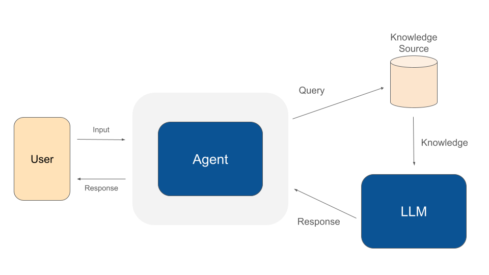
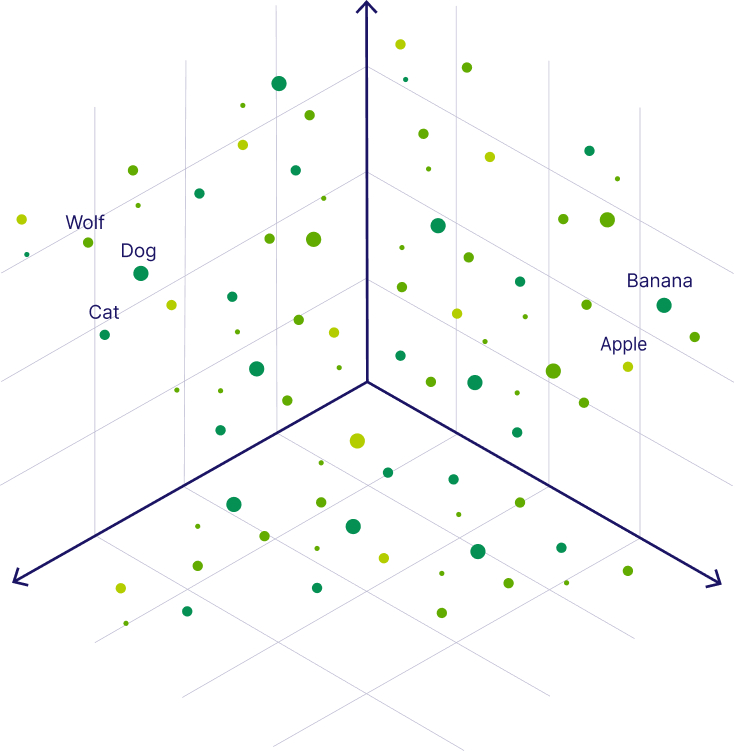
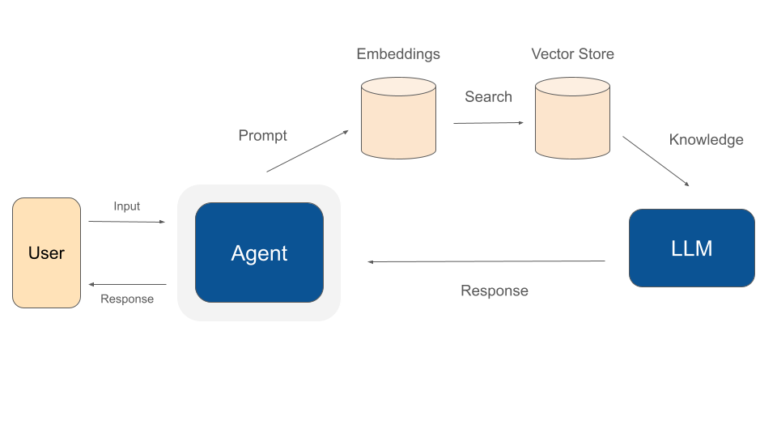
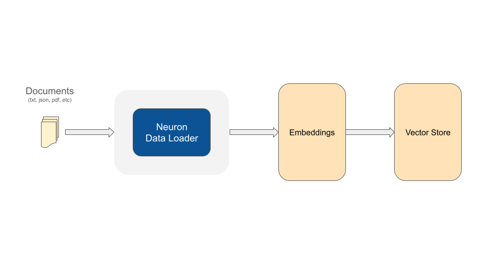
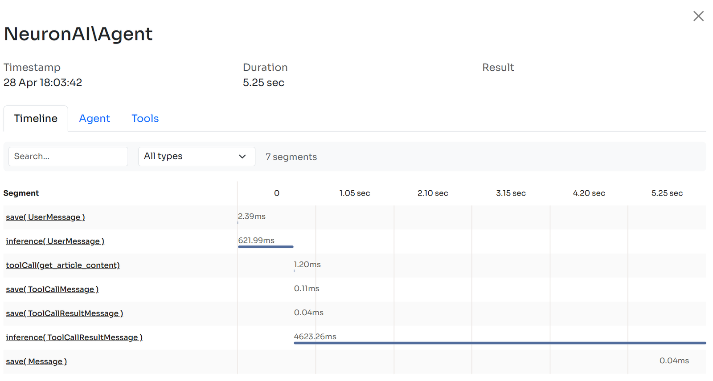

To be honest, when I first encountered the term "RAG", I felt like I was staring at a wall of technical jargon. You've probably heard a lot of buzzwords floating around the AI Agents topic: vector databases, embeddings, retrieval augmented generation. These concepts can feel overwhelming, especially when every tutorial assumes you already understand the fundamental building blocks. After spending countless hours building agents with [Neuron AI](https://github.com/inspector-apm/neuron-ai), I've learned that the real challenge isn't the implementation—it's grasping what these systems actually do and why they matter.

Let me start by demystifying what RAG actually stands for and why it's become the cornerstone of modern AI agent development.

## Understanding the Foundation: What RAG Really Means

Retrieval Augmented Generation breaks down into three critical components that work in harmony to solve a fundamental problem in AI: how do we give language models access to specific, up-to-date, or proprietary information that wasn't part of their original training data?

The “G” part of the *RAG* acronym is straightforward—we're talking about “Generative” AI models like GPT, Claude, Gemini, or any large language model that can produce human-like text responses. These models are incredibly powerful, but they have a significant limitation: they only know what they were trained on, and that knowledge has a cutoff date. They can't access your company's internal documents, your personal notes, or real-time information from your databases.

This is where the "Retrieval Augmented" component becomes transformative. Instead of relying solely on the model's pre-trained knowledge, we augment its capabilities by retrieving relevant information from external sources at the moment of generation. Think of it as giving your AI agent a research assistant that can instantly find and present relevant context before answering any question.

Below you can see an example of how this process should work:



## The Magic Behind Embeddings and Vector Spaces

To understand how retrieval works in practice, we need to dive into embeddings—a concept that initially seems abstract but becomes intuitive once you see it in action. An embedding is essentially a mathematical representation of text, images, or any data converted into a list of numbers called a vector. What makes this powerful is that similar concepts end up with similar vectors, creating a mathematical space where related ideas cluster together.



When I first started working with Neuron AI, I was amazed by how this actually works in practice. Imagine you have thousands of documents—customer support tickets, product manuals, internal wikis, research papers. Traditional keyword search would require exact matches or clever Boolean logic to find relevant information. But with embeddings, you can ask a question like "How do I troubleshoot connection issues?" and the system will find documents about network problems, authentication failures, and server timeouts, even if those documents never use the exact phrase "connection issues".

The process works by converting both your question and all your documents into these mathematical vectors. The system then calculates which document vectors are closest to your question vector in this multi-dimensional space. It's like having a librarian who understands the meaning and context of your request, not just the literal words you used.

You can go deeper into this technology in the article below.

[Vector Store & AI Agents - Beyond The Traditional Data Storage](/vector-store-ai-agents-beyond-the-traditional-data-storage/)

## Vector Databases: The Memory System Your Agent Needs

This brings us to vector databases, which serve as the memory system for your RAG agent. Traditional databases are excellent for structured data—names, dates, categories, transactions. But they struggle with the nuanced relationships between concepts and ideas. Vector databases are specifically designed to store these embedding vectors and perform lightning-fast similarity searches across millions of documents.

During my experience developing with Neuron AI, I've seen how vector databases transform the user experience. Instead of agents that give generic responses or claim they don't have access to specific information, you get agents that can instantly access and synthesize information from your entire knowledge base. The agent doesn't just know about general topics—it knows about your specific products, your company's policies, your customer's history, and your unique business context.

## The Challenge of RAG Implementation

The conceptual understanding of RAG is one thing, actually building a working system is another challenge entirely. This is where the complexity really emerges, and it's why Neuron is such a valuable tool for PHP developers entering this space.

The ecosystem involves multiple moving parts: you need to chunk your documents effectively, generate embeddings using appropriate models, store and index those embeddings in a vector database, implement semantic search functionality, and then orchestrate the retrieval and generation process seamlessly.



Each of these steps involves technical decisions that can significantly impact your agent's performance. How do you split long documents into meaningful chunks? Which embedding model works best for your domain? How do you handle updates to your knowledge base? How do you balance retrieval accuracy with response speed? These questions become more pressing when you're building production systems that need to scale and perform reliably.

Working with Neuron has taught me that successful RAG implementation isn't just about understanding the individual components—it's about orchestrating them into a cohesive system that feels natural and intelligent to users. Neuron framework handles many of the complex integration challenges, allowing developers to focus on the business logic and user experience rather than the underlying infrastructure.

In the detailed implementation guide that follows, we'll explore how Neuron AI simplifies this complex orchestration, providing PHP developers with tools and patterns that make RAG agent development both accessible and powerful.

## Install Neuron AI

Install the latest version with the composer command below:

```bash
composer require neuron-core/neuron-ai
```

## Implement the first RAG Agent

To create your RAG agent you must extend the \`NeuronAI\\RAG\\RAG\` class, and attach the required components such as a vector store, and an embeddings provider along with the AI provider.

Here is an example of a RAG class:

```php
<?php

namespace App\Neuron;

use NeuronAI\Providers\AIProviderInterface;
use NeuronAI\Providers\Anthropic\Anthropic;
use NeuronAI\RAG\Embeddings\EmbeddingsProviderInterface;
use NeuronAI\RAG\Embeddings\OpenAIEmbeddingProvider;
use NeuronAI\RAG\RAG;
use NeuronAI\RAG\VectorStore\FileVectoreStore;
use NeuronAI\RAG\VectorStore\VectorStoreInterface;

class MyChatBot extends RAG
{
    protected function provider(): AIProviderInterface
    {
        return new Anthropic(
            key: 'ANTHROPIC_API_KEY',
            model: 'ANTHROPIC_MODEL',
        );
    }
    
    protected function embeddings(): EmbeddingsProviderInterface
    {
        return new OpenAIEmbeddingProvider(
            key: 'OPENAI_API_KEY',
            model: 'OPENAI_MODEL'
        );
    }
    
    protected function vectorStore(): VectorStoreInterface
    {
        return new FileVectoreStore(
            directory: __DIR__,
            key: 'demo'
        );
    }
}
```

In the example above we provided the agent with a connection to:

- The LLM (Anthropic in this case)
- The Embedding provider - service able to transform text into vector embeddings
- The vector store to persist the generated embeddings and perform document retrieval

You have plenty of options for each of these components, so feel free to explore the documentation to choose your preferred ones: [https://docs.neuron-ai.dev/components/ai-provider](https://docs.neuron-ai.dev/components/ai-provider)

## Feed Your RAG With A Knowledge Base

At this stage the vector store behind our RAG agent is empty. If we send a prompt to the agent it will be able to respond leveraging only the underlying LLM training data.

```php
use NeuronAI\Chat\Messages\UserMessage;

$response = MyChatBot::make()
    ->chat(
        new UserMessage('What size is the door handle on our top car model?')
    );
    
echo $response->getContent();

// I don't really know specifically about your top car model. Do you want to provide me with additional information?
```

We need to feed the RAG with some knowledge to make it able to respond to questions about private information outside its default training data.

## Neuron AI Data Loader

To build a structured AI application you need the ability to convert all the information you have into text, so you can generate embeddings, save them into a vector store, and then feed your Agent to answer the user's questions.



Neuron gives you several tools (data loaders) to simplify this process. In order to answer the previous question (*How can I create an AI Agent with Neuron AI?*) we can feed the rag with the *README.md* file of the Neuron composer package.

```php
use NeuronAI\RAG\DataLoader\FileDataLoader;

MyChatBot::make()->addDocuments(
    // Use the file data loader component to process a text file
    FileDataLoader::for(__DIR__.'/README.md')->getDocuments()
);
```

Using the Neuron AI you can create data loading pipelines with the benefits of unified interfaces to facilitate interactions between components, like embedding providers, vector stores, and file readers.

The code above must be implemented in a separated command and executed to make your chatbot able to answer questions about Neuron AI. You load text files, PDF, simple strings from a database and other sources. Explore the dedicated section in the documentation: [https://docs.neuron-ai.dev/components/data-loader](https://docs.neuron-ai.dev/components/data-loader)

After loading data into the RAG agent we can now send our question again:

```php
use NeuronAI\Chat\Messages\UserMessage;

$response = MyChatBot::make()
    ->chat(
        new UserMessage('How can I create an agent with Neuron AI PHP framework?.')
    );
    
echo $response->getContent();

// Neuron is an AI that simplifies the development of AI Agents in PHP. 
// Here is an example of how to implement an AI Agent using Neuron components...
```

## Monitoring & Debugging

Integrating AI Agents into your application you’re not working only with functions and deterministinc code, you program your agent also influencing probability distributions. Same input ≠ output. That means reproducibility, versioning, and debugging become real problems.Share feedback on the editor

Many of the Agents you build with NeuronAI will contain multiple steps with multiple invocations of LLM calls, tool usage, access to external memories, etc. As these applications get more and more complex, it becomes crucial to be able to inspect what exactly your agent is doing and why. Share feedback on the editor

Why is the model taking certain decisions? What data is the model reacting to? Prompting is not programming in the common sense. No static types, small changes break output, long prompts cost latency, and no two models behave exactly the same with the same prompt.Share feedback on the editor

The [Inspector](/) team designed NeuronAI with built-in observability features, so you can monitor AI agents were running, helping you maintain production-grade implementations with confidence.



## Resources

If you are getting started with AI Agents, or you simply want to elevate your skills to a new level here is a list of resources to help you go in the right direction:

- **Neuron AI – Agent Development Kit for PHP**: [https://github.com/inspector-apm/neuron-ai](https://github.com/inspector-apm/neuron-ai)
- **Newsletter**: [https://neuron-ai.dev](https://neuron-ai.dev/)
- **E-Book (Start With AI Agents In PHP)**: [https://www.amazon.com/dp/B0F1YX8KJB](https://www.amazon.com/dp/B0F1YX8KJB)

## Moving Forward: From Theory to Practice

The complexity of orchestrating embeddings, vector databases, and language models might seem a bit daunting, but remember that every expert was once a beginner wrestling with these same concepts.

The next step is to dive into the practical implementation using Neuron AI. The framework is designed specifically to bridge the gap between RAG theory and production-ready agents, handling the complex integrations while giving you the flexibility to customize the behavior for your specific use case. Start building your first RAG agent today and discover how powerful context-aware AI can transform your applications.
