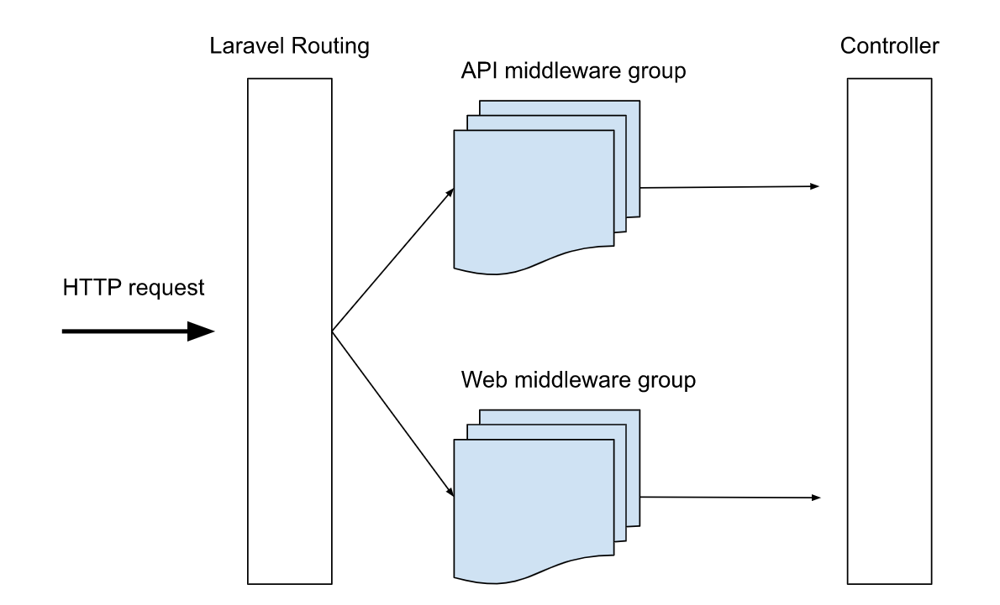

In this article I will show you how Laravel Middlewares work like a filtering pipeline to process http requests before they come into the controller.

I'm Valerio, software engineer and CTO at Inspector, a [Laravel package](https://github.com/inspector-apm/inspector-laravel) that works with middleware to monitor what your application is doing HTTP traffic in real-time in your Laravel application.

For more technical articles you can follow me on [**Linkedin**](https://www.linkedin.com/in/valeriobarbera/) or **[X](https://x.com/Barbalerio)**.

## What is middleware?

A middleware is a class to pass HTTP requests through. These classes can be concatenated and organized to create custom filtering paths of HTTP requests flowing into your application.

Here is a simplified schema of how the middleware system works inside a Laravel application.



They are a layer that acts in the middle between the reception of the http request in the web server and the controller.

Laravel already ships with a ton of default configured middleware out of the box if you check in the **app/Http/Middleware** directory.

All of the default middlewares and custom ones must be registered in the **app/Http/Kernel.php** file before being used. The Kernel class is also the place where you have to register your own custom middleware.

## Steps for creating Custom Middleware in Laravel Application

The following PHP artisan command can be used to create middleware files, so launch your terminal (or command prompt on Windows) and go to your application directory, then type the following command:

```bash
php artisan make:middleware SecretHeaders
```

This command will create a new **SecretHeaders.php** file in the **app/Http/Middleware** directory.

```php
namespace App\Http\Middleware;

use Closure;

class SecretHeaders 
{
    /**
     * Handle an incoming request.
     *
     * @param \Illuminate\Http\Request $request
     * @param \Closure $next
     * @return mixed
     */
    public function handle($request, Closure $next)
    {
        // Your code here...

        return $next($request);
    }
}
```

The middleware must include logic to process the HTTP request. In this instance, our validation criteria are to see if the request has some headers needed to allow it to go through.

Let's use the following script to create logic to verify the secret header:

```php
class SecretHeaders 
{
    /**
     * Handle an incoming request.
     *
     * @param \Illuminate\Http\Request $request
     * @param \Closure $next
     * @return mixed
     */
    public function handle($request, Closure $next)
    {
        if (!is_null($request->header('x-secret-key', null))) {
			return $next($request);
		}

        abort(401);
    }
}
```

In the logic above, the request will be rejected if it doesn’t contain the "x-secret-key" header.In order to use the middleware we must register it in the **app/Http/Kernel.php** file in the $routeMiddleware section:

```php
protected $routeMiddleware = [
    ...,
    'verify.secret’ => \App\Http\Middleware\SecretHeaders::class,
];
```

Now you can add this restriction to specific routes so that only authorized requests can access the endpoints.

```php
Route::get(‘/api/protected-endpoint’, App\Http\Controllers\ProtecrtedController@action’)->middleware(['auth', 'verify.secret']);
```

## How to use Inspector middleware to monitor your Http traffic

Inspector library for Laravel applications ships with a pre-packaged middleware that allows you to observe what happens inside your application during HTTP requests fulfillment.

First install the Inspector package with the command below:

```bash
composer require inspector-apm/inspector-laravel
```

Then you need to configure an ingestion key in your environment file. Get a new ingestion key creating a new project in your [Inspector account](https://app.inspector.dev/register).

```bash
INSPECTOR_INGESTION_KEY=xxxxxxxxxxxxxxxxxxxxxxx
```

Now you can attach the Inspector middleware in the **app/Http/Kernel.php** file:

```php
/**
 * The application's route middleware groups.
 *
 * @var  array
 */
protected $middlewareGroups = [
    'web' => [
        ...,
        \Inspector\Laravel\Middleware\WebRequestMonitoring::class,
    ],

    'api' => [
        ...,
        \Inspector\Laravel\Middleware\WebRequestMonitoring::class,
    ]
];
```

Attaching the middleware to the predefined "web" and "api" middleware groups you will probably be able to monitor the entire application.

Learn more about http request monitoring in the official Inspector documentation: [https://docs.inspector.dev/guides/laravel/http-requests-monitoring](https://docs.inspector.dev/guides/laravel/http-requests-monitoring)

## Ignore Http Requests

Sometimes it could be needed to turn off monitoring on specific urls. Think about paths like /nova, /telescope, or other parts of your app that don't affect the user experience.

First you need to publish the Inspector configuration file using the command below:

```bash
php artisan vendor:publish --provider="Inspector\Laravel\InspectorServiceProvider"
```

Add the urls you don’t want to monitor in the “ignore_url” configuration parameter. You can also use the wildcard character "\*" to exclude all sub-paths.

```php
/*
 |---------------------------------------------------------------------
 | Web request url to ignore
 |---------------------------------------------------------------------
 |
 | Add at this list the url schemes that you don't want monitoring
 | in your Inspector dashboard. You can also use wildcard expression (*).
 |
 */
 
'ignore_url' => [
    'telescope*',
    'vendor/telescope*',
    'horizon*',
    'vendor/horizon*',
],
```

For more technical articles you can follow me on [**Linkedin**](https://www.linkedin.com/in/valeriobarbera/) or **[X](https://x.com/Barbalerio)**.
