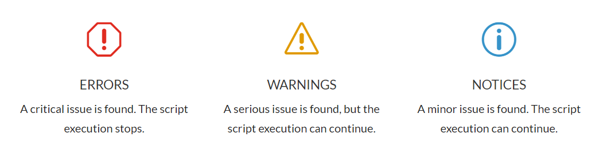

*Alex*

Hey, I recently had the pleasure of speaking with Alex ([https://alexwebdevelop.com](https://alexwebdevelop.com)), a highly experienced Italian PHP developer who helps companies develop and maintain their PHP applications.

I agreed to post one of his articles on our blog. I hope it will be useful for you to better understand some technical details about PHP.

---

How do you **debug your PHP code**, without using a debugger?

In this tutorial, you will learn how to debug your PHP scripts **the easy way**. In fact, I’m going to show you exactly how to:

- Display PHP errors and warnings
- Debug variables and functions
- Save debugging logs to the database or to a file
- Send debug data to an email address

So, if you want to debug your PHP code without installing a debugger, this is the guide for you.

Let’s get started.

## About PHP debugging

When your PHP scripts don’t work as expected, you need to debug them to see what’s wrong.

However, setting up a debugging environment is a complex process that requires the installation of a PHP debugger like [Xdebug](https://xdebug.org/) or [Zend Debugger.](https://www.zend.com/downloads/zend-studio-web-debugger)

This can be a daunting task, especially on a production environment.

Fortunately, there are simpler ways to debug your PHP code. And you don’t need to use a debugger at all.

In this tutorial you are going to learn some quick & easy debugging techniques, including:

- Using PHP error reporting
- Debugging your script variables
- Getting function call backtraces
- Logging your debug data

Let’s start with the first one.

## Enabling PHP error reporting

The PHP engine generates useful debugging messages when it finds a problem in the code. This functionality is called *error reporting*.

These debugging messages can be **Errors**, **Warnings** or **Notices**.

(There are actually more possible types, but they can all be grouped into the previous three. You can find the complete list [here](https://www.php.net/manual/en/errorfunc.constants.php) if you are interested).

Errors are triggered when a critical issue is found in the code. When that happens, the script execution stops.

Warnings are triggered when a severe issue is found. Warnings are not as critical as Errors and they let the script execution continue.

Finally, Notices are triggered when something wrong is found, but it’s not as severe as a Warning.



Here are some examples of error reporting:

- If you use an invalid syntax, PHP generates an **Error** and stops the script execution.
- If a database connection fails, PHP generates a **Warning** (and the script execution continues).
- If you misspell a variable or if you use an invalid array index, PHP generates a **Notice** (and the script execution continues).

Now, here is the thing.

You do not want to show these messages in production, because they can mess with the output HTML.

Moreover, such messages may help attackers gain information about your system (I explain exactly how to avoid this and similar security issues in my [PHP Security course](https://alexwebdevelop.com/php-security-mastery/)).

However, they are very useful for debugging purposes.

So, you want to be able to see those messages but, at the same time, you want to hide them from remote users.

It may seem complicated, but you can do that in three simple steps.

### Step 1: enable error reporting

First, make sure error reporting is enabled.

Search for the ***error_reporting*** directive in your *php.ini* file<em>.</em>

This directive enables error reporting for specific message types. The most common setting, which is also the one I recommend, is the following one:

```apacheconf
error_reporting = E_ALL & ~E_DEPRECATED & ~E_STRICT
```

This is the default setting on many installations. Translated into English, it says: *“Enable error reporting for all message types, except for deprecated and strict”*.

You can use the above setting safely.

If your setting is different and you prefer to keep it that way, feel free to share it in the comments and I’ll tell you what it does.

If you don’t have access to your *php.ini* file, you can enable error reporting at runtime directly from your PHP scripts by using the [*error_reporting()*](https://www.php.net/manual/en/function.error-reporting.php) function.

You have to do that for each script where you want to enable error reporting.

For example, the following statement has the same effect of the previous *php.ini* directive, but only for the script where it’s executed:

```php
<?php

/* Enable error reporting for all types except for deprecated and strict. */
error_reporting(E_ALL & ~E_DEPRECATED & ~E_STRICT);

/* ... */
```

### Step 2: turn off HTML error output

The *error_reporting* directive is the “master switch” for error reporting.

In addition to that, you also need to tell PHP **where** debugging messages (Errors, Warnings and Notices) are going to be sent.

PHP can send debugging messages to:

- The PHP error **log file**
- The scripts **HTML output**

The first option, the error log, can be useful and does not have security implications. Therefore, it’s a good idea to enable it. You can do that by setting this *php.ini* directive:

```apacheconf
log_errors = On
```

*log_errors* is usually enabled by default.

The second option makes debugging messages appear in the scripts HTML output. As we mentioned earlier, enabling this option is not a good idea, so be sure to disable it.

To do it, you need to set the *display_errors* directive to Off in your *php.ini* file:

```apacheconf
display_errors = Off
```

Now, debugging messages are saved to the PHP error file only. This is the standard production configuration.

But you don’t have to use the log file to debug your scripts.

In step #3, I’ll show you how to display debugging messages in the HTML output only for yourself, without affecting regular users.

### Step 3: enable HTML error output only for yourself

Even if you disabled HTML error reporting in your *php.ini* (by disabling the *display_errors* directive), you can still enable it at runtime by using the [*ini_set()*](https://www.php.net/manual/en/function.ini-set) function.

Again: you don’t want to do that always, but **only for yourself**. So, you need to do that *conditionally*.

There are four different ways to do that:

- By making a copy of the script to debug it
- By using your IP address as filter
- By using a specific user
- By using a request parameter

### Option #1 make a copy of the script

This is the simplest solution.

You just need to copy the script you want to debug to a different location (better if private) and add the *ini_set()* statement at the beginning.

This is the *ini_set()* syntax to enable the HTML error reporting:

```php
<?php

/* Enable HTML error reporting. */
ini_set('display_errors', '1');
```

Then, you can work on the copy of the script where you can see the debug messages.

Once you have found the problem, you can fix the original script.

### Option #2: use your IP address

If you have a static IP address, you can decide whether display error messages depending on the page viewer’s IP.

For example, let’s say that your static IP address is 1.1.1.1

This is how you can enable HTML error reporting only when the script is executed by that IP:

```php
<?php

/* Your IP. */
$myIP = '1.1.1.1';

/* Check the request IP address. */
if ($_SERVER['REMOTE_ADDR'] == $myIP)
{
  /* Enable HTML error reporting. */
  ini_set('display_errors', '1');
}
```

### Option #3: use a specific user

If you are debugging an authentication-based PHP application, you can create a specific user for debugging purposes.

For example, let’s say that you are using my [Account class](https://alexwebdevelop.com/user-authentication/). You can create the “debug” user and enable HTML error reporting only for that account.

This is how to do it:

```php
<?php

/* Include the Account class. */
include 'account_class.php';

/* Authentication steps... */
$account = new Account();
/* ... */

/* Check the user name. */
if ($account->getName() == 'debug')
{
  /* Enable HTML error reporting. */
  ini_set('display_errors', '1');
}
```

This works for any authentication system. You just need to use the right syntax for the system you are using.

### Option #4: use a request parameter

If none of the previous solutions work for you, you can use a request parameter as debug switch.

For example, the following code enables HTML error reporting only if the *“enable_debug”* request parameter is set to *“1”*:

```php
<?php

/* Check if the "enable_debug" request parameter is set and its value is "1". */
if (isset($_REQUEST['enable_debug']))
{
  if ($_REQUEST['enable_debug'] == '1')
  {
    /* Enable HTML error reporting. */
    ini_set('display_errors', '1');
  }
}
```

Note that any page visitor who knows the request parameter can enable HTML error messages.

## Variable debugging

PHP error reporting is useful to check if something is wrong with the code syntax.

However, you often need to look at your **variables** to fix your script. This is where variable debugging comes into play.

The simplest way to check the value of a variable is to “echo” it. For example, in the following code you can echo the *$domain* variable to make sure it is correct:

```php
$addr = 'www.google.com';
$domain = mb_substr($addr, mb_strpos($addr, '.') + 1);

/* Is $domain correct? */
echo $domain;
```

When debugging your variables, you want to restrict the debug output to yourself, just like for HTML error reporting.

You can use the same techniques you learned in the previous chapter for variables debugging too: making a copy of the script, using your IP address, using a specific user, or using a request parameter.

For example, this is how to echo the *$domain* variable only when accessing the page as the *debug* user:

```php
<?php

/* Include the Account class. */
include 'account_class.php';

/* Authentication steps... */
$account = new Account();
/* ... */


$addr = 'www.google.com';
$domain = mb_substr($addr, mb_strpos($addr, '.') + 1);

/* Check the user name. */
if ($account->getName() == 'debug')
{
  /* Debugging. */
  echo $domain;
}
```

### get_defined_vars()

“echo” works fine as long as you know which variable you need to check.  
However, sometimes you need to check **all the variables** in your script.  
To do that, you can use the [*get_defined_vars()*](https://www.php.net/manual/en/function.get-defined-vars) function.

*get_defined_vars()* returns an array with all the variables defined up to that moment.

This is how you use it:

```php
$addr = 'www.google.com';
$dotPos = mb_strpos($addr, '.');
$domainPos = $dotPos + 1;
$domain = mb_substr($addr, $domainPos);

/* Debug. */
echo '<pre>';
print_r(get_defined_vars());
echo '</pre>';
```

*get_defined_vars()* shows both user defined variables (like *$addr*, *$dotPos*, etc.) and system variables, including *$\_SERVER* and the request string arrays (*$\_POST*, *$\_GET*…)

This makes *get_defined_vars()* a very powerful debugging tool.

This is the output from the above example (I removed some elements for the sake of readability):

```bash
Array
(
    [_GET] => Array
        (
        )

    [_POST] => Array
        (
        )

    [_COOKIE] => Array
        (
        )

    [_FILES] => Array
        (
        )

    [_REQUEST] => Array
        (
        )

    [_SERVER] => Array
        (
            [MIBDIRS] => C:/xampp/php/extras/mibs
            [MYSQL_HOME] => \xampp\mysql\bin
            [OPENSSL_CONF] => C:/xampp/apache/bin/openssl.cnf
            [PHP_PEAR_SYSCONF_DIR] => \xampp\php
            ....
            [PHP_SELF] => /test.php
            [REQUEST_TIME_FLOAT] => 1595999862.718
            [REQUEST_TIME] => 1595999862
        )

    [addr] => www.google.com
    [dotPos] => 3
    [domainPos] => 4
    [domain] => google.com
)
```

Note:

*get_defined_vars()* shows all the variables defined in the current **scope**.

If you need to debug a function or a class method, you need to call *get_defined_vars()* **from within the function or method**.

For example:

```php
function myFunction($arg1, $arg2, $arg3)
{
  $var1 = $arg1 + $arg2;
  $var2 = $arg1 * $arg2;
  $arrayVar = [$arg1, $arg2, $arg3, $var1, $var2];
  
  /* This prints all the variables in the current scope. */
  echo '<pre>';
  print_r(get_defined_vars());
  echo '</pre>';
}

/* Call myFunction() */
myFunction(5, 10, 15);
```

In this case, the output from *get_defined_vars()* will include the variables available inside *myFunction()*:

```bash
Array
(
    [arg1] => 5
    [arg2] => 10
    [arg3] => 15
    [var1] => 15
    [var2] => 50
    [arrayVar] => Array
        (
            [0] => 5
            [1] => 10
            [2] => 15
            [3] => 15
            [4] => 50
        )
)
```

## Function debugging: backtraces

A **function backtrace** gives you the history of the function calls.

While variables debugging shows you a “photograph” of the current situation (showing the current values of all the script variables), a function backtrace shows you what the script has done to get there.

More specifically, it shows you all the **function calls** from the beginning of the script execution up to the moment the backtrace is shown.

You can get a function backtrace by using the [*debug_backtrace()*](https://www.php.net/manual/en/function.debug-backtrace) function.

Let’s see an example:

```php
function f1(int $arg)
{
  $a = f2($arg + 1);
  $b = $a + 2;

  return $b;
}


function f2(int $arg)
{
  $a = f3($arg);
  $b = $a * 3;
  
  return $b;
}


function f3(int $arg)
{
  $a = $arg * 10;
  
  echo '<pre>';
  print_r(debug_backtrace());
  echo '</pre>';
  
  return $a;
}

$val = f1(5);
```

Here, you call *f1()* that in turn calls *f2()* that in turn calls *f3()*.

If you ask for a function backtrace inside *f3()*, like in the example, you can see all the function calls that have been made to get there.

This is the output from *debug_backtrace()*:

```bash
Array
(
    [0] => Array
        (
            [file] => C:\xampp\htdocs\test.php
            [line] => 15
            [function] => f3
            [args] => Array
                (
                    [0] => 6
                )

        )

    [1] => Array
        (
            [file] => C:\xampp\htdocs\test.php
            [line] => 6
            [function] => f2
            [args] => Array
                (
                    [0] => 6
                )

        )

    [2] => Array
        (
            [file] => C:\xampp\htdocs\test.php
            [line] => 33
            [function] => f1
            [args] => Array
                (
                    [0] => 5
                )

        )

)
```

Here’s how it works:

*debug_backtrace()* returns an array. Each element of this array is a **function call**. The first element of this array is the last function call (*f3()* in the example), and the last element of the array if the first function call (*f1()* in the example).

Each array element contains:

- the **file** from where the function has been called (*C:\\xampp\\htdocs\\test.php*). If the function has been called from an included file, this element contains the included file path;
- the **line** where the function call has been made (*15* in the first element);
- the **function name** (*f3* in the first element);
- the list of the function **arguments**, as an array. For example, the last function call shown in the first array element has the number 6 as only argument.

You can also use the [*debug_print_backtrace()*](https://www.php.net/manual/en/function.debug-print-backtrace.php) function as an alternative to *debug_backtrace()*.

There are two main differences between these functions:

- *debug_print_backtrace()* shows the function calls as text lines, instead of array elements.
- *debug_print_backtrace()* echoes the output automatically, so you don’t have to use *print_r()*.

This is how to use *debug_print_backtrace()* in the *f3()* function:

```php
function f3(int $arg)
{
  $a = $arg * 10;
  
  echo '<pre>';
  debug_print_backtrace();
  echo '</pre>';
  
  return $a;
}
```

And this is the output:

```bash
#0  f3(6) called at [C:\xampp\htdocs\test.php:15]
#1  f2(6) called at [C:\xampp\htdocs\test.php:6]
#2  f1(5) called at [C:\xampp\htdocs\test.php:33]
```

Function backtraces are very useful when you want to see if your code logic works es expected.

By looking at every backtrace step, you can see exactly what your script has done to get to that point, including the values of every function argument.

## How to log your debug data

So far, you have seen how to display debug data in the scripts HTML output.

Now, let’s see how to save that data to a **log file**.

Logging your debug data has three advantages:

1. You can **keep your debug results** for longer, without having to keep the browser open.
2. You don’t need to apply any technique to **hide debugging data** from users.
3. You can log the **actual users’ activity**, instead of just your own tests.

The last point is particularly important. By logging debug information as your PHP scripts are executed, you can see how your scripts work in production with real user data. Without logging, you are limited to your own tests.

There are a few different ways you can write a log file with PHP. Here, I will show you the easiest.

To write to a log file, you first need to open it with [*fopen()*](https://www.php.net/manual/en/function.fopen). For example, let’s say that you want to save your debug data into *c:\\xampp\\debug.log*:

```php
/* Open the log file. */
$handle = fopen('c:\xampp\debug.log', 'ab');
```

The first argument of *fopen()* is the path of the log file.

The second argument contains the opening flags. In particular, “a” tells *fopen()* to append new data to the file (you don’t want to erase your log file every time), and “b” avoids automatic newline conversion.

Note: be sure that the file you choose can be written by PHP.

Now, a good idea is to create a function to add a new line to the log file.

For example, the following *addLog()* function automatically adds the current date and time to each log line and adds a newline at the end:

```php
function addLog($handle, string $log)
{
  /* Datetime to add at the beginning of the log line. */
  $date = date('d/m/Y H:i:s');
  
  /* Complete log line. */
  $line = $date . ' ' . $log . "\n";
  
  /* Add the new line to the log file. */
  fwrite($handle, $line);
}
```

Note that the [*fwrite()*](https://www.php.net/manual/en/function.fwrite) function needs the resource handle returned by *fopen()*. This is why you are passing this handle to *addLog()* as first argument.

Now, instead of printing your debug information to screen, you pass it to *addLog()* as second argument. The debug text will be added in a new line in the log file.

Let’s see a few examples.

This is how to add a single variable value (remember to open the log file with *fopen()* before adding the log):

```php
$addr = 'www.google.com';
$domain = mb_substr($addr, mb_strpos($addr, '.') + 1);

/* Log the $domain variable */
addLog($handle, 'domain is: ' . $domain);
```

When the script is executed, a new line is added to the debug log file:

```bash
04/10/2020 17:55:16 domain is: google.com
```

Note that you don’t have to restrict the logging like you do with HTML output, because the logging process is completely invisible to regular users.

To log the output from *get_defined_vars()*, you can set the second *print_r()* argument to *TRUE* to save its output in a variable. Then, you pass that variable to *addLog()*:

```php
$addr = 'www.google.com';
$dotPos = mb_strpos($addr, '.');
$domainPos = $dotPos + 1;
$domain = mb_substr($addr, $domainPos);

/* Save the output from print_r/get_defined_vars into $vars. */
$vars = print_r(get_defined_vars(), TRUE);

/* Log the $vars variable */
addLog($handle, 'Variables: ' . $vars);
```

You can repeat the same exact procedure to log the output from *debug_backtrace()* as well.

### Log file locking

When more PHP scripts write to the same file, you need to make sure writes are not performed at the same time.

The same must be done for multiple instances of the same PHP script (that is, if more users execute the same script).

What you need to do is to set a **file lock** every time you write to the log file.

To do that, edit your *addLog()* function so that it uses [*flock()*](https://www.php.net/manual/en/function.flock) to acquire an exclusive lock on the file:

```php
function addLog($handle, string $log)
{
  /* Datetime to add at the beginning of the log line. */
  $date = date('d/m/Y H:i:s');
  
  /* Complete log line. */
  $line = $date . ' ' . $log . "\n";
  
  /* Lock the log file before writing. */
  flock($handle, LOCK_EX);
  
  /* Add the new line to the log file. */
  fwrite($handle, $line);
  
  /* Release the lock. */
  flock($handle, LOCK_UN);
}
```

That’s it.

There are other and more efficient ways to perform file locking, but the above solution works just fine for our purpose.

## Database logging

Database logging is about saving your debug logs to the database instead of a regular file. It’s an alternative to file logging.

Database logging has some advantages over file logging:

- You can perform searches and filtering more easily.
- You can export the logs on an XLS or CSV file as needed.
- You don’t need to open/close files and you don’t need to use locking (the database already does that for you).

On the other hand, database logging is a bit more complex to set up, as you need to create the database structure.

Also, intensive logging (many logs per second) can affect your database performance.

That said, let’s see how it’s done.

### Database structure

First, let’s create a table where to save the logs.

One of the advantages of database logging is that you can create a column for each piece of information. For example: the datetime, the script name, and the log text itself.

This makes searches and filtering operations a lot easier.

The following SQL code creates a table with a *timestamp* column, a *script* column for the name of the source script, and a *log* column for the log message:

```sql
CREATE TABLE `logs` (
  `id` int(10) UNSIGNED NOT NULL,
  `timestamp` timestamp NOT NULL DEFAULT CURRENT_TIMESTAMP,
  `script` varchar(254) NOT NULL,
  `log` varchar(254) NOT NULL
) ENGINE=InnoDB DEFAULT CHARSET=utf8;

ALTER TABLE `logs`
  ADD PRIMARY KEY (`id`);

ALTER TABLE `logs`
  MODIFY `id` int(10) UNSIGNED NOT NULL AUTO_INCREMENT;
```

Now you need a function to add a new log row to the table.

This function, let’s call it *addDBLog()*, does not write to a file. Instead, it executes an SQL query to insert a new row into the above table.

With file logging, *addLog()* takes the file handler as first argument. When using databases, you need to pass the database connection resource instead.

This resource is either a MySQLi object or a PDO object.

For example, let’s say you are using PDO. The following code (taken from my [MySQL with PHP tutorial](https://alexwebdevelop.com/php-with-mysql/)) connects to a local MySQL server using PDO and saves the PDO connection resource into the *$pdo* variable:

```php
/* Host name of the MySQL server */
$host = 'localhost';

/* MySQL account username */
$user = 'myUser';

/* MySQL account password */
$passwd = 'myPasswd';

/* The schema you want to use */
$schema = 'mySchema';

/* The PDO object */
$pdo = NULL;

/* Connection string, or "data source name" */
$dsn = 'mysql:host=' . $host . ';dbname=' . $schema;

/* Connection inside a try/catch block */
try
{  
   /* PDO object creation */
   $pdo = new PDO($dsn, $user,  $passwd);
   
   /* Enable exceptions on errors */
   $pdo->setAttribute(PDO::ATTR_ERRMODE, PDO::ERRMODE_EXCEPTION);
}
catch (PDOException $e)
{
   /* If there is an error an exception is thrown */
   echo 'Connection failed<br>';
   echo 'Error number: ' . $e->getCode() . '<br>';
   echo 'Error message: ' . $e->getMessage() . '<br>';
   die();
}
```

And here is the *addDBLog()* function:

```php
function addDBLog(PDO $pdo, string $script, string $log)
{
  /* Insert query. */
  $query = 'INSERT INTO logs (timestamp, script, log) VALUES (NOW(), :script, :log)';
  
  /* Query values. */
  $values = [':script' => $script, ':log' => $log];
  
  /* Query execution. */
  try
  {
    $res = $pdo->prepare($query);
    $res->execute($values);
  }
  catch (PDOException $e)
  {
    echo 'Query error: ' . $e->getMessage();
    die();
  }
}
```

You can use *addDBLog()* just like you use *addLog()*.

The only differences are:

- You need to connect to the database first.
- You need to pass the PDO connection resource instead of the file handle.
- You need to pass the script name.
- The log will end up on the database.

To pass the script name, you can use the magic constant [*\_\_FILE\_\_*](https://www.php.net/manual/en/language.constants.predefined.php).

For example:

```php
$addr = 'www.google.com';
$dotPos = mb_strpos($addr, '.');
$domainPos = $dotPos + 1;
$domain = mb_substr($addr, $domainPos);

/* Save the output from print_r/get_defined_vars into $vars. */
$vars = print_r(get_defined_vars(), TRUE);

/* Log the $vars variable */
addDBLog($pdo, __FILE__, 'Variables: ' . $vars);
```

You can edit *addDBLog()* to make it use MySQLi instead of PDO. You just need to use the MySQLi syntax and pass a MySQLi connection resource instead of a PDO one.

If you want, you can also combine file logging with database logging, using both *addLog()* and *addDBLog()* one after the other.

## Sending debug data to an email address

Sometimes, you want to receive debug information only when a specific condition arises. For example, when an authentication attempt fails, or when a database query error occurs.

In such cases, you may want to get the debug data immediately. To do that, you can make your PHP scripts send the data to you via email.

It’s important to make sure not to send too many emails, otherwise you may overflow your inbox with debug messages!

To send emails with PHP, I suggest you use the PHPMailer library.

You can follow my [PHPMailer tutorial](https://alexwebdevelop.com/phpmailer-tutorial/) to install it and get it running.

Once you are ready, you can create a function that sends a message to a specific email address. You will use this function to send debug data as email messages.

Here is a simple example:

```php
function sendDebugData(string $data)
{
  /* Create a new PHPMailer object. */
  $mail = new PHPMailer();
  
  /* Set the mail sender and recipient. */
  $mail->setFrom('debug@yourdomain.com');
  $mail->addAddress('debug@yourdomain.com');
  
  /* Set the subject. */
  $mail->Subject = 'PHP debug data';
  
  /* Set the mail message body. */
  $mail->Body = 'Debug data: ' . $data;
  
  /* Send the mail. */
  $mail->send();
}
```

For all the details about how to use PHPMailer you can refer to [my tutorial](https://alexwebdevelop.com/phpmailer-tutorial/).

Now, all you need to do is to call the above function with the debug information you want to send.

For example, the following code snippet sends useful debugging information if a PDO query execution fails:

```php
/* PDO connection. */
$pdo = new PDO( /* Connection parameters here. */ );

/* An SQL query. */
$query = 'SELECT * FROM your_table';

/* Start a try/catch block to catch PDO exceptions. */
try
{
  /* Prepare step. */
  $res = $pdo->prepare($query);
  
  /* Execute step. */
  $res->execute();
}
catch (PDOException $e)
{
  /* Query error. */
  
  /* Create a string with useful debug data. */
  $debugData = 'An SQL query failed. The query is: "' . $query . '". The error is: "' . $e->getMessage() . '"';
  
  /* Send an email with the debug data. */
  sendDebugData($debugData);
}
```

(For more details about PDO and MySQL, you can refer to my [PHP with MySQL tutorial](https://alexwebdevelop.com/php-with-mysql/)).

## Conclusion

In this tutorial you learned different ways to debug your PHP code, without actually using any debugger.

You learned how to use error reporting, a powerful PHP feature to catch code mistakes and unexpected events, even on production scripts.

You also learned how to debug your variables by using *get_defined_vars()* and how to debug your code flow with function backtraces.

Finally, you saw how to log your debug information to a file or to the database, and how to send it as an email message.

**Now it’s your turn: leave your questions and your comments below.**

An if you liked this post, please share it with your friends 😉
