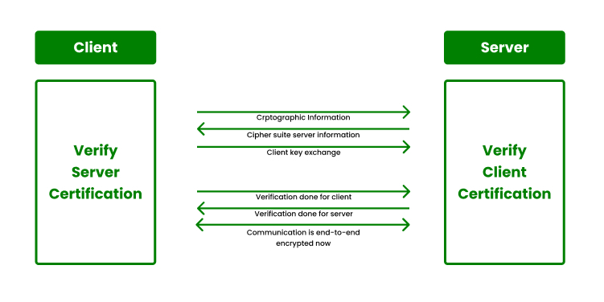

In this article I'll show you how to enable HTTPS for your local applications served by Homestead, the official development environment for Laravel developers.

Hi, I'm Valerio Barbera, software engineer, founder and CTO at Inspector.

I met the need to enable HTTPS because I am working to implement browser notifications for Inspector using [Pusher/Beams](https://pusher.com/beams). But Beams requires that the application be necessarily served over HTTPS. It is required also in the local development environment.

Laravel Homestead comes to the rescue.

I adopted Laravel Homestead as my local development environment for three years. It radically changed my development experience creating a faithful replica of the production environment separated for each project.

If you are looking for a step by step guide to use Laravel Homestead to supercharge your development experience take a look at this article I wrote for Homestead beginners:

[https://inspector.dev/how-and-why-to-use-laravel-homestead-for-local-development-real-life-tips/](/how-and-why-to-use-laravel-homestead-for-local-development-real-life-tips/)

## What is an SSL certificate?

SSL stands for Secure Sockets Layer, a protocol that creates an encrypted link between a web server and a web browser. An SSL certificate is a digital signature that allows browsers to authenticate a website's identity and enables encrypted connections.

It's main goal is to make it impossible for third parties to see what data client and server are exchanging. Since its introduction about 25 years ago it's now a mandatory requirement in everyday internet navigation and the use of web services in general (Payments, Email, Public services, etc).

## Trust Laravel Homestead SSL Certificates

By default, Laravel Homestead generates a security certificate for all sites you register.

If you attempt to access your application using **https://…** instead of **http://…**, the browser and the web server (Homestead) establish an SSL connection using a process called "SSL Handshake".

Since the Homestead certificates are generated locally, not released from a public Certificates Authority, the browser will warn you every time you visit the local site.

To get your browser to trust Homestead's self-signed certificates, you have some options:

- Click through the privacy warning every time you visit a local site;
- Add each generated certificate one by one (not sure this will persist through reprovisioning);
- **Import Homestead’s root CA to your browser’s trusted authorities.**

The last one is by far the most long-term solution, so I'll show you how to do this below.

## Add Homestead's Certification Authority to Trusted Certificates in your browser

These instructions are specific to Chrome, but adding a certificate to other browsers should just be a quick Google search away.

The gist is to grab the root CA file from the Homestead Vagrant box, and copy it in your project directory. The project directory is accessible from your host machine. So you will be able to import it into Chrome.

- First, ssh into your running Vagrant machine (*vagrant ssh*);
- Navigate to /etc/ssl/certs (in Homestead versions < 11, you want to go to /etc/nginx/ssl);
- Copy ***ca.homestead.homestead.pem*** from this directory into the project’s directory (usually */home/vagrant/code*), so the command should be: **cp ca.homestead.homestead.pem /home/vagrant/code** (in Homestead versions < 11, this file is *ca.homestead.homestead.crt*);
- Open Chrome's settings (via the menus or just visit *chrome://settings* in the navigation bar);
- Go to “Manage certificates / Manage HTTPS/SSL certificates and settings”. This will open a new window (set "all files");
- Start the Import process, and browse for that file we just copied over;
- When selecting the certificate store on the next screen or so, use "**Place all certificates in the following store**". Browse, and select "**Trusted Root Certification Authorities**"
- Finish, and restart Chrome (*chrome://restart* in the navigation bar)

That's it! You should be able to visit your various local sites using https without issues.

To avoid bringing the certificate file to your repository you can add the filename to your *.gitignore*.

For any other browser (or your OS itself), you should be able to find instructions specific to your browser for actually importing the certificate we copied in *step 3*.

For more technical articles you can follow me on [**Linkedin**](https://www.linkedin.com/in/valeriobarbera/) or **[X](https://x.com/Barbalerio)**.
