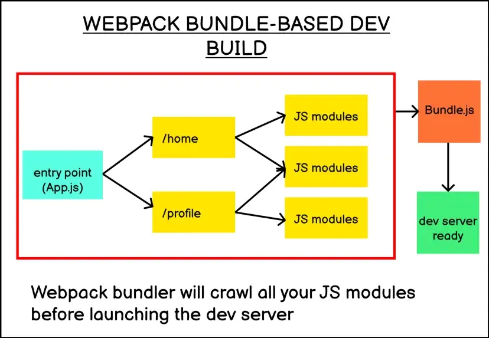
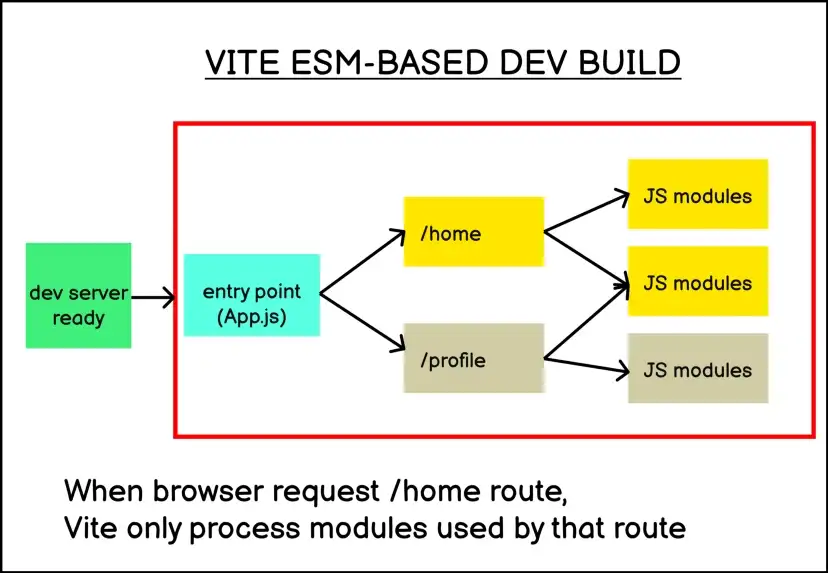
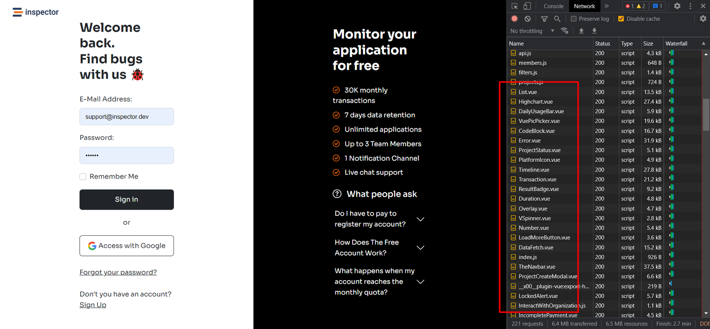
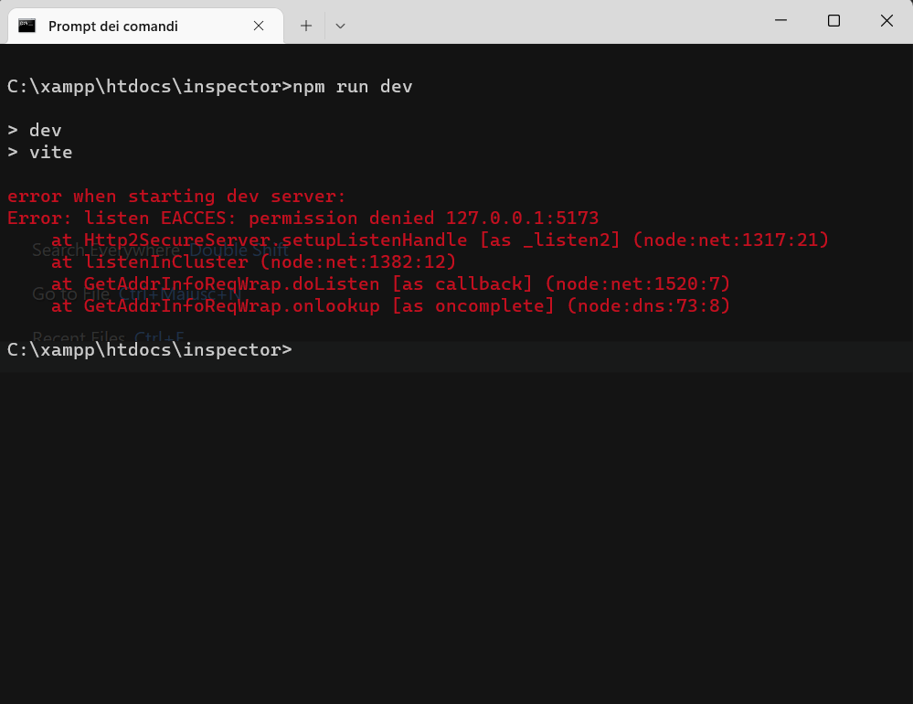
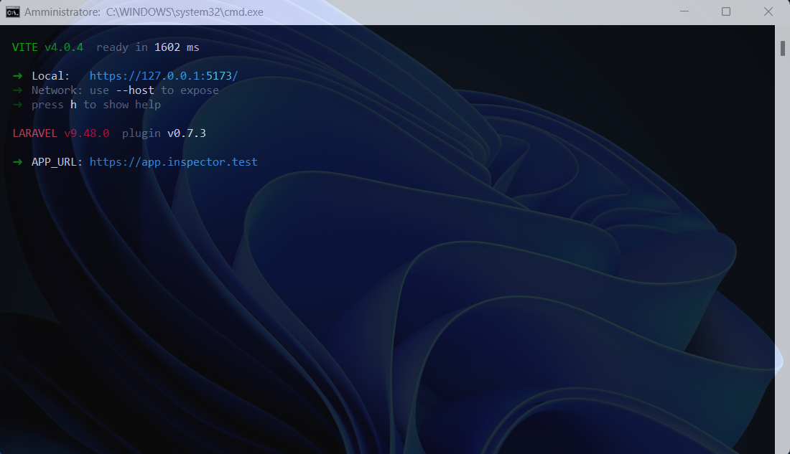

As many of our community members already know, we recently started the renovation of the Inspector dashboard UI with a fresh new design and a modern technology stack. In this article I will explain why we decided to leave Webpack and embrace [Vite](https://vitejs.dev/) as assets build tool and Hot Module Replacement. I will show you how to use HMR (hot module replacement) on Windows working with a VM as a development environment.

Since we use Laravel Homestead as a development machine we struggled a bit to figure out how to properly use this new frontend development environment.

Let me start with a bit of context.

## Vite vs Webpack

Webpack rebuilds the entire application when you save a file. This is why changes can take some time to be reflected in the browser, even with HMR enabled. The slow feedback loop caused by Webpack creates a bad developer experience for developers working on mid to large-scale JavaScript applications.



Vite instead leverages two improvements made recently in the JavaScript ecosystem to offer a better developer experience: the availability of **ES Modules in the browser** and **compile-to-native bundler tools** like esbuild.

The availability of ES Modules in the browser allows you to run a JavaScript application on the browser without having to bundle them together.

The core idea of Vite is to separate your Javascript application in two categories:

1. All the dependencies loaded from the **node_modules** directory. Pretty much everything that is listed in the package.json file.
2. Your application code. Modules that you write for your application, which often involves .js, .jsx, .vue, or .scss files.

While a bundler-based workflow like Webpack will have to process your entire JavaScript modules before a single browser request, Vite only processes your dependency modules before a single browser request.

Vite will transforms your application modules and serves them when they are required. Literally on the fly:



This is why Vite is able to process your development build faster than Webpack.

Another characteristic that I appreciate is that the entire environment requires very little configuration. You have to place a **vite.config.js** file in your project root folder. It requires very few options to be ready, and everything else is well documented: [https://vitejs.dev/config/](https://vitejs.dev/config/)

## Vite dev server in action

I noticed this different behavior opening the Chrome developer tool navigating my application:



As you can see Vite serves all the application components separately. Not a single bundle as was the case with webpack.

This makes the first load in the browser a bit slow, but it makes the hot module replacement really fast, or even incredibly fast. Because it only loads the ES modules it needs, when they are needed.

## Hot Module Replacement

Hot Module Replacement (HMR) exchanges, adds, or removes modules while an application is running, without a full reload. This can significantly speed up development in a few ways:

- Retain the application state which is lost during a full reload.
- Save valuable development time by only updating what's changed.
- Instantly update the browser when modifications are made to CSS/JS in the source code, which is almost comparable to changing styles directly in the browser's dev tools.

Here is an example of HMR in action during the development of our Sign-In page:

<video controls src="/videos/hot-module-replacement-inspector-login-page.mp4"></video>

## How to use HMR working with VM as a local environment

With webpack we used to work by running all the commands directly inside the Homestead VM.

But running the Vite dev server (npm run dev) caused the HMR to not work.

The problem is not the virtualized environment per-se. But the virtualized environment on top of a Windows machine. This is because of the way [WSL](https://github.com/microsoft/WSL/issues/4739) (Windows Subsystem for Linux) currently works. The workaround is to use **usePolling** option in the Vite config file:

```javascript
export default defineConfig({
  plugins: [vue()],
  server: {
    watch: {
      usePolling: true
    }
  }
});
```

Consider that this option implies a high CPU usage.

You can find a detailed description of how this option works in the documentation: [https://vitejs.dev/config/server-options.html#server-watch](https://vitejs.dev/config/server-options.html#server-watch)

Updating the browser after a file change is not as immediate as one would like. But it works.

## How to fix the HMR issue

The solution is to run the Vite dev server in your windows terminal, outside of the Homestead VM. The problem should be the same for other virtualized environments like Docker.

Remember you have to run the Windows terminal with admin permission, otherwise you will get a permissions denied error.



Running the console with admin permissions the server will start as expected and you can enjoy the HMR during UI development.


