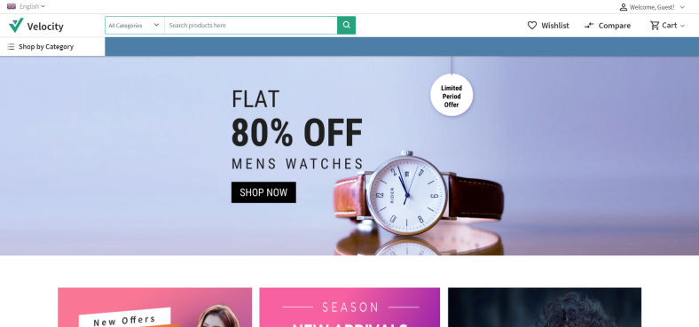
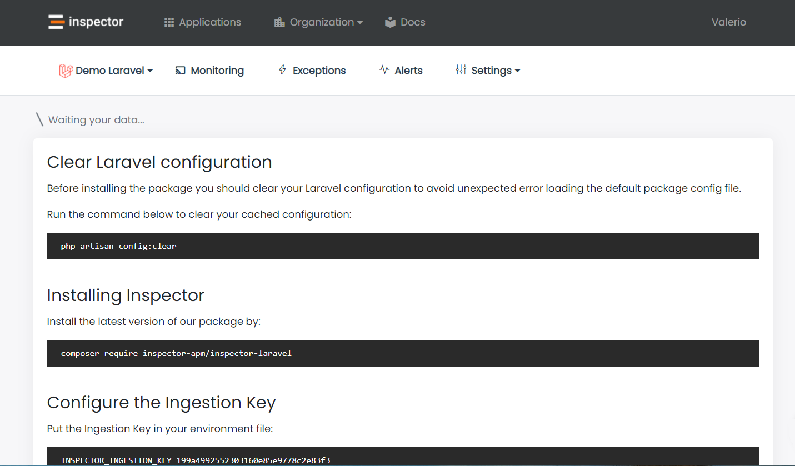
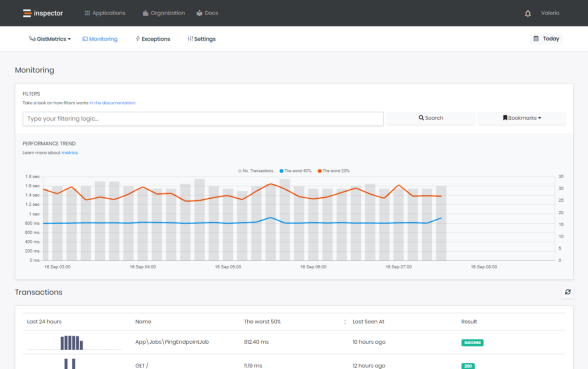
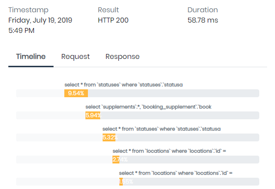

Hi I’m Valerio, software engineer from Italy and CTO at Inspector.

As you probably know [Bagisto](https://bagisto.com/en/) is a great e-commerce platform based on **Laravel framework**. It is “developer oriented”, so it is very common to implement our extension or use those of other developers by installing external packages.

If you are responsible to keep a bagisto implementation fully operational you probably know that any issue can expose you to competitive or financial risks.

If something goes wrong in your platform, customers will not spend their time to inform you about the problem, **they simply close the page, and it may take months before they return.**

Thanks to its Laravel foundation Bagisto is a perfect example of how developers can enjoy the ready-to-go Inspector experience, integrating a real-time monitoring system in less than one minute.

## Before starting

I will configure [Laravel Homestead](https://laravel.com/docs/7.x/homestead) as development environment so you can eventually reproduce your production environment with no effort.

Using a VM for local development changed my development experience in a positive way so I really invite you to use this setup as well.

In this article I will not dive deep in Homestead installation and configuration, take a look on my Homestead step by step guide to have a complete “how to”: [https://inspector.dev/how-and-why-to-use-laravel-homestead-for-local-development-real-life-tips/](/how-and-why-to-use-laravel-homestead-for-local-development-real-life-tips/)

## Create a Bagisto project

Bagisto ships as composer project, so the best way to start is creating a new composer project using the command below:

```bash
composer create-project bagisto/bagisto
```

This command will create a “bagisto” folder inside the current terminal’s directory.

The first things to do is to complete the configuration in your “.env” file to be sure that your installation have all information to run smoothly.

Open your “.env” file and fill the information below:

```bash
APP_URL=http://bagisto.locl
DB_DATABASE=homestead
DB_USERNAME=homestead
DB_PASSWORD=secretAPP_TIMEZONE=Europe/Rome
APP_CURRENCY=eur
```

Database configurations are needed to make your application ready to run in the Homestead VM, so be sure to copy exactly what reported above.

For *APP_TIMEZONE* and *APP_CURRENCY* feel free to use what is appropriate in your case.

## Install Homestead

Now it’s time to install Laravel Homestead to create a dedicated VM to use as isolated development environment.

If it’s the first time that you approach with Homestead you need to install **VirtualBox** and **Vagrant** in your laptop.

You can download and Install **VirtualBox** from here: [https://www.virtualbox.org/wiki/Downloads](https://www.virtualbox.org/wiki/Downloads)

You can download and install **Vagrant** from here: [https://www.vagrantup.com/downloads.html](https://www.vagrantup.com/downloads.html)

## Generate the Homestead.yaml file

Run the *make* command based on your OS:

Mac / Linux:

```bash
php vendor/bin/homestead make
```

Windows:

```bash
vendor\\bin\\homestead make
```

This command will generate the *Homestead.yaml* file in your project directory.

Open the file in your editor and change the url to reach your Bagisto installation in your browser:

```yaml
sites:
    -
        map: bagisto.locl
        to: /home/vagrant/code/public
```

That’s it.

## Run the VM with your application inside

In your project’s directory execute:

```bash
vagrant up
```

You will see the booting logs appear in your teminal, it takes just a few seconds, than the console back in your control.

Now the VM is running in your PC and every change you make in your source code will be automatically reported inside the VM, so you can continue to work in your IDE as usual.

Open your browser and past the bagisto installation address:

```
http://bagisto.locl
```



## Add Real-Time monitoring for your production environment

Now you are able to develop your e-commerce platform and release your code in production.

To monitor how your code performs in production environment we’ll install the Inspector package so you will be able to identify any issues before your users are aware of them.

Inspector is a composer package to add real-time monitoring in Laravel applications, it’s very easy to install and use, and it takes just two minutes to get started.

Thanks to Inspector you no longer need to spend a lot of time to monitor your application behaviour manually, because an autonomous tool does this job for you 24/7, making it rise to the surface anything that could create problems for users.

Let me show you how it works.

## Install Inspector

Point your terminal in your project directory and run the command below:

```bash
composer require inspector-apm/inspector-laravel
```

### Configure the API key

Get a fresh API key by signing up for Inspector ([https://app.inspector.dev/register](https://app.inspector.dev/register)) and creating a new application, it takes just a few seconds.

You’ll see installation instructions directly in the app screen:



Put the API key into your environment file:

```bash
INSPECTOR_API_KEY=13c37c434XXXXXXXXXXXX
```

### Test everything is working:

Execute our *test* command to check if your application is well configured:

```bash
php artisan inspector:test
```

Go to [https://app.inspector.dev/home](https://app.inspector.dev/home) to explore your demo data.

## Incoming Web Requests monitoring

To activate monitoring when your app is executed due to an incoming http request you can use the `WebRequestMonitoring` middleware.

It works like any other Laravel middleware you are familiar to so you are free to decide which routes need to be monitored based on your routes configuration or on your personal monitoring preferences.

The most easy way to cover all your application routes is attaching the middleware in the *App\\Http\\Kernel* class.

```php
/**
 * The application's route middleware groups.
 *
 * @var  array
 */
protected $middlewareGroups = [
    'web' => [
        ...,
        \Inspector\Laravel\Middleware\WebRequestMonitoring::class,
    ],'api' => [
        ...,
        \Inspector\Laravel\Middleware\WebRequestMonitoring::class,
    ]
]
```

Instantly you will see transactions streams in your project’s dashboard:



and for each transaction you can monitor what your application is executing in real-time:


