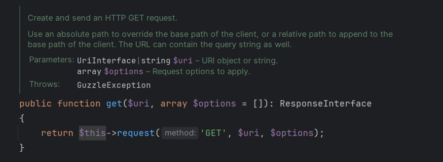
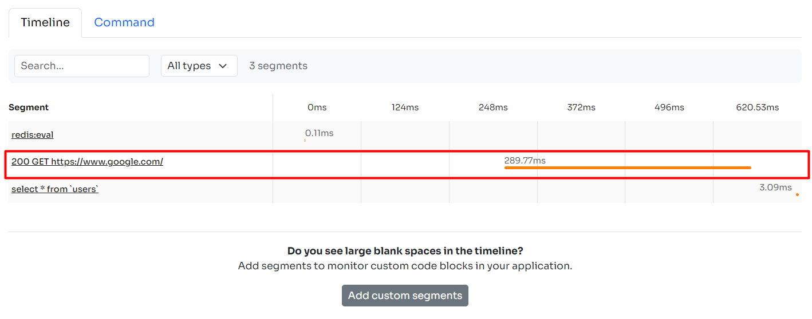

Guzzle is a popular PHP HTTP client that makes it easy to send HTTP requests and create web service libraries. The most popular PHP frameworks provides an internal Http Client service, and they are simply a customized implementation of the Guzzle Http Client:

- [Laravel Http Client](https://laravel.com/docs/master/http-client)
- [Symfony Http Client](https://symfony.com/doc/current/http_client.html)
- [Laminas (formerly Zend Framework) Http Client](https://docs.laminas.dev/laminas-http/client/intro/)

Guzzle is widely used for two main reasons:

## Customization and Flexibility

For the fans of design patterns Guzzle is open to extensions. Means that you can easily implement new functionalities into Guzzle by extending its core components (Http Client, Request, Response, Milddeware, etc).

## Support for Middleware

The Guzzle middleware system allows developers to interact with a Request before it is sent, and Response before they are processed. It can enable advanced features like logging, authentication, and error handling.

## Introduction

In this tutorial, I will guide you through the process of creating a custom Guzzle Http Client to make it easy to monitor every request made from your application against external services.

I will also show you how to inject this implementation into the IoC container (or Services Container) to make this implementation available throughout your application.

We will cover the basics, customization options, and provide real code examples.

## Install Guzzle

Ensure you have Guzzle installed. If not, install it using Composer:

```bash
composer require guzzlehttp/guzzle
```

## Basic Customization

Let's start by creating a basic custom Guzzle Http Client:

```php
namespace App\Extensions\Guzzle;

use GuzzleHttp\Client;

class CustomGuzzleClient extends Client 
{
    public function __construct(array $config = []) 
    {
        $config['headers']['Custom-Header'] = 'Custom-Value';
        parent::__construct($config);
    }
}
```

In this example, we extend the Guzzle Http Client class and customize the constructor to add a custom header to all requests made by this client.

## Monitor Guzzle Http Requests

Guzzle provides shortcut methods to run Http requests:

```php
$client->get('/endpoint');
$client->post('/endpoint');
$client->put('/endpoint');
```

All of these methods use the generic **request** method inside. The screenshot below was taken from the Guzzle Client code:



You can override the **request** method to customize the management of HTTP calls made by your application to external services.

```php
namespace App\Extensions\Guzzle;

use GuzzleHttp\Client;
use GuzzleHttp\Exception\RequestException;


class CustomGuzzleClient extends Client 
{
    public function request($method, $uri, array $options = []) 
    {
        return inspector()->addSegment(function () use ($method, $uri, $options) {

            return parent::request($method, $uri, $options);

        }, "http", "{$method} {$uri}");
    }
}
```

In this example I just add a new item in the transaction's timeline for every request. Now you can see the API calls made by Guzzle in your monitoring view:



If you are new to Inspector you can follow this tutorial on how to get started:

[Laravel Application Monitoring with a simple package](/laravel-real-time-performance-monitoring-using-inspector-part-1/)

You can also inject the **Segment** parameter in the callback to interact with the item or add more information:

```php
namespace App\Extensions\Guzzle;

use GuzzleHttp\Client;
use GuzzleHttp\Exception\RequestException;
use Inspector\Models\Segment;

class CustomGuzzleClient extends Client 
{
    public function request($method, $uri, array $options = []) 
    {
        return inspector()->addSegment(function (Segment $segment) use ($method, $uri, $options) {

            $response = parent::request($method, $uri, $options);
            $segment->label = "{$response->getStatusCode()} {$method} {$uri}";
            return $response;

        }, "http");
    }
}
```

## Use the custom Http Client

Now, you can use your custom client in your application. Since the extension doesn't introduce any change to the behavior of the standard Guzzle Http Client, you can make an instance of the custom class and use it as usual:

```php
// Create an instance of the custom client
$client = new CustomGuzzleClient(['base_uri' => 'https://api.example.com']);

// Make an API request. It will be automatically monitored by Inspector.
$response = $client->get('/endpoint');
```

## Bind the Guzzle Http Client into the container

I'm going to use Laravel in this example, but the basic concept is the same for the most popular PHP frameworks mentioned at the beginning of the article. All of them work with a Service Container.

We create a singleton binding into the container for the Guzzle Http Client class. So every service that ask for this class will receive an instance of our custom client that supports real-time monitoring.

```php
use GuzzleHttp\Client;
use App\Extensions\Guzzle\CustomGuzzleClient;
use Illuminate\Contracts\Foundation\Application;
 
$this->app->singleton(Client::class, function (Application $app) {
    return new CustomGuzzleClient();
});
```

Now you can try to inject the Guzzle Http Client class in an Artisan Command and run an Http call just for testing:

```php
namespace App\Console\Commands;


use Illuminate\Console\Command;
use GuzzleHttp\Client;

class TryCommand extends Command
{
    /**
     * The name and signature of the console command.
     *
     * @var string
     */
    protected $signature = 'try';

    /**
     * The console command description.
     *
     * @var string
     */
    protected $description = 'Test Guzzle Http Client monitoring.';

    /**
     * Inject the Guzzle Http Client class into the constructor.
     * The CustomGuzzleClient will be the concrete class.
     */
    public function __construct(protected Client $client)
    {
        parent::__construct();
    }

    /**
     * Handle the command execution.
     */
    public function handle()
    {
        $this->line($this->description);

        $this->line("Concrete class: ".get_class($this->client));
        
        $this->client->get('https://google.com');
        
        return Command::SUCCESS;
    }
}
```

Run the command to verify if the Http Call will be visible in the transaction's timeline:

```php
php artisan try
```
