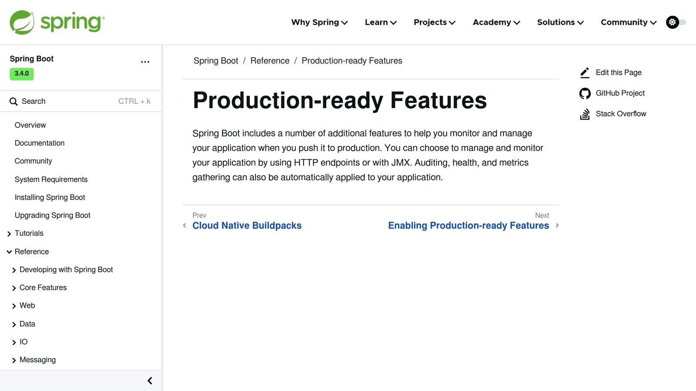
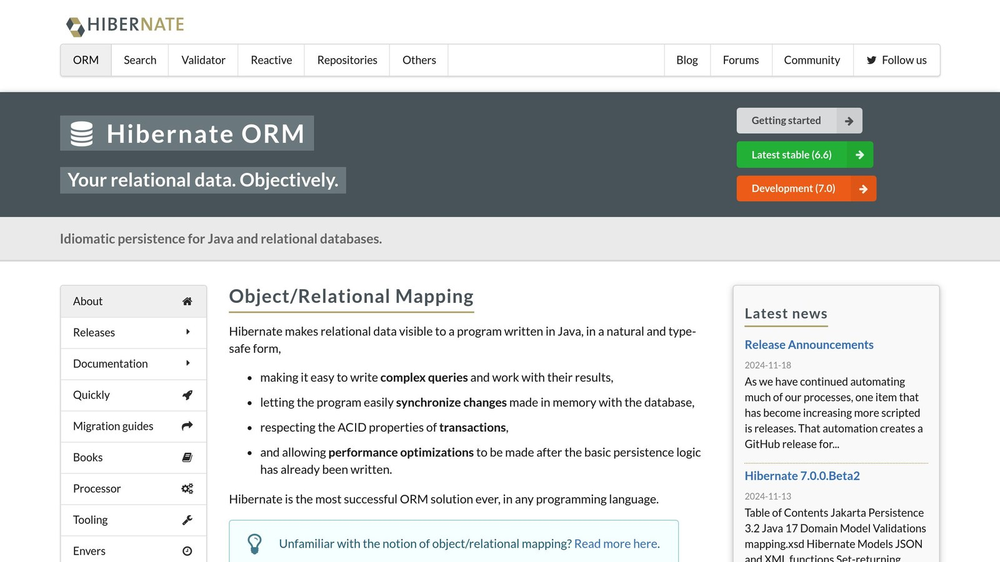

**Slow SQL queries can cripple your Spring Boot application.** Monitoring SQL performance is essential to keep your app running smoothly, and tools like [Spring Boot Actuator](https://docs.spring.io/spring-boot/reference/actuator/index.html), [Hibernate](https://hibernate.org/orm/) Statistics, and [Micrometer](https://micrometer.io/) make it easier.

## Key Monitoring Tools:

- **Spring Boot Actuator:** Tracks query execution times and connection pool usage.
- **Hibernate Statistics:** Provides detailed query analysis and cache usage stats.
- **Micrometer:** Exports metrics to platforms like [Prometheus](https://prometheus.io/) and [Grafana](https://grafana.com/).
- **External Tools (e.g.,** [**Inspector.dev**](/)**):** Offer advanced analytics and monitoring dashboards.

## Quick Comparison:

| Tool | Key Benefits | Best Used For |
| --- | --- | --- |
| **Spring Boot Actuator** | Built-in metrics, easy setup | Basic performance monitoring |
| **Hibernate Statistics** | Query-level insights | Query optimization |
| **Micrometer** | Standardized metrics collection | Cross-platform monitoring |
| **External Tools** | Advanced analytics, dashboards | Production environments |

This guide explains how to set up these tools, monitor key metrics (e.g., query times, connection pool usage), and optimize your database performance effectively.

## [Spring Boot Actuator](https://docs.spring.io/spring-boot/reference/actuator/index.html) metrics monitoring with [Prometheus](https://prometheus.io/)



[Spring Boot Actuator metrics monitoring with Prometheus](https://www.youtube.com/watch?v=tZWIrsPy3FM)

## How to Use Spring Boot Actuator for SQL Monitoring

Spring Boot Actuator makes it easier to monitor SQL performance by tracking metrics like query execution times and connection pool usage. With these insights, you can pinpoint and resolve database performance issues efficiently.

### Key Actuator Endpoints for SQL Metrics

The `/metrics` endpoint is crucial for monitoring SQL-related data, including query execution times, connection pool activity, and database latency. Other endpoints like `/health` and `/info` add value by checking database connectivity and configuration status.

To get started, include the Spring Boot Actuator dependency in your `pom.xml` file and configure the relevant endpoints in your `application.properties` file:

```xml
<dependency>
    <groupId>org.springframework.boot</groupId>
    <artifactId>spring-boot-starter-actuator</artifactId>
</dependency>
```

```properties
management.endpoints.web.exposure.include=health,metrics,info
```

Make sure Hibernate statistics are enabled to gather detailed query metrics.

### Linking Actuator to External Monitoring Tools

You can integrate Actuator with Prometheus by adding the Micrometer registry dependency and configuring metrics export in your `application.properties`. This enables visualization in tools like Grafana, where you can track:

- Query execution times
- Connection pool usage
- Active and idle connections
- Database errors and timeouts

**Key Metrics to Monitor**

| Metric Type | What to Monitor | Why It Matters |
| --- | --- | --- |
| Query Performance | Execution time trends | Spot slow queries early |
| Connection Pool | Utilization rates | Avoid connection bottlenecks |
| Error Rates | Failed queries, timeouts | Identify recurring issues |
| Response Time | Database latency | Measure overall system performance |

Set up alerts for query execution times that exceed your application's normal thresholds (e.g., queries taking over 200ms when they typically run in 100ms).

While Spring Boot Actuator provides a strong starting point for SQL monitoring, tools like Hibernate Statistics and Micrometer can deliver even deeper insights to help with query tuning and database performance analysis.

## Using [Hibernate](https://hibernate.org/orm/) Statistics and [Micrometer](https://micrometer.io/) for SQL Analysis



Hibernate Statistics and Micrometer make it easier to monitor SQL performance by tracking query execution, cache usage, and resource consumption.

### Tracking Queries with Hibernate Statistics

To enable Hibernate Statistics, add the following to your `application.properties` file:

```properties
spring.jpa.properties.hibernate.generate_statistics=true
```

This setting allows you to track:

- Query execution times
- Cache hit and miss rates
- Session activity
- Transaction details

| Metric Category | What It Tracks | Why It Matters |
| --- | --- | --- |
| Query Metrics | Execution time, prepared statement count | Identifies slow queries and resource usage |
| Cache Statistics | Hit/miss ratio, region statistics | Helps refine caching strategies |
| Session Data | Active sessions, transaction count | Evaluates database connection efficiency |

Hibernate Statistics focuses on detailed, query-specific metrics. For a broader view, Micrometer complements this by monitoring overall database performance.

### Monitoring Databases with Micrometer

Micrometer offers a unified way to track metrics and integrates smoothly with Hibernate Statistics and other [monitoring tools](/log-monitoring-tools/).

Here’s a simple example of setting up query monitoring with Micrometer:

```java
import io.micrometer.core.instrument.MeterRegistry;

@Service
public class DatabaseMonitoringService {
    private final MeterRegistry registry;

    public DatabaseMonitoringService(MeterRegistry registry) {
        this.registry = registry;
    }

    public void trackQueryPerformance() {
        registry.timer("sql.query.execution")
               .record(() -> {
                   // Execute query here
               });
    }
}
```

Metrics worth monitoring include:

- Connection pool usage
- Query response times
- Database throughput
- Resource usage trends

While Hibernate Statistics provides detailed query-level insights, Micrometer aggregates these metrics for visualization in external tools. For even deeper analysis, you can integrate solutions like DataDog or New Relic.

## Using External Tools for Advanced SQL Monitoring

When built-in solutions fall short, external tools can step in to provide deeper insights and better control over SQL performance in Spring Boot applications.

### How [Inspector](/) Supports SQL Monitoring


[Inspector](/) is designed specifically for real-time SQL monitoring and debugging in Spring Boot. It provides tools like query analysis, [AI-based debugging](/ai-bug-fixer-revolutionizing-web-application-monitoring-with-inspector/), and transaction tracking to help identify and fix SQL performance issues. With flexible pricing, it caters to both small and large-scale projects.

| Feature | Purpose | Example Use Case |
| --- | --- | --- |
| Real-time Query Analysis | Detect slow queries instantly | Monitoring production |
| AI-powered Debugging | Suggest [automated bug fixes](https://docs.inspector.dev/concepts/ai-bug-fixes) | Optimizing performance |
| Transaction Monitoring | Track database operations | Analyzing resource usage |

### Security Considerations

When using external tools, prioritize security by:

- Ensuring data transmission is encrypted
- Implementing strict access controls
- Regularly reviewing agent configurations
- Managing permissions for data collection

These tools enhance Spring Boot's built-in features, offering the advanced functionality needed for effective SQL performance monitoring in production settings.

## Steps to Improve SQL Query Performance

After setting up monitoring tools, the next move is to pinpoint and resolve slow queries that could be dragging down performance.

### How to Find and Fix Slow Queries

To track query-level metrics, check out the Hibernate Statistics section. Profiling tools like [YourKit](https://www.yourkit.com/) or [VisualVM](https://visualvm.github.io/) can help you analyze key metrics such as:

| Metric | What to Monitor | Impact on Performance |
| --- | --- | --- |
| **CPU Usage** | Thread contention patterns | High CPU usage often indicates inefficient queries |
| **Memory Usage** | Heap allocation rates | Can signal memory leaks from result sets |
| **Query Times** | Execution duration trends | Identifies queries with the longest execution times |

To optimize slow queries, consider these strategies:

- Add indexes to columns used in filters.
- Use batching with `@Transactional` to reduce the number of database calls.
- Enable prepared statements to cut down on parsing overhead.

### Managing and Optimizing Connection Pools

Once you've tackled query performance, it's just as important to manage database connections effectively to avoid bottlenecks. Spring Boot Actuator's `/actuator/metrics` endpoint can provide insights into your connection pool's health.

Here are some recommended connection pool configurations:

| Setting | Value | Why It Matters |
| --- | --- | --- |
| **Pool Size** | Initial: 10; Max: 2N + 1 (N = CPU cores) | Balances availability and prevents thread contention |
| **Connection Timeout** | 30 seconds | Avoids requests hanging indefinitely |

Keep these tips in mind for smoother performance:

- Avoid adding too many indexes, as this can slow down write operations.
- Always release connections immediately after use.
- Monitor connection pool metrics during peak loads to prevent unexpected slowdowns.

Tools like Micrometer can help fine-tune your connection pool settings based on real-time load. By combining query optimization with effective connection pool management, you can ensure your database performs well, even under pressure.

## Conclusion

Spring Boot Actuator, Hibernate Statistics, and Micrometer provide tools for tracking [real-time metrics](/metrics-performance-monitoring/), analyzing query performance, and monitoring connection pools. Together, they offer critical insights into database performance, forming a strong base for monitoring database operations.

When combined effectively, these tools create a monitoring stack designed to meet the specific needs of your application. The monitoring setup typically includes three layers:

| Layer | Tools | Purpose |
| --- | --- | --- |
| **Core Monitoring** | Spring Boot Actuator | Tracks real-time metrics, performs health checks, and automates database monitoring |
| **Detailed Analysis** | Hibernate Statistics, Micrometer | Provides insights into query execution, connection pool usage, and performance patterns |
| **Advanced Insights** | Inspector, DataDog, New Relic | Offers query tracing, alerting, and performance dashboards |

In the Advanced Insights layer, tools like Inspector excel in SQL monitoring, offering features such as real-time query analysis and [AI-driven debugging](https://docs.inspector.dev/concepts/ai-bug-fixer). These advanced options build on the foundation provided by Spring Boot's native monitoring capabilities.

Effective monitoring goes beyond data collection - it’s about acting on the insights gathered. Using Micrometer’s metrics, like counters and timers, teams can identify and address database issues early, preventing disruptions to users.

For better results, integrate your monitoring tools with visualization platforms like Prometheus and Grafana. These tools make performance trends easier to understand and ensure your Spring Boot applications remain reliable and scalable under varying workloads.

## FAQs

Here are answers to some common questions about monitoring SQL performance in Spring Boot, based on the tools and techniques discussed earlier in this article:

### How to find slow queries in Spring Boot?

To identify slow queries, you can enable Hibernate statistics, as explained in the "Using Hibernate Statistics" section. Once activated, Hibernate will log detailed performance data, such as:

```log
14:38:05,231 DEBUG ConcurrentStatisticsImpl:387 - HQL: SELECT o FROM Customer o WHERE id = 1, time: 148ms, rows: 1
```

For a broader view of database performance, you can also use Spring Boot Actuator's `/actuator/metrics` endpoint. This combination helps you analyze and track query performance effectively.

### How to reduce query execution time in Spring Boot?

Here are some techniques to optimize query performance:

| Technique | How to Implement | Advantage |
| --- | --- | --- |
| **Query Analysis** | Use fetch joins and eager loading to avoid N+1 queries | Reduces unnecessary database calls |
| **Index Strategy** | Add indexes to frequently queried columns | Speeds up data retrieval |
| **Connection Tuning** | Adjust connection pool settings based on app load | Prevents connection bottlenecks |

You can also set up monitoring tools like Inspector to track and alert you when query performance drops below acceptable levels.

## Related Blog Posts

- [Real-Time Error Tracking vs. Log Analysis: A Comparison](/real-time-error-tracking-vs-log-analysis-a-comparison/)
- [Symfony file upload examples and best practices](/symfony-file-upload-examples-and-best-practices/)
- [Error Pattern Recognition in PHP Applications](/error-pattern-recognition-in-php-applications/)
- [Symfony Messenger Component - Setup and Use with doctrine and MySQL](/symfony-messenger-component-setup-and-use-with-doctrine-and-mysql/)
