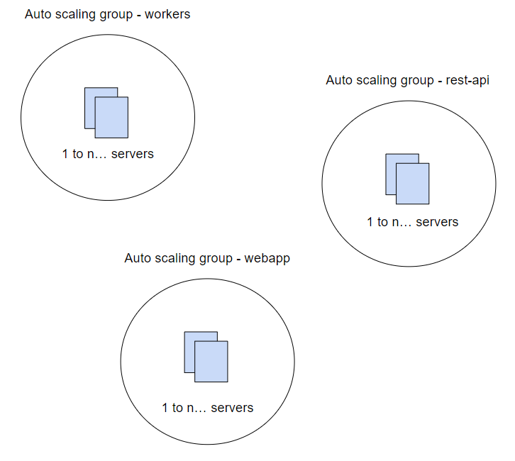
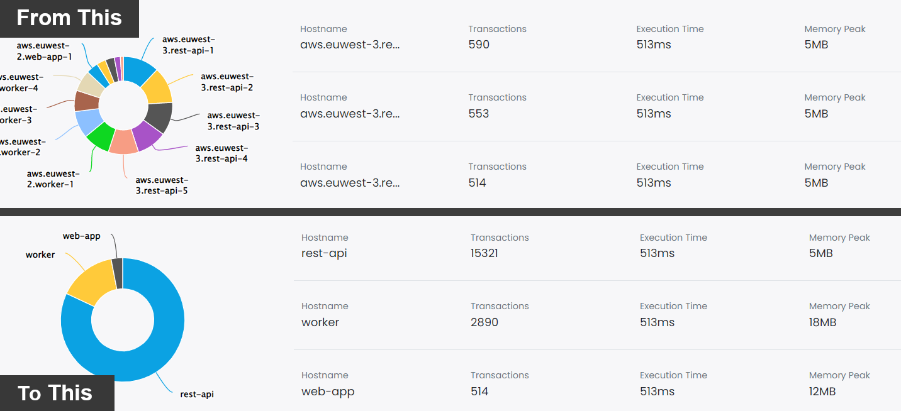
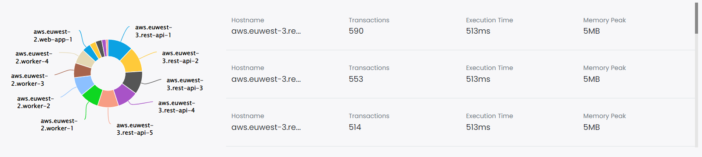
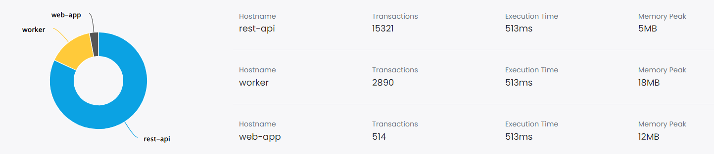
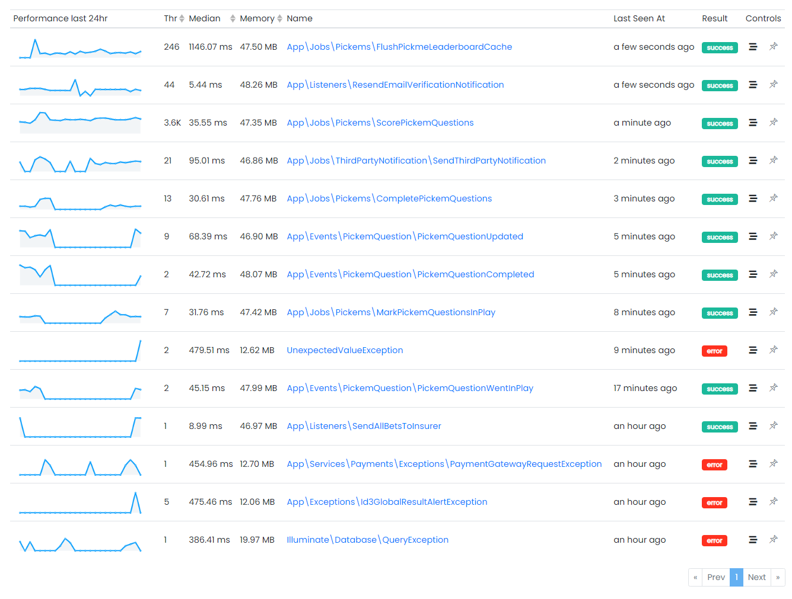

Hi, I'm Valerio, software engineer, founder & CTO at Inspector.

I decided to write this post after responding to a support request from a developer who asked me how he can monitor his Laravel application by services and not by hostnames.

The company is working on a backend API for a mobile app. The APIs are running on a set of AWS EC2 instances managed by an Autoscaling Group.

Inspector segments metrics by hostnames. So as the number of underlying hosts increase it could create a bit of clutter in the charts.

Here is the solution.

## What is an autoscaling group?

An *Autoscaling Group* contains a collection of VM instances that are treated as a logical grouping for the purposes of automatic scaling and management of specific component of your system.

In Laravel is quite easy to separate your application in logical components that runs in different servers, like APIs, background Jobs workers, web app, scheduled tasks (cron), etc, so they can scale in and out indipendently based on their specific workload.

Every established cloud provider allwos you to configure Autoscaling Groups, or you can use other technologies like Kubernetes. The result is the same:

> Due to the constant turnover of servers to handle the application load dynamically you could see a bit of mess in your monitoring charts. A lot of trendlines turn on and off continuously, one for each underlying server.

## Grouping monitoring data by service name

It may be more clear to use a human friendly **service name** to represent all your servers inside the same logical group.



We can use the Inspector library to programmatically change the hostname just before the transaction is sent out of your server and set the same for related server. It will make your dashboard more clear and understandable.



In the boot method of the *AppServiceProvider* you can pass a callback to **beforeFlush()** method to change the hostname of the transaction. You can assign a general service name (rest-api, workers, web-app, etc) instead of the original hostname of the server.

```php
namespace App\Providers;

use App\Jobs\ExampleJob;
use Illuminate\Support\ServiceProvider;
use Inspector\Laravel\Facades\Inspector;

class AppServiceProvider extends ServiceProvider
{
    /**
     * Register any application services.
     *
     * @return void
     */
    public function register()
    {
        //
    }

    /**
     * Bootstrap any application services.
     *
     * @return void
     */
    public function boot()
    {
        Inspector::beforeFlush(function ($inspector) {
            $inspector->currentTransaction()
                ->host
                // You can get the desired service_name by config, env, etc.
                ->hostname = config('app.service_name')
        });
    }
}
```

You can pass the name of the service that should be used during transaction monitoring by using an environment variable. Environment variables can be set accordingly in your CI/CD pipeline.

The **app.service_name** configuration property could be setup as below:

```php
return [

    'service_name' => env('INSPECTOR_SERVICE_NAME', 'rest_api'),

];
```

Along the deployment pipeline you can inject a different "INSPECTOR_SERVICE_NAME" for each autoscaling group.

Your dashboard will chage from this:



*Application load by hostnames*

To this:



*Application load by services*

I think it looks more clear, and it is what our customer think too 😃!

The number of servers is no longer visible, but you could gather this information from your cloud console.

## Use filters to eliminate noise

Thanks to the transactions filtering it's even more easy to identify the most heaviest tasks in each Autoscaling Group. You can optimize their performance and cut the costs due to the high number of tasks perfomed before the Autoscaling Group need to start a new server.



*Transactions list*
