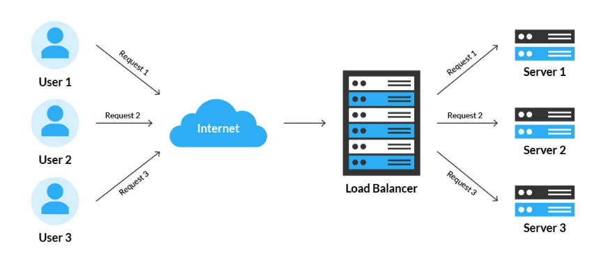
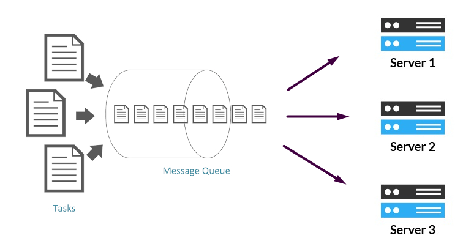
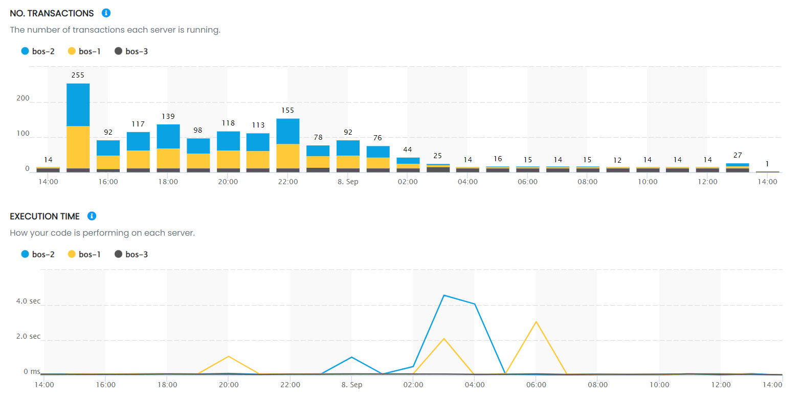
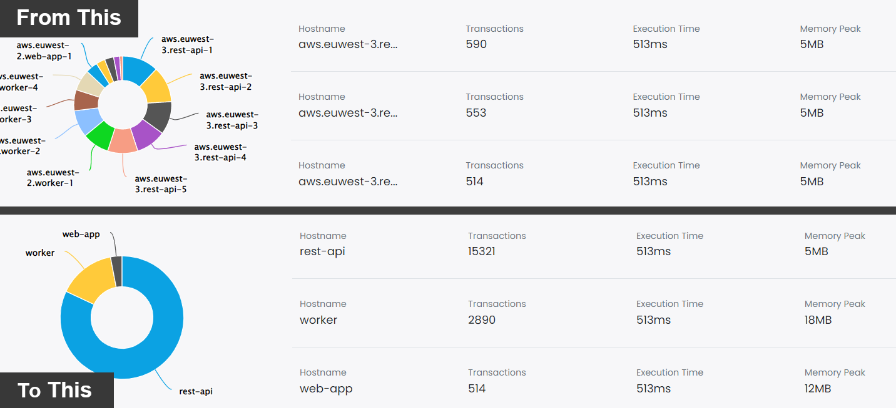

Hi, I’m Valerio, software engineer, co-founder and CTO at Inspector.

In this article I want to show you a monitoring strategy to help you save thousands of dollars a year on cloud costs.

The typical scenario where you can get the most payback from this strategy is when your application runs on multiple servers.

If your application is designed to scale horizontally to support the incoming traffic, or the internal load, you know that costs can be very volatile and can suddenly increase. In this scenario one of the most important variables to save costs is the type of virtual machine to use.

Cloud providers (AWS, GCP, DigitalOcean, Azure, etc.) offer a lot of different hardware combinations to choose from. Perhaps too many 🤔. AWS offers over 300 EC2 instance types across six EC2 instance families, each with varying resources and performance focuses.

How do you know which one guarantees you the lowest price for the same performance?

You have to measure.

Thanks to this monitoring approach you will be able to find the right balance between hardware costs and performance, saving thousands of dollars a year on your cloud costs. Without any impact on the customer experience, just a relief for your bank account.

In the example below I’ll be using a Laravel application, but it works exactly the same for the other supported technologies and frameworks (visit the [GitHub](https://github.com/inspector-apm) repository for other libraries).

## Load balanced architecture

Load balancing is the process of distributing network traffic across multiple servers. This ensures no single server bears too much demand. By spreading the work evenly, load balancing improves application responsiveness. It also increases availability.

Here is an example of a typical load balanced architecture:

Modern applications can manage the servers behind the load balancer with auto scaling policies. Servers will be added or deleted dynamically based on the amount of the incoming traffic. Replicating an overpriced machine can negatively impact your cloud costs at the end of the month.

## Scaling queue workers

Another typical scenario in modern systems may depend on a messages queue.

The workers that consume the queue can be managed by auto scaling policies too to set the number of workers accordingly with the amount of messages to be processed.

This is another example of how applications can be designed for horizontal scalability.

## How to choose the cheapest hardware with the same performance

If you have ever managed these architectures, you know that the type of virtual machine chosen will have a significant impact on cloud costs at the end of the billing cycle.

$50 of difference between two types of machines, multiplied by tens of VMs in place can become thousands of dollars a month.

We need a tool to measure load and performance of each machine so we can introduce a cheaper VM in the group and compare its metrics with others.

If the new machine guarantees similar performance under the same load, then by replacing all the others with this new instance type you will save a few hundred dollars a month 🧐.

That's exactly what Inspector is designed to do.

## Connect your application with Inspector

It’s super easy and requires just two steps:

- Register an account for free and create a new application to get the ingestion key → [https://app.inspector.dev/register](https://app.inspector.dev/register)
- Install the library → [https://docs.inspector.dev/laravel/installation](https://docs.inspector.dev/laravel/installation)

Take a look at this article if you prefer to follow a more complete tutorial: [https://inspector.dev/laravel-real-time-performance-monitoring-using-inspector-part-1/](/laravel-real-time-performance-monitoring-using-inspector-part-1/)

Deploy the application in your production environment to collect metrics about your application’s load and performance.

## How to compare VMs performance

Inspector groups metrics separately for each server by default to give you visibility of how your application performs on each host.

Thanks to this simple view you can compare the performance of code execution in relation to the load on each server.

Thanks to these ongoing metrics, developers often find that more expensive hardware does not lead to better performance.

Instead, they can easily use much cheaper types of servers, significantly increasing the margins of their projects, without any hitch for customers.

## How to manage very large server groups

Inspector segments metrics by hostnames. So as the number of underlying hosts increases it could create a bit of clutter in the charts.

The solution could be to group the servers in the same autoscaling group under a single service name in your monitoring dashboard. You can mix the comparison strategy described in this article with this setup to make your dashboard more clear and understandable.

I recently wrote a detailed guide (with code examples) to do this setup: [https://inspector.dev/how-to-monitor-your-laravel-application-by-services-not-by-hostnames/](/how-to-monitor-your-laravel-application-by-services-not-by-hostnames/)
