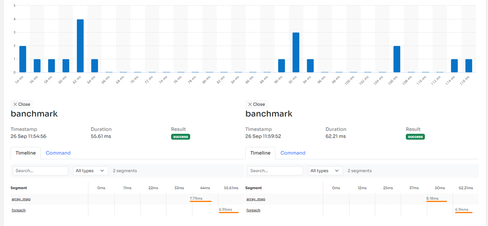

Associative arrays are a fundamental data structure in PHP, allowing developers to store key-value pairs. They are versatile and commonly used to represent structured data. Searching for specific elements within a PHP associative array is a common task. But the most native functions available in PHP work great with simple arrays.

For this reason we often have to find combinations of functions that allow us to do the same things on associative arrays. Possibly without out-of-memory errors 😁.

In this tutorial, we will explore various methods and techniques to search for values in a PHP associative array.

For more technical articles you can follow me on [**Linkedin**](https://www.linkedin.com/in/valeriobarbera/) or **[X](https://x.com/Barbalerio)**.

## Searching for a Key in an Associative Array

The **array_key_exists()** function checks if a specific key exists in an associative array. It returns \`true\` if the key is found and \`false\` otherwise.

```php
$fruits = [
    'apple' => 'red',
    'banana' => 'yellow',
];

if (array_key_exists('banana', $fruits)) {
    echo "The key 'banana' exists in the array.";
} else {
    echo "The key 'banana' does not exist in the array.";
}
```

## Searching by Value in an Associative Array

### Using array_search() and in_array()

The **array_search()** function searches for a value in an associative array and returns the corresponding *key* if found, or *false* if not found.

```php
$colors = [
    'apple' => 'red',
    'banana' => 'yellow',
];

echo array_search('yellow', $colors); // Print "banana"
```

You can also use arrays with more complex data as value:

```php
$colors = [
    'apple' => ['red'],
    'banana' => 'yellow',
];

echo array_search(['red'], $colors); // Print "apple"
```

In this case I suggest you use the strict comparison mode. It can be requested passing a third boolean parameter to **array_search**:

```php
echo array_search([‘red’], $colors, true);
```

Similar to array_search() is the in_array function that just returns a boolean flag instead of the key of the item.

```php
/*
 * It also supports strict mode comparison, useful for working with structured data as a value.
 */

echo in_array(['red'], $colors, true); // Return "true"
```

### Using a foreach Loop

You can iterate through the associative array using a \`foreach\` loop and manually search for a specific value. This is useful when you need to make complex comparison or manipulation because the loop lives in the same scope of the array, so you have access to all data in the loop.

```php
$targetValue = 'yellow';

foreach ($colors as $key => $value) {
    if ($value === $targetValue) {
        echo "The value {$targetValue} is associated with the key {$key}.";
        break; // Optional: Stop searching after finding the occurrence.
    }
}
```

### Using array_filter()

The **array_filter()** function can be used to filter the array and return only elements that pass a test callback.

```php
$colors = [
    'apple' => 'red',
    'banana' => 'yellow',
];

$filteredArray = array_filter($colors, function ($value) {
    return $value === 'red';
});

/*
 * It contains just one element: ['apple' => 'red']
 * ‘banana’ was filtered out.
 */
var_dump($filteredArray);
```

## Performance benchmarks between PHP array functions and foreach

If performance is one of your concerns you will find this section of the article interesting for sure.

I made a script to perform a simple operation on an array of 200,000 items using **array_map** and the **foreach** loop.I used the Inspector package to trace performance of the two statements.

```php
$data = range(1, 200000);

$inspector->addSegment(function () use ($data) {
    array_map(function ($item) {
        return $item * 3;
    }, $data);
}, 'array_map');

$data = range(1, 200000);

$inspector->addSegment(function () use ($data) {
    foreach ($data as $item) {
        $data[$item] = $item * 3;
    }
}, 'foreach');
```

Dozens of executions show that foreach is consistently better than array_map by approximately 10%.



But this result can change a lot based on the contextual environment. If you run the snippet in the sandbox linked above you will find out that **foreach** is 10x more efficient than **array_map**. You can copy the script in your local environment and make some benchmarks for yourself.

Anyway the reason **foreach** is generally more efficient than **array_map** is because it doesn’t imply the use of a callback. There's more overhead in invoking a function rather than using the array directly in the same scope.For this reason **array_map** wastes a little more time with each iteration. But it's only visible for larger datasets. The smaller the array the more insignificant the gap.

For more technical articles you can follow me on [**Linkedin**](https://www.linkedin.com/in/valeriobarbera/) or **[X](https://x.com/Barbalerio)**.
