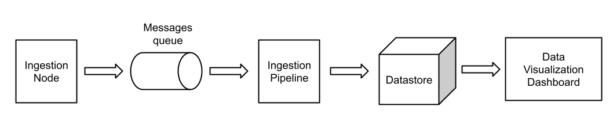
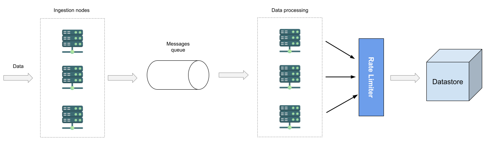
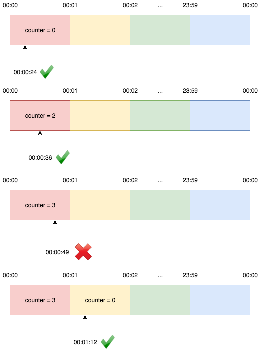
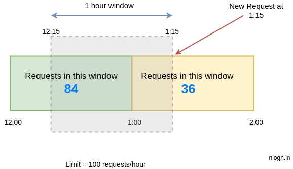

Hi, I'm Valerio, founder and CTO at Inspector.

You may have already heard of rate limiting associated with API consumption. In this article, I'll show you a more complex use of this component, using it to coordinate data ingestion pipelines.

Building Inspector I'm learning a lot about data-intensive applications, and pipelines are one of the most critical component of their internal architecture.

The architecture of a data-intensive application can be simplified with the schema below:



*Simplified architecture of a data-intensive application*

Large, unpredictable volumes of incoming data requires a well designed data processing pipeline to ingest that data without disrupting the entire system at every incoming data spike.

While the *Ingestion Node* and the *Ingestion Pipeline* can easily scale horizontally with an "auto scaling" configuration in your cloud platform (Google Cloud, AWS, Azure, or Digital Ocean, provide this feature), or using a modern serverless infrastructure, for the datastore instead it is not so easy.

Databases are often the real bottleneck for data intensive systems because they need to support a big big number of write requests per second.

Write requests can hardly be scaled.

I talked about database scalability in a recent article: [**https://inspector.dev/how-i-handled-the-scalability-of-the-sql-database-at-inspector/**](/how-i-handled-the-scalability-of-the-sql-database-at-inspector/)

Yes there are many technologies that claim their ability to "infinite scale". Think about Elastic, Scilla DB, SingleStore, Rockset, MongoDB, and many many more. Perhaps technically they can do it without problems, **but that the costs are compatible with your business constraints is far from obvious**.

Here comes the Rate Limiter.

## What is rate limiting and how to use it in data processing pipelines?

In Inspector the Rate Limiter protects the datastore from inadvertent or malicious overuse by limiting the rate at which an application can store monitoring data.

Without rate limiting, each application may make a request as often as they like, leading to “spikes” of requests that starve other consumers. Once enabled, rate limiting can only perform a fixed number of write requests per second against the datastore. A rate limiting algorithm helps automate the process.



*Extended architecture of a data intensive application*

But a moniring system can't lost data. It would mean generating fake metrics. But at the same time it should be capable to store all data without breaking down the entire system at a resonable costs.

For this reason, requests that exceed limit are not lost, but they are re-scheduled again onto the messages queue, waiting for a time window with free capacity.

## Fixed Window

Fixed window algorithm divides the timeline into fixed-size windows and assign a counter to each window.

Each request, based on its arriving time, is mapped to a window. If the counter in the window has reached the limit, requests falling in this window should be rejected.

The current timestamp floor typically defines the windows, so if we set the window size to 1 minute. Then the windows are **(12:00:00 - 12:01:00)**, **(12:01:00 - 12:02:00)**, etc.

Suppose the limit is 2 requests per minute:



Request at 00:00:24 and 00:00:36 increase the window’s counter up to 2. The next request that comes at 00:00:49 is re-scheduled because the counter has exceeded the limit. Then the request comes at 00:01:12 can be served because it belongs to a new window.

There are two main downsides to this algorithm:

**Many consumers waiting for a reset window**

If a window becomes too busy, the entire capacity can be consumed in a single second, overloading the system (e.g. during peak hour like black Friday sale).

**A burst of traffic that occurs near the boundary of a window can result in twice the rate of requests being processed**

Suppose, the counter is empty, and 10 requests spikes arrive at **00:00:59**, they will be accepted and again a 10 requests spike arrives at **00:01:00** since this is a new window and the counter will be set to 0 for this window. Even these requests will be accepted and sever is now handling 20 requests in a few seconds (not really 10 requests/minute).

## Sliding Window

Sliding window counter is similar to fixed window but it smooths out bursts of traffic near the boundary by adding a weighted count in previous window to the count in current window.

Let me show you a real example.



Suppose a new request arrives at "1:15". To decide, whether we should accept this request or deny it will be based on the approximation.

The current rate will be calculated considering the weighted sum below:

```
limit = 100 requests/hour

rate = 84 * ((60-15)/60) + 36
     = 84 * 0.75 + 36
     = 99

rate < 100
    hence, the request will be accepted.
```

## Conclusion

As discussed in this article we didn't use the rate limiting to control the incoming traffic in a public API , but we used it internally to protect the datastore against burst of data.

We started with the fixed window and now we moved to the sliding window algorithm improving the speed at which developers see data available in their dashboard.
