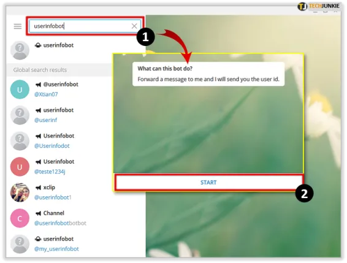
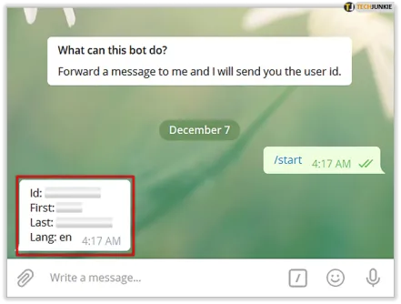
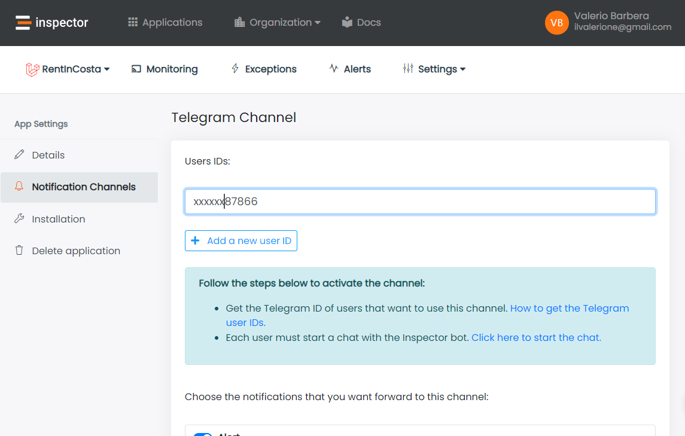
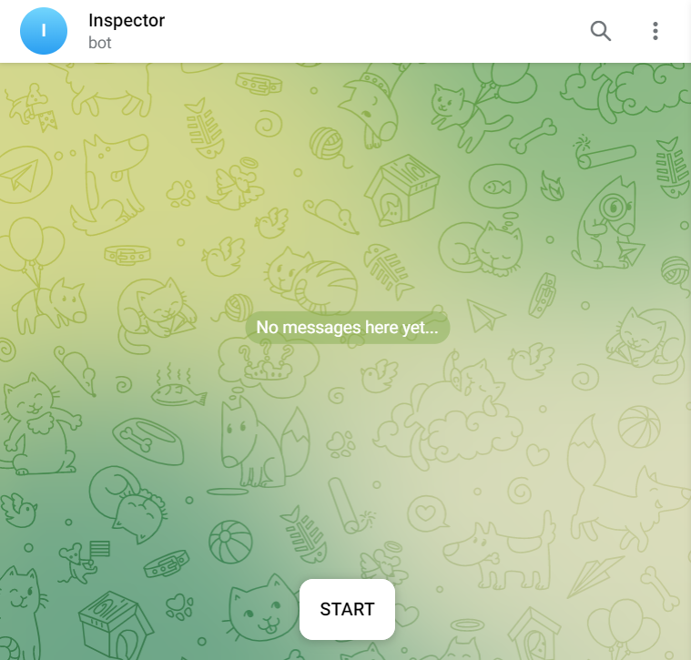

Hi, I’m Valerio, software engineer and CTO at Inspector.

I'm so happy to share with you the latest product update for Inspector Code Execution Monitoring platform 😊.

## Telegram notification channel

Telegram is now available as a notification channel to receive alerts about the status of your application directly in your telegram chat on your phone.

You can activate the Telegram notification channel in two steps:

- Retrieve the Telegram ID of users that want to use this channel;
- Each user must start a chat with the Inspector bot.

## How to get the Telegram user ID?

The steps are the same for desktop and mobile apps. First, open your Telegram app. Then, type "**userinfobot"** in your contacts search bar. If you can't find this "profile", try adding an "@" in front of the search query. When you’ve located **@userinfobot**, click or tap it. Then, select **Start** at the bottom of the chat.

By clicking Start, you've automatically entered "**/start**." It will prompt the bot to display your user ID, as well as your selected first name, last name, and the language of choice.

Copy the value of the ID field and add it in the configuration screen of the notification channel.

Click **Save** or **Enable channel** in case of the first activation.

## Start a chat with the Inspector bot

In order to be able to send you messages in your telegram app there must be an active chat with the bot.Open this link and click Start to start a chat: [https://web.telegram.org/k/#@InspectorAlertBot](https://web.telegram.org/k/#@InspectorAlertBot)

Now your monitoring system is connected with your Telegram account and you'll receive alerts and notification directly in your phone in real-time.

## Conclusion

Inspector offers many other notification channels like Slack, Microsoft Teams, Discord, Webhooks, and more. So you can connect your monitoring system to your work environment as easy as possible.
