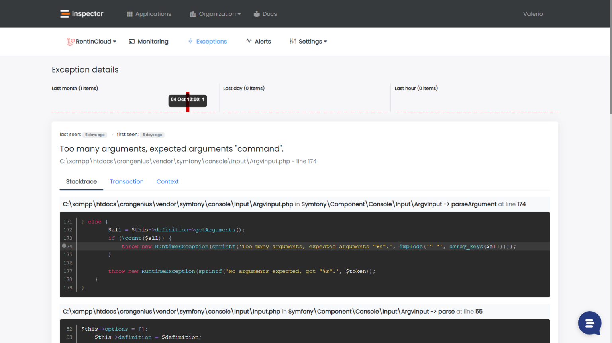
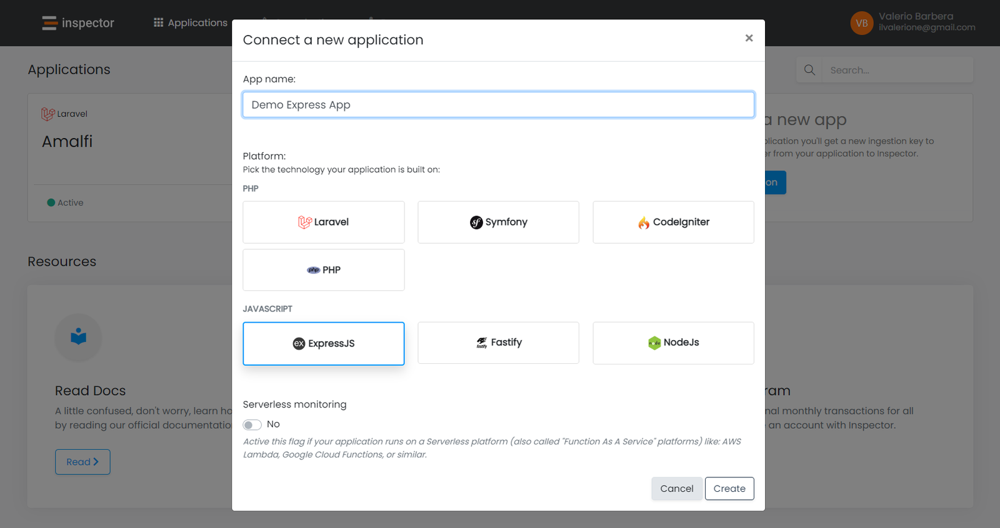

With the booming software economy, the demand for new applications and software-defined automations is set to grow in the future years.

Companies in any industry are creating software in the form of internal business tools, productivity tools, integrations, automations, and more. As a result, there is a need for tools that make it easy to create and maintain software over time.

The software delivery lifecycle can be optimized by automating many tasks developers perform manually, like application debugging, monitoring and control, alerts, and collecting customer feedback.

If you have an application that helps your company generate revenue, it's very easy to get these benefits and help your development team to become more efficient and productive with Inspector.

See for yourself what other developers think: [**https://inspector.dev/testimonials**](/testimonials/)

## What is Inspector

Inspector is a Code Execution Monitoring tool that helps developers identify bugs and bottlenecks in their applications automatically.

Depending on the programming language you use, you can connect your application using different libraries as you can see in our GitHub account: [https://github.com/inspector-apm](https://github.com/inspector-apm)

In the Inspector dashboard you can analyze the data visually. Inspector will monitor your code execution in real time, alerting you if something goes wrong.



In some cases, not all application parts need to be monitored. Maybe because you want to restrict the focus of your development activity, or to mitigate data consumption excluding requests for not-interesting assets, just as an example.

Following recent updates if you are integrating Inspector into your app you can now configure “Exclude Paths” using wildcards.

## Connecting your Application to Inspector

If you don't have an account yet, you can create a new one here: [https://app.inspector.dev/register](https://app.inspector.dev/register)

### Step 1 - Create a new application

After logging in to your Inspector account dashboard, create a new project.



### Step 2 - Install the library

Run the npm command below in your terminal:

```bash
npm install @inspector-apm/inspector-nodejs --save
```

### Step 3 - Initialization

To monitor the code execution in real time you need to Initialize the Inspector module at the first line, before you require any other modules in your application – i.e. before express, http, mysql, etc.

Later you can use the **expressMiddleware()** in your express instance.

```javascript
/* 
 * -------------------------------------------
 * Initialize Inspector with the Ingestion Key.
 * --------------------------------------------
 */
const inspector = require('@inspector-apm/inspector-nodejs')({
  ingestionKey: 'xxxxxxxxxxxxx',
});

const app = require('express')();

/* 
 * -----------------------------------------------
 * Attach the middleware to monitor HTTP requests.
 * ------------------------------------------------
 */
app.use(inspector.expressMiddleware());


/* 
 * ---------------------------------
 * Other application routes.
 * ---------------------------------
 */
app.get('/', function (req, res) {
    return res.send('Home Page!');
});

app.listen(3006);
```

## Exclude Paths

If you want to turn off monitoring in some parts of your application you can pass a JSON object to the **expressMiddleware** function with **excludePaths** property to define which routes you want to exclude:

```javascript
app.use(inspector.expressMiddleware({
    excludePaths: [
        '/posts',
        '/posts/:id',
        '/admin'
    ]
}));
```

You can also use the wildcard character `*` to match a subset of your urls:

```javascript
app.use(inspector.expressMiddleware({
    excludePaths: [
        // Single wildcard
        '/posts*',
        
        // Multiple wildcards
        '/admin/*/posts*'
    ]
}));
```

### Why would you use a wildcard?

There could be parts of your application that don't affect the user experience. Think about a backend admin panel. You would exclude this private part of your system and focus your monitoring data on what your customers use.

### Our implementation of wildcard match function

Unfortunately, the framework does not support wildcards by default to identify the path of the current request.

Below you can find our implementation included in the [ExpressJs](https://github.com/inspector-apm/inspector-nodejs) and [Fastify](https://github.com/inspector-apm/inspector-nodejs) plugin:

```javascript
exports.wildcardMatchRule = function(str, rule) {
    let escapeRegex = (str) => str.replace(/([.*+?^=!:${}()|\[\]\/\\])/g, "\\$1");
    return new RegExp("^" + rule.split("*").map(escapeRegex).join(".*") + "$").test(str);
}
```

Check out the code in our GitHub repository: [https://github.com/inspector-apm/inspector-nodejs/blob/master/src/modules/utils.js](https://github.com/inspector-apm/inspector-nodejs/blob/master/src/modules/utils.js)

We use the wildcard match function in the express middleware that iterates the list of excluded paths passed during initialization checking for a match with the path of the current request.

If it found a match the middleware doesn’t start a transaction: [https://github.com/inspector-apm/inspector-nodejs/blob/master/src/modules/express.js#L12](https://github.com/inspector-apm/inspector-nodejs/blob/master/src/modules/express.js#L12)

The same is in the fastify plugin: [https://github.com/inspector-apm/inspector-nodejs/blob/master/src/modules/fastify.js#L21](https://github.com/inspector-apm/inspector-nodejs/blob/master/src/modules/fastify.js#L21)

## Try Inspector for free now

If you are interested in automating all manual monitoring habits we offer a complete free tier to help you make your experiments without pressure.

Inspector works with a simple software library. It doesn't require any difficult installation on the underlying infrastructure, so it is perfect for software development teams.

[**Navigate to our website**](/laravel/) for more information or drop in a live chat if you need help. We are happy to support you and your team to avoid losing customers and money due to unexpected technical errors in your application.
