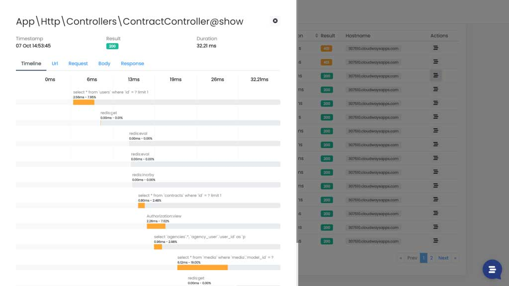
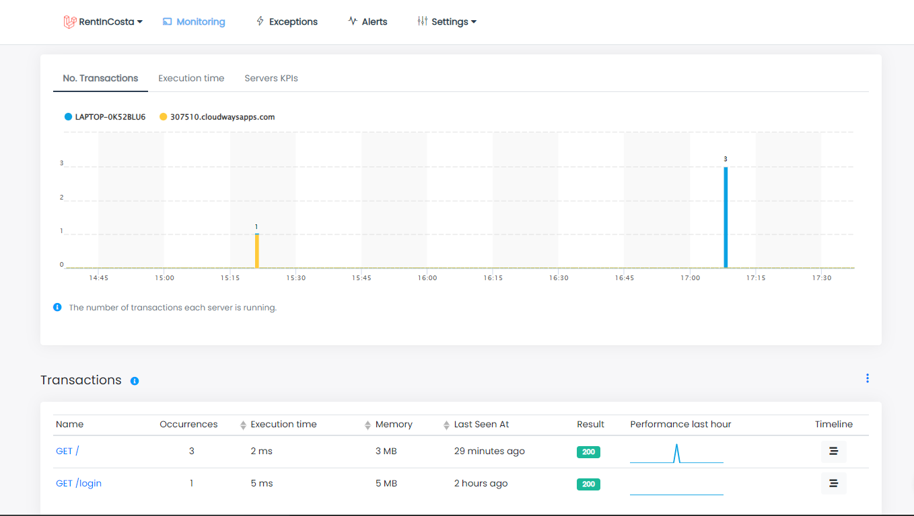
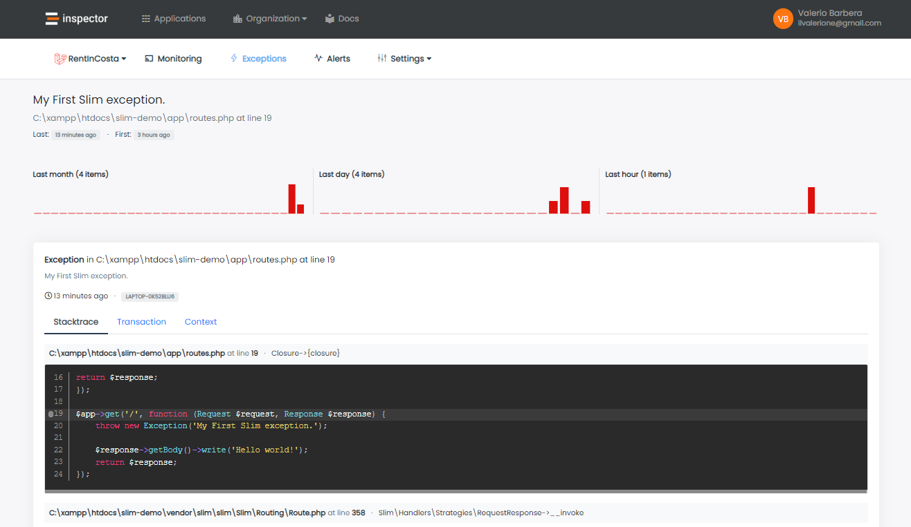

This article follows the release of the first version of the monitoring library for Slim framework. Thanks to this package you can fully monitor the HTTP traffic against your application based on Slim.

It takes less than one minute to get started. First let me give you a bit of context.

## Introducing the Slim framework

[Slim](https://www.slimframework.com/) is a PHP micro-framework that helps developers build simple, yet powerful web applications and APIs. It is designed to be lightweight and easy to use, with minimal setup and configuration required.

Slim provides basic routing, middleware support, and dependency injection features out of the box, while also allowing developers to add their own custom functionality as needed. It is a good choice for small to medium-sized projects, and is often used as the foundation for building RESTful APIs.

As written in the official documentation:

> *At its core, Slim is a dispatcher that receives an HTTP request, invokes an appropriate callback routine, and returns an HTTP response.*

The latest version 4 has reached an excellent level of maturity. It also provides an [application skeleton](https://github.com/slimphp/Slim-Skeleton) to speed up the startup of new projects while respecting a very flexible standard configuration.

## What is Inspector? When should you take it into consideration?

Inspector is a composer package to monitor your Slim application in real-time. It allows you to work on continuous code changes while catching bugs and bottlenecks automatically. Before your users do.



To be honest, not all software development teams need to monitor their applications "professionally". You have to experience the pain of not having a monitoring tool on your skin before you decide to invest in it.

Monitoring is the way to connect developers to the customers experience, to make them accountable for the success of the software development project.

You don't need monitoring, so you will not be motivated to spend time and invest money on this task, if:

- **You don't care about the users** - Maybe they're not paying you, and the decision to adopt a monitoring system rests with the company you work for as a consultant.
- **The application you are working on doesn't generate income to sustain your business** - Many projects are managed only to make a customer happy, from which, however, you earn little or nothing.
- **You work for short-term projects** - If the project you are working on has a short duration by nature, it is useless to waste time with monitoring.

Monitoring is to take care of your customers over time and protect the sources of income that are important to grow your business. If this resonates with you check out our website for more information: [https://inspector.dev](/)

## How to install Inspector to monitor a Slim application

Slim is designed to play well with other PHP components, too. You can register additional first-party components such as [Slim-Csrf](https://github.com/slimphp/Slim-Csrf/), or [Slim-HttpCache](https://github.com/slimphp/Slim-HttpCache) that build upon Slim’s default functionality.

Thanks to composer It’s also easy to integrate third-party components found on Packagist.

## Install

Install the latest version of the Inspector package by:

```bash
composer require inspector-apm/inspector-slim
```

## Register On Container

First you have to register the Inspector instance inside the application container in order to make the monitoring agent available within the Slim application.

```php
$container->set('inspector', function () {
    $configuration = new \Inspector\Slim\Configuration('INSPECTOR_INGESTION_KEY');
	
    return new \Inspector\Inspector($configuration);
});
```

Consider to use [environment variables](https://github.com/vlucas/phpdotenv) to store your project's INGESTION KEY.

If you are using a Slim 4 skeleton you can add a new container definition in **app/dependencies.php** file:

```php
use DI\ContainerBuilder;
use Psr\Container\ContainerInterface;

return function (ContainerBuilder $containerBuilder) {
    $containerBuilder->addDefinitions([
    
        // Other services definitions...
    
        'inspector' => function (ContainerInterface $container) {
            $configuration = new \Inspector\Slim\Configuration('INSPECTOR_INGESTION_KEY');
            return new \Inspector\Inspector($configuration);
        }
        
    ]);
}
```

You can get an INSPECTOR_INGESTION_KEY creating a new project in your [Inspector](/) account.

## Attach the middleware

To monitor all the incoming HTTP traffic you can attach the middleware globally:

```php
$app->add(\Inspector\Slim\WebRequestMonitoring::class);
```

Or use it in specific routes:

```php
$app->get('/home', function () {
    
    // do something...
    
})->add(\Inspector\Slim\WebRequestMonitoring::class);
```

## Test the Slim monitoring integration

Now you can create a *test* route and open it in the browser:

```php
$app->get('/test', function () {
    
    throw new \Exception('My First Slim exception.');
    
});
```

Within seconds you will see the HTTP monitoring data appear on your inspector dashboard: [https://app.inspector.dev](https://app.inspector.dev)





## Add Segments

One of the most important features of Inspector is the ability to monitor the execution of your internal code statements in a convenient timeline.


You can add segments to the transaction's timeline from route functions:

```php
$app->get('/', function (Request $request, Response $response) {
    /*
     * Retrieve the inspector instance from the container.
     */
    $this->get('inspector')->addSegment(function () {
        
        // your code here...
        sleep(1);
        
    }, 'sleep');
        
    return $response;
});
```

If your routes are organized using controllers you need to inject the container in the controller constructor in order to retrieve the inspector agent later during execution:

```php
namespace App\Controllers;


use Psr\Container\ContainerInterface;
use Psr\Http\Message\ResponseInterface as Response;
use Psr\Http\Message\ServerRequestInterface as Request;

class TestRouteController
{
    protected $container;
    
    /**
     * Inject the container to retrieve the inspector instance later.
     */
    public function __construct(ContainerInterface $container)
    {
        $this->container = $container;
    }

    public function __invoke(Request $request, Response $response)
    {
        // Use the inspector instance from the container.
        $this->container->get('inspector')->addSegment(function () {
        
            // your code here...
            sleep(1);
            
        }, 'sleep');

        $response->getBody()->write('Test route.');

        return $response;
    }
}
```

## Try Inspector for free now

If you are interested in monitoring the HTTP traffic in your Slim application we offer a complete free tier to help you make your experiments without pressure.

Inspector works with a simple software library. It doesn't require any difficult installation on the underlying infrastructure, so it is perfect for software development teams.

[**Navigate to our website**](/laravel/) for more information or drop in a live chat if you need help. We are happy to support you and your team to avoid losing customers and money due to unexpected technical errors in your application.
