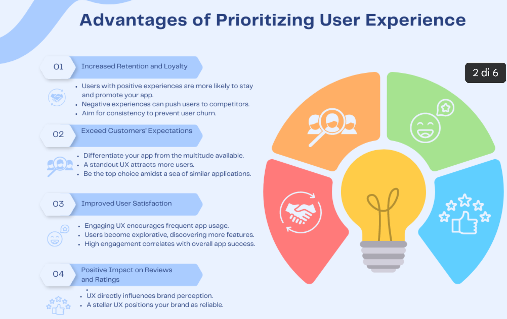
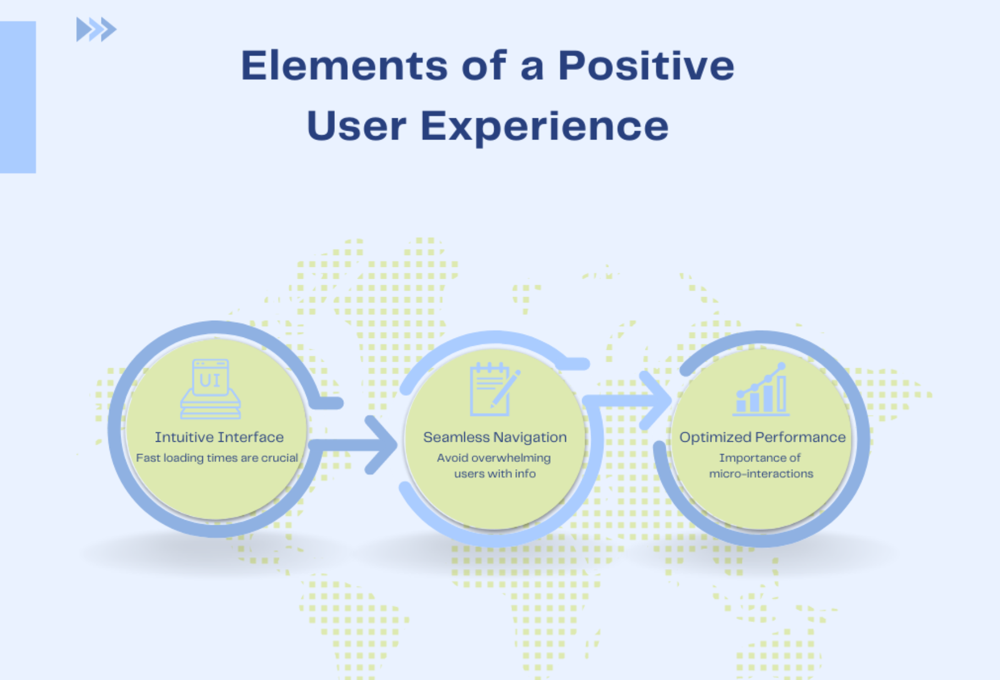

When producing a high-quality application, **user experience** (UX) and interface (UI) styles play a fundamental role. A UX design focuses on the user's experience, leading to an interactive and user-friendly system. It takes into consideration elements like usage patterns, reliability, as well as availability. On the other hand, UI layout is everything about aesthetic attraction. Concentrating on graphics and user interface format boosts the total feel and look of your application, offering a comfortable experience for customers.

Throughout this article, we will go over exactly how UX plays an essential function in application development and how it can benefit individuals in various ways.

## Understanding User Experience

Consider the applications you make use of each day. You may select them since they bring you delight. Also, for useful jobs like getting train tickets, you select the application with the most effective UX. There has to have been something you really dislike to go away, such as the layout or the challenging actions to finish a booking. A bad UX drives you far from those applications.

UI and UX are typically mistaken, yet they are different. User Interface concentrates on the capability of a feature, just how easy as well as reliable it is to utilize. On the other hand, **User Experience** incorporates the whole customer experience (notifications, copy of messages, etc). Moreover, excellent functionality enhances the possibility of a favorable experience.

Creating an application that supplies a superior **user experience** is necessary when it involves cloud application development. To accomplish this, concentrate on these crucial elements:

**1. Uniformity in Design:**

An aesthetically pleasing and user-friendly application is essential. Produce a natural style of wording that ensures uniformity throughout all aesthetic aspects. This assists individuals in quickly recognizing how to browse and utilize your application, thereby attracting and retaining them.

**2. Collect User Feedback:**

Look for customer comments to assess the way your users want to be served. Use clear comment devices like in-app studies or comment types to collect beneficial understandings. This information will allow you to boost your application and give a far better individual experience.

**3. Maintain Users Immersed:**

An exciting and nonstop customer experience is vital to maintaining customer involvement. Include notifications, emails, rich content like video and images to produce an immersive atmosphere. By doing so, you'll bring in and also maintain individuals, inevitably boosting consumer commitment.

## Advantages of Prioritizing User Experience

In today's cloud-centric globe, customer experience is more crucial than ever in application development. To ensure a wonderful **user experience** for your customers, it is essential to adhere to the very best individual experience standards. Right here are four essential reasons that giving a favorable customer experience is necessary.

**Increased retention and loyalty**

When customers have a favorable experience with an application, they are more likely to use it and suggest it to others. On the other hand, an unfavorable experience can cause stress and loss of clients to your rivals. Do not allow that to occur in your application.

**Competitive advantage in the market**

With readily available applications, standing apart from competitors is essential. By providing a premium individual experience, you can bring in many more customers and make your application the best selection in a congested market.

**Improved user satisfaction and engagement**

A fantastic customer experience motivates customers to regularly utilize your application, discover its attributes, and also give responses. This enhanced interaction can bring about greater customer satisfaction and total success for your application.

**Positive impact on reviews and ratings**

Individual experience directly affects a brand name's track record. By offering an extraordinary individual experience, you can place your brand name as trustworthy. Favorable word-of-mouth is effective in today's linked globe, so it's crucial to have individuals speaking about how great and simple your application is.

## Elements of a Positive User Experience

This important facet of program layout concentrates on how customers communicate with your item and how it makes them feel. Your application will most likely stop working if it cannot satisfy customers.

**Instinctive as well as User-friendly Interface**

No one values laggy applications. A [Google research study](https://www.marketingdive.com/news/google-53-of-mobile-users-abandon-sites-that-take-over-3-seconds-to-load/426070/) recommends that 53% of individuals are most likely to desert a website if it takes more than 3 secs to load. This highlights the vital nature of rate in application layout. To optimize customer retention and ensure a favorable experience, it's critical for an application to load rapidly and successfully.

**Smooth as well as Seamless Navigation**

An application filled with info can confuse and discourage customers. White spacing is essential to a user-friendly style as an aesthetic "break" white area helps guide individuals easily through your application's layout, making navigation simple and reliable.

**Receptive as well as Optimized Performance**

Micro-interactions are the little touches that make an application absolutely shine. Micro-interactions improve individual involvement, whether it's the pleasing "click" of a switch, a tiny computer animation signifying a web page refresh, or any refined comments system. They're not simply style components but remarkable little details that raise the general customer experience. Incorporating these communications ensures that your application does not simply do jobs-- it thrills individuals simultaneously.

## User Research and Testing

An extensive understanding of its customers is at the heart of any effective product and service. Think of creating an item based on presumptions to understand post-launch that it does not resolve any of the individuals' real discomfort factors or requirements. Not only is this a pricey error, but it likewise weakens the real objective of the item.

By understanding customer demands, developers and programmers can craft remedies customized to real-world obstacles and wishes. This understanding ensures that the end product straightens carefully with the individual's assumptions, thus making the most of complete satisfaction and reducing disappointment.

Yet how do we ensure that our understanding of customer demands is exact? Usability testing is an approach where genuine individuals connect with an item or model while viewers (frequently developers or scientists) view, pay attention, and bear in mind. It provides an indispensable understanding of how customers browse an item, where they deal with obstacles, and also which components reverberate most with them.

The advantages of using usability testing are diverse:

- **Straight Feedback:** Unlike depending on presumptions or pre-owned records, usability testing offers straight comments from the customers. This raw information is a diamond of understanding that can be incorporated into the item's instructions.
- **Cost-Efficiency:** Catching problems throughout the style or model stage is considerably less costly than post-launch. Usability testing can recognize prospective mistakes early, permitting groups to remedy them before they become a lot more considerable trouble.
- **Boosted User Satisfaction:** When individuals feel that an item "simply functions" and satisfies their demands, their total complete satisfaction and the probability of suggesting the item to others grow.

## Collaboration between Designers, Developers, and Users

The success of any digital product depends upon the harmony between developers, designers, and customers. A VPN's core objective is to give customers protection and personal privacy. Yet if an individual discovers the VPN application hard or complicated, they may utilize it inaccurately or, even worse, prevent it entirely, beating its extreme objective.

Right here are the crucial elements of why cooperation between various stakeholders is essential:

- **Shared Vision:** Alignment on task objectives guarantees a natural end product.
- **Comments Loops:** Continuous comments lead the way for renovations and improvements.
- **Prototyping and Testing:** Early individual participation gives an essential understanding of style and performance.

## Impact of User Experience on App Success

Customer Experience (UX) is essential for an application's success in today's open market. Here are some of the UX factors that play an important role in software product success;

- **Impressions Matter:** An engaging layout can keep individuals, while a bad one can drive them away.
- **Boosted Engagement:** Intuitive UX maintains individuals involved for much longer.
- **Enhanced Conversions:** Seamless experiences can bring about greater profit chances.
- **Commitment and Recommendations:** Pleasant experiences foster individual commitment and natural development via recommendations.
- **Lowered Development Costs:** Initial UX financial investments can minimize later updates and solutions, conserving expenses.

## Tools and Resources for Enhancing User Experience

Recognizing customer actions is vital to boosting their experience. The Lean UX layout method, which highlights partnership testing and prototyping, supplies a well-organized method to use numerous UX tools successfully.

Below is a breakdown of stages and what tools, including [**free VPN services**](https://cybernews.com/best-vpn/free-vpn-services/), we can use for each stage:

**THINK stage: UX Research**

**Comprehending Your Users:** Grasp your target market's requirements via qualitative and measurable research tools. Tools include:

- Hotjar Engage
- Loop11
- Hotjar Observe & Ask
- UXPressia

**MAKE stage: UX Design**

**Establishing the Interface:** Use user interface (UI) tools to transform research study understandings into real styles. Tools include:

- Figma
- InVision
- Lay out
- Adobe XD
- Miro

**CHECK stage: UX Testing**

**Examining the Design:** Test and also fine-tune the customer experience post-design. Tools include:

- Optimizely
- Omniconvert
