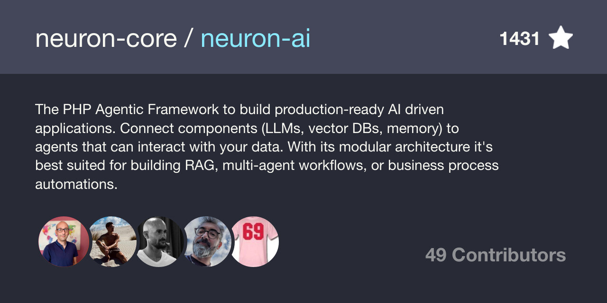
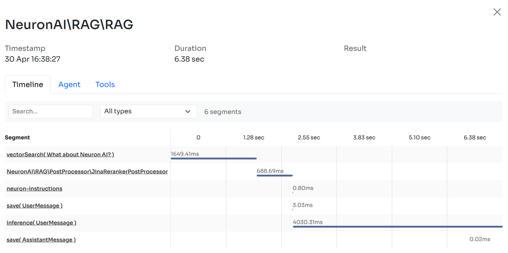

Building effective Retrieval-Augmented Generation (RAG) systems that deliver accurate, relevant responses it's not as easy as you can imagine. Vector databases are the foundation of this architecture, but when your RAG needs to embed a significant amount of information, the quality of response can start to decrease. Today, we're excited to announce a significant enhancement to the Neuron AI framework: Post Processors and Rerankers.

This powerful new feature set empowers developers to refine their RAG pipelines, dramatically improving result quality and ensuring that your AI agents deliver the most relevant information to users.

You can explore the Neuron repository here:

[](https://github.com/neuron-core/neuron-ai)

## The RAG Challenge: Beyond Simple Vector Search

RAG systems combine the knowledge access of retrieval systems with the generative capabilities of Large Language Models (LLMs). While the concept seems straightforward—store documents in a vector database, retrieve relevant content, and feed it to an LLM—achieving optimal results requires sophisticated engineering.

The fundamental challenge lies in the limitations of vector search itself. When we transform text into vectors (typically 768 or 1536 dimensions), we inevitably lose some information through compression. This compression means that sometimes the most relevant information might not appear in your top search results, leading to suboptimal AI responses.

Consider this common scenario: your RAG system retrieves the top 3 documents based on vector similarity, but critical information exists in documents ranked 4th or 5th. Without access to these documents, your LLM cannot generate the most accurate or helpful response.

## Introducing Post Processors in Neuron

Neuron's new Post Processors feature addresses this fundamental challenge by allowing developers to define a series of processor components that optimize retrieved documents before they reach the LLM.

This part of the framework was implemented by [**Alessandro Astarita**](https://www.linkedin.com/in/alessandroastarita/), founder and Tech Lead of [**Caprionline**](https://www.caprionline.it/), the most important digital network for traveling around the Capri & Amalfi Coast area.

With Post Processors, you can gather more candidates from the vector store by retrieving a larger initial set of documents, and then apply sophisticated filtering techniques to identify truly relevant content, reorder documents to ensure the most important information appears first, and optimize context window usage by delivering only the most valuable content to your LLM.

The Post Processor pipeline in Neuron is fully customizable, allowing you to chain together multiple transformation steps to achieve the perfect balance of relevance and performance.

```php
use NeuronAI\RAG\RAG;
use NeuronAI\RAG\PostProcessor\JinaRerankerPostProcessor;

class MyChatBot extends RAG
{
    ...

    protected function postProcessors(): array
    {
        return [
            new JinaRerankerPostProcessor(
                key: 'JINA_API_KEY',
                model: 'JINA_MODEL',
                topN: 3
            ),
			
			// ... other processors
        ];
    }
}
```

## Rerankers: The Power of Two-Stage Retrieval in RAG Systems

Reranking represents the most common transformation for RAG systems.

### What is Reranking?

Reranking is an advanced two-stage retrieval process that combines the computational efficiency of vector search with the precision of more sophisticated relevance models. The process begins with an initial standard vector search that retrieves a larger candidate set of documents from your knowledge base—significantly more than you would typically pass directly to an LLM.

This initial retrieval cast a wide net to ensure we don't miss potentially valuable information. Following this broad retrieval, a specialized reranking model then meticulously evaluates each document against the input query with much greater precision. The reranker calculates a similarity score between each retrieved document and the query, using this score to reorder the documents based on true relevance. Finally, only the most relevant documents—based on the reranker's comprehensive scoring—are selected to be passed to the LLM for response generation.

Unlike the initial vector search, which relies on compressed vector representations that inevitably lose some semantic information, rerankers employ sophisticated cross-attention mechanisms to analyze the relationship between the query and each document. This thorough analysis allows rerankers to capture nuanced relevance signals and contextual relationships that vector similarity algorithms alone might miss. The reranking approach effectively addresses the information loss that occurs during vector embedding compression, ensuring that critical information isn't overlooked simply because it didn't fit well into the vector representation.

In Neuron you just need to attach the two components to your Agent class and the framework will take care of this process:

```php
use NeuronAI\RAG\RAG;
use NeuronAI\RAG\Embeddings\EmbeddingsProviderInterface;
use NeuronAI\RAG\Embeddings\VoyageEmbeddingProvider;
use NeuronAI\RAG\PostProcessor\JinaRerankerPostProcessor;
use NeuronAI\RAG\VectorStore\PineconeVectoreStore;
use NeuronAI\RAG\VectorStore\VectorStoreInterface;

class MyChatBot extends RAG
{
    ...
	
    protected function embeddings(): EmbeddingsProviderInterface
    {
        return new VoyageEmbeddingProvider(
            key: 'VOYAGE_API_KEY',
            model: 'VOYAGE_MODEL'
        );
    }
    
    protected function vectorStore(): VectorStoreInterface
    {
        return new PineconeVectoreStore(
            key: 'PINECONE_API_KEY',
            indexUrl: 'PINECONE_INDEX_URL',
            topK: 50
        );
    }

    protected function postProcessors(): array
    {
        return [
            new JinaRerankerPostProcessor(
                key: 'JINA_API_KEY',
                model: 'JINA_MODEL',
                topN: 5
            ),
        ];
    }
}
```

In the example above you can see how the *vector store is instructed to get 50 documents, and the reranker will basically take only the 5 most relevant ones*.

### Why Reranking Matters in RAG Systems

The integration of rerankers into RAG systems addresses several critical limitations.

Vector search alone, while computationally efficient, often fails to capture the precise relationship between a user's query and the most relevant information. Rerankers bridge this gap by providing dramatically improved precision in document selection.

Document length has been a persistent challenge in RAG systems, as vector embeddings typically struggle with longer documents where key information might be diluted in the overall embedding. The compressed nature of vector representations means they cannot fully capture all the nuances of lengthy texts. Rerankers address this limitation effectively by examining the detailed relationship between the query and specific sections of documents, allowing them to better identify relevant content even when it's embedded within longer texts that might score poorly in vector similarity.

Context window optimization represents another crucial benefit of reranking. LLMs have limited context windows—a finite amount of text they can process at once—making it absolutely essential that only the most relevant content occupies this valuable space. Every token spent on irrelevant information reduces the model's ability to focus on what matters. Rerankers ensure you're making the most efficient use of this context window by selecting only the most pertinent documents, effectively maximizing the information density of what gets passed to the LLM.

While reranking stands as a cornerstone post-processing technique, Neuron supports an array of transformation types that developers can combine to create sophisticated, multi-stage document processing pipelines tailored to their specific needs.

For those new to AI agent development in PHP, I’ve documented the foundational patterns and progressive implementation approaches in an educational resource that walks through the basic development lifecycle — [Start With AI Agents In PHP](https://www.amazon.it/dp/B0F1YX8KJB)

## Extending the framework - Implementing new post-processor components

Neuron makes implementing sophisticated reranking capabilities remarkably straightforward and flexible for developers of all experience levels. The framework provides an intuitive interface for configuring reranking post-processors as integral components of your retrieval pipeline.

You can easily create your custom post processor components by simply extending the `\NeuronAI\PostProcessor\PostProcessorInterface`:

```php
namespace NeuronAI\RAG\PostProcessor;

use NeuronAI\Chat\Messages\Message;
use NeuronAI\RAG\Document;

interface PostProcessorInterface
{
    /**
     * Process an array of documents and return the processed documents.
     *
     * @param Message $question The question to process the documents for.
     * @param array<Document> $documents The documents to process.
     * @return array<Document> The processed documents.
     */
    public function process(Message $question, array $documents): array;
}
```

Here is a practical example:

```php
use \NeuronAI\RAG\PostProcessor\PostProcessorInterface;

// Implement your custom component
class CutOffPostProcessor implements PostProcessorInterface
{
    public function __constructor(protected int $level) {}

    public function process(Message $question, array $documents): array
    {
        /*
         * Apply a cut off on the score returned by the vector store
         */
         
        return $documents;
    }
}

// Add to the agent
class MyChatBot extends RAG
{
    ...

    protected function postProcessors(): array
    {
        return [
            new CutOffPostProcessor(
                level: 0.9
            ),
        ];
    }
}
```

## Observability

Neuron's built-in observability features automatically trace the execution of each post processor, so you'll be able to monitor interactions with external services in your [Inspector](/) account. Learn more in the [observability section](https://docs.neuron-ai.dev/the-basics/observability).



## Conclusion

The introduction of Post Processors and Rerankers to the Neuron AI framework represents a significant advancement in RAG technology and it was possible only thanks to the great work of [Alessandro](https://www.linkedin.com/in/alessandroastarita/) and the team at [Caprionline](https://www.caprionline.it/). By addressing the fundamental limitations of simple vector search, these new features enable developers to build more accurate, reliable AI systems that truly understand and respond to user needs.

We're excited to see how the community leverages these new capabilities to create the next generation of intelligent applications. The Neuron team remains committed to make PHP the best platform for AI development, and this release is just one step forward.

Try out the new Post Processors and Rerankers in Neuron today, and experience the difference that advanced retrieval techniques can make in your AI applications.

[**https://docs.neuron-ai.dev/post-processor**](https://docs.neuron-ai.dev/rag/pre-post-processor#post-processors)
